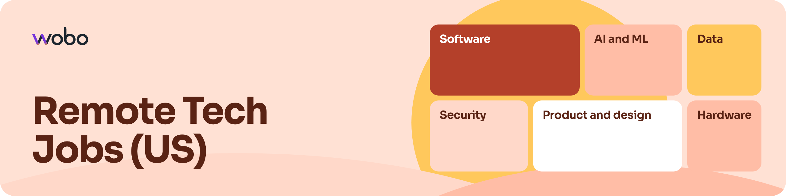

# <a href="#remote-software-jobs"><picture><source media="(prefers-color-scheme: dark)" srcset="assets/banner-dark.png"></picture></a>

**1,500 open remote tech jobs for people in the US**, kept by Wobo. Read from employers' own career sites; the list is rebuilt every hour (last update Nov 23, 2026, 2:41 pm ET). Every level, from intern to staff. Remote means the employer marks the role as fully remote. Each role opens on wobo.ai, where you can read the job and apply.

> [!TIP]
> **Tired of applying one by one?** [Let Wobo apply for you](https://www.wobo.ai/?utm_source=github&utm_medium=list&utm_campaign=remote-tech&utm_content=tip), with a resume tailored to each job. Free to start.

**Sections:** [Software](#remote-software-jobs) (634) · [AI and ML](#remote-ai-and-ml-jobs) (238) · [Data](#remote-data-jobs) (187) · [Security](#remote-security-jobs) (140) · [Product and design](#remote-product-and-design-jobs) (224) · [Hardware](#remote-hardware-jobs) (77) · [About this list](#about-this-list)

🎓 Graduate degree required · <kbd>clearance</kbd> US security clearance required

## Remote software jobs

| Company | Role | Location | Pay | Posted |
| :-- | :-- | :-- | :-- | :-- |
| **Ford** | [Software Development Manager](https://www.wobo.ai/job/software-development-manager-at-ford-sju9fdryz/?utm_source=github&utm_medium=list&utm_campaign=remote-tech) | Remote (US) | \$133K to \$251K/yr | Nov&nbsp;23 |
| **Lineage Logistics** | [Senior Software Engineer - LinOS](https://www.wobo.ai/job/senior-software-engineer-linos-at-lineage-logistics-sn2chhsyv/?utm_source=github&utm_medium=list&utm_campaign=remote-tech) | Novi, MI |  | Nov&nbsp;22 |
| **iRhythm Technologies** | [Senior Test Automation Engineer I (SDET)](https://www.wobo.ai/job/senior-test-automation-engineer-i-sdet-at-irhythm-technologies-sn0r1wty1/?utm_source=github&utm_medium=list&utm_campaign=remote-tech) | Remote (US) | \$115K to \$149K/yr | Nov&nbsp;22 |
| **Cerence AI** | [Software Engineering Director](https://www.wobo.ai/job/software-engineering-director-at-cerence-ai-slp8h1ydw/?utm_source=github&utm_medium=list&utm_campaign=remote-tech) | Remote (US) | \$185K to \$280K/yr | Nov&nbsp;22 |
| **Testlio** | [Remote Software Tester (Freelance) \| Test AT&T U-verse & Cox](https://www.wobo.ai/job/remote-software-tester-freelance-test-att-u-verse-cox-at-testlio-slkob4gn4/?utm_source=github&utm_medium=list&utm_campaign=remote-tech) | Remote (US) | \$18/hr | Nov&nbsp;22 |
| **Miratech** | [Middle Full-Stack Engineer (React, Java)](https://www.wobo.ai/job/middle-full-stack-engineer-react-java-at-miratech-slfw07cs5/?utm_source=github&utm_medium=list&utm_campaign=remote-tech) | New York City, NY |  | Nov&nbsp;22 |
| **Software Mind** | [Senior C++ Software Engineer — Real‑Time Graphics (Talent Pool)](https://www.wobo.ai/job/senior-c-software-engineer-realtime-graphics-talent-pool-at-software-mind-slfgl6605/?utm_source=github&utm_medium=list&utm_campaign=remote-tech) | Washington, DC |  | Nov&nbsp;21 |
| **GDIT** | [ServiceNow Developer](https://www.wobo.ai/job/servicenow-developer-at-gdit-sjfndy8ev/?utm_source=github&utm_medium=list&utm_campaign=remote-tech) | Any Location | \$98K to \$132K/yr | Nov&nbsp;21 |
| ↳ | [Senior Drupal Developer](https://www.wobo.ai/job/senior-drupal-developer-at-gdit-sjfncfz2b/?utm_source=github&utm_medium=list&utm_campaign=remote-tech) | Any Location | \$106K to \$144K/yr | Nov&nbsp;21 |
| **Cincinnati Children's** | [Lead Systems Engineer](https://www.wobo.ai/job/lead-systems-engineer-at-cincinnati-childrens-sn344bzfd/?utm_source=github&utm_medium=list&utm_campaign=remote-tech) | Remote (US) | \$103K to \$134K/yr | Nov&nbsp;21 |
| **Teaching Strategies, LLC** | [Software Engineering Manager (Remote)](https://www.wobo.ai/job/software-engineering-manager-remote-at-teaching-strategies-llc-sg6nc7ed8/?utm_source=github&utm_medium=list&utm_campaign=remote-tech) | Denton, TX |  | Nov&nbsp;21 |
| **SAIC** | [Software Support Specialist](https://www.wobo.ai/job/software-support-specialist-at-saic-sfjkzo2fd/?utm_source=github&utm_medium=list&utm_campaign=remote-tech) | NC |  | Nov&nbsp;21 |
| ↳ | [Systems Engineer](https://www.wobo.ai/job/systems-engineer-at-saic-sfjk7p6nh/?utm_source=github&utm_medium=list&utm_campaign=remote-tech) | IN |  | Nov&nbsp;21 |
| **Dell Karriere** | [Systems Engineer – Research Infrastructure & Lab Platforms](https://www.wobo.ai/job/systems-engineer-research-infrastructure-lab-platforms-at-dell-karriere-sfiddrsy1/?utm_source=github&utm_medium=list&utm_campaign=remote-tech) | McLean, VA |  | Nov&nbsp;21 |
| **NikoHealth** | [Staff Platform Engineer](https://www.wobo.ai/job/staff-platform-engineer-at-nikohealth-sfhrky2ux/?utm_source=github&utm_medium=list&utm_campaign=remote-tech) | Remote (US) |  | Nov&nbsp;21 |
| **Clera** | [Forward Deployed Engineer](https://www.wobo.ai/job/forward-deployed-engineer-at-clera-shyxeborw/?utm_source=github&utm_medium=list&utm_campaign=remote-tech) | New York City, NY |  | Nov&nbsp;21 |
| **Playlab** | [Staff Platform Engineer](https://www.wobo.ai/job/staff-platform-engineer-at-playlab-sfa8mkrgy/?utm_source=github&utm_medium=list&utm_campaign=remote-tech) | Remote (US) |  | Nov&nbsp;21 |
| **Talentpluto** | [Senior Platform Engineer](https://www.wobo.ai/job/senior-platform-engineer-at-talentpluto-sdc8qkanj/?utm_source=github&utm_medium=list&utm_campaign=remote-tech) | Remote (US) | \$180K to \$250K/yr | Nov&nbsp;21 |
| **Pavago** | [WordPress Developer](https://www.wobo.ai/job/wordpress-developer-at-pavago-scow3ekev/?utm_source=github&utm_medium=list&utm_campaign=remote-tech) | Remote (US) |  | Nov&nbsp;21 |
| ↳ | [DevOps Engineer](https://www.wobo.ai/job/devops-engineer-at-pavago-scoub88ac/?utm_source=github&utm_medium=list&utm_campaign=remote-tech) | Remote (US) |  | Nov&nbsp;21 |
| **TeamSnap** | [Senior Backend Engineer](https://www.wobo.ai/job/senior-backend-engineer-at-teamsnap-sg9nqjk4m/?utm_source=github&utm_medium=list&utm_campaign=remote-tech) | Remote (US) | from \$150K/yr | Nov&nbsp;20 |
| **SnapLogic** | [Senior Solutions Engineer](https://www.wobo.ai/job/senior-solutions-engineer-at-snaplogic-scyj06eaj/?utm_source=github&utm_medium=list&utm_campaign=remote-tech) | Remote (US) |  | Nov&nbsp;20 |
| **GDIT** | [Software Developer Principal](https://www.wobo.ai/job/software-developer-principal-at-gdit-sexsyg062/?utm_source=github&utm_medium=list&utm_campaign=remote-tech) | Any Location | \$122K to \$166K/yr | Nov&nbsp;20 |
| **F5** | [Senior Solutions Engineer - Major Accounts](https://www.wobo.ai/job/senior-solutions-engineer-major-accounts-at-f5-sj8ilmucy/?utm_source=github&utm_medium=list&utm_campaign=remote-tech) | MD | \$204K to \$306K/yr | Nov&nbsp;20 |
| **Cisco** | [Network Systems Engineer](https://www.wobo.ai/job/network-systems-engineer-at-cisco-selw492r5/?utm_source=github&utm_medium=list&utm_campaign=remote-tech) | Rancho Cordova, CA | \$117K to \$148K/yr | Nov&nbsp;20 |
| **Megaport** | [Senior Software Enigneer](https://www.wobo.ai/job/senior-software-enigneer-at-megaport-sh64xk6g0/?utm_source=github&utm_medium=list&utm_campaign=remote-tech) | Remote (US) |  | Nov&nbsp;20 |
| **Elastic** | [Principal Software Engineer - Search Infra - Elasticsearch](https://www.wobo.ai/job/principal-software-engineer-search-infra-elasticsearch-at-elastic-scznu1zrj/?utm_source=github&utm_medium=list&utm_campaign=remote-tech) | Remote (US) | \$160K to \$253K/yr | Nov&nbsp;20 |
| ↳ | [Principal Software Engineer - Vector Search - Elasticsearch](https://www.wobo.ai/job/principal-software-engineer-vector-search-elasticsearch-at-elastic-sczo9vhkg/?utm_source=github&utm_medium=list&utm_campaign=remote-tech) | Remote (US) | \$160K to \$253K/yr | Nov&nbsp;20 |
| ↳ | [Senior Software Engineer - Vector Search - Elasticsearch](https://www.wobo.ai/job/senior-software-engineer-vector-search-elasticsearch-at-elastic-sczon6ek1/?utm_source=github&utm_medium=list&utm_campaign=remote-tech) | Remote (US) | \$133K to \$211K/yr | Nov&nbsp;20 |
| **onX** | [Senior Android Engineer - Offroad](https://www.wobo.ai/job/senior-android-engineer-offroad-at-onx-sh9uygqvf/?utm_source=github&utm_medium=list&utm_campaign=remote-tech) | Austin, TX | \$146K to \$182K/yr | Nov&nbsp;20 |
| **Pinterest** | [Solutions Engineer - Ads Product & Innovation](https://www.wobo.ai/job/solutions-engineer-ads-product-innovation-at-pinterest-shajtu9hb/?utm_source=github&utm_medium=list&utm_campaign=remote-tech) | San Francisco, CA | \$86K to \$178K/yr | Nov&nbsp;20 |
| **NetBox Labs** | [Solutions Engineer](https://www.wobo.ai/job/solutions-engineer-at-netbox-labs-sgfvcfu8e/?utm_source=github&utm_medium=list&utm_campaign=remote-tech) | US West Coast |  | Nov&nbsp;20 |
| ↳ | [Staff Software Engineer, Tech Lead - NetBox Core](https://www.wobo.ai/job/staff-software-engineer-tech-lead-netbox-core-at-netbox-labs-sgfvdw23d/?utm_source=github&utm_medium=list&utm_campaign=remote-tech) | New York City, NY |  | Nov&nbsp;20 |
| **Airbnb** | [Senior Software Engineer, Partner Integrations](https://www.wobo.ai/job/senior-software-engineer-partner-integrations-at-airbnb-sd3ejs3ko/?utm_source=github&utm_medium=list&utm_campaign=remote-tech) | Remote (US) | \$190K to \$220K/yr | Nov&nbsp;20 |
| **Northbeam** | [Staff Infrastructure Engineer](https://www.wobo.ai/job/staff-infrastructure-engineer-at-northbeam-shagfa1ur/?utm_source=github&utm_medium=list&utm_campaign=remote-tech) | Remote (US) | \$190K to \$240K/yr | Nov&nbsp;20 |
| **VIVIO Health** | [Software Engineer/Sr Software Engineer](https://www.wobo.ai/job/software-engineersr-software-engineer-at-vivio-health-sctcg72q8/?utm_source=github&utm_medium=list&utm_campaign=remote-tech) | Remote (US) | \$120K to \$170K/yr | Nov&nbsp;20 |
| **LIGHTFEATHER IO LLC** | [Senior ServiceNow Developer - Public Trust Clearance](https://www.wobo.ai/job/senior-servicenow-developer-public-trust-clearance-at-lightfeather-io-llc-scsx3kujd/?utm_source=github&utm_medium=list&utm_campaign=remote-tech) | Remote (US) | \$90K to \$115K/yr | Nov&nbsp;20 |
| ↳ | [Lead ServiceNow Developer](https://www.wobo.ai/job/lead-servicenow-developer-at-lightfeather-io-llc-scswzbgpo/?utm_source=github&utm_medium=list&utm_campaign=remote-tech) <kbd>clearance</kbd> | Remote (US) | \$120K to \$140K/yr | Nov&nbsp;20 |
| **Scribd, Inc.** | [Senior Software Engineer, Core Infrastructure](https://www.wobo.ai/job/senior-software-engineer-core-infrastructure-at-scribd-inc-sg79vxk59/?utm_source=github&utm_medium=list&utm_campaign=remote-tech) | San Francisco, CA | \$151K to \$235K/yr | Nov&nbsp;20 |
| **Cohere Health** | [Staff Software Architect](https://www.wobo.ai/job/staff-software-architect-at-cohere-health-sczpfloh4/?utm_source=github&utm_medium=list&utm_campaign=remote-tech) | Remote (US) | \$190K to \$225K/yr | Nov&nbsp;20 |
| **AbbVie** | [Site Reliability Engineer](https://www.wobo.ai/job/site-reliability-engineer-at-abbvie-sh5er2lb7/?utm_source=github&utm_medium=list&utm_campaign=remote-tech) | Houston, TX |  | Nov&nbsp;20 |
| **Noctua Technology** | [DevOps Engineer](https://www.wobo.ai/job/devops-engineer-at-noctua-technology-sd0wdtmcs/?utm_source=github&utm_medium=list&utm_campaign=remote-tech) <kbd>clearance</kbd> | San Diego, CA | \$107K to \$178K/yr | Nov&nbsp;20 |
| **Zimperium** | [QA Automation Engineer (SDET) - Dallas, TX Only (Hybrid)](https://www.wobo.ai/job/qa-automation-engineer-sdet-dallas-tx-only-hybrid-at-zimperium-se6mmnlsg/?utm_source=github&utm_medium=list&utm_campaign=remote-tech) | Dallas, TX |  | Nov&nbsp;20 |
| **Nemetschek SE2** | [Senior Software Engineer](https://www.wobo.ai/job/senior-software-engineer-at-nemetschek-se2-sff5asi4d/?utm_source=github&utm_medium=list&utm_campaign=remote-tech) | Pasadena, CA |  | Nov&nbsp;20 |
| ↳ | [DevOps Engineer](https://www.wobo.ai/job/devops-engineer-at-nemetschek-se2-sff5bipq6/?utm_source=github&utm_medium=list&utm_campaign=remote-tech) | Dallas, TX |  | Nov&nbsp;20 |
| **MongoDB** | [Software Engineer 3](https://www.wobo.ai/job/software-engineer-3-at-mongodb-scrwgs647/?utm_source=github&utm_medium=list&utm_campaign=remote-tech) | Remote (US) | \$106K to \$209K/yr | Nov&nbsp;20 |
| **Jane Technologies** | [Senior Software Engineer, Ads (Remote)](https://www.wobo.ai/job/senior-software-engineer-ads-remote-at-jane-technologies-sh5jkyzt3/?utm_source=github&utm_medium=list&utm_campaign=remote-tech) | Santa Cruz, CA |  | Nov&nbsp;20 |
| **Intertek USA** | [Staff Software Developer (Mobile)](https://www.wobo.ai/job/staff-software-developer-mobile-at-intertek-usa-sbz53acyc/?utm_source=github&utm_medium=list&utm_campaign=remote-tech) | Denver, CO |  | Nov&nbsp;20 |
| **The Hanover Insurance Group** | [Senior Application Engineer (REMOTE or HYBRID TO MA)](https://www.wobo.ai/job/senior-application-engineer-remote-or-hybrid-to-ma-at-the-hanover-insurance-group-sbwx26bqg/?utm_source=github&utm_medium=list&utm_campaign=remote-tech) | Worcester, MA |  | Nov&nbsp;20 |
| **Akamai** | [Senior Software Development Engineer in Test](https://www.wobo.ai/job/senior-software-development-engineer-in-test-at-akamai-sbs8vgkgo/?utm_source=github&utm_medium=list&utm_campaign=remote-tech) | Cambridge, MA | \$121K to \$219K/yr | Nov&nbsp;20 |
| **Hugging Face** | [Senior Software Engineer, Bot Detection (Client-Side & Signals) - US Remote](https://www.wobo.ai/job/senior-software-engineer-bot-detection-client-side-signals-us-remote-at-hugging-face-sbridf3vp/?utm_source=github&utm_medium=list&utm_campaign=remote-tech) | New York City, NY |  | Nov&nbsp;20 |
| **Oracle** | [Software Developer 5](https://www.wobo.ai/job/software-developer-5-at-oracle-sbq51zfs3/?utm_source=github&utm_medium=list&utm_campaign=remote-tech) | Austin, TX | \$137K to \$306K/yr | Nov&nbsp;20 |
| ↳ | [Principal Site Reliability Engineer - Oracle Health (US REMOTE)](https://www.wobo.ai/job/principal-site-reliability-engineer-oracle-health-us-remote-at-oracle-s89o7tt2p/?utm_source=github&utm_medium=list&utm_campaign=remote-tech) | Remote (US) | \$85K to \$210K/yr | Nov&nbsp;20 |
| ↳ | [Systems Engineer - Clinical Imaging, PACS Implementation](https://www.wobo.ai/job/systems-engineer-clinical-imaging-pacs-implementation-at-oracle-s89o10sli/?utm_source=github&utm_medium=list&utm_campaign=remote-tech) | Remote (US) | \$60K to \$132K/yr | Nov&nbsp;20 |
| **Laravel** | [Solutions Engineer](https://www.wobo.ai/job/solutions-engineer-at-laravel-sbov747go/?utm_source=github&utm_medium=list&utm_campaign=remote-tech) | Remote (US) |  | Nov&nbsp;20 |
| **American Express** | [Sr Software Engineer I - Enterprise Architecture](https://www.wobo.ai/job/sr-software-engineer-i-enterprise-architecture-at-american-express-sbkxudhqv/?utm_source=github&utm_medium=list&utm_campaign=remote-tech) | Sunrise, FL |  | Nov&nbsp;20 |
| **Ricoh** | [Senior Solutions Engineer](https://www.wobo.ai/job/senior-solutions-engineer-at-ricoh-sbkfa7978/?utm_source=github&utm_medium=list&utm_campaign=remote-tech) | Meadville, PA |  | Nov&nbsp;20 |
| **Stafford Gray** | [Remote SharePoint Online Developer](https://www.wobo.ai/job/remote-sharepoint-online-developer-at-stafford-gray-sbi2vwrxg/?utm_source=github&utm_medium=list&utm_campaign=remote-tech) | Tallahassee, FL | \$70 to \$80/hr | Nov&nbsp;20 |
| ↳ | [Remote Power Pages / Dynamics 365 Developer](https://www.wobo.ai/job/remote-power-pages-dynamics-365-developer-at-stafford-gray-sbi2ujzyt/?utm_source=github&utm_medium=list&utm_campaign=remote-tech) | Tallahassee, FL | \$75 to \$85/hr | Nov&nbsp;20 |
| **Clera** | [Founding Forward Deployed Engineer](https://www.wobo.ai/job/founding-forward-deployed-engineer-at-clera-sde5q8ots/?utm_source=github&utm_medium=list&utm_campaign=remote-tech) | New York City, NY | \$180K to \$250K/yr | Nov&nbsp;20 |
| **Lightning AI** | [Engineering Manager, Infrastructure Software](https://www.wobo.ai/job/engineering-manager-infrastructure-software-at-lightning-ai-sci2va0z7/?utm_source=github&utm_medium=list&utm_campaign=remote-tech) | New York City, NY | \$205K to \$310K/yr | Nov&nbsp;20 |
| **Miratech** | [Full Stack Java Engineer](https://www.wobo.ai/job/full-stack-java-engineer-at-miratech-scc8foca1/?utm_source=github&utm_medium=list&utm_campaign=remote-tech) | Texas City, TX +1 |  | Nov&nbsp;20 |
| **Oddball** | [Senior Full Stack Engineer](https://www.wobo.ai/job/senior-full-stack-engineer-at-oddball-scvnwa9wn/?utm_source=github&utm_medium=list&utm_campaign=remote-tech) | Remote (US) | \$110K to \$150K/yr | Nov&nbsp;20 |
| **Focus** | [Senior Test Software Engineer](https://www.wobo.ai/job/senior-test-software-engineer-at-focus-scuaffpkz/?utm_source=github&utm_medium=list&utm_campaign=remote-tech) | Remote (US) |  | Nov&nbsp;20 |
| **Stillfront** | [QA Automation Engineer, Mobile Games - Freelance](https://www.wobo.ai/job/qa-automation-engineer-mobile-games-freelance-at-stillfront-sbeysqqa6/?utm_source=github&utm_medium=list&utm_campaign=remote-tech) | Remote (US) |  | Nov&nbsp;20 |
| **Depot** | [Senior Developer Educator](https://www.wobo.ai/job/senior-developer-educator-at-depot-sctel31bx/?utm_source=github&utm_medium=list&utm_campaign=remote-tech) | Remote (US) |  | Nov&nbsp;20 |
| **ProShop ERP** | [Product Solutions Engineer](https://www.wobo.ai/job/product-solutions-engineer-at-proshop-erp-sawpe22mh/?utm_source=github&utm_medium=list&utm_campaign=remote-tech) | Remote (US) |  | Nov&nbsp;20 |
| **Domaine** | [Backend Engineer](https://www.wobo.ai/job/backend-engineer-at-domaine-sahy9f1ub/?utm_source=github&utm_medium=list&utm_campaign=remote-tech) | Remote (US) |  | Nov&nbsp;20 |
| **Vcheck** | [Senior Software Engineer](https://www.wobo.ai/job/senior-software-engineer-at-vcheck-sahxqib0h/?utm_source=github&utm_medium=list&utm_campaign=remote-tech) | Remote (US) |  | Nov&nbsp;20 |
| **Revive Media** | [Senior C# Back-End Developer](https://www.wobo.ai/job/senior-c-back-end-developer-at-revive-media-sac8kyo2j/?utm_source=github&utm_medium=list&utm_campaign=remote-tech) | Remote (US) | \$165K to \$180K/yr | Nov&nbsp;20 |
| **Raydar** | [Senior Software Engineer](https://www.wobo.ai/job/senior-software-engineer-at-raydar-s76j4ylac/?utm_source=github&utm_medium=list&utm_campaign=remote-tech) | Remote (US) | \$200K to \$275K/yr | Nov&nbsp;19 |
| **Zoom** | [Solutions Engineer](https://www.wobo.ai/job/solutions-engineer-at-zoom-sf3ak4y70/?utm_source=github&utm_medium=list&utm_campaign=remote-tech) | Remote (US) | \$131K to \$262K/yr | Nov&nbsp;19 |
| **Zillow** | [Director, Software Engineering, Big Data](https://www.wobo.ai/job/director-software-engineering-big-data-at-zillow-seklkqf9k/?utm_source=github&utm_medium=list&utm_campaign=remote-tech) | Remote (US) | \$251K to \$402K/yr | Nov&nbsp;19 |
| **UC University of the Cumberlands** | [Workday Software Developer – Student Financial Systems](https://www.wobo.ai/job/workday-software-developer-student-financial-systems-at-uc-university-of-the-cumberlands-scsxo2skb/?utm_source=github&utm_medium=list&utm_campaign=remote-tech) | Remote (US) |  | Nov&nbsp;19 |
| **The Home Depot** | [Software Engineer II, Supply Chain Sourcing Core (Remote)](https://www.wobo.ai/job/software-engineer-ii-supply-chain-sourcing-core-remote-at-the-home-depot-sgyp9e8by/?utm_source=github&utm_medium=list&utm_campaign=remote-tech) | Remote (US) | \$90K to \$240K/yr | Nov&nbsp;19 |
| ↳ | [Staff Software Engineer, Content Operations Enablement (Remote)](https://www.wobo.ai/job/staff-software-engineer-content-operations-enablement-remote-at-the-home-depot-sgyoxd7u7/?utm_source=github&utm_medium=list&utm_campaign=remote-tech) | Remote (US) | \$120K to \$190K/yr | Nov&nbsp;19 |
| ↳ | [Software Engineering Manager - Mobile Apps (Remote)](https://www.wobo.ai/job/software-engineering-manager-mobile-apps-remote-at-the-home-depot-sgyoq5hfs/?utm_source=github&utm_medium=list&utm_campaign=remote-tech) | Remote (US) | \$140K to \$240K/yr | Nov&nbsp;19 |
| ↳ | [Staff Software Engineer - Salesforce Engineering (Remote)](https://www.wobo.ai/job/staff-software-engineer-salesforce-engineering-remote-at-the-home-depot-sgyokstf7/?utm_source=github&utm_medium=list&utm_campaign=remote-tech) | Remote (US) | \$120K to \$190K/yr | Nov&nbsp;19 |
| **Salesforce** | [Senior Solution Engineer - Nonprofits](https://www.wobo.ai/job/senior-solution-engineer-nonprofits-at-salesforce-scygjy1dh/?utm_source=github&utm_medium=list&utm_campaign=remote-tech) | Remote (US) | \$113K to \$152K/yr | Nov&nbsp;19 |
| **Penn State University** | [Cloud Engineer](https://www.wobo.ai/job/cloud-engineer-at-penn-state-university-sek4i1m8x/?utm_source=github&utm_medium=list&utm_campaign=remote-tech) <kbd>clearance</kbd> | San Diego, CA | \$120K to \$227K/yr | Nov&nbsp;19 |
| **Parsons** | [Associate Software Engineer](https://www.wobo.ai/job/associate-software-engineer-at-parsons-sexpxlxif/?utm_source=github&utm_medium=list&utm_campaign=remote-tech) | Remote (US) | \$64K to \$111K/yr | Nov&nbsp;19 |
| **North** | [Senior AWS Cloud Engineer](https://www.wobo.ai/job/senior-aws-cloud-engineer-at-north-scsii6zcd/?utm_source=github&utm_medium=list&utm_campaign=remote-tech) | Remote (US) | \$105K to \$150K/yr | Nov&nbsp;19 |
| **Momentive Software** | [Data Migration Specialist / SQL Developer](https://www.wobo.ai/job/data-migration-specialist-sql-developer-at-momentive-software-scsyyblro/?utm_source=github&utm_medium=list&utm_campaign=remote-tech) | Remote (US) |  | Nov&nbsp;19 |
| **Lineage Logistics** | [Lead Software Quality Engineer](https://www.wobo.ai/job/lead-software-quality-engineer-at-lineage-logistics-sema8eslm/?utm_source=github&utm_medium=list&utm_campaign=remote-tech) | Novi, MI |  | Nov&nbsp;19 |
| **Leidos** | [Cryptography & Security Infrastructure Engineer – Mid-Level](https://www.wobo.ai/job/cryptography-security-infrastructure-engineer-mid-level-at-leidos-sexnvztjv/?utm_source=github&utm_medium=list&utm_campaign=remote-tech) <kbd>clearance</kbd> | Remote (US) | \$87K to \$157K/yr | Nov&nbsp;19 |
| **ICF** | [Site Reliability Engineer (Top Secret Clearance) - Remote US](https://www.wobo.ai/job/site-reliability-engineer-top-secret-clearance-remote-us-at-icf-sen3kq5d3/?utm_source=github&utm_medium=list&utm_campaign=remote-tech) <kbd>clearance</kbd> | Reston, VA | \$99K to \$168K/yr | Nov&nbsp;19 |
| **GE Vernova** | [Engineering Technical Lead - I&C Embedded Software](https://www.wobo.ai/job/engineering-technical-lead-ic-embedded-software-at-ge-vernova-sen8n61nf/?utm_source=github&utm_medium=list&utm_campaign=remote-tech) | Remote (US) | \$113K to \$189K/yr | Nov&nbsp;19 |
| **GDIT** | [Oracle EBS Developer](https://www.wobo.ai/job/oracle-ebs-developer-at-gdit-sextp2rrz/?utm_source=github&utm_medium=list&utm_campaign=remote-tech) | Any Location | \$130K to \$175K/yr | Nov&nbsp;19 |
| ↳ | [Junior Scala Back-End Developer](https://www.wobo.ai/job/junior-scala-back-end-developer-at-gdit-s9wu1ac2p/?utm_source=github&utm_medium=list&utm_campaign=remote-tech) | Any Location | \$89K to \$121K/yr | Nov&nbsp;19 |
| ↳ | [Application Developer (Medicare / Medicaid)](https://www.wobo.ai/job/application-developer-medicaremedicaid-at-gdit-s9wtru22t/?utm_source=github&utm_medium=list&utm_campaign=remote-tech) | Any Location | \$85K to \$104K/yr | Nov&nbsp;19 |
| **DIRECTV** | [Principal, IT Software Engineer 1](https://www.wobo.ai/job/principal-it-software-engineer-1-at-directv-sf2ox1lrd/?utm_source=github&utm_medium=list&utm_campaign=remote-tech) | El Segundo, CA | \$134K to \$244K/yr | Nov&nbsp;19 |
| **CSI** | [Senior Software Engineer, Qolo](https://www.wobo.ai/job/senior-software-engineer-qolo-at-csi-scsoh9jys/?utm_source=github&utm_medium=list&utm_campaign=remote-tech) | Remote (US) |  | Nov&nbsp;19 |
| **Covius** | [Senior Software Developer](https://www.wobo.ai/job/senior-software-developer-at-covius-sf348fe4t/?utm_source=github&utm_medium=list&utm_campaign=remote-tech) | Remote (US) | \$101K to \$126K/yr | Nov&nbsp;19 |
| **Cisco** | [IIoT U.S. Public Sector Solutions Engineer](https://www.wobo.ai/job/iiot-us-public-sector-solutions-engineer-at-cisco-selwm7ntj/?utm_source=github&utm_medium=list&utm_campaign=remote-tech) | Glendale, CA | \$219K to \$286K/yr | Nov&nbsp;19 |
| **Booz Allen** | [Systems Engineer](https://www.wobo.ai/job/systems-engineer-at-booz-allen-scz8viikv/?utm_source=github&utm_medium=list&utm_campaign=remote-tech) <kbd>clearance</kbd> | Rome, NY | \$62K to \$141K/yr | Nov&nbsp;19 |
| **Blackbaud** | [Senior Strategic Business Developer, K-12 Financial Solutions](https://www.wobo.ai/job/senior-strategic-business-developer-k-12-financial-solutions-at-blackbaud-scsgtg0ro/?utm_source=github&utm_medium=list&utm_campaign=remote-tech) | Remote (US) | \$156K to \$218K/yr | Nov&nbsp;19 |
| **Alignment Health** | [Remote Business Solutions Engineer – Provider Data Management](https://www.wobo.ai/job/remote-business-solutions-engineer-provider-data-management-at-alignment-health-sf7aghrqn/?utm_source=github&utm_medium=list&utm_campaign=remote-tech) | Remote (US) | \$130K to \$195K/yr | Nov&nbsp;19 |
| **AIS** | [Cloud Engineer III](https://www.wobo.ai/job/cloud-engineer-iii-at-ais-sekpgf1xd/?utm_source=github&utm_medium=list&utm_campaign=remote-tech) | Remote (US) | \$102K to \$154K/yr | Nov&nbsp;19 |
| **ABB** | [Field Application Engineer](https://www.wobo.ai/job/field-application-engineer-at-abb-shbhcupo5/?utm_source=github&utm_medium=list&utm_campaign=remote-tech) | MO | \$101K to \$161K/yr | Nov&nbsp;19 |
| **ResolveAI** | [Solutions Engineering Manager](https://www.wobo.ai/job/solutions-engineering-manager-at-resolveai-sbi3xagu0/?utm_source=github&utm_medium=list&utm_campaign=remote-tech) | New York City, NY |  | Nov&nbsp;19 |
| **Nextdoor** | [Senior Software Engineer, Cloud Engineering](https://www.wobo.ai/job/senior-software-engineer-cloud-engineering-at-nextdoor-s63wx9lnb/?utm_source=github&utm_medium=list&utm_campaign=remote-tech) | Remote (US) | \$187K to \$238K/yr | Nov&nbsp;19 |
| **Reliable Robotics Corporation** | [Build Software Engineer](https://www.wobo.ai/job/build-software-engineer-at-reliable-robotics-corporation-s5zpbbhne/?utm_source=github&utm_medium=list&utm_campaign=remote-tech) | Remote (US) |  | Nov&nbsp;19 |
| **BlackCloak** | [Senior Software Engineer](https://www.wobo.ai/job/senior-software-engineer-at-blackcloak-s776wxl76/?utm_source=github&utm_medium=list&utm_campaign=remote-tech) | Remote (US) |  | Nov&nbsp;19 |
| **Bitwarden** | [Senior Software Engineer, Self-Host Orchestration](https://www.wobo.ai/job/senior-software-engineer-self-host-orchestration-at-bitwarden-s4xt7b953/?utm_source=github&utm_medium=list&utm_campaign=remote-tech) | Remote (US) | \$140K to \$150K/yr | Nov&nbsp;19 |
| **Voyager Technologies, Inc.** | [Systems Engineer – Project Engineer VI](https://www.wobo.ai/job/systems-engineer-project-engineer-vi-at-voyager-technologies-inc-s6wv7y3tg/?utm_source=github&utm_medium=list&utm_campaign=remote-tech) <kbd>clearance</kbd> | Folsom, CA | \$161K to \$279K/yr | Nov&nbsp;19 |
| **Talan** | [Senior Oracle APEX Developer](https://www.wobo.ai/job/senior-oracle-apex-developer-at-talan-sc9i6vs3c/?utm_source=github&utm_medium=list&utm_campaign=remote-tech) | Texas City, TX | \$110K to \$130K/yr | Nov&nbsp;19 |
| **Bounteous** | [Lead CRO Developer](https://www.wobo.ai/job/lead-cro-developer-at-bounteous-scgww4821/?utm_source=github&utm_medium=list&utm_campaign=remote-tech) | Remote (US) |  | Nov&nbsp;19 |
| **Thyme Care** | [Senior Platform Engineer](https://www.wobo.ai/job/senior-platform-engineer-at-thyme-care-sbvrg5oih/?utm_source=github&utm_medium=list&utm_campaign=remote-tech) | Remote (US) | \$170K to \$200K/yr | Nov&nbsp;19 |
| **OpenRouter** | [Multimodal, Developer Relations](https://www.wobo.ai/job/multimodal-developer-relations-at-openrouter-sa77frdnv/?utm_source=github&utm_medium=list&utm_campaign=remote-tech) | Remote (US) |  | Nov&nbsp;19 |
| **Clarasight** | [Lead, Forward Deployed Engineering](https://www.wobo.ai/job/lead-forward-deployed-engineering-at-clarasight-s64vveboz/?utm_source=github&utm_medium=list&utm_campaign=remote-tech) | Remote (US) |  | Nov&nbsp;19 |
| **Lumin Digital** | [Manager, Site Reliability Engineering](https://www.wobo.ai/job/manager-site-reliability-engineering-at-lumin-digital-s6457nvs2/?utm_source=github&utm_medium=list&utm_campaign=remote-tech) | Remote (US) |  | Nov&nbsp;19 |
| **Outreach** | [Senior Forward Deployed Engineer, Managed Services](https://www.wobo.ai/job/senior-forward-deployed-engineer-managed-services-at-outreach-scgub3cfs/?utm_source=github&utm_medium=list&utm_campaign=remote-tech) | Seattle, WA |  | Nov&nbsp;19 |
| **Life360** | [Senior Software Engineer, Lifecycle](https://www.wobo.ai/job/senior-software-engineer-lifecycle-at-life360-s65g0efpl/?utm_source=github&utm_medium=list&utm_campaign=remote-tech) | Remote (US) | \$148K to \$216K/yr | Nov&nbsp;19 |
| **Eurofins** | [Global Software Implementation Manager](https://www.wobo.ai/job/global-software-implementation-manager-at-eurofins-s66kcb3gb/?utm_source=github&utm_medium=list&utm_campaign=remote-tech) | Lancaster, PA |  | Nov&nbsp;19 |
| **Sopra Steria** | [Embedded Software Verification Engineer (Entry Level)](https://www.wobo.ai/job/embedded-software-verification-engineer-entry-level-at-sopra-steria-sci7yu8vk/?utm_source=github&utm_medium=list&utm_campaign=remote-tech) | Platteville, WI |  | Nov&nbsp;19 |
| ↳ | [Embedded Software Verification Engineer (Mid level)](https://www.wobo.ai/job/embedded-software-verification-engineer-mid-level-at-sopra-steria-sci831uh1/?utm_source=github&utm_medium=list&utm_campaign=remote-tech) | Platteville, WI |  | Nov&nbsp;19 |
| ↳ | [Embedded Software Development Engineer (Senior Level)](https://www.wobo.ai/job/embedded-software-development-engineer-senior-level-at-sopra-steria-sci87vv3q/?utm_source=github&utm_medium=list&utm_campaign=remote-tech) | Platteville, WI |  | Nov&nbsp;19 |
| **Elastic** | [Lead IT Systems Engineer](https://www.wobo.ai/job/lead-it-systems-engineer-at-elastic-s6vxsgq5a/?utm_source=github&utm_medium=list&utm_campaign=remote-tech) | Remote (US) |  | Nov&nbsp;19 |
| **NetBox Labs** | [Senior Frontend Engineer, Foundations](https://www.wobo.ai/job/senior-frontend-engineer-foundations-at-netbox-labs-sbc36dbg2/?utm_source=github&utm_medium=list&utm_campaign=remote-tech) | Remote (US) |  | Nov&nbsp;19 |
| **Code Metal** | [Solutions Engineer, Automotive](https://www.wobo.ai/job/solutions-engineer-automotive-at-code-metal-s47dsk6a2/?utm_source=github&utm_medium=list&utm_campaign=remote-tech) | Detroit, MI |  | Nov&nbsp;19 |
| **CoLab Software** | [Senior Full Stack Software Developer -FedRAMP](https://www.wobo.ai/job/senior-full-stack-software-developer-fedramp-at-colab-software-schmxta4i/?utm_source=github&utm_medium=list&utm_campaign=remote-tech) | Remote (US) |  | Nov&nbsp;19 |
| **ServiceNow** | [Sr Staff Software Engineer](https://www.wobo.ai/job/sr-staff-software-engineer-at-servicenow-sc8i8ujqq/?utm_source=github&utm_medium=list&utm_campaign=remote-tech) | Albany, NY | \$172K to \$301K/yr | Nov&nbsp;19 |
| **Pearson** | [Cloud Engineering Team Manager](https://www.wobo.ai/job/cloud-engineering-team-manager-at-pearson-s13psc3od/?utm_source=github&utm_medium=list&utm_campaign=remote-tech) | Remote (US) | \$170K to \$200K/yr | Nov&nbsp;19 |
| **Nant** | [Lead Clinical Software Engineer \| Remote \| AirStrip](https://www.wobo.ai/job/lead-clinical-software-engineer-remote-airstrip-at-nant-s12awu0w7/?utm_source=github&utm_medium=list&utm_campaign=remote-tech) | San Antonio, TX | \$144K to \$186K/yr | Nov&nbsp;19 |
| **David's Bridal** | [Remote Order Management Systems Engineer MANHATTAN EXP REQUIRED](https://www.wobo.ai/job/remote-order-management-systems-engineer-manhattan-exp-required-at-davids-bridal-s104gct0j/?utm_source=github&utm_medium=list&utm_campaign=remote-tech) | King of Prussia, PA |  | Nov&nbsp;19 |
| **Akamai** | [Principal Site Reliability Engineer](https://www.wobo.ai/job/principal-site-reliability-engineer-at-akamai-s0wumpd4n/?utm_source=github&utm_medium=list&utm_campaign=remote-tech) | Cambridge, MA | \$169K to \$305K/yr | Nov&nbsp;19 |
| **Hospitable** | [Senior Platform Engineer (Remote)](https://www.wobo.ai/job/senior-platform-engineer-remote-at-hospitable-s0w8n2vlt/?utm_source=github&utm_medium=list&utm_campaign=remote-tech) | OR | \$134K to \$167K/yr | Nov&nbsp;19 |
| **Sago Group** | [Sr. Software Engineer (Full Stack)](https://www.wobo.ai/job/sr-software-engineer-full-stack-at-sago-group-s0w7qdo12/?utm_source=github&utm_medium=list&utm_campaign=remote-tech) | NJ |  | Nov&nbsp;19 |
| **Valsoft Corporation** | [Senior Full Stack .NET Developer](https://www.wobo.ai/job/senior-full-stack-net-developer-at-valsoft-corporation-s0vhw002n/?utm_source=github&utm_medium=list&utm_campaign=remote-tech) | Remote (US) |  | Nov&nbsp;19 |
| **Intermedia Intelligent Communications** | [Forward Deployed Engineer](https://www.wobo.ai/job/forward-deployed-engineer-at-intermedia-intelligent-communications-s0d28dx74/?utm_source=github&utm_medium=list&utm_campaign=remote-tech) | CA |  | Nov&nbsp;19 |
| **Hiver** | [Senior Solutions Engineer](https://www.wobo.ai/job/senior-solutions-engineer-at-hiver-s0bh04yn9/?utm_source=github&utm_medium=list&utm_campaign=remote-tech) | San Jose, CA |  | Nov&nbsp;19 |
| **Concept Plus** | [Sr. Database Developer](https://www.wobo.ai/job/sr-database-developer-at-concept-plus-s0bdcp6bl/?utm_source=github&utm_medium=list&utm_campaign=remote-tech) | Remote (US) |  | Nov&nbsp;19 |
| ↳ | [Database Developer](https://www.wobo.ai/job/database-developer-at-concept-plus-s0bdbga5v/?utm_source=github&utm_medium=list&utm_campaign=remote-tech) | Remote (US) |  | Nov&nbsp;19 |
| **Genios AI** | [Senior Platform Engineer — Kubernetes, DevOps, & Cloud Infra (US)](https://www.wobo.ai/job/senior-platform-engineer-kubernetes-devops-cloud-infra-us-at-genios-ai-rzs806iul/?utm_source=github&utm_medium=list&utm_campaign=remote-tech) | Remote (US) |  | Nov&nbsp;19 |
| **SAIC** | [Senior Principal Software Engineer](https://www.wobo.ai/job/senior-principal-software-engineer-at-saic-rzrl3hhdn/?utm_source=github&utm_medium=list&utm_campaign=remote-tech) <kbd>clearance</kbd> | CA |  | Nov&nbsp;19 |
| **Domaine** | [Backend Technical Lead](https://www.wobo.ai/job/backend-technical-lead-at-domaine-rzpu3kpy4/?utm_source=github&utm_medium=list&utm_campaign=remote-tech) | Remote (US) |  | Nov&nbsp;19 |
| **Friends From The City** | [Senior Frontend Developer](https://www.wobo.ai/job/senior-frontend-developer-at-friends-from-the-city-rzkbi0q8w/?utm_source=github&utm_medium=list&utm_campaign=remote-tech) | New York City, NY | \$152K/yr | Nov&nbsp;19 |
| **Polygon Labs** | [Forward Deployed Engineer, Payments](https://www.wobo.ai/job/forward-deployed-engineer-payments-at-polygon-labs-s0j45kq82/?utm_source=github&utm_medium=list&utm_campaign=remote-tech) | Remote (US) |  | Nov&nbsp;18 |
| **Wiley** | [Prototyping and Tools Developer](https://www.wobo.ai/job/prototyping-and-tools-developer-at-wiley-s87ob8hy3/?utm_source=github&utm_medium=list&utm_campaign=remote-tech) | NY | \$73K to \$105K/yr | Nov&nbsp;18 |
| **Wealth Enhancement** | [Senior Drupal Developer](https://www.wobo.ai/job/senior-drupal-developer-at-wealth-enhancement-s8haod5sa/?utm_source=github&utm_medium=list&utm_campaign=remote-tech) | Remote (US) | \$132K to \$140K/yr | Nov&nbsp;18 |
| **The Home Depot** | [Sr Software Engineer, Supply Chain Delivery (Remote)](https://www.wobo.ai/job/sr-software-engineer-supply-chain-delivery-remote-at-the-home-depot-sbx2j4g0a/?utm_source=github&utm_medium=list&utm_campaign=remote-tech) | Remote (US) | \$80K to \$180K/yr | Nov&nbsp;18 |
| ↳ | [Systems Engineer (Remote)](https://www.wobo.ai/job/systems-engineer-remote-at-the-home-depot-sbx1yzpx3/?utm_source=github&utm_medium=list&utm_campaign=remote-tech) | Remote (US) | \$50K to \$130K/yr | Nov&nbsp;18 |
| **T-Mobile** | [Solutions Engineer, Wireless - NJ, Remote](https://www.wobo.ai/job/solutions-engineer-wireless-nj-remote-at-t-mobile-sclz8cwc9/?utm_source=github&utm_medium=list&utm_campaign=remote-tech) | NJ | \$95K to \$172K/yr | Nov&nbsp;18 |
| **Southern New Hampshire University** | [ServiceNow Software Developer I](https://www.wobo.ai/job/servicenow-software-developer-i-at-southern-new-hampshire-university-s42a3po6u/?utm_source=github&utm_medium=list&utm_campaign=remote-tech) | Remote (US) | \$88K to \$141K/yr | Nov&nbsp;18 |
| **Ryder** | [Software Quality Engineering Lead](https://www.wobo.ai/job/software-quality-engineering-lead-at-ryder-sahpoungz/?utm_source=github&utm_medium=list&utm_campaign=remote-tech) | Remote (US) | \$100K to \$130K/yr | Nov&nbsp;18 |
| **RTX** | [Lead Platform Engineer](https://www.wobo.ai/job/lead-platform-engineer-at-rtx-s7uendhow/?utm_source=github&utm_medium=list&utm_campaign=remote-tech) | Remote (US) | \$132K to \$252K/yr | Nov&nbsp;18 |
| **Resolve Tech Solutions** | [L3 Cloud Engineer](https://www.wobo.ai/job/l3-cloud-engineer-at-resolve-tech-solutions-s9wpf1mfw/?utm_source=github&utm_medium=list&utm_campaign=remote-tech) | Remote (US) |  | Nov&nbsp;18 |
| **R1** | [US-Software Engineer \|\|, IAM Architecture](https://www.wobo.ai/job/us-software-engineer-iam-architecture-at-r1-s9q3g3qwk/?utm_source=github&utm_medium=list&utm_campaign=remote-tech) | Remote (US) | \$51K to \$172K/yr | Nov&nbsp;18 |
| **Parsons** | [CNO Tool Developer](https://www.wobo.ai/job/cno-tool-developer-at-parsons-s9wpz00ck/?utm_source=github&utm_medium=list&utm_campaign=remote-tech) <kbd>clearance</kbd> | Remote (US) | \$112K to \$196K/yr | Nov&nbsp;18 |
| **Palo Alto Networks** | [District Systems Engineer](https://www.wobo.ai/job/district-systems-engineer-at-palo-alto-networks-scjnc3zan/?utm_source=github&utm_medium=list&utm_campaign=remote-tech) | San Francisco, CA +1 | \$178K to \$244K/yr | Nov&nbsp;18 |
| ↳ | [Staff Escalation Engineer Software](https://www.wobo.ai/job/staff-escalation-engineer-software-at-palo-alto-networks-s2ous0hyy/?utm_source=github&utm_medium=list&utm_campaign=remote-tech) | Boston, MA | \$112K to \$180K/yr | Nov&nbsp;18 |
| **NVIDIA** | [Senior Automation Infrastructure Engineer](https://www.wobo.ai/job/senior-automation-infrastructure-engineer-at-nvidia-scj4lf7u3/?utm_source=github&utm_medium=list&utm_campaign=remote-tech) | CA | \$188K to \$442K/yr | Nov&nbsp;18 |
| **NIKE** | [Senior Software Engineer](https://www.wobo.ai/job/senior-software-engineer-at-nike-scr5zwasg/?utm_source=github&utm_medium=list&utm_campaign=remote-tech) | Philadelphia, PA | \$108K to \$213K/yr | Nov&nbsp;18 |
| **Motorola Solutions** | [Senior DevOps Engineer (US REMOTE)](https://www.wobo.ai/job/senior-devops-engineer-us-remote-at-motorola-solutions-s7t6dx54x/?utm_source=github&utm_medium=list&utm_campaign=remote-tech) | Waltham, MA | \$140K to \$170K/yr | Nov&nbsp;18 |
| **Modivcare** | [Site Reliability Engineer IV](https://www.wobo.ai/job/site-reliability-engineer-iv-at-modivcare-sa27ttlc1/?utm_source=github&utm_medium=list&utm_campaign=remote-tech) | Remote (US) | \$97K to \$134K/yr | Nov&nbsp;18 |
| **Insperity** | [Software Engineer, Workday](https://www.wobo.ai/job/software-engineer-workday-at-insperity-s48ian8cg/?utm_source=github&utm_medium=list&utm_campaign=remote-tech) | TX | \$78K to \$89K/yr | Nov&nbsp;18 |
| **Humana** | [Cloud Solutions Engineer](https://www.wobo.ai/job/cloud-solutions-engineer-at-humana-s8k9wud3e/?utm_source=github&utm_medium=list&utm_campaign=remote-tech) | Louisville, KY | \$89K to \$121K/yr | Nov&nbsp;18 |
| **GDIT** | [Back End Developer](https://www.wobo.ai/job/back-end-developer-at-gdit-s9wv5ov5x/?utm_source=github&utm_medium=list&utm_campaign=remote-tech) | USA VA Home | from \$94K/yr | Nov&nbsp;18 |
| ↳ | [Cloud Developer Principal](https://www.wobo.ai/job/cloud-developer-principal-at-gdit-s9wv0o2ov/?utm_source=github&utm_medium=list&utm_campaign=remote-tech) | Falls Church, VA | \$151K to \$205K/yr | Nov&nbsp;18 |
| ↳ | [NCIS Cloud Engineer \| Active Secret clearance](https://www.wobo.ai/job/ncis-cloud-engineer-active-secret-clearance-at-gdit-s9wto7ufc/?utm_source=github&utm_medium=list&utm_campaign=remote-tech) <kbd>clearance</kbd> | Any Location | \$162K to \$164K/yr | Nov&nbsp;18 |
| **CSI** | [Cobol Software Engineer](https://www.wobo.ai/job/cobol-software-engineer-at-csi-s4jpe9qh3/?utm_source=github&utm_medium=list&utm_campaign=remote-tech) | Paducah, KY |  | Nov&nbsp;18 |
| **Cisco** | [Solutions Engineer - Splunk (Remote)](https://www.wobo.ai/job/solutions-engineer-splunk-remote-at-cisco-s7ywwl693/?utm_source=github&utm_medium=list&utm_campaign=remote-tech) | McLean, VA | \$247K to \$327K/yr | Nov&nbsp;18 |
| ↳ | [Leader, Solutions Engineer, Splunk FSI - Remote](https://www.wobo.ai/job/leader-solutions-engineer-splunk-fsi-remote-at-cisco-s7ywdm4qj/?utm_source=github&utm_medium=list&utm_campaign=remote-tech) | New York City, NY | \$266K to \$343K/yr | Nov&nbsp;18 |
| **Chickasaw Nation Industries** | [Systems Engineer III](https://www.wobo.ai/job/systems-engineer-iii-at-chickasaw-nation-industries-s41g6phyo/?utm_source=github&utm_medium=list&utm_campaign=remote-tech) | Remote (US) | \$95K to \$130K/yr | Nov&nbsp;18 |
| ↳ | [Solutions Engineer II](https://www.wobo.ai/job/solutions-engineer-ii-at-chickasaw-nation-industries-s41g5eei2/?utm_source=github&utm_medium=list&utm_campaign=remote-tech) | Remote (US) | \$95K to \$115K/yr | Nov&nbsp;18 |
| ↳ | [Model-Based Systems Engineer II](https://www.wobo.ai/job/model-based-systems-engineer-ii-at-chickasaw-nation-industries-s41g4tbw6/?utm_source=github&utm_medium=list&utm_campaign=remote-tech) | Remote (US) | \$100K to \$130K/yr | Nov&nbsp;18 |
| **Centene** | [Site Reliability Operational Analyst Intern (Undergraduate Summer 2027)](https://www.wobo.ai/job/site-reliability-operational-analyst-intern-undergraduate-summer-2027-at-centene-s8kdk6ki0/?utm_source=github&utm_medium=list&utm_campaign=remote-tech) | Remote (US) | \$18 to \$26/hr | Nov&nbsp;18 |
| **Capital One** | [Senior Director, Product Management- Capital One Software (Remote)](https://www.wobo.ai/job/senior-director-product-management-capital-one-software-remote-at-capital-one-s77gj9f5d/?utm_source=github&utm_medium=list&utm_campaign=remote-tech) | Richmond, VA | \$245K to \$280K/yr | Nov&nbsp;18 |
| **Booz Allen** | [Software Engineer, Senior](https://www.wobo.ai/job/software-engineer-senior-at-booz-allen-s67pjudp0/?utm_source=github&utm_medium=list&utm_campaign=remote-tech) <kbd>clearance</kbd> | Alexandria, VA +1 | \$87K to \$198K/yr | Nov&nbsp;18 |
| **Alteryx** | [Forward Deployed Engineer](https://www.wobo.ai/job/forward-deployed-engineer-at-alteryx-s4tir0ehw/?utm_source=github&utm_medium=list&utm_campaign=remote-tech) | Remote (US) | \$240K to \$300K/yr | Nov&nbsp;18 |
| **Alkami Technology** | [Sr. Platform Engineer](https://www.wobo.ai/job/sr-platform-engineer-at-alkami-technology-s47pdwim7/?utm_source=github&utm_medium=list&utm_campaign=remote-tech) | Remote (US) | \$145K to \$165K/yr | Nov&nbsp;18 |
| **ABB** | [Process Systems Engineer, Pulp & Paper](https://www.wobo.ai/job/process-systems-engineer-pulp-paper-at-abb-sck9molq8/?utm_source=github&utm_medium=list&utm_campaign=remote-tech) | OH | \$59K to \$94K/yr | Nov&nbsp;18 |
| **Cyberhaven** | [Senior Solutions Engineer - West](https://www.wobo.ai/job/senior-solutions-engineer-west-at-cyberhaven-s0j4gewzx/?utm_source=github&utm_medium=list&utm_campaign=remote-tech) | CA |  | Nov&nbsp;18 |
| **Neural Earth** | [DevOps Engineer II (6-Month)](https://www.wobo.ai/job/devops-engineer-ii-6-month-at-neural-earth-s5suotpjg/?utm_source=github&utm_medium=list&utm_campaign=remote-tech) | Remote (US) | \$125K to \$145K/yr | Nov&nbsp;18 |
| **Horizon3** | [Staff Software Engineer, EDR Team Lead](https://www.wobo.ai/job/staff-software-engineer-edr-team-lead-at-horizon3-s0znodobv/?utm_source=github&utm_medium=list&utm_campaign=remote-tech) | Remote (US) | \$230K to \$270K/yr | Nov&nbsp;18 |
| ↳ | [Engineering Manager, Developer Experience](https://www.wobo.ai/job/engineering-manager-developer-experience-at-horizon3-s0znl4632/?utm_source=github&utm_medium=list&utm_campaign=remote-tech) | Remote (US) | \$220K to \$260K/yr | Nov&nbsp;18 |
| **CapTech Consulting** | [Senior Full-Stack Developer (.NET)](https://www.wobo.ai/job/senior-full-stack-developer-net-at-captech-consulting-s17wsn9zb/?utm_source=github&utm_medium=list&utm_campaign=remote-tech) | Reston, VA | \$90K to \$190K/yr | Nov&nbsp;18 |
| **Discord** | [Staff Software Engineer, Safety Processing](https://www.wobo.ai/job/staff-software-engineer-safety-processing-at-discord-s1hsdt34u/?utm_source=github&utm_medium=list&utm_campaign=remote-tech) | Remote (US) | \$279K to \$341K/yr | Nov&nbsp;18 |
| **Intelerad** | [Site Reliability Specialist II (Linux / AWS / Monitoring)](https://www.wobo.ai/job/site-reliability-specialist-ii-linuxawsmonitoring-at-intelerad-s1dfa4acr/?utm_source=github&utm_medium=list&utm_campaign=remote-tech) | Remote (US) | \$83K to \$110K/yr | Nov&nbsp;18 |
| **Lantern** | [Senior Cloud Platform Engineer](https://www.wobo.ai/job/senior-cloud-platform-engineer-at-lantern-s1hwkcxv6/?utm_source=github&utm_medium=list&utm_campaign=remote-tech) | Remote (US) |  | Nov&nbsp;18 |
| **CodeAI** | [Software Engineer, Teacher Experience](https://www.wobo.ai/job/software-engineer-teacher-experience-at-codeai-s66791trb/?utm_source=github&utm_medium=list&utm_campaign=remote-tech) | WA | \$146K to \$162K/yr | Nov&nbsp;18 |
| **Going** | [Senior Full Stack Software Engineer](https://www.wobo.ai/job/senior-full-stack-software-engineer-at-going-rzeu2yej8/?utm_source=github&utm_medium=list&utm_campaign=remote-tech) | Remote (US) | from \$149K/yr | Nov&nbsp;18 |
| **SimSpace Corporation** | [Staff Software Engineer](https://www.wobo.ai/job/staff-software-engineer-at-simspace-corporation-rzjfbnedr/?utm_source=github&utm_medium=list&utm_campaign=remote-tech) | Remote (US) | \$180K to \$260K/yr | Nov&nbsp;18 |
| **Keycard** | [Staff Developer Advocate](https://www.wobo.ai/job/staff-developer-advocate-at-keycard-s522yyffs/?utm_source=github&utm_medium=list&utm_campaign=remote-tech) | Remote (US) |  | Nov&nbsp;18 |
| **n8n** | [Solutions Engineer Manager (US)](https://www.wobo.ai/job/solutions-engineer-manager-us-at-n8n-s0izwpl00/?utm_source=github&utm_medium=list&utm_campaign=remote-tech) | Boston, MA |  | Nov&nbsp;18 |
| **Seon** | [Senior WordPress Developer](https://www.wobo.ai/job/senior-wordpress-developer-at-seon-s650qdrbn/?utm_source=github&utm_medium=list&utm_campaign=remote-tech) | Remote (US) |  | Nov&nbsp;18 |
| **Mercer Advisors** | [Senior Software Engineer](https://www.wobo.ai/job/senior-software-engineer-at-mercer-advisors-s48md1pid/?utm_source=github&utm_medium=list&utm_campaign=remote-tech) | Remote (US) | \$136K to \$160K/yr | Nov&nbsp;18 |
| **Northbeam** | [Senior Fullstack Engineer (Python + TypeScript)](https://www.wobo.ai/job/senior-fullstack-engineer-python-typescript-at-northbeam-s1j14wonp/?utm_source=github&utm_medium=list&utm_campaign=remote-tech) | Remote (US) | \$165K to \$210K/yr | Nov&nbsp;18 |
| **Fanatics Betting & Gaming** | [Principal Software Engineer -Ecosystem (FES) REMOTE](https://www.wobo.ai/job/principal-software-engineer-ecosystem-fes-remote-at-fanatics-betting-gaming-s6x30mnl4/?utm_source=github&utm_medium=list&utm_campaign=remote-tech) | New York City, NY | \$193K to \$319K/yr | Nov&nbsp;18 |
| **Factory** | [Regional Director, Solutions Engineering, Enterprise - Central](https://www.wobo.ai/job/regional-director-solutions-engineering-enterprise-central-at-factory-rzf25yi6e/?utm_source=github&utm_medium=list&utm_campaign=remote-tech) | Austin, TX |  | Nov&nbsp;18 |
| **Natera** | [Software Quality Assurance Engineer](https://www.wobo.ai/job/software-quality-assurance-engineer-at-natera-s1iys5fip/?utm_source=github&utm_medium=list&utm_campaign=remote-tech) | Boulder, CO | \$104K to \$130K/yr | Nov&nbsp;18 |
| **EAC Product Development Solutions** | [Sales Executive - Software Sales](https://www.wobo.ai/job/sales-executive-software-sales-at-eac-product-development-solutions-s1dagpjtf/?utm_source=github&utm_medium=list&utm_campaign=remote-tech) | Houston, TX | \$80K/yr | Nov&nbsp;18 |
| **Jamf** | [Senior Software Engineer](https://www.wobo.ai/job/senior-software-engineer-at-jamf-s5rteo15w/?utm_source=github&utm_medium=list&utm_campaign=remote-tech) | Remote (US) | \$113K to \$206K/yr | Nov&nbsp;18 |
| **Stripe** | [Technical Solutions Engineer](https://www.wobo.ai/job/technical-solutions-engineer-at-stripe-rxh2f4mxf/?utm_source=github&utm_medium=list&utm_campaign=remote-tech) | Remote (US) |  | Nov&nbsp;18 |
| **UCM** | [Senior IAM Developer](https://www.wobo.ai/job/senior-iam-developer-at-ucm-rwzajcuz2/?utm_source=github&utm_medium=list&utm_campaign=remote-tech) | Darien, IL |  | Nov&nbsp;18 |
| **Akamai** | [Senior II Site Reliability Engineer](https://www.wobo.ai/job/senior-ii-site-reliability-engineer-at-akamai-rwsensqwy/?utm_source=github&utm_medium=list&utm_campaign=remote-tech) | Cambridge, MA | \$146K to \$264K/yr | Nov&nbsp;18 |
| ↳ | [Senior Site Reliability Engineer](https://www.wobo.ai/job/senior-site-reliability-engineer-at-akamai-rwsemvm8h/?utm_source=github&utm_medium=list&utm_campaign=remote-tech) | Cambridge, MA | \$121K to \$219K/yr | Nov&nbsp;18 |
| **Mindex** | [Sr. OpenEdge Software Engineer - Remote](https://www.wobo.ai/job/sr-openedge-software-engineer-remote-at-mindex-rws4wzwsr/?utm_source=github&utm_medium=list&utm_campaign=remote-tech) | Rochester, NY | \$90K to \$140K/yr | Nov&nbsp;18 |
| **Weekday AI** | [Senior SWE - Python / TypeScript](https://www.wobo.ai/job/senior-swe-python-typescript-at-weekday-ai-rwr95u4ia/?utm_source=github&utm_medium=list&utm_campaign=remote-tech) | Remote (US) | \$100 to \$150/hr | Nov&nbsp;18 |
| **Bask Health** | [Solutions Engineering Intern](https://www.wobo.ai/job/solutions-engineering-intern-at-bask-health-rwr1qixa5/?utm_source=github&utm_medium=list&utm_campaign=remote-tech) | Remote (US) |  | Nov&nbsp;18 |
| ↳ | [Solutions Engineer, Merchant Platform](https://www.wobo.ai/job/solutions-engineer-merchant-platform-at-bask-health-rwr1pwdl9/?utm_source=github&utm_medium=list&utm_campaign=remote-tech) | Remote (US) |  | Nov&nbsp;18 |
| ↳ | [Solutions Engineer](https://www.wobo.ai/job/solutions-engineer-at-bask-health-rwr1nvw7u/?utm_source=github&utm_medium=list&utm_campaign=remote-tech) | Remote (US) |  | Nov&nbsp;18 |
| ↳ | [Partner Solutions Engineer](https://www.wobo.ai/job/partner-solutions-engineer-at-bask-health-rwr1dzobr/?utm_source=github&utm_medium=list&utm_campaign=remote-tech) | Remote (US) |  | Nov&nbsp;18 |
| ↳ | [Associate Solutions Engineer, New Grad](https://www.wobo.ai/job/associate-solutions-engineer-new-grad-at-bask-health-rwr1au8c8/?utm_source=github&utm_medium=list&utm_campaign=remote-tech) | Remote (US) |  | Nov&nbsp;18 |
| **MetaPhase Consulting** | [Junior ServiceNow Developer](https://www.wobo.ai/job/junior-servicenow-developer-at-metaphase-consulting-rwe2stk3g/?utm_source=github&utm_medium=list&utm_campaign=remote-tech) | Remote (US) |  | Nov&nbsp;18 |
| **AbsenceSoft** | [Software Engineer IV/Tech Lead - Platform](https://www.wobo.ai/job/software-engineer-ivtech-lead-platform-at-absencesoft-rw8fplb0g/?utm_source=github&utm_medium=list&utm_campaign=remote-tech) | Remote (US) |  | Nov&nbsp;18 |
| **Genios AI** | [Backend Engineer (US)](https://www.wobo.ai/job/backend-engineer-us-at-genios-ai-rw720wr9k/?utm_source=github&utm_medium=list&utm_campaign=remote-tech) | Remote (US) |  | Nov&nbsp;18 |
| **SAIC** | [Software Tester](https://www.wobo.ai/job/software-tester-at-saic-rvnv9wxh3/?utm_source=github&utm_medium=list&utm_campaign=remote-tech) <kbd>clearance</kbd> | VA |  | Nov&nbsp;18 |
| **Ford** | [Data Security Platform Engineer](https://www.wobo.ai/job/data-security-platform-engineer-at-ford-rviixs7tl/?utm_source=github&utm_medium=list&utm_campaign=remote-tech) | Remote (US) | \$100K to \$193K/yr | Nov&nbsp;18 |
| **Skydio** | [Solutions Engineer - Commercial, Site Security](https://www.wobo.ai/job/solutions-engineer-commercial-site-security-at-skydio-rvfqb93t2/?utm_source=github&utm_medium=list&utm_campaign=remote-tech) | Remote (US) | \$150K to \$190K/yr | Nov&nbsp;17 |
| **Zscaler** | [Principal Site Reliability Engineer](https://www.wobo.ai/job/principal-site-reliability-engineer-at-zscaler-rxhneo5at/?utm_source=github&utm_medium=list&utm_campaign=remote-tech) | Remote (US) | \$212K to \$265K/yr | Nov&nbsp;17 |
| **Hudu** | [Full Stack Rails Engineer](https://www.wobo.ai/job/full-stack-rails-engineer-at-hudu-s5suhfaj0/?utm_source=github&utm_medium=list&utm_campaign=remote-tech) | Remote (US) |  | Nov&nbsp;17 |
| **Zoetis** | [Data Solutions Engineer](https://www.wobo.ai/job/data-solutions-engineer-at-zoetis-rxx3bnknz/?utm_source=github&utm_medium=list&utm_campaign=remote-tech) | Remote (US) | \$85K to \$110K/yr | Nov&nbsp;17 |
| **Workday** | [Senior Manager, Solution Engineering, Identity](https://www.wobo.ai/job/senior-manager-solution-engineering-identity-at-workday-ryu84004x/?utm_source=github&utm_medium=list&utm_campaign=remote-tech) | CA | \$164K to \$246K/yr | Nov&nbsp;17 |
| **Washington University in St. Louis** | [C-BRAIN Principal Software Development Engineer (Remote) - Neurology](https://www.wobo.ai/job/c-brain-principal-software-development-engineer-remote-neurology-at-washington-university-ryopx6mhn/?utm_source=github&utm_medium=list&utm_campaign=remote-tech) | Remote (US) | \$130K to \$228K/yr | Nov&nbsp;17 |
| ↳ | [C-BRAIN Senior Software Development Engineer (Remote) - Neurology](https://www.wobo.ai/job/c-brain-senior-software-development-engineer-remote-neurology-at-washington-university-in-ryopvkmee/?utm_source=github&utm_medium=list&utm_campaign=remote-tech) | Remote (US) | \$96K to \$169K/yr | Nov&nbsp;17 |
| **UPS** | [Director, Software Engineering (Flex Location)](https://www.wobo.ai/job/director-software-engineering-flex-location-at-ups-rytyezuyh/?utm_source=github&utm_medium=list&utm_campaign=remote-tech) | UPS TECHNOLOGY & DATACENTER |  | Nov&nbsp;17 |
| **Stryker** | [Power Apps Developer (Remote)](https://www.wobo.ai/job/power-apps-developer-remote-at-stryker-s0b4r8whu/?utm_source=github&utm_medium=list&utm_campaign=remote-tech) | Kalamazoo, MI | \$103K to \$205K/yr | Nov&nbsp;17 |
| **SHI International Corp.** | [Solutions Engineer - Enterprise](https://www.wobo.ai/job/solutions-engineer-enterprise-at-shi-international-corp-rxt5ehexf/?utm_source=github&utm_medium=list&utm_campaign=remote-tech) | Atlanta, GA | \$160K to \$260K/yr | Nov&nbsp;17 |
| **RTX** | [Appian Developer](https://www.wobo.ai/job/appian-developer-at-rtx-s7ug098ja/?utm_source=github&utm_medium=list&utm_campaign=remote-tech) | Remote (US) | \$87K to \$165K/yr | Nov&nbsp;17 |
| **Rapid7** | [Staff Software Engineer - Golang](https://www.wobo.ai/job/staff-software-engineer-golang-at-rapid7-s4ofjqxjf/?utm_source=github&utm_medium=list&utm_campaign=remote-tech) | Remote (US) | \$165K to \$223K/yr | Nov&nbsp;17 |
| **Quantiphi** | [Technical Architect Platform Engineering](https://www.wobo.ai/job/technical-architect-platform-engineering-at-quantiphi-rygb5mfnh/?utm_source=github&utm_medium=list&utm_campaign=remote-tech) | Remote (US) |  | Nov&nbsp;17 |
| **PURE Insurance** | [Senior Platform Engineer](https://www.wobo.ai/job/senior-platform-engineer-at-pure-insurance-s5s73cr88/?utm_source=github&utm_medium=list&utm_campaign=remote-tech) | Remote (US) | \$145K to \$175K/yr | Nov&nbsp;17 |
| **Premier** | [Senior QA Engineer](https://www.wobo.ai/job/senior-qa-engineer-at-premier-rxuvo3g7q/?utm_source=github&utm_medium=list&utm_campaign=remote-tech) | Remote (US) | \$90K to \$150K/yr | Nov&nbsp;17 |
| **Nelnet** | [Principal Software Architect & Developer - CampusGuard](https://www.wobo.ai/job/principal-software-architect-developer-campusguard-at-nelnet-rz5paf5w4/?utm_source=github&utm_medium=list&utm_campaign=remote-tech) | Remote (US) | \$140K to \$170K/yr | Nov&nbsp;17 |
| **Logitech** | [Senior Solutions Engineer](https://www.wobo.ai/job/senior-solutions-engineer-at-logitech-ry24ahhkd/?utm_source=github&utm_medium=list&utm_campaign=remote-tech) | New York City, NY | \$150K to \$285K/yr | Nov&nbsp;17 |
| **Leidos** | [Mission Software Lead](https://www.wobo.ai/job/mission-software-lead-at-leidos-ryu8spj0a/?utm_source=github&utm_medium=list&utm_campaign=remote-tech) <kbd>clearance</kbd> | Remote (US) | \$154K to \$278K/yr | Nov&nbsp;17 |
| ↳ | [UI/UX Web Developer](https://www.wobo.ai/job/uiux-web-developer-at-leidos-ryu8qsi6h/?utm_source=github&utm_medium=list&utm_campaign=remote-tech) | Remote (US) | \$108K to \$195K/yr | Nov&nbsp;17 |
| **GE Vernova** | [Ingénieur d'application (support commercial) / Application Engineer (Commercial Support)](https://www.wobo.ai/job/ingenieur-dapplication-support-commercial-application-engineer-commercial-support-at-ge-rycz8jy1z/?utm_source=github&utm_medium=list&utm_campaign=remote-tech) | Remote (US) | \$109K to \$181K/yr | Nov&nbsp;17 |
| **FedEx Freight** | [Advisor-Software Engineer](https://www.wobo.ai/job/advisor-software-engineer-at-fedex-freight-s2q7ssxv5/?utm_source=github&utm_medium=list&utm_campaign=remote-tech) | FXF-US | \$104K to \$182K/yr | Nov&nbsp;17 |
| **Dataminr** | [Software Engineer III, Backend](https://www.wobo.ai/job/software-engineer-iii-backend-at-dataminr-s5xcmox79/?utm_source=github&utm_medium=list&utm_campaign=remote-tech) | Remote (US) | \$121K to \$178K/yr | Nov&nbsp;17 |
| **CVS Health** | [Senior Software Development Engineer](https://www.wobo.ai/job/senior-software-development-engineer-at-cvs-health-rz6mrl1xx/?utm_source=github&utm_medium=list&utm_campaign=remote-tech) | Remote (US) | \$93K to \$185K/yr | Nov&nbsp;17 |
| **Cone Health** | [Analytic Developer Intermediate](https://www.wobo.ai/job/analytic-developer-intermediate-at-cone-health-s60wgzr9a/?utm_source=github&utm_medium=list&utm_campaign=remote-tech) | Market Street - 4411 |  | Nov&nbsp;17 |
| **Cisco** | [Solutions Engineer - Splunk](https://www.wobo.ai/job/solutions-engineer-splunk-at-cisco-s7yxni19y/?utm_source=github&utm_medium=list&utm_campaign=remote-tech) | Richardson, TX | \$138K to \$177K/yr | Nov&nbsp;17 |
| ↳ | [Software Engineering Technical Leader](https://www.wobo.ai/job/software-engineering-technical-leader-at-cisco-rxx14tm5c/?utm_source=github&utm_medium=list&utm_campaign=remote-tech) | Boulder, CO | \$152K to \$222K/yr | Nov&nbsp;17 |
| **Chickasaw Nation Industries** | [SharePoint Developer/Analyst II](https://www.wobo.ai/job/sharepoint-developeranalyst-ii-at-chickasaw-nation-industries-s41gfmnn2/?utm_source=github&utm_medium=list&utm_campaign=remote-tech) | Washington, DC | \$74K to \$81K/yr | Nov&nbsp;17 |
| **Booz Allen** | [Software Engineer](https://www.wobo.ai/job/software-engineer-at-booz-allen-rz1jannwh/?utm_source=github&utm_medium=list&utm_campaign=remote-tech) <kbd>clearance</kbd> | Rome, NY | \$69K to \$158K/yr | Nov&nbsp;17 |
| **BlueCross BlueShield of Tennessee** | [Platform Engineer](https://www.wobo.ai/job/platform-engineer-at-bluecross-blueshield-of-tennessee-rzahzb6x7/?utm_source=github&utm_medium=list&utm_campaign=remote-tech) | TN |  | Nov&nbsp;17 |
| **BlueCross BlueShield of South Carolina** | [Senior VTAM Systems Programmer Analyst](https://www.wobo.ai/job/senior-vtam-systems-programmer-analyst-at-bluecross-blueshield-of-south-carolina-s42m46g9j/?utm_source=github&utm_medium=list&utm_campaign=remote-tech) | SC |  | Nov&nbsp;17 |
| **Amcor** | [IT Developer](https://www.wobo.ai/job/it-developer-at-amcor-rz5neq7cd/?utm_source=github&utm_medium=list&utm_campaign=remote-tech) | Remote (US) |  | Nov&nbsp;17 |
| **Kohr Consulting** | [Solutions Engineering Integration Specialist](https://www.wobo.ai/job/solutions-engineering-integration-specialist-at-kohr-consulting-s4x8ei25g/?utm_source=github&utm_medium=list&utm_campaign=remote-tech) | Remote (US) |  | Nov&nbsp;17 |
| **Skylight** | [Staff Power Platform Developer (ACF)](https://www.wobo.ai/job/staff-power-platform-developer-acf-at-skylight-s4nul3x2h/?utm_source=github&utm_medium=list&utm_campaign=remote-tech) | Remote (US) | \$170K to \$203K/yr | Nov&nbsp;17 |
| **Airbnb** | [Software Engineer, DevAI](https://www.wobo.ai/job/software-engineer-devai-at-airbnb-rxqui6sjx/?utm_source=github&utm_medium=list&utm_campaign=remote-tech) | Remote (US) | \$162K to \$190K/yr | Nov&nbsp;17 |
| **EverOps** | [Senior Infrastructure Engineer (Network Infrastructure)](https://www.wobo.ai/job/senior-infrastructure-engineer-network-infrastructure-at-everops-rwenp2gon/?utm_source=github&utm_medium=list&utm_campaign=remote-tech) | San Francisco, CA |  | Nov&nbsp;17 |
| **Fieldguide** | [Senior Software Engineer, Production Support](https://www.wobo.ai/job/senior-software-engineer-production-support-at-fieldguide-rvauh5uiw/?utm_source=github&utm_medium=list&utm_campaign=remote-tech) | Remote (US) |  | Nov&nbsp;17 |
| **NBCUniversal** | [Associate SDET (Software Development Engineer in Test)](https://www.wobo.ai/job/associate-sdet-software-development-engineer-in-test-at-nbcuniversal-rx3f33gc0/?utm_source=github&utm_medium=list&utm_campaign=remote-tech) | NY | \$90K to \$105K/yr | Nov&nbsp;17 |
| ↳ | [Senior Software Engineer (SAP SuccessFactors)](https://www.wobo.ai/job/senior-software-engineer-sap-successfactors-at-nbcuniversal-rx3f58pma/?utm_source=github&utm_medium=list&utm_campaign=remote-tech) | NY | \$120K to \$170K/yr | Nov&nbsp;17 |
| **Kiva Confections** | [Junior Developer](https://www.wobo.ai/job/junior-developer-at-kiva-confections-rxh0iqjat/?utm_source=github&utm_medium=list&utm_campaign=remote-tech) | New York City, NY |  | Nov&nbsp;17 |
| **Torc Robotics** | [Senior, Systems Engineer - Functional Safety & Safety Architecture (Unstructured Environments)](https://www.wobo.ai/job/senior-systems-engineer-functional-safety-safety-architecture-unstructured-environments-rxdmgmwgm/?utm_source=github&utm_medium=list&utm_campaign=remote-tech) | Remote (US) | \$153K to \$184K/yr | Nov&nbsp;17 |
| **Agile Six Applications** | [Fullstack Engineer](https://www.wobo.ai/job/fullstack-engineer-at-agile-six-applications-s654fr9t0/?utm_source=github&utm_medium=list&utm_campaign=remote-tech) | Washington, DC | \$129K/yr | Nov&nbsp;17 |
| **Natera** | [Lead, Office of Software Assurance](https://www.wobo.ai/job/lead-office-of-software-assurance-at-natera-rxevauisz/?utm_source=github&utm_medium=list&utm_campaign=remote-tech) | Remote (US) | \$139K to \$174K/yr | Nov&nbsp;17 |
| **WongDoody** | [Backend Engineer / DevOps](https://www.wobo.ai/job/backend-engineer-devops-at-wongdoody-rxh1ahzq5/?utm_source=github&utm_medium=list&utm_campaign=remote-tech) | Berlin |  | Nov&nbsp;17 |
| **GameChanger** | [Principal Software Engineer](https://www.wobo.ai/job/principal-software-engineer-at-gamechanger-rwei3ortj/?utm_source=github&utm_medium=list&utm_campaign=remote-tech) | New York City, NY | \$210K to \$230K/yr | Nov&nbsp;17 |
| **Ramp** | [Senior Software Engineer, Product Foundations](https://www.wobo.ai/job/senior-software-engineer-product-foundations-at-ramp-rweog6bkz/?utm_source=github&utm_medium=list&utm_campaign=remote-tech) | Remote (US) |  | Nov&nbsp;17 |
| **Branch** | [Android Engineer](https://www.wobo.ai/job/android-engineer-at-branch-rxfxthoys/?utm_source=github&utm_medium=list&utm_campaign=remote-tech) | Remote (US) | \$145K to \$155K/yr | Nov&nbsp;17 |
| **Flox** | [Senior Software Engineer, Packaging](https://www.wobo.ai/job/senior-software-engineer-packaging-at-flox-rvdx9ce3i/?utm_source=github&utm_medium=list&utm_campaign=remote-tech) | Remote (US) |  | Nov&nbsp;17 |
| **Prove** | [Senior Software Engineer, Agentic](https://www.wobo.ai/job/senior-software-engineer-agentic-at-prove-s65d9tdmm/?utm_source=github&utm_medium=list&utm_campaign=remote-tech) | Remote (US) | \$190K to \$210K/yr | Nov&nbsp;17 |
| **Toast** | [Staff Software Engineer, IQ](https://www.wobo.ai/job/staff-software-engineer-iq-at-toast-rwzja1ufx/?utm_source=github&utm_medium=list&utm_campaign=remote-tech) | Remote (US) | \$151K to \$309K/yr | Nov&nbsp;17 |
| **Seamless Migration** | [ServiceNow SPM Developer](https://www.wobo.ai/job/servicenow-spm-developer-at-seamless-migration-s4egvxs0u/?utm_source=github&utm_medium=list&utm_campaign=remote-tech) | Remote (US) |  | Nov&nbsp;17 |
| **Hatch IT** | [Senior Software Engineer](https://www.wobo.ai/job/senior-software-engineer-at-hatch-it-s4ejqdy5z/?utm_source=github&utm_medium=list&utm_campaign=remote-tech) | Reston, VA |  | Nov&nbsp;17 |
| **Latitude AI** | [Senior Embedded Software Engineer (C++) - Hardware Safety](https://www.wobo.ai/job/senior-embedded-software-engineer-c-hardware-safety-at-latitude-ai-rxewk9hb3/?utm_source=github&utm_medium=list&utm_campaign=remote-tech) | Pittsburgh, PA | \$160K to \$240K/yr | Nov&nbsp;17 |
| **Koniag Government Services** | [DevOps Engineer (Remote)](https://www.wobo.ai/job/devops-engineer-remote-at-koniag-government-services-rsz9a9fzn/?utm_source=github&utm_medium=list&utm_campaign=remote-tech) | Washington, DC |  | Nov&nbsp;17 |
| **Buckland** | [Full Stack Application Developer, Intermediate](https://www.wobo.ai/job/full-stack-application-developer-intermediate-at-buckland-rsx333kgd/?utm_source=github&utm_medium=list&utm_campaign=remote-tech) | Laredo, TX |  | Nov&nbsp;17 |
| **Pavago** | [Software Engineer](https://www.wobo.ai/job/software-engineer-at-pavago-rsssorkh6/?utm_source=github&utm_medium=list&utm_campaign=remote-tech) | Remote (US) |  | Nov&nbsp;17 |
| ↳ | [Shopify Web Developer](https://www.wobo.ai/job/shopify-web-developer-at-pavago-rsssle9fh/?utm_source=github&utm_medium=list&utm_campaign=remote-tech) | Remote (US) |  | Nov&nbsp;17 |
| ↳ | [Full Stack Engineer](https://www.wobo.ai/job/full-stack-engineer-at-pavago-rsss8wevl/?utm_source=github&utm_medium=list&utm_campaign=remote-tech) | Remote (US) |  | Nov&nbsp;17 |
| **Weekday AI** | [Software Engineer - Core Contributor](https://www.wobo.ai/job/software-engineer-core-contributor-at-weekday-ai-rsrorcl06/?utm_source=github&utm_medium=list&utm_campaign=remote-tech) | Remote (US) | \$150/hr | Nov&nbsp;17 |
| **SignalFire** | [Forward Deployed Engineer (FDE) - VC Backed Startups](https://www.wobo.ai/job/forward-deployed-engineer-fde-vc-backed-startups-at-signalfire-rsetnvomi/?utm_source=github&utm_medium=list&utm_campaign=remote-tech) | Remote (US) |  | Nov&nbsp;17 |
| ↳ | [Staff Front-End Software Engineer - VC Backed Startups](https://www.wobo.ai/job/staff-front-end-software-engineer-vc-backed-startups-at-signalfire-rseuzb2hr/?utm_source=github&utm_medium=list&utm_campaign=remote-tech) | Remote (US) |  | Nov&nbsp;17 |
| ↳ | [Founding Front-End Software Engineer (Senior/Staff) - VC Backed Startups](https://www.wobo.ai/job/founding-front-end-software-engineer-seniorstaff-vc-backed-startups-at-signalfire-rsetv0ilj/?utm_source=github&utm_medium=list&utm_campaign=remote-tech) | Remote (US) |  | Nov&nbsp;17 |
| ↳ | [Principal Software Engineer - VC Backed Startups](https://www.wobo.ai/job/principal-software-engineer-vc-backed-startups-at-signalfire-rseujir8p/?utm_source=github&utm_medium=list&utm_campaign=remote-tech) | Remote (US) |  | Nov&nbsp;17 |
| ↳ | [Founding Full Stack Software Engineer (Senior/Staff) - VC Backed Startups](https://www.wobo.ai/job/founding-full-stack-software-engineer-seniorstaff-vc-backed-startups-at-signalfire-rsetyepcz/?utm_source=github&utm_medium=list&utm_campaign=remote-tech) | Remote (US) |  | Nov&nbsp;17 |
| ↳ | [Staff Full Stack Software Engineer - VC Backed Startups](https://www.wobo.ai/job/staff-full-stack-software-engineer-vc-backed-startups-at-signalfire-rsev08f3c/?utm_source=github&utm_medium=list&utm_campaign=remote-tech) | Remote (US) |  | Nov&nbsp;17 |
| ↳ | [Founding Backend Software Engineer (Senior/Staff) - VC Backed Startups](https://www.wobo.ai/job/founding-backend-software-engineer-seniorstaff-vc-backed-startups-at-signalfire-rsetrkaqm/?utm_source=github&utm_medium=list&utm_campaign=remote-tech) | Remote (US) |  | Nov&nbsp;17 |
| ↳ | [Staff Backend Software Engineer - VC Backed Startups](https://www.wobo.ai/job/staff-backend-software-engineer-vc-backed-startups-at-signalfire-rseuuv2e9/?utm_source=github&utm_medium=list&utm_campaign=remote-tech) | Remote (US) |  | Nov&nbsp;17 |
| ↳ | [Staff Platform Engineer - VC Backed Startups](https://www.wobo.ai/job/staff-platform-engineer-vc-backed-startups-at-signalfire-rsev5cjkp/?utm_source=github&utm_medium=list&utm_campaign=remote-tech) | Remote (US) |  | Nov&nbsp;17 |
| ↳ | [Senior Platform Engineer - VC Backed Startups](https://www.wobo.ai/job/senior-platform-engineer-vc-backed-startups-at-signalfire-rseut8teu/?utm_source=github&utm_medium=list&utm_campaign=remote-tech) | Remote (US) |  | Nov&nbsp;17 |
| **SAIC** | [Sr. Systems Engineer (Angular-NodeJS FullStack Developer)](https://www.wobo.ai/job/sr-systems-engineer-angular-nodejs-fullstack-developer-at-saic-rs2byym70/?utm_source=github&utm_medium=list&utm_campaign=remote-tech) | Flexwork |  | Nov&nbsp;17 |
| **Orderful** | [Senior Software Engineer](https://www.wobo.ai/job/senior-software-engineer-at-orderful-s4yut6fuu/?utm_source=github&utm_medium=list&utm_campaign=remote-tech) | San Francisco, CA |  | Nov&nbsp;17 |
| **Tilt Finance** | [Senior Android Engineer](https://www.wobo.ai/job/senior-android-engineer-at-tilt-finance-rrg0n1zz0/?utm_source=github&utm_medium=list&utm_campaign=remote-tech) | Remote (US) |  | Nov&nbsp;16 |
| **SimSpace Corporation** | [Senior Software Engineer](https://www.wobo.ai/job/senior-software-engineer-at-simspace-corporation-rrg3jnh8s/?utm_source=github&utm_medium=list&utm_campaign=remote-tech) | Remote (US) | \$160K to \$225K/yr | Nov&nbsp;16 |
| **Anthropic** | [Software Engineer, Datacenter Server Lifecycle](https://www.wobo.ai/job/software-engineer-datacenter-server-lifecycle-at-anthropic-rtf9ircmd/?utm_source=github&utm_medium=list&utm_campaign=remote-tech) | Remote (US) | \$405K to \$485K/yr | Nov&nbsp;16 |
| **BlackSky** | [Staff Software Engineer](https://www.wobo.ai/job/staff-software-engineer-at-blacksky-s49rw07ts/?utm_source=github&utm_medium=list&utm_campaign=remote-tech) | Seattle, WA | \$150K to \$180K/yr | Nov&nbsp;16 |
| **Clera** | [Full-Stack Software Engineering Intern](https://www.wobo.ai/job/full-stack-software-engineering-intern-at-clera-rtxl5jh5k/?utm_source=github&utm_medium=list&utm_campaign=remote-tech) | New York City, NY | \$50/hr | Nov&nbsp;16 |
| ↳ | [Founding Full-Stack Engineer](https://www.wobo.ai/job/founding-full-stack-engineer-at-clera-rtxkuzpvt/?utm_source=github&utm_medium=list&utm_campaign=remote-tech) | New York City, NY | \$120K to \$150K/yr | Nov&nbsp;16 |
| **Quilter** | [Senior Full Stack Engineer](https://www.wobo.ai/job/senior-full-stack-engineer-at-quilter-rrb60m6df/?utm_source=github&utm_medium=list&utm_campaign=remote-tech) | Los Angeles, CA |  | Nov&nbsp;16 |
| **Tandem Diabetes Care** | [Embedded Software Engineer I](https://www.wobo.ai/job/embedded-software-engineer-i-at-tandem-diabetes-care-rvb53tj9o/?utm_source=github&utm_medium=list&utm_campaign=remote-tech) | CA | \$39 to \$49/hr | Nov&nbsp;16 |
| **SouthState** | [Software Asset Management Senior Analyst (Remote)](https://www.wobo.ai/job/software-asset-management-senior-analyst-remote-at-southstate-s44exfbrf/?utm_source=github&utm_medium=list&utm_campaign=remote-tech) | NC | \$87K to \$139K/yr | Nov&nbsp;16 |
| **Salesforce** | [Staff Security Software Engineer, SecOps - Slack](https://www.wobo.ai/job/staff-security-software-engineer-secops-slack-at-salesforce-rxgc7u6q3/?utm_source=github&utm_medium=list&utm_campaign=remote-tech) | San Francisco, CA | \$197K to \$314K/yr | Nov&nbsp;16 |
| ↳ | [Lead Solution Engineer - Financial Services](https://www.wobo.ai/job/lead-solution-engineer-financial-services-at-salesforce-rxgby0xab/?utm_source=github&utm_medium=list&utm_campaign=remote-tech) | Remote (US) | \$158K to \$211K/yr | Nov&nbsp;16 |
| **Red Hat** | [Senior Software Engineer](https://www.wobo.ai/job/senior-software-engineer-at-red-hat-rxyj4vin8/?utm_source=github&utm_medium=list&utm_campaign=remote-tech) | Remote (US) | \$136K to \$196K/yr | Nov&nbsp;16 |
| **Omnissa India Private** | [Senior Software Engineer](https://www.wobo.ai/job/senior-software-engineer-at-omnissa-india-private-s4t89wvzx/?utm_source=github&utm_medium=list&utm_campaign=remote-tech) | Remote (US) | \$170K to \$215K/yr | Nov&nbsp;16 |
| **NVIDIA** | [Senior Software Engineer, Developer Tools for Cloud](https://www.wobo.ai/job/senior-software-engineer-developer-tools-for-cloud-at-nvidia-rxdqygtfd/?utm_source=github&utm_medium=list&utm_campaign=remote-tech) | WA | \$158K to \$299K/yr | Nov&nbsp;16 |
| **Leidos** | [Software Engineer](https://www.wobo.ai/job/software-engineer-at-leidos-ruu9uv9vt/?utm_source=github&utm_medium=list&utm_campaign=remote-tech) <kbd>clearance</kbd> | Remote (US) | \$108K to \$195K/yr | Nov&nbsp;16 |
| **ICF** | [Appian Developer- Remote](https://www.wobo.ai/job/appian-developer-remote-at-icf-rugrvkp84/?utm_source=github&utm_medium=list&utm_campaign=remote-tech) | Reston, VA | \$67K to \$115K/yr | Nov&nbsp;16 |
| **Humana** | [Senior Software Engineer](https://www.wobo.ai/job/senior-software-engineer-at-humana-ryj28afpw/?utm_source=github&utm_medium=list&utm_campaign=remote-tech) | Louisville, KY | \$107K to \$147K/yr | Nov&nbsp;16 |
| **Harris Computer** | [Senior Software Architect](https://www.wobo.ai/job/senior-software-architect-at-harris-computer-rvaqev4lf/?utm_source=github&utm_medium=list&utm_campaign=remote-tech) | TN | \$150K to \$200K/yr | Nov&nbsp;16 |
| **GE Vernova** | [Lead Application Engineer](https://www.wobo.ai/job/lead-application-engineer-at-ge-vernova-ru7vbi6i2/?utm_source=github&utm_medium=list&utm_campaign=remote-tech) 🎓 | Remote (US) | \$89K to \$149K/yr | Nov&nbsp;16 |
| **GDIT** | [Software Engineer (React, TypeScript) - Remote](https://www.wobo.ai/job/software-engineer-react-typescript-remote-at-gdit-rv0jjm052/?utm_source=github&utm_medium=list&utm_campaign=remote-tech) | Any Location | \$74K to \$99K/yr | Nov&nbsp;16 |
| **Ensemble Health Partners** | [Sr Engineer, Software](https://www.wobo.ai/job/sr-engineer-software-at-ensemble-health-partners-ruj9ffqxq/?utm_source=github&utm_medium=list&utm_campaign=remote-tech) | Remote (US) | \$102K to \$152K/yr | Nov&nbsp;16 |
| **Diné Development Corporation** | [Senior IBM z/OS Communications Programmer](https://www.wobo.ai/job/senior-ibm-zos-communications-programmer-at-dine-development-corporation-s8xetv7ci/?utm_source=github&utm_medium=list&utm_campaign=remote-tech) <kbd>clearance</kbd> | Remote (US) |  | Nov&nbsp;16 |
| **CVS Health** | [Staff Software Development Engineer - Digital](https://www.wobo.ai/job/staff-software-development-engineer-digital-at-cvs-health-rz6ygls3w/?utm_source=github&utm_medium=list&utm_campaign=remote-tech) | Remote (US) | \$118K to \$237K/yr | Nov&nbsp;16 |
| **Booz Allen** | [Kubernetes Infrastructure Engineer](https://www.wobo.ai/job/kubernetes-infrastructure-engineer-at-booz-allen-rv0vyi3eo/?utm_source=github&utm_medium=list&utm_campaign=remote-tech) <kbd>clearance</kbd> | Colorado Springs, CO | \$99K to \$225K/yr | Nov&nbsp;16 |
| **Beltone** | [QA Engineer, Mobile](https://www.wobo.ai/job/qa-engineer-mobile-at-beltone-ruhh9j90e/?utm_source=github&utm_medium=list&utm_campaign=remote-tech) | North, SC | \$92K to \$110K/yr | Nov&nbsp;16 |
| **Protege** | [IT Systems Engineer](https://www.wobo.ai/job/it-systems-engineer-at-protege-rrb4qf4ai/?utm_source=github&utm_medium=list&utm_campaign=remote-tech) | Remote (US) |  | Nov&nbsp;16 |
| **Inductive Automation LLC** | [Senior Software Engineer I (Java Security)](https://www.wobo.ai/job/senior-software-engineer-i-java-security-at-inductive-automation-llc-s645rv73k/?utm_source=github&utm_medium=list&utm_campaign=remote-tech) | Remote (US) |  | Nov&nbsp;16 |
| **Abacus Insights** | [Senior Full Stack Software Engineer](https://www.wobo.ai/job/senior-full-stack-software-engineer-at-abacus-insights-scszg7kws/?utm_source=github&utm_medium=list&utm_campaign=remote-tech) | Remote (US) |  | Nov&nbsp;16 |
| **Airbnb** | [Senior Software Engineer Guest & Host](https://www.wobo.ai/job/senior-software-engineer-guest-host-at-airbnb-rtq07yn8t/?utm_source=github&utm_medium=list&utm_campaign=remote-tech) | Remote (US) |  | Nov&nbsp;16 |
| **MCA Connect** | [Power Platform Engineer - CX Services](https://www.wobo.ai/job/power-platform-engineer-cx-services-at-mca-connect-rseodp1e2/?utm_source=github&utm_medium=list&utm_campaign=remote-tech) | Remote (US) |  | Nov&nbsp;16 |
| ↳ | [Power Platform Engineer (Managed Services)](https://www.wobo.ai/job/power-platform-engineer-managed-services-at-mca-connect-rseoef99r/?utm_source=github&utm_medium=list&utm_campaign=remote-tech) | Remote (US) |  | Nov&nbsp;16 |
| **Quince** | [Staff Software Development Engineer in Test](https://www.wobo.ai/job/staff-software-development-engineer-in-test-at-quince-rtdb7rk7r/?utm_source=github&utm_medium=list&utm_campaign=remote-tech) | Remote (US) | \$193K to \$223K/yr | Nov&nbsp;16 |
| **Certum Legal Solutions** | [Salesforce Developer](https://www.wobo.ai/job/salesforce-developer-at-certum-legal-solutions-rskid8jo8/?utm_source=github&utm_medium=list&utm_campaign=remote-tech) | Remote (US) | \$125K to \$140K/yr | Nov&nbsp;16 |
| **PDI Technologies** | [Software Engineer (Mid-level)](https://www.wobo.ai/job/software-engineer-mid-level-at-pdi-technologies-rtdadtbwc/?utm_source=github&utm_medium=list&utm_campaign=remote-tech) | Remote (US) |  | Nov&nbsp;16 |
| **Skydio** | [Solutions Engineer - Highway, Safety, and Transit](https://www.wobo.ai/job/solutions-engineer-highway-safety-and-transit-at-skydio-rrg3t6o0w/?utm_source=github&utm_medium=list&utm_campaign=remote-tech) | Remote (US) | \$150K to \$225K/yr | Nov&nbsp;16 |
| **BlackCloak** | [Platform Software Engineer](https://www.wobo.ai/job/platform-software-engineer-at-blackcloak-rtrr59ky2/?utm_source=github&utm_medium=list&utm_campaign=remote-tech) | Remote (US) |  | Nov&nbsp;16 |
| **Terac** | [Product Managers: 1-on-1 Interview on Software Strategy and Roadmaps](https://www.wobo.ai/job/product-managers-1-on-1-interview-on-software-strategy-and-roadmaps-at-terac-rrfynyui8/?utm_source=github&utm_medium=list&utm_campaign=remote-tech) | Remote (US) |  | Nov&nbsp;16 |
| **NETGEAR** | [Systems Engineer](https://www.wobo.ai/job/systems-engineer-at-netgear-rsg14ch1c/?utm_source=github&utm_medium=list&utm_campaign=remote-tech) | Remote (US) |  | Nov&nbsp;16 |
| **LI-COR** | [Sr. Software Engineer, Cloud Software](https://www.wobo.ai/job/sr-software-engineer-cloud-software-at-li-cor-rtgvz7c2n/?utm_source=github&utm_medium=list&utm_campaign=remote-tech) | Lincoln, NE |  | Nov&nbsp;16 |
| **AeroVect** | [Software Engineer, Simulation](https://www.wobo.ai/job/software-engineer-simulation-at-aerovect-rsg18t9qm/?utm_source=github&utm_medium=list&utm_campaign=remote-tech) | Remote (US) |  | Nov&nbsp;16 |
| ↳ | [Senior Software Engineer, Motion Planning](https://www.wobo.ai/job/senior-software-engineer-motion-planning-at-aerovect-rsg17cddu/?utm_source=github&utm_medium=list&utm_campaign=remote-tech) | Remote (US) |  | Nov&nbsp;16 |
| **Bounteous** | [Contact Center Platform Engineer](https://www.wobo.ai/job/contact-center-platform-engineer-at-bounteous-rtegjbok0/?utm_source=github&utm_medium=list&utm_campaign=remote-tech) | Remote (US) |  | Nov&nbsp;16 |
| **Distro** | [Software Engineer (DEMO)](https://www.wobo.ai/job/software-engineer-demo-at-distro-s0dkqc07f/?utm_source=github&utm_medium=list&utm_campaign=remote-tech) | Multiple Locations |  | Nov&nbsp;16 |
| **Weaviate** | [Enterprise Solution Engineer](https://www.wobo.ai/job/enterprise-solution-engineer-at-weaviate-rrecwyu9x/?utm_source=github&utm_medium=list&utm_campaign=remote-tech) | Remote (US) |  | Nov&nbsp;16 |
| **IonQ** | [Staff Software Engineer](https://www.wobo.ai/job/staff-software-engineer-at-ionq-rtf1hsjpw/?utm_source=github&utm_medium=list&utm_campaign=remote-tech) | Remote (US) | \$160K to \$200K/yr | Nov&nbsp;16 |
| **Entrupy** | [Senior Infrastructure / DevOps Engineer (Python)](https://www.wobo.ai/job/senior-infrastructure-devops-engineer-python-at-entrupy-rpqf7db5v/?utm_source=github&utm_medium=list&utm_campaign=remote-tech) | Remote (US) | \$60K to \$130K/yr | Nov&nbsp;16 |
| **WEX** | [Software Engineer (Apps) 4](https://www.wobo.ai/job/software-engineer-apps-4-at-wex-rtxs5gkxo/?utm_source=github&utm_medium=list&utm_campaign=remote-tech) | Remote (US) | \$141K to \$173K/yr | Nov&nbsp;15 |
| **The Home Depot** | [Staff Software Engineer, Supply Chain Sourcing (Remote)](https://www.wobo.ai/job/staff-software-engineer-supply-chain-sourcing-remote-at-the-home-depot-sbx568bxl/?utm_source=github&utm_medium=list&utm_campaign=remote-tech) | Remote (US) | \$120K to \$190K/yr | Nov&nbsp;15 |
| **Siemens Healthineers** | [Software Agreement Sales Specialist](https://www.wobo.ai/job/software-agreement-sales-specialist-at-siemens-healthineers-rqm4z858h/?utm_source=github&utm_medium=list&utm_campaign=remote-tech) | Seattle, WA |  | Nov&nbsp;15 |
| **SHI International Corp.** | [Solutions Engineer - Global](https://www.wobo.ai/job/solutions-engineer-global-at-shi-international-corp-rtslllfy8/?utm_source=github&utm_medium=list&utm_campaign=remote-tech) | Austin, TX | \$160K to \$260K/yr | Nov&nbsp;15 |
| **SailPoint** | [Senior Staff Software Engineer](https://www.wobo.ai/job/senior-staff-software-engineer-at-sailpoint-rr0s78q5c/?utm_source=github&utm_medium=list&utm_campaign=remote-tech) | Remote (US) | \$156K to \$263K/yr | Nov&nbsp;15 |
| **RTX** | [Lead Full Stack Engineer](https://www.wobo.ai/job/lead-full-stack-engineer-at-rtx-rxuaczt6w/?utm_source=github&utm_medium=list&utm_campaign=remote-tech) | Remote (US) | \$157K to \$299K/yr | Nov&nbsp;15 |
| **Rapid7** | [Senior Federal Security Solutions Engineer II](https://www.wobo.ai/job/senior-federal-security-solutions-engineer-ii-at-rapid7-s4ofpqvh3/?utm_source=github&utm_medium=list&utm_campaign=remote-tech) <kbd>clearance</kbd> | Remote (US) | \$133K to \$180K/yr | Nov&nbsp;15 |
| **Pima County** | [ITSD - Software Engineer I](https://www.wobo.ai/job/itsd-software-engineer-i-at-pima-county-rqa9w6y54/?utm_source=github&utm_medium=list&utm_campaign=remote-tech) | SUPERIOR COURT | \$65K to \$72K/yr | Nov&nbsp;15 |
| **M&T Bank** | [Lead Forward Deployed Engineer - Agentic Engineering](https://www.wobo.ai/job/lead-forward-deployed-engineer-agentic-engineering-at-mt-bank-rur28l3bw/?utm_source=github&utm_medium=list&utm_campaign=remote-tech) | Remote (US) | \$116K to \$194K/yr | Nov&nbsp;15 |
| **JBT Marel** | [Meat Specialist Application Engineer III](https://www.wobo.ai/job/meat-specialist-application-engineer-iii-at-jbt-marel-rs8cq8br6/?utm_source=github&utm_medium=list&utm_campaign=remote-tech) | Sandusky, OH | \$70K to \$90K/yr | Nov&nbsp;15 |
| **ICF** | [Forward Deployed Software Engineer](https://www.wobo.ai/job/forward-deployed-software-engineer-at-icf-rugs1jzbv/?utm_source=github&utm_medium=list&utm_campaign=remote-tech) | Reston, VA | \$99K to \$168K/yr | Nov&nbsp;15 |
| **Group 1001** | [Senior Product Software Engineer](https://www.wobo.ai/job/senior-product-software-engineer-at-group-1001-s4ltjh4m0/?utm_source=github&utm_medium=list&utm_campaign=remote-tech) | Zionsville, IN | \$160K to \$240K/yr | Nov&nbsp;15 |
| **GE Vernova** | [Senior Director, Software & Services Strategy](https://www.wobo.ai/job/senior-director-software-services-strategy-at-ge-vernova-ru7w237xd/?utm_source=github&utm_medium=list&utm_campaign=remote-tech) | Atlanta, GA | \$248K to \$341K/yr | Nov&nbsp;15 |
| **Franciscan Health** | [Systems Engineer II](https://www.wobo.ai/job/systems-engineer-ii-at-franciscan-health-rr6d6qm4d/?utm_source=github&utm_medium=list&utm_campaign=remote-tech) | Remote (US) | \$74K to \$102K/yr | Nov&nbsp;15 |
| **Evolent** | [Manager, Software Engineering](https://www.wobo.ai/job/manager-software-engineering-at-evolent-s48uodp2o/?utm_source=github&utm_medium=list&utm_campaign=remote-tech) | Remote (US) | \$141K to \$161K/yr | Nov&nbsp;15 |
| **Ecolab** | [Lead Platform Engineer - Remote](https://www.wobo.ai/job/lead-platform-engineer-remote-at-ecolab-s2le0p2qn/?utm_source=github&utm_medium=list&utm_campaign=remote-tech) | Eagan, MN | \$108K to \$162K/yr | Nov&nbsp;15 |
| **CVS Health** | [Lead Director - Software Engineering](https://www.wobo.ai/job/lead-director-software-engineering-at-cvs-health-rz7l9wfpb/?utm_source=github&utm_medium=list&utm_campaign=remote-tech) | Remote (US) | \$144K to \$288K/yr | Nov&nbsp;15 |
| ↳ | [Staff Software Development Engineer](https://www.wobo.ai/job/staff-software-development-engineer-at-cvs-health-rz7kn0814/?utm_source=github&utm_medium=list&utm_campaign=remote-tech) | Remote (US) +3 | \$118K to \$237K/yr | Nov&nbsp;15 |
| ↳ | [Principal Software Development Engineer - Medicare Technology](https://www.wobo.ai/job/principal-software-development-engineer-medicare-technology-at-cvs-health-rz7dow3g3/?utm_source=github&utm_medium=list&utm_campaign=remote-tech) | Hartford, CT | \$144K to \$288K/yr | Nov&nbsp;15 |
| **CrowdStrike** | [DevOps Engineer (Remote)](https://www.wobo.ai/job/devops-engineer-remote-at-crowdstrike-rqm5dl1sy/?utm_source=github&utm_medium=list&utm_campaign=remote-tech) | CA | \$85K to \$120K/yr | Nov&nbsp;15 |
| **Cisco** | [SASE Solutions Engineer](https://www.wobo.ai/job/sase-solutions-engineer-at-cisco-rtwnkh7h4/?utm_source=github&utm_medium=list&utm_campaign=remote-tech) | Indianapolis, IN | \$208K to \$264K/yr | Nov&nbsp;15 |
| **Chamberlain Group** | [Principal Software Engineer, Front End](https://www.wobo.ai/job/principal-software-engineer-front-end-at-chamberlain-group-ru3o04lix/?utm_source=github&utm_medium=list&utm_campaign=remote-tech) | Remote (US) | \$159K to \$268K/yr | Nov&nbsp;15 |
| **Cambium Learning** | [Cloud Engineer (Temporary)](https://www.wobo.ai/job/cloud-engineer-temporary-at-cambium-learning-rum8nuxgy/?utm_source=github&utm_medium=list&utm_campaign=remote-tech) | Remote (US) |  | Nov&nbsp;15 |
| **Ancestry** | [Senior Site Reliability Engineer](https://www.wobo.ai/job/senior-site-reliability-engineer-at-ancestry-s4vfczy9s/?utm_source=github&utm_medium=list&utm_campaign=remote-tech) | Remote (US) |  | Nov&nbsp;15 |
| **AIS** | [Lead Developer](https://www.wobo.ai/job/lead-developer-at-ais-rpz6qxjjg/?utm_source=github&utm_medium=list&utm_campaign=remote-tech) | Remote (US) | \$100K to \$150K/yr | Nov&nbsp;15 |
| **ABB** | [Electrification Services Application Engineer](https://www.wobo.ai/job/electrification-services-application-engineer-at-abb-scklut6ts/?utm_source=github&utm_medium=list&utm_campaign=remote-tech) | CA | \$99K to \$158K/yr | Nov&nbsp;15 |
| **Raydar** | [Senior Cloud Infrastructure Engineer](https://www.wobo.ai/job/senior-cloud-infrastructure-engineer-at-raydar-rmp5l5q8v/?utm_source=github&utm_medium=list&utm_campaign=remote-tech) | Remote (US) | \$230K to \$275K/yr | Nov&nbsp;15 |
| **ASRC Federal** | [ServiceNow Developer](https://www.wobo.ai/job/servicenow-developer-at-asrc-federal-rm38nvm0b/?utm_source=github&utm_medium=list&utm_campaign=remote-tech) | TX |  | Nov&nbsp;15 |
| **Zillow** | [Senior Software Development Engineer, iOS - Agentic Experience](https://www.wobo.ai/job/senior-software-development-engineer-ios-agentic-experience-at-zillow-rpxoo14w7/?utm_source=github&utm_medium=list&utm_campaign=remote-tech) | Remote (US) | \$164K to \$263K/yr | Nov&nbsp;14 |
| **Hewlett Packard Enterprise** | [Principal Presales, Systems Engineer](https://www.wobo.ai/job/principal-presales-systems-engineer-at-hewlett-packard-enterprise-ro18gyppt/?utm_source=github&utm_medium=list&utm_campaign=remote-tech) | LA | \$179K to \$420K/yr | Nov&nbsp;14 |
| **GDIT** | [Gatling Test Automation Engineer – API & UI Integration](https://www.wobo.ai/job/gatling-test-automation-engineer-api-ui-integration-at-gdit-rnl46v1kl/?utm_source=github&utm_medium=list&utm_campaign=remote-tech) | Any Location | \$106K to \$144K/yr | Nov&nbsp;14 |
| **Raydar** | [Senior Solutions Engineer, CFD](https://www.wobo.ai/job/senior-solutions-engineer-cfd-at-raydar-rjh4zg6ve/?utm_source=github&utm_medium=list&utm_campaign=remote-tech) | Remote (US) | \$132K to \$236K/yr | Nov&nbsp;14 |
| **Mate.** | [Senior Software Engineer (Ad Tech Focus)](https://www.wobo.ai/job/senior-software-engineer-ad-tech-focus-at-mate-rj2z4cjyf/?utm_source=github&utm_medium=list&utm_campaign=remote-tech) | Remote (US) |  | Nov&nbsp;14 |
| **Golden1** | [IT - Service Delivery - Sr ServiceNow Developer](https://www.wobo.ai/job/it-service-delivery-sr-servicenow-developer-at-golden1-rinb97146/?utm_source=github&utm_medium=list&utm_campaign=remote-tech) | Sacramento, CA | \$124K to \$145K/yr | Nov&nbsp;14 |
| **DeVry University** | [Online Visiting Professor of Software Development](https://www.wobo.ai/job/online-visiting-professor-of-software-development-at-devry-university-rimpdmzf9/?utm_source=github&utm_medium=list&utm_campaign=remote-tech) 🎓 | Remote (US) |  | Nov&nbsp;14 |
| **Oec** | [Senior Software Engineer- Remote near Dallas Ft Worth area](https://www.wobo.ai/job/senior-software-engineer-remote-near-dallas-ft-worth-area-at-oec-rildiv7od/?utm_source=github&utm_medium=list&utm_campaign=remote-tech) | Dallas, TX |  | Nov&nbsp;14 |
| **Pavago** | [Full Stack Developer](https://www.wobo.ai/job/full-stack-developer-at-pavago-rik0i5e6m/?utm_source=github&utm_medium=list&utm_campaign=remote-tech) | Remote (US) |  | Nov&nbsp;14 |
| **Aretum** | [Junior Web Developer/Engineer - Contingent](https://www.wobo.ai/job/junior-web-developerengineer-contingent-at-aretum-rijstjxra/?utm_source=github&utm_medium=list&utm_campaign=remote-tech) | McLean, VA | \$75K to \$100K/yr | Nov&nbsp;14 |
| **Cherokee Federal** | [Salesforce Developer](https://www.wobo.ai/job/salesforce-developer-at-cherokee-federal-rign2kbkk/?utm_source=github&utm_medium=list&utm_campaign=remote-tech) | Remote (US) | \$130K to \$140K/yr | Nov&nbsp;14 |
| **Riot Platforms, Inc** | [Senior ServiceNow Developer](https://www.wobo.ai/job/senior-servicenow-developer-at-riot-platforms-inc-ri847yfcy/?utm_source=github&utm_medium=list&utm_campaign=remote-tech) | Remote (US) | \$135K to \$145K/yr | Nov&nbsp;14 |
| **Positron** | [Systems Engineer, Experiments & Integration (Mid / Senior / Principal)](https://www.wobo.ai/job/systems-engineer-experiments-integration-midseniorprincipal-at-positron-ri5pi4v9h/?utm_source=github&utm_medium=list&utm_campaign=remote-tech) | Remote (US) | \$160K to \$350K/yr | Nov&nbsp;14 |
| ↳ | [Distributed Systems Engineer, Multi-Chip Simulation (Mid / Senior / Principal)](https://www.wobo.ai/job/distributed-systems-engineer-multi-chip-simulation-midseniorprincipal-at-positron-ri5pfx6ds/?utm_source=github&utm_medium=list&utm_campaign=remote-tech) | Remote (US) | \$160K to \$220K/yr | Nov&nbsp;14 |
| ↳ | [Developer Platform Engineer, Agentic (Mid / Senior / Principal)](https://www.wobo.ai/job/developer-platform-engineer-agentic-midseniorprincipal-at-positron-ri5pekell/?utm_source=github&utm_medium=list&utm_campaign=remote-tech) | Remote (US) | \$160K to \$350K/yr | Nov&nbsp;14 |
| **MD Integrations** | [Senior Backend Engineer](https://www.wobo.ai/job/senior-backend-engineer-at-md-integrations-ri0bto3e5/?utm_source=github&utm_medium=list&utm_campaign=remote-tech) | Remote (US) | \$140K to \$175K/yr | Nov&nbsp;14 |
| **Saliense LLC** | [SharePoint/Power App Developer](https://www.wobo.ai/job/sharepointpower-app-developer-at-saliense-llc-rhtocz5c5/?utm_source=github&utm_medium=list&utm_campaign=remote-tech) | Remote (US) | \$130K to \$145K/yr | Nov&nbsp;14 |
| **OpenLoop Health** | [Staff Site Reliability Engineer (DBRE), AWS & Databases](https://www.wobo.ai/job/staff-site-reliability-engineer-dbre-aws-databases-at-openloop-health-s5zyn3lrk/?utm_source=github&utm_medium=list&utm_campaign=remote-tech) | Des Moines, IA |  | Nov&nbsp;13 |
| **WellSky** | [Staff Software Engineer - Python](https://www.wobo.ai/job/staff-software-engineer-python-at-wellsky-rkihdjz2d/?utm_source=github&utm_medium=list&utm_campaign=remote-tech) | Remote (US) |  | Nov&nbsp;13 |
| **Skylight** | [Principal Software Engineer, Lead (U.S. Air Force)](https://www.wobo.ai/job/principal-software-engineer-lead-us-air-force-at-skylight-s4nubn3s1/?utm_source=github&utm_medium=list&utm_campaign=remote-tech) | Remote (US) | \$180K to \$230K/yr | Nov&nbsp;13 |
| **Vector Solutions** | [Director, Software Engineering](https://www.wobo.ai/job/director-software-engineering-at-vector-solutions-ri6k3l5cq/?utm_source=github&utm_medium=list&utm_campaign=remote-tech) | Tampa, FL |  | Nov&nbsp;13 |
| **Canals** | [Senior Software Engineer - USA](https://www.wobo.ai/job/senior-software-engineer-usa-at-canals-rkqx9lepo/?utm_source=github&utm_medium=list&utm_campaign=remote-tech) | San Francisco, CA |  | Nov&nbsp;13 |
| **Ashby** | [Senior Security Platform Engineer - Secure Delivery](https://www.wobo.ai/job/senior-security-platform-engineer-secure-delivery-at-ashby-riadlzy90/?utm_source=github&utm_medium=list&utm_campaign=remote-tech) | Remote (US) |  | Nov&nbsp;13 |
| **Stitch Fix** | [Lead Platform Engineer](https://www.wobo.ai/job/lead-platform-engineer-at-stitch-fix-rjc2hxqfx/?utm_source=github&utm_medium=list&utm_campaign=remote-tech) | Remote (US) | \$113K to \$189K/yr | Nov&nbsp;13 |
| **Tilt Finance** | [Senior iOS Engineer](https://www.wobo.ai/job/senior-ios-engineer-at-tilt-finance-rhaizo13u/?utm_source=github&utm_medium=list&utm_campaign=remote-tech) | Remote (US) |  | Nov&nbsp;13 |
| **Blitzy** | [Senior Solution Engineer](https://www.wobo.ai/job/senior-solution-engineer-at-blitzy-rhalq2nhi/?utm_source=github&utm_medium=list&utm_campaign=remote-tech) | Miami, FL | \$160K to \$252K/yr | Nov&nbsp;13 |
| **Nemetschek SE2** | [Staff Software Engineer](https://www.wobo.ai/job/staff-software-engineer-at-nemetschek-se2-rhc1cgtu2/?utm_source=github&utm_medium=list&utm_campaign=remote-tech) | Dallas, TX |  | Nov&nbsp;13 |
| **Pulmovant** | [Senior Clinical Database Programmer, Pulmovant](https://www.wobo.ai/job/senior-clinical-database-programmer-pulmovant-at-pulmovant-rjb0qq4ud/?utm_source=github&utm_medium=list&utm_campaign=remote-tech) | Remote (US) |  | Nov&nbsp;13 |
| **NextGen Federal Systems** | [Senior Software Engineer](https://www.wobo.ai/job/senior-software-engineer-at-nextgen-federal-systems-rj938xby3/?utm_source=github&utm_medium=list&utm_campaign=remote-tech) <kbd>clearance</kbd> | Remote (US) |  | Nov&nbsp;13 |
| **SimSpace Corporation** | [Senior Software Engineer - Networking](https://www.wobo.ai/job/senior-software-engineer-networking-at-simspace-corporation-rhamc9kgm/?utm_source=github&utm_medium=list&utm_campaign=remote-tech) | Remote (US) | \$160K to \$225K/yr | Nov&nbsp;13 |
| **Beacon Biosignals** | [Fulfillment Automation Solutions Engineer](https://www.wobo.ai/job/fulfillment-automation-solutions-engineer-at-beacon-biosignals-s4kr0pe8u/?utm_source=github&utm_medium=list&utm_campaign=remote-tech) | Boston, MA | \$170K to \$190K/yr | Nov&nbsp;13 |
| **Reveal Technology** | [Forward Deployed Software Engineer](https://www.wobo.ai/job/forward-deployed-software-engineer-at-reveal-technology-ri0cjfp53/?utm_source=github&utm_medium=list&utm_campaign=remote-tech) <kbd>clearance</kbd> | Remote (US) |  | Nov&nbsp;13 |
| **Anthropic** | [Staff Software Engineer, Internal Products](https://www.wobo.ai/job/staff-software-engineer-internal-products-at-anthropic-rja9ozkxl/?utm_source=github&utm_medium=list&utm_campaign=remote-tech) | Remote (US) | \$405K to \$485K/yr | Nov&nbsp;13 |
| **Octane** | [Software Engineer II](https://www.wobo.ai/job/software-engineer-ii-at-octane-rj966euja/?utm_source=github&utm_medium=list&utm_campaign=remote-tech) | Irving, TX | \$105K to \$135K/yr | Nov&nbsp;13 |
| **Trilogy Federal** | [QA Engineer](https://www.wobo.ai/job/qa-engineer-at-trilogy-federal-rjk1hkxrl/?utm_source=github&utm_medium=list&utm_campaign=remote-tech) | Arlington, VA |  | Nov&nbsp;13 |
| ↳ | [Full Stack Engineer – CDW Migration](https://www.wobo.ai/job/full-stack-engineer-cdw-migration-at-trilogy-federal-rjk1gyf3u/?utm_source=github&utm_medium=list&utm_campaign=remote-tech) | Arlington, VA |  | Nov&nbsp;13 |
| **OpenClaw Foundation** | [Mobile Engineer (Member of Technical Staff)](https://www.wobo.ai/job/mobile-engineer-member-of-technical-staff-at-openclaw-foundation-s53950yo6/?utm_source=github&utm_medium=list&utm_campaign=remote-tech) | San Francisco, CA |  | Nov&nbsp;13 |
| **GameChanger** | [Software Engineer, Ads](https://www.wobo.ai/job/software-engineer-ads-at-gamechanger-ri8b5tv8p/?utm_source=github&utm_medium=list&utm_campaign=remote-tech) | New York City, NY | \$120K to \$140K/yr | Nov&nbsp;13 |
| **Protective** | [Sr Dynamics 365 App Developer (remote)](https://www.wobo.ai/job/sr-dynamics-365-app-developer-remote-at-protective-rickbwsld/?utm_source=github&utm_medium=list&utm_campaign=remote-tech) | Remote (US) |  | Nov&nbsp;13 |
| **Aduna Global** | [Developer Advocate - Network APIs](https://www.wobo.ai/job/developer-advocate-network-apis-at-aduna-global-rj879zp7n/?utm_source=github&utm_medium=list&utm_campaign=remote-tech) | Dallas, TX |  | Nov&nbsp;13 |
| **Raydar** | [Staff Desktop Software Engineer](https://www.wobo.ai/job/staff-desktop-software-engineer-at-raydar-rfzaoh6hx/?utm_source=github&utm_medium=list&utm_campaign=remote-tech) | Remote (US) | \$270K to \$350K/yr | Nov&nbsp;13 |
| ↳ | [Senior Backend Software Engineer](https://www.wobo.ai/job/senior-backend-software-engineer-at-raydar-rfzalyrb8/?utm_source=github&utm_medium=list&utm_campaign=remote-tech) | Remote (US) | \$190K to \$300K/yr | Nov&nbsp;13 |
| **Anaconda** | [Senior Software Engineer](https://www.wobo.ai/job/senior-software-engineer-at-anaconda-rftt6mmy6/?utm_source=github&utm_medium=list&utm_campaign=remote-tech) | Remote (US) | \$142K to \$191K/yr | Nov&nbsp;13 |
| **ASRC Federal** | [Senior Backend Software Engineer (supporting NOAA)](https://www.wobo.ai/job/senior-backend-software-engineer-supporting-noaa-at-asrc-federal-rf6b1cxcc/?utm_source=github&utm_medium=list&utm_campaign=remote-tech) | Silver Spring, MD |  | Nov&nbsp;13 |
| **Sarnova** | [Java Developer - Digitech - Remote](https://www.wobo.ai/job/java-developer-digitech-remote-at-sarnova-rf5kaf9km/?utm_source=github&utm_medium=list&utm_campaign=remote-tech) | Remote (US) |  | Nov&nbsp;13 |
| **V4c** | [Databricks QA Engineer](https://www.wobo.ai/job/databricks-qa-engineer-at-v4c-rf13hrn9b/?utm_source=github&utm_medium=list&utm_campaign=remote-tech) | Remote (US) | \$70 to \$80/hr | Nov&nbsp;13 |
| **Weekday AI** | [Software Engineer - Backend](https://www.wobo.ai/job/software-engineer-backend-at-weekday-ai-rf0is6diq/?utm_source=github&utm_medium=list&utm_campaign=remote-tech) | Remote (US) | \$50 to \$100/hr | Nov&nbsp;13 |
| ↳ | [Game Developer (Godot Expert)](https://www.wobo.ai/job/game-developer-godot-expert-at-weekday-ai-rf0hvaqvc/?utm_source=github&utm_medium=list&utm_campaign=remote-tech) 🎓 | Remote (US) | \$70 to \$130/hr | Nov&nbsp;13 |
| **Yum! Brands** | [Sr. Software Engineer II](https://www.wobo.ai/job/sr-software-engineer-ii-at-yum-brands-rey67lgbq/?utm_source=github&utm_medium=list&utm_campaign=remote-tech) | Remote (US) | \$131K to \$164K/yr | Nov&nbsp;13 |
| **Truemed** | [Senior Full Stack Engineer - Checkout & Payments](https://www.wobo.ai/job/senior-full-stack-engineer-checkout-payments-at-truemed-rh8tgo146/?utm_source=github&utm_medium=list&utm_campaign=remote-tech) | Remote (US) | \$175K to \$225K/yr | Nov&nbsp;12 |
| **Veradigm** | [Principal Software Engineer](https://www.wobo.ai/job/principal-software-engineer-at-veradigm-s3thaxmh0/?utm_source=github&utm_medium=list&utm_campaign=remote-tech) | Remote (US) | \$130K to \$190K/yr | Nov&nbsp;12 |
| **The Home Depot** | [Sr. Software Engineer, Kotlin Mobile Applications (Remote)](https://www.wobo.ai/job/sr-software-engineer-kotlin-mobile-applications-remote-at-the-home-depot-sbx5tfivl/?utm_source=github&utm_medium=list&utm_campaign=remote-tech) | Remote (US) | \$80K to \$180K/yr | Nov&nbsp;12 |
| ↳ | [Senior Software Engineer - Mobile Apps (Remote)](https://www.wobo.ai/job/senior-software-engineer-mobile-apps-remote-at-the-home-depot-sbx5ao5ao/?utm_source=github&utm_medium=list&utm_campaign=remote-tech) | Remote (US) | \$80K to \$180K/yr | Nov&nbsp;12 |
| **ServiceTitan** | [Senior Manager, Software Engineering](https://www.wobo.ai/job/senior-manager-software-engineering-at-servicetitan-rgifj7d4i/?utm_source=github&utm_medium=list&utm_campaign=remote-tech) | Remote (US) | \$218K to \$328K/yr | Nov&nbsp;12 |
| **Pax8** | [Staff Software Engineer](https://www.wobo.ai/job/staff-software-engineer-at-pax8-s4app9akg/?utm_source=github&utm_medium=list&utm_campaign=remote-tech) | Remote (US) | \$274K/yr | Nov&nbsp;12 |
| ↳ | [Staff Software Engineer - Fintech](https://www.wobo.ai/job/staff-software-engineer-fintech-at-pax8-s4apojatc/?utm_source=github&utm_medium=list&utm_campaign=remote-tech) | Remote (US) | up to \$274K/yr | Nov&nbsp;12 |
| **M&T Bank** | [OpenShift Platform Engineer](https://www.wobo.ai/job/openshift-platform-engineer-at-mt-bank-rgrxkpo2w/?utm_source=github&utm_medium=list&utm_campaign=remote-tech) | Remote (US) | \$97K to \$162K/yr | Nov&nbsp;12 |
| **GDIT** | [Identity and Access Management (IAM) Systems Engineer II](https://www.wobo.ai/job/identity-and-access-management-iam-systems-engineer-ii-at-gdit-rjjm2s9pj/?utm_source=github&utm_medium=list&utm_campaign=remote-tech) | Any Location | \$108K to \$127K/yr | Nov&nbsp;12 |
| **Diné Development Corporation** | [Service Now Developer](https://www.wobo.ai/job/service-now-developer-at-dine-development-corporation-s8xez81z4/?utm_source=github&utm_medium=list&utm_campaign=remote-tech) <kbd>clearance</kbd> | Remote (US) |  | Nov&nbsp;12 |
| **CVS Health** | [Senior Manager, Software Development Engineering](https://www.wobo.ai/job/senior-manager-software-development-engineering-at-cvs-health-rk87gtn83/?utm_source=github&utm_medium=list&utm_campaign=remote-tech) | TX | \$107K to \$284K/yr | Nov&nbsp;12 |
| **Cone Health** | [Analytic Developer](https://www.wobo.ai/job/analytic-developer-at-cone-health-s60yod1gb/?utm_source=github&utm_medium=list&utm_campaign=remote-tech) | Market Street - 4411 |  | Nov&nbsp;12 |
| **Cisco** | [Senior Software Engineer – Splunk Framework & Runtime Services](https://www.wobo.ai/job/senior-software-engineer-splunk-framework-runtime-services-at-cisco-rjir6woau/?utm_source=github&utm_medium=list&utm_campaign=remote-tech) | Boulder, CO | \$139K to \$204K/yr | Nov&nbsp;12 |
| **Caterpillar** | [Forward Deployed Robotics & Systems Engineer](https://www.wobo.ai/job/forward-deployed-robotics-systems-engineer-at-caterpillar-s2y4zrlin/?utm_source=github&utm_medium=list&utm_campaign=remote-tech) | Irving, TX | \$98K to \$158K/yr | Nov&nbsp;12 |
| ↳ | [Senior Forward Deployed Robotics & Systems Engineer](https://www.wobo.ai/job/senior-forward-deployed-robotics-systems-engineer-at-caterpillar-s2y4xmj43/?utm_source=github&utm_medium=list&utm_campaign=remote-tech) | Irving, TX | \$113K to \$183K/yr | Nov&nbsp;12 |
| **Blackbaud** | [Principal Software Engineer Agents for Good](https://www.wobo.ai/job/principal-software-engineer-agents-for-good-at-blackbaud-s4bdxcuf4/?utm_source=github&utm_medium=list&utm_campaign=remote-tech) | Remote (US) | \$134K to \$174K/yr | Nov&nbsp;12 |
| **Accenture** | [Adobe Experience Manager (AEM) Developer](https://www.wobo.ai/job/adobe-experience-manager-aem-developer-at-accenture-ripwfo2wx/?utm_source=github&utm_medium=list&utm_campaign=remote-tech) | Charlotte, NC | \$70K to \$196K/yr | Nov&nbsp;12 |
| **8x8** | [Director, Site Reliability Engineering](https://www.wobo.ai/job/director-site-reliability-engineering-at-8x8-rjo69myqu/?utm_source=github&utm_medium=list&utm_campaign=remote-tech) | Remote (US) |  | Nov&nbsp;12 |
| **Buzz Solutions** | [Senior Backend Engineer, Data & Integrations](https://www.wobo.ai/job/senior-backend-engineer-data-integrations-at-buzz-solutions-rfqy9a2x2/?utm_source=github&utm_medium=list&utm_campaign=remote-tech) | Remote (US) |  | Nov&nbsp;12 |
| ↳ | [Senior Systems & Infrastructure Engineer](https://www.wobo.ai/job/senior-systems-infrastructure-engineer-at-buzz-solutions-rfqyacopx/?utm_source=github&utm_medium=list&utm_campaign=remote-tech) | Remote (US) |  | Nov&nbsp;12 |
| **Stedi** | [Solutions Engineer](https://www.wobo.ai/job/solutions-engineer-at-stedi-repexpljj/?utm_source=github&utm_medium=list&utm_campaign=remote-tech) | Remote (US) |  | Nov&nbsp;12 |
| **SewerAI Corporation** | [Senior Site Reliability Engineer, Agentic Automation](https://www.wobo.ai/job/senior-site-reliability-engineer-agentic-automation-at-sewerai-corporation-rhalizka5/?utm_source=github&utm_medium=list&utm_campaign=remote-tech) | Remote (US) | \$150K to \$190K/yr | Nov&nbsp;12 |
| **Banyan Software** | [Forward Deployed Engineer](https://www.wobo.ai/job/forward-deployed-engineer-at-banyan-software-rfs5v15xd/?utm_source=github&utm_medium=list&utm_campaign=remote-tech) | Remote (US) | \$170K/yr | Nov&nbsp;12 |
| **Mirantis** | [Senior Software Engineer (Storage)](https://www.wobo.ai/job/senior-software-engineer-storage-at-mirantis-rfcpc8id6/?utm_source=github&utm_medium=list&utm_campaign=remote-tech) | Austin, TX |  | Nov&nbsp;12 |
| ↳ | [Principal Software Engineer (Storage)](https://www.wobo.ai/job/principal-software-engineer-storage-at-mirantis-rfcpddkqz/?utm_source=github&utm_medium=list&utm_campaign=remote-tech) | Austin, TX |  | Nov&nbsp;12 |
| **Horizon3** | [Senior Backend Engineer, Autonomous Defense](https://www.wobo.ai/job/senior-backend-engineer-autonomous-defense-at-horizon3-rf40kuj1i/?utm_source=github&utm_medium=list&utm_campaign=remote-tech) | Remote (US) | \$170K to \$235K/yr | Nov&nbsp;12 |
| **Ramp** | [Senior Design Systems Engineer](https://www.wobo.ai/job/senior-design-systems-engineer-at-ramp-repead9fo/?utm_source=github&utm_medium=list&utm_campaign=remote-tech) | Remote (US) |  | Nov&nbsp;12 |
| **Hex** | [Staff Software Engineer, Infrastructure](https://www.wobo.ai/job/staff-software-engineer-infrastructure-at-hex-s489cjx7o/?utm_source=github&utm_medium=list&utm_campaign=remote-tech) | Remote (US) | \$246K to \$329K/yr | Nov&nbsp;12 |
| **‎ConnectWise** | [Software Training Consultant II](https://www.wobo.ai/job/software-training-consultant-ii-at-connectwise-rfsm1spqf/?utm_source=github&utm_medium=list&utm_campaign=remote-tech) | Remote (US) |  | Nov&nbsp;12 |
| **Matter Labs** | [Senior Software Engineer, Production](https://www.wobo.ai/job/senior-software-engineer-production-at-matter-labs-repdrn2r5/?utm_source=github&utm_medium=list&utm_campaign=remote-tech) | Remote (US) | \$192K to \$230K/yr | Nov&nbsp;12 |
| **Qdrant** | [Solutions Engineer (US)](https://www.wobo.ai/job/solutions-engineer-us-at-qdrant-s5s6qdf1v/?utm_source=github&utm_medium=list&utm_campaign=remote-tech) | San Francisco, CA |  | Nov&nbsp;12 |
| **Bluesight** | [Senior Software Engineer - 340B](https://www.wobo.ai/job/senior-software-engineer-340b-at-bluesight-rep0op7yx/?utm_source=github&utm_medium=list&utm_campaign=remote-tech) | Remote (US) |  | Nov&nbsp;12 |
| **Omni** | [Staff Solutions Engineer, Pre-Sales](https://www.wobo.ai/job/staff-solutions-engineer-pre-sales-at-omni-s62srak8e/?utm_source=github&utm_medium=list&utm_campaign=remote-tech) | Remote (US) |  | Nov&nbsp;12 |
| **GoDaddy** | [Software Development Engineer](https://www.wobo.ai/job/software-development-engineer-at-godaddy-rfrjaa5et/?utm_source=github&utm_medium=list&utm_campaign=remote-tech) | Remote (US) | \$99K to \$148K/yr | Nov&nbsp;12 |
| **Rippling** | [Staff Software Engineer - Ledger](https://www.wobo.ai/job/staff-software-engineer-ledger-at-rippling-rbkqhde68/?utm_source=github&utm_medium=list&utm_campaign=remote-tech) | Washington, DC +1 |  | Nov&nbsp;12 |
| **Empyrean Benefit Solutions** | [ServiceNow Developer Role](https://www.wobo.ai/job/servicenow-developer-role-at-empyrean-benefit-solutions-rbcu7gcpg/?utm_source=github&utm_medium=list&utm_campaign=remote-tech) | Houston, TX |  | Nov&nbsp;12 |
| **Bask Health** | [Software Engineering Intern](https://www.wobo.ai/job/software-engineering-intern-at-bask-health-rb9jju3js/?utm_source=github&utm_medium=list&utm_campaign=remote-tech) | Remote (US) |  | Nov&nbsp;12 |
| ↳ | [Software Engineer, Early Career](https://www.wobo.ai/job/software-engineer-early-career-at-bask-health-rb9jig48z/?utm_source=github&utm_medium=list&utm_campaign=remote-tech) | Remote (US) |  | Nov&nbsp;12 |
| ↳ | [Senior Full Stack Product Engineer, Merchant Platform](https://www.wobo.ai/job/senior-full-stack-product-engineer-merchant-platform-at-bask-health-rb9je4epl/?utm_source=github&utm_medium=list&utm_campaign=remote-tech) | Remote (US) |  | Nov&nbsp;12 |
| ↳ | [Senior Frontend Engineer, Patient Experience & Intakes](https://www.wobo.ai/job/senior-frontend-engineer-patient-experience-intakes-at-bask-health-rb9jcqggh/?utm_source=github&utm_medium=list&utm_campaign=remote-tech) | Remote (US) |  | Nov&nbsp;12 |
| ↳ | [Senior Frontend Engineer, EMR & Clinical Workflows](https://www.wobo.ai/job/senior-frontend-engineer-emr-clinical-workflows-at-bask-health-rb9jb4db0/?utm_source=github&utm_medium=list&utm_campaign=remote-tech) | Remote (US) |  | Nov&nbsp;12 |
| ↳ | [Senior Forward Deployed Engineer, Merchant Solutions](https://www.wobo.ai/job/senior-forward-deployed-engineer-merchant-solutions-at-bask-health-rb9jakqof/?utm_source=github&utm_medium=list&utm_campaign=remote-tech) | Remote (US) |  | Nov&nbsp;12 |
| ↳ | [Platform Engineer, APIs & Workflow Automation](https://www.wobo.ai/job/platform-engineer-apis-workflow-automation-at-bask-health-rb9j0bz0n/?utm_source=github&utm_medium=list&utm_campaign=remote-tech) | Remote (US) |  | Nov&nbsp;12 |
| ↳ | [Junior Full Stack Engineer, Merchant Tools](https://www.wobo.ai/job/junior-full-stack-engineer-merchant-tools-at-bask-health-rb9iyuz23/?utm_source=github&utm_medium=list&utm_campaign=remote-tech) | Remote (US) |  | Nov&nbsp;12 |
| ↳ | [Junior Full Stack Engineer](https://www.wobo.ai/job/junior-full-stack-engineer-at-bask-health-rb9ixesig/?utm_source=github&utm_medium=list&utm_campaign=remote-tech) | Remote (US) |  | Nov&nbsp;12 |
| ↳ | [Junior Forward Deployed Engineer](https://www.wobo.ai/job/junior-forward-deployed-engineer-at-bask-health-rb9iw8zs8/?utm_source=github&utm_medium=list&utm_campaign=remote-tech) | Remote (US) |  | Nov&nbsp;12 |
| ↳ | [Full Stack Product Engineer, Merchant Platform](https://www.wobo.ai/job/full-stack-product-engineer-merchant-platform-at-bask-health-rb9irr60f/?utm_source=github&utm_medium=list&utm_campaign=remote-tech) | Remote (US) |  | Nov&nbsp;12 |
| ↳ | [Frontend Engineering Intern](https://www.wobo.ai/job/frontend-engineering-intern-at-bask-health-rb9iqux0b/?utm_source=github&utm_medium=list&utm_campaign=remote-tech) | Remote (US) |  | Nov&nbsp;12 |
| ↳ | [Frontend Engineer, Patient Experience & Intakes](https://www.wobo.ai/job/frontend-engineer-patient-experience-intakes-at-bask-health-rb9iovvaf/?utm_source=github&utm_medium=list&utm_campaign=remote-tech) | Remote (US) |  | Nov&nbsp;12 |
| ↳ | [Frontend Engineer, New Grad](https://www.wobo.ai/job/frontend-engineer-new-grad-at-bask-health-rb9inyffk/?utm_source=github&utm_medium=list&utm_campaign=remote-tech) | Remote (US) |  | Nov&nbsp;12 |
| ↳ | [Forward Deployed Product Engineer](https://www.wobo.ai/job/forward-deployed-product-engineer-at-bask-health-rb9il22ro/?utm_source=github&utm_medium=list&utm_campaign=remote-tech) | Remote (US) |  | Nov&nbsp;12 |
| ↳ | [Backend Engineering Intern](https://www.wobo.ai/job/backend-engineering-intern-at-bask-health-rb9ic8a75/?utm_source=github&utm_medium=list&utm_campaign=remote-tech) | Remote (US) |  | Nov&nbsp;12 |
| **Teaching Strategies, LLC** | [Senior Full Stack Engineer--SmartCenter (Remote)](https://www.wobo.ai/job/senior-full-stack-engineer-smartcenter-remote-at-teaching-strategies-llc-ravruq6ff/?utm_source=github&utm_medium=list&utm_campaign=remote-tech) | Denton, TX |  | Nov&nbsp;12 |
| **CARTO** | [Solutions Engineer](https://www.wobo.ai/job/solutions-engineer-at-carto-ravpx6rm4/?utm_source=github&utm_medium=list&utm_campaign=remote-tech) | New York City, NY |  | Nov&nbsp;12 |
| **RVO Health** | [Software Engineer, Red Platform](https://www.wobo.ai/job/software-engineer-red-platform-at-rvo-health-rc0adt8uv/?utm_source=github&utm_medium=list&utm_campaign=remote-tech) | Remote (US) | \$97K to \$125K/yr | Nov&nbsp;11 |
| **Second Nature** | [Staff Software Engineer](https://www.wobo.ai/job/staff-software-engineer-at-second-nature-rhakh0etj/?utm_source=github&utm_medium=list&utm_campaign=remote-tech) | Remote (US) |  | Nov&nbsp;11 |
| **Real-Time Innovations** | [Application Engineer](https://www.wobo.ai/job/application-engineer-at-real-time-innovations-rc1on4331/?utm_source=github&utm_medium=list&utm_campaign=remote-tech) | Remote (US) |  | Nov&nbsp;11 |
| **Zillow** | [Senior Software Development Engineer, Backend](https://www.wobo.ai/job/senior-software-development-engineer-backend-at-zillow-rg15wjgw9/?utm_source=github&utm_medium=list&utm_campaign=remote-tech) | Remote (US) | \$164K to \$263K/yr | Nov&nbsp;11 |
| ↳ | [Principal Software Development Engineer, Design Systems (Web)](https://www.wobo.ai/job/principal-software-development-engineer-design-systems-web-at-zillow-rg15t7nzx/?utm_source=github&utm_medium=list&utm_campaign=remote-tech) | Remote (US) | \$196K to \$312K/yr | Nov&nbsp;11 |
| **WEX** | [Software Development Engineer 3](https://www.wobo.ai/job/software-development-engineer-3-at-wex-rg1yv3amu/?utm_source=github&utm_medium=list&utm_campaign=remote-tech) | Remote (US) | \$122K to \$146K/yr | Nov&nbsp;11 |
| **NVIDIA** | [Senior Software Engineer, Nix Packaging and Release Automation](https://www.wobo.ai/job/senior-software-engineer-nix-packaging-and-release-automation-at-nvidia-rerfff7pg/?utm_source=github&utm_medium=list&utm_campaign=remote-tech) | CA | \$224K to \$357K/yr | Nov&nbsp;11 |
| **Nextpower** | [Application Engineer - Solar Inverter and PCS](https://www.wobo.ai/job/application-engineer-solar-inverter-and-pcs-at-nextpower-s3npjmoib/?utm_source=github&utm_medium=list&utm_campaign=remote-tech) | Mesa, AZ |  | Nov&nbsp;11 |
| **HCSC** | [Senior Developer-FACETS](https://www.wobo.ai/job/senior-developer-facets-at-hcsc-s39e8hmk2/?utm_source=github&utm_medium=list&utm_campaign=remote-tech) | Richardson, TX | \$93K to \$168K/yr | Nov&nbsp;11 |
| **General Motors** | [Senior Software Engineer - AV Data & Analysis Tools](https://www.wobo.ai/job/senior-software-engineer-av-data-analysis-tools-at-general-motors-rda8sjaww/?utm_source=github&utm_medium=list&utm_campaign=remote-tech) | Sunnyvale, CA | \$145K to \$261K/yr | Nov&nbsp;11 |
| **GDIT** | [BMC Remedy/Helix Developer](https://www.wobo.ai/job/bmc-remedyhelix-developer-at-gdit-rf1sxij3o/?utm_source=github&utm_medium=list&utm_campaign=remote-tech) <kbd>clearance</kbd> | Any Location | \$128K to \$173K/yr | Nov&nbsp;11 |
| **F5** | [Senior Solutions Engineer, US Federal – DoD](https://www.wobo.ai/job/senior-solutions-engineer-us-federal-dod-at-f5-rg1vqo5pb/?utm_source=github&utm_medium=list&utm_campaign=remote-tech) <kbd>clearance</kbd> | Washington, DC | \$163K to \$245K/yr | Nov&nbsp;11 |
| **Dimensional Fund Advisors** | [Senior Full Stack Software Engineer](https://www.wobo.ai/job/senior-full-stack-software-engineer-at-dimensional-fund-advisors-s3wm7c9vj/?utm_source=github&utm_medium=list&utm_campaign=remote-tech) | Remote (US) |  | Nov&nbsp;11 |
| **CVS Health** | [Senior Manager, Software Development](https://www.wobo.ai/job/senior-manager-software-development-at-cvs-health-re6j1wu5b/?utm_source=github&utm_medium=list&utm_campaign=remote-tech) | Remote (US) | \$107K to \$284K/yr | Nov&nbsp;11 |
| **Capital One** | [Staff Full-stack Engineer](https://www.wobo.ai/job/staff-full-stack-engineer-at-capital-one-rdadujk69/?utm_source=github&utm_medium=list&utm_campaign=remote-tech) | Remote (US) | \$245K to \$279K/yr | Nov&nbsp;11 |
| **Alkami Technology** | [Software Engineer, Activations (MANTL)](https://www.wobo.ai/job/software-engineer-activations-mantl-at-alkami-technology-s47phml2i/?utm_source=github&utm_medium=list&utm_campaign=remote-tech) | Remote (US) | \$130K to \$145K/yr | Nov&nbsp;11 |
| **3M** | [Senior Application Engineer](https://www.wobo.ai/job/senior-application-engineer-at-3m-rgpvhpq8t/?utm_source=github&utm_medium=list&utm_campaign=remote-tech) | Remote (US) | \$124K to \$152K/yr | Nov&nbsp;11 |
| **Toast** | [Staff Software Engineer, Application Infrastructure](https://www.wobo.ai/job/staff-software-engineer-application-infrastructure-at-toast-rbkayfs5u/?utm_source=github&utm_medium=list&utm_campaign=remote-tech) | Remote (US) | \$151K to \$309K/yr | Nov&nbsp;11 |
| **Keebler Health** | [Solutions Engineer](https://www.wobo.ai/job/solutions-engineer-at-keebler-health-r9wif170v/?utm_source=github&utm_medium=list&utm_campaign=remote-tech) | Remote (US) |  | Nov&nbsp;11 |
| **SmartSuite** | [DevOps Engineer (Remote)](https://www.wobo.ai/job/devops-engineer-remote-at-smartsuite-r9w0khv27/?utm_source=github&utm_medium=list&utm_campaign=remote-tech) | Remote (US) | \$125K to \$140K/yr | Nov&nbsp;11 |
| **Imgacademy** | [DevOps / Site Reliability Engineer](https://www.wobo.ai/job/devops-site-reliability-engineer-at-imgacademy-r9vz48hlo/?utm_source=github&utm_medium=list&utm_campaign=remote-tech) | Remote (US) |  | Nov&nbsp;11 |
| **Edmentum** | [Software Engineer I](https://www.wobo.ai/job/software-engineer-i-at-edmentum-rc074gi5n/?utm_source=github&utm_medium=list&utm_campaign=remote-tech) | Bloomington, MN | \$80K to \$100K/yr | Nov&nbsp;11 |
| **VOLO Health** | [Senior Mobile Software Engineer](https://www.wobo.ai/job/senior-mobile-software-engineer-at-volo-health-s53h4xg1a/?utm_source=github&utm_medium=list&utm_campaign=remote-tech) | Jupiter, FL |  | Nov&nbsp;11 |
| **Photon** | [Front End Engineer - Angular- Dallas, TX](https://www.wobo.ai/job/front-end-engineer-angular-dallas-tx-at-photon-r8lyjr49h/?utm_source=github&utm_medium=list&utm_campaign=remote-tech) | Dallas, TX | \$38K to \$135K/yr | Nov&nbsp;11 |
| ↳ | [Java Backend Engineer-AZ/Remote](https://www.wobo.ai/job/java-backend-engineer-azremote-at-photon-r6m9s5ern/?utm_source=github&utm_medium=list&utm_campaign=remote-tech) | Anthem, AZ | \$40K to \$140K/yr | Nov&nbsp;11 |
| **Honeywell** | [Spring 2027 Software Engineering Co-op](https://www.wobo.ai/job/spring-2027-software-engineering-co-op-at-honeywell-r8i8x6brc/?utm_source=github&utm_medium=list&utm_campaign=remote-tech) | Remote (US) | \$26 to \$45/hr | Nov&nbsp;11 |
| **Zaden Technologies, Inc.** | [Site Reliability / Observability Engineer](https://www.wobo.ai/job/site-reliability-observability-engineer-at-zaden-technologies-inc-r8gpvgvhc/?utm_source=github&utm_medium=list&utm_campaign=remote-tech) | Continental, OH | \$123K to \$163K/yr | Nov&nbsp;11 |
| **Bloomerang** | [Sr. Software Engineer (Payments)](https://www.wobo.ai/job/sr-software-engineer-payments-at-bloomerang-rc1r0zkdy/?utm_source=github&utm_medium=list&utm_campaign=remote-tech) | Remote (US) | \$115K to \$191K/yr | Nov&nbsp;11 |
| **TMS LLC** | [Hiring \| Lead Software Developer (with OutSystems & Alteryx) \| 10+ Years \| Canada (Remote) \| Independent Visa](https://www.wobo.ai/job/hiring-lead-software-developer-with-outsystems-alteryx-10-years-canada-remote-independent-rbyjf8mfj/?utm_source=github&utm_medium=list&utm_campaign=remote-tech) | Menlo Park, CA |  | Nov&nbsp;11 |
| **Mirantis** | [Senior Software Engineer](https://www.wobo.ai/job/senior-software-engineer-at-mirantis-rblnpgzx6/?utm_source=github&utm_medium=list&utm_campaign=remote-tech) | Raleigh, NC |  | Nov&nbsp;11 |
| ↳ | [Senior Software Engineer, UI](https://www.wobo.ai/job/senior-software-engineer-ui-at-mirantis-rblnqx6ar/?utm_source=github&utm_medium=list&utm_campaign=remote-tech) | Raleigh, NC |  | Nov&nbsp;11 |
| **Cologix** | [NetSuite Developer](https://www.wobo.ai/job/netsuite-developer-at-cologix-rb2n4no8d/?utm_source=github&utm_medium=list&utm_campaign=remote-tech) | Denver, CO |  | Nov&nbsp;11 |
| **Pogo Technologies, Inc.** | [Full Stack Engineer](https://www.wobo.ai/job/full-stack-engineer-at-pogo-technologies-inc-s4tl07vrw/?utm_source=github&utm_medium=list&utm_campaign=remote-tech) | Brooklyn, NY |  | Nov&nbsp;11 |
| **BNY** | [Senior Vice President, Infrastructure Solution Engineer](https://www.wobo.ai/job/senior-vice-president-infrastructure-solution-engineer-at-bny-r750okc6i/?utm_source=github&utm_medium=list&utm_campaign=remote-tech) | Charlotte, NC |  | Nov&nbsp;11 |
| **Lyntris** | [Teamcenter Application Developer](https://www.wobo.ai/job/teamcenter-application-developer-at-lyntris-r6xex3t7p/?utm_source=github&utm_medium=list&utm_campaign=remote-tech) <kbd>clearance</kbd> | Remote (US) |  | Nov&nbsp;11 |
| **Fortinet** | [Principal Front-End Web Developer](https://www.wobo.ai/job/principal-front-end-web-developer-at-fortinet-r6t4z9z18/?utm_source=github&utm_medium=list&utm_campaign=remote-tech) | Sunnyvale, CA | \$148K to \$180K/yr | Nov&nbsp;11 |
| **Rippling** | [Staff Software Engineer, Payroll Calculation](https://www.wobo.ai/job/staff-software-engineer-payroll-calculation-at-rippling-r5outrt6j/?utm_source=github&utm_medium=list&utm_campaign=remote-tech) | Washington, DC +5 |  | Nov&nbsp;11 |
| **Cedars-Sinai** | [Associate Director, ERP Application Developer (Payroll & UKG) - Remote](https://www.wobo.ai/job/associate-director-erp-application-developer-payroll-ukg-remote-at-cedars-sinai-r5mabd4f1/?utm_source=github&utm_medium=list&utm_campaign=remote-tech) | Los Angeles, CA |  | Nov&nbsp;11 |
| **UCM** | [Automation Developer, Revenue Cycle, Full time, Day](https://www.wobo.ai/job/automation-developer-revenue-cycle-full-time-day-at-ucm-r5jqeck9o/?utm_source=github&utm_medium=list&utm_campaign=remote-tech) | Chicago, IL |  | Nov&nbsp;11 |
| **Pearson** | [Senior Cloud Engineer](https://www.wobo.ai/job/senior-cloud-engineer-at-pearson-r5iqqr7n0/?utm_source=github&utm_medium=list&utm_campaign=remote-tech) | Remote (US) | \$100K to \$115K/yr | Nov&nbsp;11 |
| ↳ | [Software Engineering Team Manager](https://www.wobo.ai/job/software-engineering-team-manager-at-pearson-r5ip8x3x2/?utm_source=github&utm_medium=list&utm_campaign=remote-tech) | Remote (US) | \$170K to \$190K/yr | Nov&nbsp;11 |
| ↳ | [Principal Software Engineer](https://www.wobo.ai/job/principal-software-engineer-at-pearson-r5io7pvy7/?utm_source=github&utm_medium=list&utm_campaign=remote-tech) | Remote (US) | \$150K to \$170K/yr | Nov&nbsp;11 |
| ↳ | [Senior Software Engineer](https://www.wobo.ai/job/senior-software-engineer-at-pearson-r5inox0lb/?utm_source=github&utm_medium=list&utm_campaign=remote-tech) | Remote (US) | \$120K to \$130K/yr | Nov&nbsp;11 |
| **Intertape Polymer Group** | [Cloud Infrastructure Engineer](https://www.wobo.ai/job/cloud-infrastructure-engineer-at-intertape-polymer-group-r5fat3g63/?utm_source=github&utm_medium=list&utm_campaign=remote-tech) | Washington, DC |  | Nov&nbsp;11 |
| **Koniag Government Services** | [AWS Cloud Infrastructure Engineer – RPA Operations (REMOTE)](https://www.wobo.ai/job/aws-cloud-infrastructure-engineer-rpa-operations-remote-at-koniag-government-services-r57odfiyh/?utm_source=github&utm_medium=list&utm_campaign=remote-tech) <kbd>clearance</kbd> | Arlington, VA |  | Nov&nbsp;11 |
| ↳ | [Web Designer/Developer III – .NET / Front-End (REMOTE)](https://www.wobo.ai/job/web-designerdeveloper-iii-net-front-end-remote-at-koniag-government-services-r57ktvt94/?utm_source=github&utm_medium=list&utm_campaign=remote-tech) | MD |  | Nov&nbsp;11 |
| ↳ | [Senior Cloud & Platform Systems Engineer (Remote)](https://www.wobo.ai/job/senior-cloud-platform-systems-engineer-remote-at-koniag-government-services-r57ks5rx6/?utm_source=github&utm_medium=list&utm_campaign=remote-tech) <kbd>clearance</kbd> | Washington, DC |  | Nov&nbsp;11 |
| ↳ | [Cloud Engineer (REMOTE)](https://www.wobo.ai/job/cloud-engineer-remote-at-koniag-government-services-r57kf27lf/?utm_source=github&utm_medium=list&utm_campaign=remote-tech) | Washington, DC |  | Nov&nbsp;11 |
| ↳ | [Platform DevOps Administrator (REMOTE)](https://www.wobo.ai/job/platform-devops-administrator-remote-at-koniag-government-services-r57i0kgvq/?utm_source=github&utm_medium=list&utm_campaign=remote-tech) | Washington, DC |  | Nov&nbsp;11 |
| ↳ | [Endpoint & Device Systems Engineer (REMOTE)](https://www.wobo.ai/job/endpoint-device-systems-engineer-remote-at-koniag-government-services-r57gf3pvs/?utm_source=github&utm_medium=list&utm_campaign=remote-tech) | Washington, DC |  | Nov&nbsp;11 |
| ↳ | [Network & Infrastructure Engineering (REMOTE)](https://www.wobo.ai/job/network-infrastructure-engineering-remote-at-koniag-government-services-r57gd9dkq/?utm_source=github&utm_medium=list&utm_campaign=remote-tech) | Washington, DC |  | Nov&nbsp;11 |
| ↳ | [Sr. Web & Mobile Developer & DevOps (REMOTE)](https://www.wobo.ai/job/sr-web-mobile-developer-devops-remote-at-koniag-government-services-r57g9evq4/?utm_source=github&utm_medium=list&utm_campaign=remote-tech) | Albuquerque, NM |  | Nov&nbsp;11 |
| ↳ | [Sr. Developer & Design UX (Front End) (REMOTE)](https://www.wobo.ai/job/sr-developer-design-ux-front-end-remote-at-koniag-government-services-r57g8u5fl/?utm_source=github&utm_medium=list&utm_campaign=remote-tech) | Albuquerque, NM |  | Nov&nbsp;11 |
| ↳ | [Sr. Web/Mobile Developer (REMOTE)](https://www.wobo.ai/job/sr-webmobile-developer-remote-at-koniag-government-services-r57g3q2gg/?utm_source=github&utm_medium=list&utm_campaign=remote-tech) | Albuquerque, NM |  | Nov&nbsp;11 |
| ↳ | [QA Automation Engineer (Remote)](https://www.wobo.ai/job/qa-automation-engineer-remote-at-koniag-government-services-r57fz5jiw/?utm_source=github&utm_medium=list&utm_campaign=remote-tech) | MD |  | Nov&nbsp;11 |
| ↳ | [Software Developer (Remote)](https://www.wobo.ai/job/software-developer-remote-at-koniag-government-services-r57fyrrso/?utm_source=github&utm_medium=list&utm_campaign=remote-tech) | MD |  | Nov&nbsp;11 |
| **ASRC Federal** | [Web (UI/UX) Developer](https://www.wobo.ai/job/web-uiux-developer-at-asrc-federal-r4x8kinm7/?utm_source=github&utm_medium=list&utm_campaign=remote-tech) <kbd>clearance</kbd> | ID |  | Nov&nbsp;11 |
| **Vantage Risk Companies** | [Software Product Manager](https://www.wobo.ai/job/software-product-manager-at-vantage-risk-companies-r4wt2n3db/?utm_source=github&utm_medium=list&utm_campaign=remote-tech) | Chicago, IL | \$160K to \$180K/yr | Nov&nbsp;11 |
| **SONIFI Solutions** | [Software Architect](https://www.wobo.ai/job/software-architect-at-sonifi-solutions-r4vko9876/?utm_source=github&utm_medium=list&utm_campaign=remote-tech) | Sioux Falls, SD | \$120K to \$160K/yr | Nov&nbsp;11 |
| **Sarnova** | [Software Engineer (C# .NET Framework/SQL Server) - Digitech - Remote](https://www.wobo.ai/job/software-engineer-c-net-frameworksql-server-digitech-remote-at-sarnova-r4olno963/?utm_source=github&utm_medium=list&utm_campaign=remote-tech) | Remote (US) |  | Nov&nbsp;11 |
| ↳ | [Senior Full Stack IoT Software Developer - Cardio Partners - Remote](https://www.wobo.ai/job/senior-full-stack-iot-software-developer-cardio-partners-remote-at-sarnova-r4olks3la/?utm_source=github&utm_medium=list&utm_campaign=remote-tech) | Remote (US) |  | Nov&nbsp;11 |
| ↳ | [Software Architect - Cardio Partners - Remote](https://www.wobo.ai/job/software-architect-cardio-partners-remote-at-sarnova-r4oljodo4/?utm_source=github&utm_medium=list&utm_campaign=remote-tech) | Dublin, OH |  | Nov&nbsp;11 |
| ↳ | [Software Engineer - Digitech - Remote](https://www.wobo.ai/job/software-engineer-digitech-remote-at-sarnova-r4oknbnwl/?utm_source=github&utm_medium=list&utm_campaign=remote-tech) | Chappaqua, NY +1 |  | Nov&nbsp;11 |
| **Vitu** | [Senior Software Developer](https://www.wobo.ai/job/senior-software-developer-at-vitu-r4kmtbk67/?utm_source=github&utm_medium=list&utm_campaign=remote-tech) | Remote (US) | \$110K to \$160K/yr | Nov&nbsp;11 |
| ↳ | [Software Engineer I](https://www.wobo.ai/job/software-engineer-i-at-vitu-r4kmsfrkw/?utm_source=github&utm_medium=list&utm_campaign=remote-tech) | Remote (US) | \$64K to \$74K/yr | Nov&nbsp;11 |
| **Associated Universities** | [Software Engineer Group Lead, Online - UPDATED](https://www.wobo.ai/job/software-engineer-group-lead-online-updated-at-associated-universities-r4aqy3n9d/?utm_source=github&utm_medium=list&utm_campaign=remote-tech) | Socorro, NM | \$123K to \$153K/yr | Nov&nbsp;11 |
| **Golden1** | [Sr ETL Developer](https://www.wobo.ai/job/sr-etl-developer-at-golden1-r49ataj3a/?utm_source=github&utm_medium=list&utm_campaign=remote-tech) | Sacramento, CA | \$124K to \$160K/yr | Nov&nbsp;11 |
| **Nuvision Federal Credit Union** | [Information Technology - Systems Engineer - Full time - Remote (AK, AZ, So.CA, FL, NV, TX, WA, WY)](https://www.wobo.ai/job/information-technology-systems-engineer-full-time-remote-ak-az-soca-fl-nv-tx-wa-wy-at-r3pi6r3vk/?utm_source=github&utm_medium=list&utm_campaign=remote-tech) | TX | \$90K to \$161K/yr | Nov&nbsp;11 |
| **Converge Technology Solutions** | [Systems Engineer, zManaged Services](https://www.wobo.ai/job/systems-engineer-zmanaged-services-at-converge-technology-solutions-r3motsr2c/?utm_source=github&utm_medium=list&utm_campaign=remote-tech) | Remote (US) |  | Nov&nbsp;11 |
| **Mydayforce** | [Software Developer Sr](https://www.wobo.ai/job/software-developer-sr-at-mydayforce-r3k77fpnv/?utm_source=github&utm_medium=list&utm_campaign=remote-tech) | Remote (US) |  | Nov&nbsp;11 |
| **Security Benefit Business Services** | [Software Engineer](https://www.wobo.ai/job/software-engineer-at-security-benefit-business-services-r3iqxka8g/?utm_source=github&utm_medium=list&utm_campaign=remote-tech) | Topeka, KS |  | Nov&nbsp;11 |
| **Ralliant** | [Principal Platform Engineer](https://www.wobo.ai/job/principal-platform-engineer-at-ralliant-r3gft7b7j/?utm_source=github&utm_medium=list&utm_campaign=remote-tech) | Remote (US) |  | Nov&nbsp;11 |
| **Pella** | [Principal Software Engineer](https://www.wobo.ai/job/principal-software-engineer-at-pella-r3dys6mdp/?utm_source=github&utm_medium=list&utm_campaign=remote-tech) | Urbandale, IA |  | Nov&nbsp;11 |
| **The Fedcap Group** | [Head of Software Systems & Business Enablement](https://www.wobo.ai/job/head-of-software-systems-business-enablement-at-the-fedcap-group-r3dvm4b3c/?utm_source=github&utm_medium=list&utm_campaign=remote-tech) | Remote (US) | \$180K to \$220K/yr | Nov&nbsp;11 |
| **TriHealth** | [Lead Application Engineer - EPIC Resolute Hospital Billing (REMOTE)](https://www.wobo.ai/job/lead-application-engineer-epic-resolute-hospital-billing-remote-at-trihealth-r3b03sd8i/?utm_source=github&utm_medium=list&utm_campaign=remote-tech) | Cincinnati, OH |  | Nov&nbsp;11 |
| **Akamai** | [Senior II Software Engineer Lead](https://www.wobo.ai/job/senior-ii-software-engineer-lead-at-akamai-r3avchvee/?utm_source=github&utm_medium=list&utm_campaign=remote-tech) | Cambridge, MA | \$146K to \$264K/yr | Nov&nbsp;11 |
| ↳ | [Senior Software Engineer - Linux Kernel Development](https://www.wobo.ai/job/senior-software-engineer-linux-kernel-development-at-akamai-r3av5ad94/?utm_source=github&utm_medium=list&utm_campaign=remote-tech) | Cambridge, MA | \$121K to \$219K/yr | Nov&nbsp;11 |
| ↳ | [Software Development Engineer in Test II](https://www.wobo.ai/job/software-development-engineer-in-test-ii-at-akamai-r3av4qfgq/?utm_source=github&utm_medium=list&utm_campaign=remote-tech) | Cambridge, MA | \$95K to \$171K/yr | Nov&nbsp;11 |
| ↳ | [Software Engineer](https://www.wobo.ai/job/software-engineer-at-akamai-r3auzoulz/?utm_source=github&utm_medium=list&utm_campaign=remote-tech) | Cambridge, MA | \$76K to \$136K/yr | Nov&nbsp;11 |
| ↳ | [Senior Solutions Engineer](https://www.wobo.ai/job/senior-solutions-engineer-at-akamai-r3auotg0t/?utm_source=github&utm_medium=list&utm_campaign=remote-tech) | Cambridge, MA | \$120K to \$215K/yr | Nov&nbsp;11 |
| ↳ | [Principal Software Development Engineer in Test (Performance & Bare-Metal)](https://www.wobo.ai/job/principal-software-development-engineer-in-test-performance-bare-metal-at-akamai-r3auj4cc9/?utm_source=github&utm_medium=list&utm_campaign=remote-tech) | Cambridge, MA | \$169K to \$305K/yr | Nov&nbsp;11 |
| ↳ | [Senior Site Reliability Engineer - Hardware, Infrastructure, and Virtualization (HIVE) - Core Linux Platforms Team](https://www.wobo.ai/job/senior-site-reliability-engineer-hardware-infrastructure-and-virtualization-hive-core-r3auecahw/?utm_source=github&utm_medium=list&utm_campaign=remote-tech) | Cambridge, MA | \$121K to \$219K/yr | Nov&nbsp;11 |
| ↳ | [Senior II Software Engineer](https://www.wobo.ai/job/senior-ii-software-engineer-at-akamai-r3asbsszo/?utm_source=github&utm_medium=list&utm_campaign=remote-tech) | Cambridge, MA | \$146K to \$264K/yr | Nov&nbsp;11 |
| ↳ | [Principal Software Engineer Lead](https://www.wobo.ai/job/principal-software-engineer-lead-at-akamai-r3asar6xe/?utm_source=github&utm_medium=list&utm_campaign=remote-tech) | Cambridge, MA | \$169K to \$305K/yr | Nov&nbsp;11 |
| ↳ | [Software Development Engineer in Test II (Kubernetes)](https://www.wobo.ai/job/software-development-engineer-in-test-ii-kubernetes-at-akamai-r3ary4wj7/?utm_source=github&utm_medium=list&utm_campaign=remote-tech) | Cambridge, MA | \$95K to \$171K/yr | Nov&nbsp;11 |
| ↳ | [Principal Software Engineer](https://www.wobo.ai/job/principal-software-engineer-at-akamai-r3arxfopl/?utm_source=github&utm_medium=list&utm_campaign=remote-tech) | Cambridge, MA | \$169K to \$305K/yr | Nov&nbsp;11 |
| ↳ | [Partner Solutions Engineer II (Atlanta - Remote)](https://www.wobo.ai/job/partner-solutions-engineer-ii-atlanta-remote-at-akamai-r3arjzxzp/?utm_source=github&utm_medium=list&utm_campaign=remote-tech) | Cambridge, MA | \$101K to \$181K/yr | Nov&nbsp;11 |
| ↳ | [Senior II Site Reliability Engineer - Network](https://www.wobo.ai/job/senior-ii-site-reliability-engineer-network-at-akamai-r3aqy8qmi/?utm_source=github&utm_medium=list&utm_campaign=remote-tech) | Cambridge, MA | \$146K to \$264K/yr | Nov&nbsp;11 |
| ↳ | [Principal Software Engineer - (Reston or Cambridge)](https://www.wobo.ai/job/principal-software-engineer-reston-or-cambridge-at-akamai-r3ap7yxe6/?utm_source=github&utm_medium=list&utm_campaign=remote-tech) | VA | \$169K to \$305K/yr | Nov&nbsp;11 |
| ↳ | [Site Reliability Engineer II](https://www.wobo.ai/job/site-reliability-engineer-ii-at-akamai-r3ap5psnj/?utm_source=github&utm_medium=list&utm_campaign=remote-tech) | Cambridge, MA | \$95K to \$171K/yr | Nov&nbsp;11 |
| ↳ | [Manager Site Reliability Engineering](https://www.wobo.ai/job/manager-site-reliability-engineering-at-akamai-r3aoypk4r/?utm_source=github&utm_medium=list&utm_campaign=remote-tech) | Cambridge, MA | \$152K to \$273K/yr | Nov&nbsp;11 |
| ↳ | [Network Infrastructure Engineer II](https://www.wobo.ai/job/network-infrastructure-engineer-ii-at-akamai-r3aoo8k9v/?utm_source=github&utm_medium=list&utm_campaign=remote-tech) | Cambridge, MA | \$83K to \$150K/yr | Nov&nbsp;11 |
| **Aretum** | [Senior Web Developer / Technical Lead - Contingent](https://www.wobo.ai/job/senior-web-developertechnical-lead-contingent-at-aretum-r39hrd241/?utm_source=github&utm_medium=list&utm_campaign=remote-tech) | McLean, VA | \$130K to \$150K/yr | Nov&nbsp;11 |
| **UT Health San Antonio Staff Positions** | [Applications System Programmer/System Analyst-Lead](https://www.wobo.ai/job/applications-system-programmersystem-analyst-lead-at-ut-health-san-antonio-staff-positions-r3938hf60/?utm_source=github&utm_medium=list&utm_campaign=remote-tech) | San Antonio, TX |  | Nov&nbsp;11 |
| **Ford** | [Senior Software Engineering Manager, FrontEnd and API](https://www.wobo.ai/job/senior-software-engineering-manager-frontend-and-api-at-ford-r37fzgfk7/?utm_source=github&utm_medium=list&utm_campaign=remote-tech) | Irvine, CA | \$142K to \$268K/yr | Nov&nbsp;11 |
| ↳ | [Customer Identity Platform Engineer](https://www.wobo.ai/job/customer-identity-platform-engineer-at-ford-r37bc0aty/?utm_source=github&utm_medium=list&utm_campaign=remote-tech) | Dearborn, MI | \$85K to \$193K/yr | Nov&nbsp;11 |
| ↳ | [Senior Software Engineer](https://www.wobo.ai/job/senior-software-engineer-at-ford-r375w8n1m/?utm_source=github&utm_medium=list&utm_campaign=remote-tech) | Allen Park, MI | \$100K to \$193K/yr | Nov&nbsp;11 |
| **Inactive** | [Software Engineer](https://www.wobo.ai/job/software-engineer-at-inactive-r3477569b/?utm_source=github&utm_medium=list&utm_campaign=remote-tech) | Buffalo Grove, IL |  | Nov&nbsp;11 |
| ↳ | [Software Engineering Manager](https://www.wobo.ai/job/software-engineering-manager-at-inactive-r3465cuun/?utm_source=github&utm_medium=list&utm_campaign=remote-tech) | Buffalo Grove, IL |  | Nov&nbsp;11 |
| ↳ | [Senior Software Developer in Test](https://www.wobo.ai/job/senior-software-developer-in-test-at-inactive-r343zjgwl/?utm_source=github&utm_medium=list&utm_campaign=remote-tech) | Chicago, IL |  | Nov&nbsp;11 |
| **RBGlobal** | [Senior Staff Software Engineer](https://www.wobo.ai/job/senior-staff-software-engineer-at-rbglobal-r2tu2icjt/?utm_source=github&utm_medium=list&utm_campaign=remote-tech) | Westchester, IL +1 |  | Nov&nbsp;11 |
| ↳ | [Staff Software Engineer](https://www.wobo.ai/job/staff-software-engineer-at-rbglobal-r2tu1gg6x/?utm_source=github&utm_medium=list&utm_campaign=remote-tech) | Westchester, IL |  | Nov&nbsp;11 |
| ↳ | [Senior Software Engineer](https://www.wobo.ai/job/senior-software-engineer-at-rbglobal-r2tu0mn43/?utm_source=github&utm_medium=list&utm_campaign=remote-tech) | Westchester, IL |  | Nov&nbsp;11 |
| **Yum! Brands** | [Staff Software Engineer - Byte POS](https://www.wobo.ai/job/staff-software-engineer-byte-pos-at-yum-brands-r2tiu9iew/?utm_source=github&utm_medium=list&utm_campaign=remote-tech) | Remote (US) | \$149K to \$187K/yr | Nov&nbsp;11 |
| ↳ | [Sr. Software Engineer II - Byte POS](https://www.wobo.ai/job/sr-software-engineer-ii-byte-pos-at-yum-brands-r2tinqbmy/?utm_source=github&utm_medium=list&utm_campaign=remote-tech) | Remote (US) | \$131K to \$164K/yr | Nov&nbsp;11 |
| **Michael Baker International** | [Full Stack Product Builder](https://www.wobo.ai/job/full-stack-product-builder-at-michael-baker-international-r2stok96o/?utm_source=github&utm_medium=list&utm_campaign=remote-tech) | Kansas City, MO | \$150K to \$175K/yr | Nov&nbsp;11 |
| **Cherokee Federal** | [Senior Full Stack Engineer](https://www.wobo.ai/job/senior-full-stack-engineer-at-cherokee-federal-r2qrc470e/?utm_source=github&utm_medium=list&utm_campaign=remote-tech) | Remote (US) | \$140K to \$160K/yr | Nov&nbsp;11 |
| **Fortive** | [Software Engineer II](https://www.wobo.ai/job/software-engineer-ii-at-fortive-r2q8aybc3/?utm_source=github&utm_medium=list&utm_campaign=remote-tech) | Remote (US) |  | Nov&nbsp;11 |
| ↳ | [Site Reliability Engineering Manager](https://www.wobo.ai/job/site-reliability-engineering-manager-at-fortive-r2q7aqfp7/?utm_source=github&utm_medium=list&utm_campaign=remote-tech) | Remote (US) |  | Nov&nbsp;11 |
| ↳ | [Senior Software Engineer](https://www.wobo.ai/job/senior-software-engineer-at-fortive-r2q6mfzw1/?utm_source=github&utm_medium=list&utm_campaign=remote-tech) | Remote (US) |  | Nov&nbsp;11 |
| ↳ | [Sr. Product Manager, Software](https://www.wobo.ai/job/sr-product-manager-software-at-fortive-r2q5yiwnh/?utm_source=github&utm_medium=list&utm_campaign=remote-tech) | Remote (US) |  | Nov&nbsp;11 |
| ↳ | [Staff Software Engineer](https://www.wobo.ai/job/staff-software-engineer-at-fortive-r2q527s0z/?utm_source=github&utm_medium=list&utm_campaign=remote-tech) | Remote (US) |  | Nov&nbsp;11 |
| **Resideo** | [Principal Software Engineer - R&D](https://www.wobo.ai/job/principal-software-engineer-rd-at-resideo-r2o31bj6v/?utm_source=github&utm_medium=list&utm_campaign=remote-tech) | Remote (US) |  | Nov&nbsp;11 |
| **Sinch** | [Solutions Engineer III](https://www.wobo.ai/job/solutions-engineer-iii-at-sinch-r2iylx41t/?utm_source=github&utm_medium=list&utm_campaign=remote-tech) | Chicago, IL | \$100K to \$138K/yr | Nov&nbsp;11 |
| ↳ | [Senior Forward Deployed Engineer](https://www.wobo.ai/job/senior-forward-deployed-engineer-at-sinch-r2iy5me9c/?utm_source=github&utm_medium=list&utm_campaign=remote-tech) | Remote (US) | \$155K to \$186K/yr | Nov&nbsp;11 |
| ↳ | [Sr Software Engineer](https://www.wobo.ai/job/sr-software-engineer-at-sinch-r2ixws0qi/?utm_source=github&utm_medium=list&utm_campaign=remote-tech) | Remote (US) | \$137K to \$172K/yr | Nov&nbsp;11 |
| **Oracle** | [REMOTE- Senior Platform Software Engineer- Oracle Health](https://www.wobo.ai/job/remote-senior-platform-software-engineer-oracle-health-at-oracle-r2iody7oq/?utm_source=github&utm_medium=list&utm_campaign=remote-tech) | Remote (US) | \$88K to \$210K/yr | Nov&nbsp;11 |
| ↳ | [REMOTE - Principal Platform Software Engineer- Oracle Health](https://www.wobo.ai/job/remote-principal-platform-software-engineer-oracle-health-at-oracle-r2iocsgy2/?utm_source=github&utm_medium=list&utm_campaign=remote-tech) | Remote (US) | \$106K to \$235K/yr | Nov&nbsp;11 |
| ↳ | [Senior Application Software Engineer- Oracle Health](https://www.wobo.ai/job/senior-application-software-engineer-oracle-health-at-oracle-r2h7zspxk/?utm_source=github&utm_medium=list&utm_campaign=remote-tech) | Remote (US) | \$86K to \$187K/yr | Nov&nbsp;11 |
| ↳ | [OD Software Sales Representative- Federal Civilian](https://www.wobo.ai/job/od-software-sales-representative-federal-civilian-at-oracle-r2gl4x3kb/?utm_source=github&utm_medium=list&utm_campaign=remote-tech) | Remote (US) | \$77K to \$123K/yr | Nov&nbsp;11 |
| **Emergent Holdings** | [Software Engineer III - Guidewire (ClaimCenter)](https://www.wobo.ai/job/software-engineer-iii-guidewire-claimcenter-at-emergent-holdings-r2ghfvxhh/?utm_source=github&utm_medium=list&utm_campaign=remote-tech) | Lansing, MI | \$64K to \$147K/yr | Nov&nbsp;11 |
| ↳ | [Infrastructure Engineer II](https://www.wobo.ai/job/infrastructure-engineer-ii-at-emergent-holdings-r2ggpvazf/?utm_source=github&utm_medium=list&utm_campaign=remote-tech) | Lansing, MI | \$65K to \$147K/yr | Nov&nbsp;11 |
| ↳ | [Lead Guidewire Software Engineer](https://www.wobo.ai/job/lead-guidewire-software-engineer-at-emergent-holdings-r2ggmboby/?utm_source=github&utm_medium=list&utm_campaign=remote-tech) | Lansing, MI | \$83K to \$217K/yr | Nov&nbsp;11 |
| ↳ | [Infrastructure Engineer I](https://www.wobo.ai/job/infrastructure-engineer-i-at-emergent-holdings-r2ggf0s57/?utm_source=github&utm_medium=list&utm_campaign=remote-tech) | Lansing, MI | \$57K to \$115K/yr | Nov&nbsp;11 |
| ↳ | [Software Engineer II- ECM Specialization](https://www.wobo.ai/job/software-engineer-ii-ecm-specialization-at-emergent-holdings-r2gg5w6nf/?utm_source=github&utm_medium=list&utm_campaign=remote-tech) | Lansing, MI | \$57K to \$115K/yr | Nov&nbsp;11 |
| **Cyncly** | [.Net Developer](https://www.wobo.ai/job/net-developer-at-cyncly-r2fgrhxio/?utm_source=github&utm_medium=list&utm_campaign=remote-tech) | Solon, OH | \$75K to \$93K/yr | Nov&nbsp;11 |
| **Verisk** | [Senior Manager Software Engineering](https://www.wobo.ai/job/senior-manager-software-engineering-at-verisk-r2dkemqea/?utm_source=github&utm_medium=list&utm_campaign=remote-tech) | College Station, TX |  | Nov&nbsp;11 |
| **Hearst Autos** | [Software Engineer](https://www.wobo.ai/job/software-engineer-at-hearst-autos-r2cxiqp7c/?utm_source=github&utm_medium=list&utm_campaign=remote-tech) | New York City, NY | \$116K to \$125K/yr | Nov&nbsp;11 |
| **AMMEGA** | [Belting Application Engineer](https://www.wobo.ai/job/belting-application-engineer-at-ammega-r2b4712yq/?utm_source=github&utm_medium=list&utm_campaign=remote-tech) | Reading, PA | \$70K to \$75K/yr | Nov&nbsp;11 |
| **SpangleAI** | [Senior Fullstack Engineer](https://www.wobo.ai/job/senior-fullstack-engineer-at-spangleai-r28ft66vq/?utm_source=github&utm_medium=list&utm_campaign=remote-tech) | CA |  | Nov&nbsp;11 |
| **EXL** | [Senior Developer- Python Full Stack](https://www.wobo.ai/job/senior-developer-python-full-stack-at-exl-r1ntvf6r6/?utm_source=github&utm_medium=list&utm_campaign=remote-tech) | Remote (US) |  | Nov&nbsp;11 |
| ↳ | [Senior Developer](https://www.wobo.ai/job/senior-developer-at-exl-r1na1pppc/?utm_source=github&utm_medium=list&utm_campaign=remote-tech) | Remote (US) | \$100K to \$115K/yr | Nov&nbsp;11 |
| ↳ | [Software Production Engineer](https://www.wobo.ai/job/software-production-engineer-at-exl-r1n9yhh2f/?utm_source=github&utm_medium=list&utm_campaign=remote-tech) | Remote (US) | \$60K to \$99K/yr | Nov&nbsp;11 |
| ↳ | [Junior Developer](https://www.wobo.ai/job/junior-developer-at-exl-r1n3aziuh/?utm_source=github&utm_medium=list&utm_campaign=remote-tech) | Remote (US) | \$45K to \$55K/yr | Nov&nbsp;11 |
| **AtScale** | [Senior Solutions Engineer](https://www.wobo.ai/job/senior-solutions-engineer-at-atscale-r1lwz1u11/?utm_source=github&utm_medium=list&utm_campaign=remote-tech) | New York City, NY +2 |  | Nov&nbsp;11 |
| **M62 AI** | [Senior/Staff Full Stack Developer](https://www.wobo.ai/job/seniorstaff-full-stack-developer-at-m62-ai-r1eey98dx/?utm_source=github&utm_medium=list&utm_campaign=remote-tech) | New York City, NY | \$160K to \$300K/yr | Nov&nbsp;11 |
| **RSA Security** | [Software Sr Engineer - iOS](https://www.wobo.ai/job/software-sr-engineer-ios-at-rsa-security-r1dnylfxf/?utm_source=github&utm_medium=list&utm_campaign=remote-tech) | MA | \$100K to \$140K/yr | Nov&nbsp;11 |
| **Kai Agentic AI Platform** | [Senior Solutions Engineer, Southeast](https://www.wobo.ai/job/senior-solutions-engineer-southeast-at-kai-agentic-ai-platform-r1dd37mom/?utm_source=github&utm_medium=list&utm_campaign=remote-tech) | Nashville, TN +8 |  | Nov&nbsp;11 |
| ↳ | [Senior Solutions Engineer, Ohio Valley](https://www.wobo.ai/job/senior-solutions-engineer-ohio-valley-at-kai-agentic-ai-platform-r1dcuaxil/?utm_source=github&utm_medium=list&utm_campaign=remote-tech) | Pittsburgh, PA +1 |  | Nov&nbsp;11 |
| ↳ | [Senior Solutions Engineer, Central](https://www.wobo.ai/job/senior-solutions-engineer-central-at-kai-agentic-ai-platform-r1dcs42q1/?utm_source=github&utm_medium=list&utm_campaign=remote-tech) | Chicago, IL +4 |  | Nov&nbsp;11 |
| **EBizCharge** | [Software Engineer II (Infor LN)](https://www.wobo.ai/job/software-engineer-ii-infor-ln-at-ebizcharge-r1auiyhu0/?utm_source=github&utm_medium=list&utm_campaign=remote-tech) | Remote (US) |  | Nov&nbsp;11 |
| **AXP** | [Senior Software Engineer](https://www.wobo.ai/job/senior-software-engineer-at-axp-r1aiid2cy/?utm_source=github&utm_medium=list&utm_campaign=remote-tech) | Seattle, WA |  | Nov&nbsp;11 |
| **Accelerant** | [Senior Software Engineer](https://www.wobo.ai/job/senior-software-engineer-at-accelerant-r1ai0a3qw/?utm_source=github&utm_medium=list&utm_campaign=remote-tech) | Remote (US) |  | Nov&nbsp;11 |
| ↳ | [Forward Deployed Data Solution Engineer](https://www.wobo.ai/job/forward-deployed-data-solution-engineer-at-accelerant-r1ahzduxu/?utm_source=github&utm_medium=list&utm_campaign=remote-tech) | Remote (US) |  | Nov&nbsp;11 |
| **exacare ai** | [Senior Software Engineer](https://www.wobo.ai/job/senior-software-engineer-at-exacare-ai-r1aelsv95/?utm_source=github&utm_medium=list&utm_campaign=remote-tech) | Toronto, OH |  | Nov&nbsp;11 |
| ↳ | [Senior Platform Engineer](https://www.wobo.ai/job/senior-platform-engineer-at-exacare-ai-r1aekt81p/?utm_source=github&utm_medium=list&utm_campaign=remote-tech) | Toronto, OH |  | Nov&nbsp;11 |
| **Heads Up Technologies** | [Field Systems Engineer](https://www.wobo.ai/job/field-systems-engineer-at-heads-up-technologies-r1ad9tgwx/?utm_source=github&utm_medium=list&utm_campaign=remote-tech) | Jupiter, FL |  | Nov&nbsp;11 |
| **Growth Signals** | [Forward Deployed Software Engineer](https://www.wobo.ai/job/forward-deployed-software-engineer-at-growth-signals-r1a85xhik/?utm_source=github&utm_medium=list&utm_campaign=remote-tech) | Boston, MA |  | Nov&nbsp;11 |
| **Gridsight** | [Forward Deployed Power Engineer](https://www.wobo.ai/job/forward-deployed-power-engineer-at-gridsight-r1a0per9a/?utm_source=github&utm_medium=list&utm_campaign=remote-tech) | Remote (US) |  | Nov&nbsp;11 |
| **Modern Campus** | [Team Lead, Software Development](https://www.wobo.ai/job/team-lead-software-development-at-modern-campus-r19xssbmd/?utm_source=github&utm_medium=list&utm_campaign=remote-tech) | Remote (US) |  | Nov&nbsp;11 |
| **Loti AI** | [Staff Platform Engineer](https://www.wobo.ai/job/staff-platform-engineer-at-loti-ai-r19qkp0tj/?utm_source=github&utm_medium=list&utm_campaign=remote-tech) | Remote (US) |  | Nov&nbsp;11 |
| **PAXAFE** | [Senior Solutions Engineer](https://www.wobo.ai/job/senior-solutions-engineer-at-paxafe-r19ootrvw/?utm_source=github&utm_medium=list&utm_campaign=remote-tech) | Nashville, TN +4 |  | Nov&nbsp;11 |
| **LineLeap** | [Senior Software Engineer](https://www.wobo.ai/job/senior-software-engineer-at-lineleap-r19eyfe08/?utm_source=github&utm_medium=list&utm_campaign=remote-tech) | New York City, NY | \$200K to \$300K/yr | Nov&nbsp;11 |
| **Foundant Technologies + SmartSimple Software** | [Solutions Engineer](https://www.wobo.ai/job/solutions-engineer-at-foundant-technologies-smartsimple-software-r19camoow/?utm_source=github&utm_medium=list&utm_campaign=remote-tech) | Remote (US) |  | Nov&nbsp;11 |
| **PDQ** | [Senior Software Engineer, Elixir](https://www.wobo.ai/job/senior-software-engineer-elixir-at-pdq-r198ytu2p/?utm_source=github&utm_medium=list&utm_campaign=remote-tech) | Salt Lake City, UT |  | Nov&nbsp;11 |
| **Harbor Compliance** | [Manager, Software Engineering](https://www.wobo.ai/job/manager-software-engineering-at-harbor-compliance-r198jngo2/?utm_source=github&utm_medium=list&utm_campaign=remote-tech) | Remote (US) |  | Nov&nbsp;11 |
| **Walrus** | [Senior Infrastructure Engineer](https://www.wobo.ai/job/senior-infrastructure-engineer-at-walrus-r1sy9n6fj/?utm_source=github&utm_medium=list&utm_campaign=remote-tech) | Remote (US) |  | Nov&nbsp;10 |
| **Restate** | [Senior Cloud Infrastructure Engineer](https://www.wobo.ai/job/senior-cloud-infrastructure-engineer-at-restate-s5sy19pl3/?utm_source=github&utm_medium=list&utm_campaign=remote-tech) | Remote (US) |  | Nov&nbsp;10 |
| **Zillow** | [Senior Software Development Engineer, Fullstack](https://www.wobo.ai/job/senior-software-development-engineer-fullstack-at-zillow-rg15xh8k5/?utm_source=github&utm_medium=list&utm_campaign=remote-tech) | Remote (US) | \$164K to \$263K/yr | Nov&nbsp;10 |
| **The Home Depot** | [Senior Software Engineer - Online Experiences](https://www.wobo.ai/job/senior-software-engineer-online-experiences-at-the-home-depot-sbx6teawy/?utm_source=github&utm_medium=list&utm_campaign=remote-tech) | Remote (US) | \$80K to \$180K/yr | Nov&nbsp;10 |
| ↳ | [Software Engineer II - Backend (Remote)](https://www.wobo.ai/job/software-engineer-ii-backend-remote-at-the-home-depot-sbx6sox2w/?utm_source=github&utm_medium=list&utm_campaign=remote-tech) | Remote (US) | \$90K to \$170K/yr | Nov&nbsp;10 |
| ↳ | [Software Engineer Principal (Remote)](https://www.wobo.ai/job/software-engineer-principal-remote-at-the-home-depot-sbx6j59dv/?utm_source=github&utm_medium=list&utm_campaign=remote-tech) | Remote (US) | \$140K to \$240K/yr | Nov&nbsp;10 |
| **SitusAMC** | [Lead Cloud Platform Engineer - Remote US](https://www.wobo.ai/job/lead-cloud-platform-engineer-remote-us-at-situsamc-s4hh872je/?utm_source=github&utm_medium=list&utm_campaign=remote-tech) | Remote (US) | \$150K to \$175K/yr | Nov&nbsp;10 |
| **RTX** | [Sr. Cloud Engineer](https://www.wobo.ai/job/sr-cloud-engineer-at-rtx-r90b9499f/?utm_source=github&utm_medium=list&utm_campaign=remote-tech) | Fullerton, CA | \$87K to \$165K/yr | Nov&nbsp;10 |
| **Palo Alto Networks** | [Sr Principal / Architect Engineer, Software - Backend, Alerting (Chronosphere)](https://www.wobo.ai/job/sr-principal-architect-engineer-software-backend-alerting-chronosphere-at-palo-alto-s2p0k36lu/?utm_source=github&utm_medium=list&utm_campaign=remote-tech) | San Francisco, CA | \$184K to \$297K/yr | Nov&nbsp;10 |
| **North American Partners in Anesthesia** | [Lead ServiceNow Developer (Remote)](https://www.wobo.ai/job/lead-servicenow-developer-remote-at-north-american-partners-in-anesthesia-r9i0wysgt/?utm_source=github&utm_medium=list&utm_campaign=remote-tech) | Sunrise, FL | \$127K to \$158K/yr | Nov&nbsp;10 |
| **Lineage Logistics** | [Sr Workday Technical Developer/Engineer (Integrations)](https://www.wobo.ai/job/sr-workday-technical-developerengineer-integrations-at-lineage-logistics-rcflk95jp/?utm_source=github&utm_medium=list&utm_campaign=remote-tech) | Novi, MI |  | Nov&nbsp;10 |
| **Experity India** | [Senior Software Engineer (PACS) - Full Time - Remote](https://www.wobo.ai/job/senior-software-engineer-pacs-full-time-remote-at-experity-india-s5vas0d64/?utm_source=github&utm_medium=list&utm_campaign=remote-tech) | Remote (US) | \$108K to \$120K/yr | Nov&nbsp;10 |
| **DXC Technology** | [Oracle Fusion Integration / API Developer](https://www.wobo.ai/job/oracle-fusion-integration-api-developer-at-dxc-technology-r9d1uw0br/?utm_source=github&utm_medium=list&utm_campaign=remote-tech) | Washington, DC | \$97K to \$180K/yr | Nov&nbsp;10 |
| **Dimensional Fund Advisors** | [Senior Database Platform Engineer](https://www.wobo.ai/job/senior-database-platform-engineer-at-dimensional-fund-advisors-s3wm8zn7y/?utm_source=github&utm_medium=list&utm_campaign=remote-tech) | Remote (US) |  | Nov&nbsp;10 |
| **CVS Health** | [Staff Mainframe Application Developer](https://www.wobo.ai/job/staff-mainframe-application-developer-at-cvs-health-rnge0vg5n/?utm_source=github&utm_medium=list&utm_campaign=remote-tech) 🎓 | MI | \$118K to \$237K/yr | Nov&nbsp;10 |
| **Compassion** | [Senior AWS Platform Engineer](https://www.wobo.ai/job/senior-aws-platform-engineer-at-compassion-rd17vgtj0/?utm_source=github&utm_medium=list&utm_campaign=remote-tech) | Remote (US) | \$126K to \$148K/yr | Nov&nbsp;10 |
| **Cardinal Health** | [OutSystems Engineer](https://www.wobo.ai/job/outsystems-engineer-at-cardinal-health-rbf1un93a/?utm_source=github&utm_medium=list&utm_campaign=remote-tech) | Remote (US) | \$96K to \$138K/yr | Nov&nbsp;10 |
| **Allstate** | [Software Engineer Senior Consultant I](https://www.wobo.ai/job/software-engineer-senior-consultant-i-at-allstate-rcj4zstk2/?utm_source=github&utm_medium=list&utm_campaign=remote-tech) | IL | \$91K to \$154K/yr | Nov&nbsp;10 |
| **Crogl** | [Solutions Engineer](https://www.wobo.ai/job/solutions-engineer-at-crogl-r9rc9548k/?utm_source=github&utm_medium=list&utm_campaign=remote-tech) | Remote (US) |  | Nov&nbsp;10 |
| **Fin** | [Director, Solutions Engineering](https://www.wobo.ai/job/director-solutions-engineering-at-fin-r6vff9pqj/?utm_source=github&utm_medium=list&utm_campaign=remote-tech) | New York City, NY | \$329K to \$392K/yr | Nov&nbsp;10 |
| **Boomi** | [Director, Solution Engineering - Commercial](https://www.wobo.ai/job/director-solution-engineering-commercial-at-boomi-r1lc7azua/?utm_source=github&utm_medium=list&utm_campaign=remote-tech) | Remote (US) | \$244K to \$305K/yr | Nov&nbsp;10 |
| **Pinterest** | [Staff Security Software Engineer, Detection & Response](https://www.wobo.ai/job/staff-security-software-engineer-detection-response-at-pinterest-r6r5mlg46/?utm_source=github&utm_medium=list&utm_campaign=remote-tech) | Seattle, WA | \$177K to \$365K/yr | Nov&nbsp;10 |

[Back to sections](#sections)

## Remote AI and ML jobs

| Company | Role | Location | Pay | Posted |
| :-- | :-- | :-- | :-- | :-- |
| **Carhartt** | [Artificial Intelligence (AI) Enablement Lead](https://www.wobo.ai/job/artificial-intelligence-ai-enablement-lead-at-carhartt-sl8027fux/?utm_source=github&utm_medium=list&utm_campaign=remote-tech) | Dearborn, MI |  | Nov&nbsp;23 |
| **Clera** | [AI Builder, Forward Deployed Engineering, Research and Product](https://www.wobo.ai/job/ai-builder-forward-deployed-engineering-research-and-product-at-clera-sm1wzoaqu/?utm_source=github&utm_medium=list&utm_campaign=remote-tech) | New York City, NY | \$140K to \$300K/yr | Nov&nbsp;22 |
| ↳ | [Applied AI Researcher](https://www.wobo.ai/job/applied-ai-researcher-at-clera-sm1x04uwq/?utm_source=github&utm_medium=list&utm_campaign=remote-tech) 🎓 | New York City, NY |  | Nov&nbsp;22 |
| **Trellix** | [Senior Distinguished Engineer, Applied AI & Advanced Concepts](https://www.wobo.ai/job/senior-distinguished-engineer-applied-ai-advanced-concepts-at-trellix-sn3gs03fe/?utm_source=github&utm_medium=list&utm_campaign=remote-tech) 🎓 | Remote (US) | \$200K to \$240K/yr | Nov&nbsp;22 |
| ↳ | [Senior Distinguished Engineer, AI Safety & Security](https://www.wobo.ai/job/senior-distinguished-engineer-ai-safety-security-at-trellix-sn3grhufq/?utm_source=github&utm_medium=list&utm_campaign=remote-tech) | Remote (US) | \$200K to \$250K/yr | Nov&nbsp;22 |
| **Accuity** | [AI Engineer](https://www.wobo.ai/job/ai-engineer-at-accuity-sgwhr7hoj/?utm_source=github&utm_medium=list&utm_campaign=remote-tech) 🎓 | Remote (US) |  | Nov&nbsp;21 |
| **YA Group** | [AI Solutions Engineer](https://www.wobo.ai/job/ai-solutions-engineer-at-ya-group-sg7967pw2/?utm_source=github&utm_medium=list&utm_campaign=remote-tech) | Remote (US) |  | Nov&nbsp;21 |
| **BILL** | [Senior Staff Software Engineer, Backend - AI Native (Evergreen)](https://www.wobo.ai/job/senior-staff-software-engineer-backend-ai-native-evergreen-at-bill-scujjrwhb/?utm_source=github&utm_medium=list&utm_campaign=remote-tech) | Remote (US) | \$232K to \$290K/yr | Nov&nbsp;20 |
| ↳ | [Staff Software Engineer- Frontend - AI Native](https://www.wobo.ai/job/staff-software-engineer-frontend-ai-native-at-bill-scujm2dio/?utm_source=github&utm_medium=list&utm_campaign=remote-tech) | Remote (US) | \$209K to \$250K/yr | Nov&nbsp;20 |
| ↳ | [Staff Applied AI Engineer](https://www.wobo.ai/job/staff-applied-ai-engineer-at-bill-scujkhycx/?utm_source=github&utm_medium=list&utm_campaign=remote-tech) | Remote (US) | \$209K to \$250K/yr | Nov&nbsp;20 |
| ↳ | [Staff Software Engineer, Backend - AI Native](https://www.wobo.ai/job/staff-software-engineer-backend-ai-native-at-bill-scujlg4p9/?utm_source=github&utm_medium=list&utm_campaign=remote-tech) | Remote (US) | \$209K to \$250K/yr | Nov&nbsp;20 |
| **Virta Health** | [Senior Manager, Applied AI & Machine Learning](https://www.wobo.ai/job/senior-manager-applied-ai-machine-learning-at-virta-health-sgcc8w31n/?utm_source=github&utm_medium=list&utm_campaign=remote-tech) | San Francisco, CA | \$250K to \$270K/yr | Nov&nbsp;20 |
| **Airbnb** | [Staff Data Scientist - Martech Platform (ML/Algos)](https://www.wobo.ai/job/staff-data-scientist-martech-platform-mlalgos-at-airbnb-sd3eklgpq/?utm_source=github&utm_medium=list&utm_campaign=remote-tech) 🎓 | Remote (US) | \$200K to \$242K/yr | Nov&nbsp;20 |
| **Catch Creation, LLC** | [AI Engineer](https://www.wobo.ai/job/ai-engineer-at-catch-creation-llc-sd0p6zo6b/?utm_source=github&utm_medium=list&utm_campaign=remote-tech) | Remote (US) |  | Nov&nbsp;20 |
| **Stripe** | [AI Transformation Lead, Marketing](https://www.wobo.ai/job/ai-transformation-lead-marketing-at-stripe-scz59bkm7/?utm_source=github&utm_medium=list&utm_campaign=remote-tech) | NY |  | Nov&nbsp;20 |
| **Vcheck** | [AI Architect](https://www.wobo.ai/job/ai-architect-at-vcheck-sahxpcbwb/?utm_source=github&utm_medium=list&utm_campaign=remote-tech) | Remote (US) |  | Nov&nbsp;20 |
| **Ivanti** | [Senior AI Compliance Analyst](https://www.wobo.ai/job/senior-ai-compliance-analyst-at-ivanti-scza6quia/?utm_source=github&utm_medium=list&utm_campaign=remote-tech) | Remote (US) |  | Nov&nbsp;20 |
| **CHS** | [AI Engineer, Specialist - Remote](https://www.wobo.ai/job/ai-engineer-specialist-remote-at-chs-s8oa8l2ik/?utm_source=github&utm_medium=list&utm_campaign=remote-tech) | Franklin, NE |  | Nov&nbsp;20 |
| **Workiva** | [Senior Staff Product Designer, Emerging Products & AI](https://www.wobo.ai/job/senior-staff-product-designer-emerging-products-ai-at-workiva-sf7sfiq9w/?utm_source=github&utm_medium=list&utm_campaign=remote-tech) | Remote (US) | \$151K to \$245K/yr | Nov&nbsp;19 |
| ↳ | [AI Platform Product Manager](https://www.wobo.ai/job/ai-platform-product-manager-at-workiva-sf7sew8q9/?utm_source=github&utm_medium=list&utm_campaign=remote-tech) | Remote (US) | \$163K to \$290K/yr | Nov&nbsp;19 |
| **Thermo Fisher Scientific** | [Sr Engineer AI](https://www.wobo.ai/job/sr-engineer-ai-at-thermo-fisher-scientific-scx1bn91o/?utm_source=github&utm_medium=list&utm_campaign=remote-tech) | MA | \$80K to \$130K/yr | Nov&nbsp;19 |
| **Salesforce** | [Data + AI Practice D360 Product Architect](https://www.wobo.ai/job/data-ai-practice-d360-product-architect-at-salesforce-scygbs2f2/?utm_source=github&utm_medium=list&utm_campaign=remote-tech) | Remote (US) |  | Nov&nbsp;19 |
| **Humana** | [Senior Machine Learning Engineer, Decision Intelligence](https://www.wobo.ai/job/senior-machine-learning-engineer-decision-intelligence-at-humana-sennoiijx/?utm_source=github&utm_medium=list&utm_campaign=remote-tech) | Remote (US) | \$107K to \$147K/yr | Nov&nbsp;19 |
| ↳ | [Senior AI Identity Security Engineer](https://www.wobo.ai/job/senior-ai-identity-security-engineer-at-humana-sennc8bmo/?utm_source=github&utm_medium=list&utm_campaign=remote-tech) | Louisville, KY | \$118K to \$162K/yr | Nov&nbsp;19 |
| **GDIT** | [AI Engineer Principal](https://www.wobo.ai/job/ai-engineer-principal-at-gdit-sexu0wd7m/?utm_source=github&utm_medium=list&utm_campaign=remote-tech) | Any Location | \$149K to \$201K/yr | Nov&nbsp;19 |
| **EverCommerce** | [EverHealth - AI Automation Analyst (Remote, US)](https://www.wobo.ai/job/everhealth-ai-automation-analyst-remote-us-at-evercommerce-scsvicjvu/?utm_source=github&utm_medium=list&utm_campaign=remote-tech) | Remote (US) | \$55K to \$80K/yr | Nov&nbsp;19 |
| **CVS Health** | [Staff AI Engineer](https://www.wobo.ai/job/staff-ai-engineer-at-cvs-health-sgv1os0l4/?utm_source=github&utm_medium=list&utm_campaign=remote-tech) | Remote (US) | \$107K to \$213K/yr | Nov&nbsp;19 |
| **Circle** | [Principal AI & HR Systems Partner](https://www.wobo.ai/job/principal-ai-hr-systems-partner-at-circle-seovjvhld/?utm_source=github&utm_medium=list&utm_campaign=remote-tech) | Remote (US) | \$173K to \$223K/yr | Nov&nbsp;19 |
| **Bon Secours Mercy Health** | [System Director Artificial Intelligence](https://www.wobo.ai/job/system-director-artificial-intelligence-at-bon-secours-mercy-health-sf34juamn/?utm_source=github&utm_medium=list&utm_campaign=remote-tech) | Home, PA |  | Nov&nbsp;19 |
| ↳ | [System Director Artificial Intelligence Architecture](https://www.wobo.ai/job/system-director-artificial-intelligence-architecture-at-bon-secours-mercy-health-sf34hh36b/?utm_source=github&utm_medium=list&utm_campaign=remote-tech) | Home, PA |  | Nov&nbsp;19 |
| **athenahealth** | [AI Product Manager- Customer Success](https://www.wobo.ai/job/ai-product-manager-customer-success-at-athenahealth-sf2q0jch8/?utm_source=github&utm_medium=list&utm_campaign=remote-tech) | Remote (US) | \$121K to \$207K/yr | Nov&nbsp;19 |
| **Alkami Technology** | [Staff AI Platform Engineer](https://www.wobo.ai/job/staff-ai-platform-engineer-at-alkami-technology-scsdn17d2/?utm_source=github&utm_medium=list&utm_campaign=remote-tech) | Remote (US) | \$190K to \$225K/yr | Nov&nbsp;19 |
| **MCA Connect** | [Microsoft Data & AI Senior Consultant](https://www.wobo.ai/job/microsoft-data-ai-senior-consultant-at-mca-connect-sb9dm7nob/?utm_source=github&utm_medium=list&utm_campaign=remote-tech) | Remote (US) |  | Nov&nbsp;19 |
| **Pinterest** | [Staff Machine Learning Engineer, Ads Lightweight Ranking](https://www.wobo.ai/job/staff-machine-learning-engineer-ads-lightweight-ranking-at-pinterest-sci2s3ylu/?utm_source=github&utm_medium=list&utm_campaign=remote-tech) | San Francisco, CA | \$189K to \$390K/yr | Nov&nbsp;19 |
| ↳ | [Staff Machine Learning Engineer, Homefeed & Search Quality](https://www.wobo.ai/job/staff-machine-learning-engineer-homefeed-search-quality-at-pinterest-sci2t8mst/?utm_source=github&utm_medium=list&utm_campaign=remote-tech) | San Francisco, CA | \$189K to \$390K/yr | Nov&nbsp;19 |
| **Hopper** | [Forward Deployed Engineer, AI Trust and Reliability](https://www.wobo.ai/job/forward-deployed-engineer-ai-trust-and-reliability-at-hopper-sa75dhpeo/?utm_source=github&utm_medium=list&utm_campaign=remote-tech) | Remote (US) |  | Nov&nbsp;19 |
| ↳ | [Forward Deployed Engineer, Applied ML and Data](https://www.wobo.ai/job/forward-deployed-engineer-applied-ml-and-data-at-hopper-sa75e2d3y/?utm_source=github&utm_medium=list&utm_campaign=remote-tech) | Remote (US) |  | Nov&nbsp;19 |
| ↳ | [Forward Deployed AI Engineer, Travel Intelligence](https://www.wobo.ai/job/forward-deployed-ai-engineer-travel-intelligence-at-hopper-sa75bp9h4/?utm_source=github&utm_medium=list&utm_campaign=remote-tech) | Remote (US) |  | Nov&nbsp;19 |
| **Homebound** | [Senior / Staff AI Engineer](https://www.wobo.ai/job/senior-staff-ai-engineer-at-homebound-sa6zauk08/?utm_source=github&utm_medium=list&utm_campaign=remote-tech) | Santa Rosa, CA |  | Nov&nbsp;19 |
| **Toast** | [Senior Principal Product Manager - Vision AI Experiences](https://www.wobo.ai/job/senior-principal-product-manager-vision-ai-experiences-at-toast-sc0xx4r4i/?utm_source=github&utm_medium=list&utm_campaign=remote-tech) | Remote (US) | \$230K to \$368K/yr | Nov&nbsp;19 |
| **Terac** | [Software Developers: Interview on AI Assistant Integrations](https://www.wobo.ai/job/software-developers-interview-on-ai-assistant-integrations-at-terac-sa9wa5slg/?utm_source=github&utm_medium=list&utm_campaign=remote-tech) | Remote (US) | \$85/hr | Nov&nbsp;19 |
| **AppOmni** | [Staff Software Engineer, AI Automation and Workflows](https://www.wobo.ai/job/staff-software-engineer-ai-automation-and-workflows-at-appomni-s6vxykvxu/?utm_source=github&utm_medium=list&utm_campaign=remote-tech) | Remote (US) | \$200K to \$300K/yr | Nov&nbsp;19 |
| **Airbnb** | [Senior AI Development Lead](https://www.wobo.ai/job/senior-ai-development-lead-at-airbnb-s6ztzq58p/?utm_source=github&utm_medium=list&utm_campaign=remote-tech) | Remote (US) | \$157K to \$171K/yr | Nov&nbsp;19 |
| **Clera** | [Principal AI Architect](https://www.wobo.ai/job/principal-ai-architect-at-clera-s7wyt4dce/?utm_source=github&utm_medium=list&utm_campaign=remote-tech) | New York City, NY | \$270K to \$330K/yr | Nov&nbsp;19 |
| **OpenLoop Health** | [Director of AI Experience Design](https://www.wobo.ai/job/director-of-ai-experience-design-at-openloop-health-s5zx8dr8u/?utm_source=github&utm_medium=list&utm_campaign=remote-tech) | Des Moines, IA |  | Nov&nbsp;19 |
| **Extend** | [Senior AI Software Engineer, AI Enablement](https://www.wobo.ai/job/senior-ai-software-engineer-ai-enablement-at-extend-scgozn104/?utm_source=github&utm_medium=list&utm_campaign=remote-tech) | Remote (US) | \$155K to \$170K/yr | Nov&nbsp;19 |
| **Tribe AI** | [AI Delivery Lead](https://www.wobo.ai/job/ai-delivery-lead-at-tribe-ai-s4s15zj2n/?utm_source=github&utm_medium=list&utm_campaign=remote-tech) | Remote (US) |  | Nov&nbsp;19 |
| **Evidence Action** | [Manager / Senior Manager, Incubation (Evidence), The AI Access Initiative](https://www.wobo.ai/job/manager-senior-manager-incubation-evidence-the-ai-access-initiative-at-evidence-action-s0w7sp0qh/?utm_source=github&utm_medium=list&utm_campaign=remote-tech) | Remote (US) | \$100K to \$135K/yr | Nov&nbsp;19 |
| **Molina Healthcare** | [Senior Architect, Artificial Intelligence Security - Azure Infrastructure - Remote](https://www.wobo.ai/job/senior-architect-artificial-intelligence-security-azure-infrastructure-remote-at-molina-s0ozj6aus/?utm_source=github&utm_medium=list&utm_campaign=remote-tech) | Remote (US) |  | Nov&nbsp;19 |
| **Duracell** | [Forward Deployed Engineer, AI Solutions & Rollouts](https://www.wobo.ai/job/forward-deployed-engineer-ai-solutions-rollouts-at-duracell-s0odxt9qi/?utm_source=github&utm_medium=list&utm_campaign=remote-tech) | West Palm Beach, FL |  | Nov&nbsp;19 |
| **Clera** | [Founding AI / Backend Engineer](https://www.wobo.ai/job/founding-ai-backend-engineer-at-clera-s7wy81q1t/?utm_source=github&utm_medium=list&utm_campaign=remote-tech) | New York City, NY | \$180K/yr | Nov&nbsp;18 |
| **GoodLeap** | [Software Engineer, AI Transformation](https://www.wobo.ai/job/software-engineer-ai-transformation-at-goodleap-rz0d6lyit/?utm_source=github&utm_medium=list&utm_campaign=remote-tech) | Austin, TX |  | Nov&nbsp;18 |
| **Dave** | [Staff AI Acceleration Engineer](https://www.wobo.ai/job/staff-ai-acceleration-engineer-at-dave-rzevbbvir/?utm_source=github&utm_medium=list&utm_campaign=remote-tech) | Remote (US) |  | Nov&nbsp;18 |
| **RTX** | [Full Stack AI/ML Developer (Remote)](https://www.wobo.ai/job/full-stack-aiml-developer-remote-at-rtx-s7ucb1phi/?utm_source=github&utm_medium=list&utm_campaign=remote-tech) | Remote (US) | \$69K to \$131K/yr | Nov&nbsp;18 |
| **Resolve Tech Solutions** | [Ai Engineer](https://www.wobo.ai/job/ai-engineer-at-resolve-tech-solutions-s9wpej29d/?utm_source=github&utm_medium=list&utm_campaign=remote-tech) | Remote (US) |  | Nov&nbsp;18 |
| **PURE Insurance** | [Senior AI Engineer](https://www.wobo.ai/job/senior-ai-engineer-at-pure-insurance-s5s7083fj/?utm_source=github&utm_medium=list&utm_campaign=remote-tech) | Remote (US) | \$130K to \$155K/yr | Nov&nbsp;18 |
| **Johnson & Johnson** | [Senior Manager, AI Security](https://www.wobo.ai/job/senior-manager-ai-security-at-johnson-johnson-s9q81ikay/?utm_source=github&utm_medium=list&utm_campaign=remote-tech) | Raritan, NJ | \$127K to \$219K/yr | Nov&nbsp;18 |
| **Genesys** | [AI Forward Deployed Engineer](https://www.wobo.ai/job/ai-forward-deployed-engineer-at-genesys-s84pjxj7t/?utm_source=github&utm_medium=list&utm_campaign=remote-tech) | Remote (US) | \$135K to \$237K/yr | Nov&nbsp;18 |
| **General Motors** | [Senior Artificial Intelligence Machine Learning Scientist](https://www.wobo.ai/job/senior-artificial-intelligence-machine-learning-scientist-at-general-motors-sa2mmwlvf/?utm_source=github&utm_medium=list&utm_campaign=remote-tech) | Warren, MI | \$145K to \$261K/yr | Nov&nbsp;18 |
| **Fiserv** | [Senior Snowflake Data Platform & Artificial Intelligence (AI) Architect](https://www.wobo.ai/job/senior-snowflake-data-platform-artificial-intelligence-ai-architect-at-fiserv-s8j1i6npe/?utm_source=github&utm_medium=list&utm_campaign=remote-tech) | FL |  | Nov&nbsp;18 |
| **Dentsu** | [AI Innovation Manager](https://www.wobo.ai/job/ai-innovation-manager-at-dentsu-s9pyobmf7/?utm_source=github&utm_medium=list&utm_campaign=remote-tech) | Remote (US) | \$113K to \$150K/yr | Nov&nbsp;18 |
| **CVS Health** | [Principal Search AI Engineer](https://www.wobo.ai/job/principal-search-ai-engineer-at-cvs-health-saovauuon/?utm_source=github&utm_medium=list&utm_campaign=remote-tech) | Remote (US) | \$144K to \$288K/yr | Nov&nbsp;18 |
| **Centene** | [Principal AI Governance Scientist](https://www.wobo.ai/job/principal-ai-governance-scientist-at-centene-s8kdbe9jj/?utm_source=github&utm_medium=list&utm_campaign=remote-tech) | Remote (US) | \$135K to \$249K/yr | Nov&nbsp;18 |
| **Capital One** | [Staff AI Engineer (Remote Eligible)](https://www.wobo.ai/job/staff-ai-engineer-remote-eligible-at-capital-one-s77fycpda/?utm_source=github&utm_medium=list&utm_campaign=remote-tech) | McLean, VA +1 | \$245K to \$279K/yr | Nov&nbsp;18 |
| ↳ | [Sr. Director, AI Engineer (Remote Eligible)](https://www.wobo.ai/job/sr-director-ai-engineer-remote-eligible-at-capital-one-s77fxo6fy/?utm_source=github&utm_medium=list&utm_campaign=remote-tech) | McLean, VA | \$286K to \$327K/yr | Nov&nbsp;18 |
| **Biogen** | [Head of AI Cybersecurity Engineering](https://www.wobo.ai/job/head-of-ai-cybersecurity-engineering-at-biogen-s7yw3va5l/?utm_source=github&utm_medium=list&utm_campaign=remote-tech) 🎓 | Remote (US) | \$208K to \$286K/yr | Nov&nbsp;18 |
| **athenahealth** | [Salesforce AI Engineer- Agentforce](https://www.wobo.ai/job/salesforce-ai-engineer-agentforce-at-athenahealth-sa20e22hi/?utm_source=github&utm_medium=list&utm_campaign=remote-tech) | Remote (US) | \$119K to \$203K/yr | Nov&nbsp;18 |
| **Allstate** | [Software Engineer Senior Consultant, Ai - Remote](https://www.wobo.ai/job/software-engineer-senior-consultant-ai-remote-at-allstate-s85v5beem/?utm_source=github&utm_medium=list&utm_campaign=remote-tech) | USA - IL | \$91K to \$154K/yr | Nov&nbsp;18 |
| **CONFISA International** | [AI/ML Engineer, Internal Platforms - REMOTE](https://www.wobo.ai/job/aiml-engineer-internal-platforms-remote-at-confisa-international-s4ut63sly/?utm_source=github&utm_medium=list&utm_campaign=remote-tech) | Pembroke Pines, FL |  | Nov&nbsp;18 |
| **Coretelligent** | [AI Architecture Delivery Lead](https://www.wobo.ai/job/ai-architecture-delivery-lead-at-coretelligent-s6w2tmfel/?utm_source=github&utm_medium=list&utm_campaign=remote-tech) | Remote (US) | \$185K to \$210K/yr | Nov&nbsp;18 |
| **RVO Health** | [Staff AI Engineer, Internal Tools](https://www.wobo.ai/job/staff-ai-engineer-internal-tools-at-rvo-health-s1i5ts856/?utm_source=github&utm_medium=list&utm_campaign=remote-tech) | Remote (US) | \$170K to \$200K/yr | Nov&nbsp;18 |
| **CIeNET International** | [AI Infra System Engineering Team Lead](https://www.wobo.ai/job/ai-infra-system-engineering-team-lead-at-cienet-international-rxus1qmja/?utm_source=github&utm_medium=list&utm_campaign=remote-tech) | Remote (US) |  | Nov&nbsp;18 |
| ↳ | [AI Infra System Engineer](https://www.wobo.ai/job/ai-infra-system-engineer-at-cienet-international-rxus0tkfu/?utm_source=github&utm_medium=list&utm_campaign=remote-tech) | Remote (US) |  | Nov&nbsp;18 |
| **Life360** | [Senior Staff AI Security Engineer, AI Platform (AI Native)](https://www.wobo.ai/job/senior-staff-ai-security-engineer-ai-platform-ai-native-at-life360-s65g1fkqn/?utm_source=github&utm_medium=list&utm_campaign=remote-tech) | Remote (US) | \$209K to \$309K/yr | Nov&nbsp;18 |
| **Nextdoor** | [Senior Machine Learning Engineer - Search](https://www.wobo.ai/job/senior-machine-learning-engineer-search-at-nextdoor-s63wrcznr/?utm_source=github&utm_medium=list&utm_campaign=remote-tech) 🎓 | Remote (US) | \$195K to \$276K/yr | Nov&nbsp;18 |
| **CompassX Group** | [Forward Deployed Engineer (AI Solution Owner)](https://www.wobo.ai/job/forward-deployed-engineer-ai-solution-owner-at-compassx-group-s1cmoqnau/?utm_source=github&utm_medium=list&utm_campaign=remote-tech) | Irvine, CA |  | Nov&nbsp;18 |
| **Pavago** | [AI Product Engineer (Full Stack)](https://www.wobo.ai/job/ai-product-engineer-full-stack-at-pavago-rwsdl9bte/?utm_source=github&utm_medium=list&utm_campaign=remote-tech) | Remote (US) |  | Nov&nbsp;18 |
| **Fuku** | [AI-Native Talent Partner - AI Workflows & Talent Intelligence](https://www.wobo.ai/job/ai-native-talent-partner-ai-workflows-talent-intelligence-at-fuku-rws45ddfz/?utm_source=github&utm_medium=list&utm_campaign=remote-tech) | San Francisco, CA |  | Nov&nbsp;18 |
| **Weekday AI** | [Hardware Engineering Expert - AI Training & Evaluation](https://www.wobo.ai/job/hardware-engineering-expert-ai-training-evaluation-at-weekday-ai-rwr8lsv0k/?utm_source=github&utm_medium=list&utm_campaign=remote-tech) | Remote (US) | \$60 to \$120/hr | Nov&nbsp;18 |
| ↳ | [Competitive Data Scientist (Kaggle) - AI Training & Evaluation](https://www.wobo.ai/job/competitive-data-scientist-kaggle-ai-training-evaluation-at-weekday-ai-rwr8ahgtv/?utm_source=github&utm_medium=list&utm_campaign=remote-tech) | Remote (US) | \$60 to \$120/hr | Nov&nbsp;18 |
| **Bask Health** | [Solutions Engineer, AI & Integrations](https://www.wobo.ai/job/solutions-engineer-ai-integrations-at-bask-health-rwr1otk19/?utm_source=github&utm_medium=list&utm_campaign=remote-tech) | Remote (US) |  | Nov&nbsp;18 |
| **Pathos** | [Member of Technical Staff, AI](https://www.wobo.ai/job/member-of-technical-staff-ai-at-pathos-rvm239v4d/?utm_source=github&utm_medium=list&utm_campaign=remote-tech) | New York City, NY |  | Nov&nbsp;18 |
| **Terac** | [Product Managers: Paid Assessment for AI Training](https://www.wobo.ai/job/product-managers-paid-assessment-for-ai-training-at-terac-rve2ghi0o/?utm_source=github&utm_medium=list&utm_campaign=remote-tech) | Remote (US) | \$100/hr | Nov&nbsp;17 |
| **Oscilar** | [Engineering Manager - AI Agents (Agent Platform, LLMs, Evals)](https://www.wobo.ai/job/engineering-manager-ai-agents-agent-platform-llms-evals-at-oscilar-rvdy1s52a/?utm_source=github&utm_medium=list&utm_campaign=remote-tech) | Remote (US) |  | Nov&nbsp;17 |
| **Vantor** | [AI Engineering Tech Lead](https://www.wobo.ai/job/ai-engineering-tech-lead-at-vantor-ryjx421jr/?utm_source=github&utm_medium=list&utm_campaign=remote-tech) | Remote (US) | \$135K to \$198K/yr | Nov&nbsp;17 |
| **Habitat** | [Human-AI Collaboration Designer](https://www.wobo.ai/job/human-ai-collaboration-designer-at-habitat-s5vji7aox/?utm_source=github&utm_medium=list&utm_campaign=remote-tech) | GA | \$74K to \$109K/yr | Nov&nbsp;17 |
| **GE Aerospace** | [Executive Leader, AI Workforce Intelligence](https://www.wobo.ai/job/executive-leader-ai-workforce-intelligence-at-ge-aerospace-rz4h4wcl2/?utm_source=github&utm_medium=list&utm_campaign=remote-tech) | Evendale, OH | \$200K to \$300K/yr | Nov&nbsp;17 |
| **FormFactor** | [AI Solutions Analyst](https://www.wobo.ai/job/ai-solutions-analyst-at-formfactor-s786nk5j1/?utm_source=github&utm_medium=list&utm_campaign=remote-tech) | KY | \$72K to \$95K/yr | Nov&nbsp;17 |
| **Evolent** | [Senior Data Scientist (AI Evaluation & Improvement)](https://www.wobo.ai/job/senior-data-scientist-ai-evaluation-improvement-at-evolent-s48umz9rb/?utm_source=github&utm_medium=list&utm_campaign=remote-tech) | Remote (US) | \$120K to \$145K/yr | Nov&nbsp;17 |
| **Evernorth Health Services** | [Medical Senior Director (MD/DO), Head of Enterprise Clinical AI & Technology - Remote - The Cigna Group](https://www.wobo.ai/job/medical-senior-director-mddo-head-of-enterprise-clinical-ai-technology-remote-the-cigna-s8ruz8zuv/?utm_source=github&utm_medium=list&utm_campaign=remote-tech) | Remote (US) | \$262K to \$437K/yr | Nov&nbsp;17 |
| **CVS Health** | [Senior Software Engineer - Conversational AI](https://www.wobo.ai/job/senior-software-engineer-conversational-ai-at-cvs-health-rz6o0oyic/?utm_source=github&utm_medium=list&utm_campaign=remote-tech) | Remote (US) | \$118K to \$284K/yr | Nov&nbsp;17 |
| **Astreya** | [Solutions Architect IV - AI](https://www.wobo.ai/job/solutions-architect-iv-ai-at-astreya-ryot6m0v9/?utm_source=github&utm_medium=list&utm_campaign=remote-tech) | CA | \$114K to \$180K/yr | Nov&nbsp;17 |
| **Allstate** | [AI Security Engineer](https://www.wobo.ai/job/ai-security-engineer-at-allstate-s85valvix/?utm_source=github&utm_medium=list&utm_campaign=remote-tech) | Remote (US) | \$85K to \$177K/yr | Nov&nbsp;17 |
| **vCluster Labs** | [Staff Product Manager (AI Workloads)](https://www.wobo.ai/job/staff-product-manager-ai-workloads-at-vcluster-labs-s62epw0sq/?utm_source=github&utm_medium=list&utm_campaign=remote-tech) | New York, NY |  | Nov&nbsp;17 |
| **EverOps** | [Senior DevOps Engineer (AI-Enabled Platform Engineering)](https://www.wobo.ai/job/senior-devops-engineer-ai-enabled-platform-engineering-at-everops-rwenogt82/?utm_source=github&utm_medium=list&utm_campaign=remote-tech) | San Francisco, CA |  | Nov&nbsp;17 |
| **Mitek Systems** | [Senior Product Manager – Machine Learning (Biometrics & Document Intelligence)](https://www.wobo.ai/job/senior-product-manager-machine-learning-biometrics-document-intelligence-at-mitek-systems-rxgovbrr0/?utm_source=github&utm_medium=list&utm_campaign=remote-tech) | Remote (US) |  | Nov&nbsp;17 |
| **Toast** | [Software Engineer II, Support AI](https://www.wobo.ai/job/software-engineer-ii-support-ai-at-toast-rwzj9e7pa/?utm_source=github&utm_medium=list&utm_campaign=remote-tech) | Remote (US) | \$104K to \$213K/yr | Nov&nbsp;17 |
| **Striveworks** | [Senior Machine Learning Engineer, Maritime Systems (Secret Clearance Eligible)](https://www.wobo.ai/job/senior-machine-learning-engineer-maritime-systems-secret-clearance-eligible-at-striveworks-rxg14pe47/?utm_source=github&utm_medium=list&utm_campaign=remote-tech) <kbd>clearance</kbd> | TX | \$160K to \$200K/yr | Nov&nbsp;17 |
| **OpenAI** | [Cyber AI Partner Director, Americas](https://www.wobo.ai/job/cyber-ai-partner-director-americas-at-openai-rwhg0j23q/?utm_source=github&utm_medium=list&utm_campaign=remote-tech) | Remote (US) |  | Nov&nbsp;17 |
| **PartsBase Inc.** | [AI Design Engineer](https://www.wobo.ai/job/ai-design-engineer-at-partsbase-inc-rwepk34a0/?utm_source=github&utm_medium=list&utm_campaign=remote-tech) | Remote (US) |  | Nov&nbsp;17 |
| **Mission Bit** | [Spring 2027 AI Teaching Assistant - remote](https://www.wobo.ai/job/spring-2027-ai-teaching-assistant-remote-at-mission-bit-rssv5wza3/?utm_source=github&utm_medium=list&utm_campaign=remote-tech) | San Francisco, CA | \$23/hr | Nov&nbsp;17 |
| **Lawnstarter** | [Lead Product Manager, AI Agents](https://www.wobo.ai/job/lead-product-manager-ai-agents-at-lawnstarter-rrlkhjh81/?utm_source=github&utm_medium=list&utm_campaign=remote-tech) | Remote (US) | \$170K to \$225K/yr | Nov&nbsp;17 |
| **SignalFire** | [Applied AI Scientist / Researcher (Senior/Staff) - VC Backed Startups](https://www.wobo.ai/job/applied-ai-scientistresearcher-seniorstaff-vc-backed-startups-at-signalfire-rsesvcytq/?utm_source=github&utm_medium=list&utm_campaign=remote-tech) | Remote (US) |  | Nov&nbsp;17 |
| ↳ | [Principal AI/ML Engineer - VC Backed Startups](https://www.wobo.ai/job/principal-aiml-engineer-vc-backed-startups-at-signalfire-rseuhwkcf/?utm_source=github&utm_medium=list&utm_campaign=remote-tech) | Remote (US) |  | Nov&nbsp;17 |
| ↳ | [Founding AI Engineer (Senior/Staff) - VC Backed Startups](https://www.wobo.ai/job/founding-ai-engineer-seniorstaff-vc-backed-startups-at-signalfire-rsetovt4o/?utm_source=github&utm_medium=list&utm_campaign=remote-tech) | Remote (US) |  | Nov&nbsp;17 |
| ↳ | [Head of AI/ML (Director/VP) - VC Backed Startups](https://www.wobo.ai/job/head-of-aiml-directorvp-vc-backed-startups-at-signalfire-rseu8c73t/?utm_source=github&utm_medium=list&utm_campaign=remote-tech) | Remote (US) |  | Nov&nbsp;17 |
| **Discord** | [Engineering Manager, Machine Learning - Safety](https://www.wobo.ai/job/engineering-manager-machine-learning-safety-at-discord-rte3p05w4/?utm_source=github&utm_medium=list&utm_campaign=remote-tech) | Remote (US) | \$272K to \$340K/yr | Nov&nbsp;16 |
| **Airbnb** | [Engineering Manager, External Search & AI Optimization](https://www.wobo.ai/job/engineering-manager-external-search-ai-optimization-at-airbnb-rtq01dzyi/?utm_source=github&utm_medium=list&utm_campaign=remote-tech) | Remote (US) | \$212K to \$265K/yr | Nov&nbsp;16 |
| ↳ | [Engineering Manager, Machine Learning](https://www.wobo.ai/job/engineering-manager-machine-learning-at-airbnb-rtq02eh7g/?utm_source=github&utm_medium=list&utm_campaign=remote-tech) | San Francisco, CA | \$220K to \$265K/yr | Nov&nbsp;16 |
| **ServiceTitan** | [Senior Director, Product - Data & AI](https://www.wobo.ai/job/senior-director-product-data-ai-at-servicetitan-ry7n1c71t/?utm_source=github&utm_medium=list&utm_campaign=remote-tech) | Remote (US) | \$291K to \$436K/yr | Nov&nbsp;16 |
| **Harris Computer** | [Staff AI Engineer - QA](https://www.wobo.ai/job/staff-ai-engineer-qa-at-harris-computer-rvaqd5t2l/?utm_source=github&utm_medium=list&utm_campaign=remote-tech) | NC | \$120K to \$160K/yr | Nov&nbsp;16 |
| ↳ | [Staff AI Engineer - DevOps](https://www.wobo.ai/job/staff-ai-engineer-devops-at-harris-computer-rvaqcw168/?utm_source=github&utm_medium=list&utm_campaign=remote-tech) | NC | \$120K to \$160K/yr | Nov&nbsp;16 |
| **Guidewire** | [AI Engineer- Applied AI](https://www.wobo.ai/job/ai-engineer-applied-ai-at-guidewire-ruosyi1hi/?utm_source=github&utm_medium=list&utm_campaign=remote-tech) | Remote (US) |  | Nov&nbsp;16 |
| **CSI** | [Product Manager, Applied AI](https://www.wobo.ai/job/product-manager-applied-ai-at-csi-s4jpkt3ou/?utm_source=github&utm_medium=list&utm_campaign=remote-tech) | Remote (US) |  | Nov&nbsp;16 |
| **Cardinal Health** | [Manager, AI Solutions Owner](https://www.wobo.ai/job/manager-ai-solutions-owner-at-cardinal-health-rv0kztudg/?utm_source=github&utm_medium=list&utm_campaign=remote-tech) | Remote (US) | \$125K to \$197K/yr | Nov&nbsp;16 |
| **Wheel** | [Staff Software Engineer, AI-Native Systems](https://www.wobo.ai/job/staff-software-engineer-ai-native-systems-at-wheel-rsesljeh6/?utm_source=github&utm_medium=list&utm_campaign=remote-tech) | Remote (US) | \$186K to \$265K/yr | Nov&nbsp;16 |
| **OpenAI** | [Applied AI Architect](https://www.wobo.ai/job/applied-ai-architect-at-openai-rshojwona/?utm_source=github&utm_medium=list&utm_campaign=remote-tech) | Remote (US) |  | Nov&nbsp;16 |
| **Defense Unicorns** | [Agentic AI Engineer](https://www.wobo.ai/job/agentic-ai-engineer-at-defense-unicorns-rtf9ly9fp/?utm_source=github&utm_medium=list&utm_campaign=remote-tech) <kbd>clearance</kbd> | Springfield, VA | \$149K to \$201K/yr | Nov&nbsp;16 |
| **Life360** | [Senior Firmware Engineer II (AI Native)](https://www.wobo.ai/job/senior-firmware-engineer-ii-ai-native-at-life360-rtfsgv3t7/?utm_source=github&utm_medium=list&utm_campaign=remote-tech) | Remote (US) | \$110K to \$200K/yr | Nov&nbsp;16 |
| **Bounteous** | [Technical AI Product Manager](https://www.wobo.ai/job/technical-ai-product-manager-at-bounteous-rtegknzdg/?utm_source=github&utm_medium=list&utm_campaign=remote-tech) | Remote (US) |  | Nov&nbsp;16 |
| **Craft Machine Inc** | [Senior Product Manager, AI Products](https://www.wobo.ai/job/senior-product-manager-ai-products-at-craft-machine-inc-rsg4r3omm/?utm_source=github&utm_medium=list&utm_campaign=remote-tech) | Remote (US) | \$180K/yr | Nov&nbsp;16 |
| **SandboxAQ** | [Staff Machine Learning Engineer - Medical Devices](https://www.wobo.ai/job/staff-machine-learning-engineer-medical-devices-at-sandboxaq-rsg6b5anj/?utm_source=github&utm_medium=list&utm_campaign=remote-tech) 🎓 | Remote (US) |  | Nov&nbsp;16 |
| **NielsenIQ** | [AI Specialist Sales](https://www.wobo.ai/job/ai-specialist-sales-at-nielseniq-rt4i3a586/?utm_source=github&utm_medium=list&utm_campaign=remote-tech) | IL | \$141K to \$200K/yr | Nov&nbsp;16 |
| **National Information Solutions Cooperative (NISC)** | [Member Value Consultant - AI Assistant](https://www.wobo.ai/job/member-value-consultant-ai-assistant-at-national-information-solutions-cooperative-nisc-rtf2srsl6/?utm_source=github&utm_medium=list&utm_campaign=remote-tech) | Any NISC Location |  | Nov&nbsp;16 |
| **Turnitin, LLC** | [Director, AI Innovation and Transformation (USA Remote)](https://www.wobo.ai/job/director-ai-innovation-and-transformation-usa-remote-at-turnitin-llc-rt4s8no9p/?utm_source=github&utm_medium=list&utm_campaign=remote-tech) | Atlanta, GA +1 | \$153K to \$226K/yr | Nov&nbsp;16 |
| **Harvey** | [Senior AI Enablement Engineer, GTM](https://www.wobo.ai/job/senior-ai-enablement-engineer-gtm-at-harvey-rsgjr6wy9/?utm_source=github&utm_medium=list&utm_campaign=remote-tech) | Remote (US) | \$153K to \$211K/yr | Nov&nbsp;16 |
| **Trellix** | [Manager – AI Strategic Advisory, Security Operations & DFIR](https://www.wobo.ai/job/manager-ai-strategic-advisory-security-operations-dfir-at-trellix-rqmo7m583/?utm_source=github&utm_medium=list&utm_campaign=remote-tech) | Remote (US) |  | Nov&nbsp;15 |
| **SailPoint** | [Director, Product Management — Data & AI Platform](https://www.wobo.ai/job/director-product-management-data-ai-platform-at-sailpoint-rr0s9wf31/?utm_source=github&utm_medium=list&utm_campaign=remote-tech) | Remote (US) | \$167K to \$281K/yr | Nov&nbsp;15 |
| **Radiometer** | [Principle, AI Diagnostics Portfolio Orchestration](https://www.wobo.ai/job/principle-ai-diagnostics-portfolio-orchestration-at-radiometer-rpv3i18jz/?utm_source=github&utm_medium=list&utm_campaign=remote-tech) | Deer Park, IL | \$150K to \$200K/yr | Nov&nbsp;15 |
| **Novartis** | [Executive Director, Data Science & Applied AI](https://www.wobo.ai/job/executive-director-data-science-applied-ai-at-novartis-rsh67o49e/?utm_source=github&utm_medium=list&utm_campaign=remote-tech) 🎓 | Remote (US) | \$225K to \$419K/yr | Nov&nbsp;15 |
| **Momentive Software** | [Senior AI Product Manager](https://www.wobo.ai/job/senior-ai-product-manager-at-momentive-software-s4utsqvtd/?utm_source=github&utm_medium=list&utm_campaign=remote-tech) | Remote (US) |  | Nov&nbsp;15 |
| **Illumina** | [Sr. Staff Software Technical Product Manager - AI](https://www.wobo.ai/job/sr-staff-software-technical-product-manager-ai-at-illumina-ru3t7cwas/?utm_source=github&utm_medium=list&utm_campaign=remote-tech) | Remote (US) | \$156K to \$233K/yr | Nov&nbsp;15 |
| **CrowdStrike** | [AI Security Solutions Consultant (Remote)](https://www.wobo.ai/job/ai-security-solutions-consultant-remote-at-crowdstrike-ruord4ezn/?utm_source=github&utm_medium=list&utm_campaign=remote-tech) | RI | \$115K to \$165K/yr | Nov&nbsp;15 |
| **Cisco** | [AI Security Researcher](https://www.wobo.ai/job/ai-security-researcher-at-cisco-rtwng2osm/?utm_source=github&utm_medium=list&utm_campaign=remote-tech) | San Francisco, CA | \$257K to \$333K/yr | Nov&nbsp;15 |
| **BetMGM** | [Sr. Machine Learning Ops Engineer](https://www.wobo.ai/job/sr-machine-learning-ops-engineer-at-betmgm-rq3e1dpl8/?utm_source=github&utm_medium=list&utm_campaign=remote-tech) | NJ | \$117K to \$156K/yr | Nov&nbsp;15 |
| **FlexStaff** | [Emerging Technology & AI Internship](https://www.wobo.ai/job/emerging-technology-ai-internship-at-flexstaff-rm1s7ksqr/?utm_source=github&utm_medium=list&utm_campaign=remote-tech) | New Hyde Park, NY |  | Nov&nbsp;15 |
| **Zillow** | [Senior Enterprise AI Platform Administrator](https://www.wobo.ai/job/senior-enterprise-ai-platform-administrator-at-zillow-rpxonkdfe/?utm_source=github&utm_medium=list&utm_campaign=remote-tech) | Remote (US) | \$130K to \$208K/yr | Nov&nbsp;14 |
| **Intertek USA** | [Senior Cyber and AI Sales Representative](https://www.wobo.ai/job/senior-cyber-and-ai-sales-representative-at-intertek-usa-rioszkpij/?utm_source=github&utm_medium=list&utm_campaign=remote-tech) | Boxborough, MA |  | Nov&nbsp;14 |
| **Weekday AI** | [Subject Matter Experts: ML Model Evaluation (PhD)](https://www.wobo.ai/job/subject-matter-experts-ml-model-evaluation-phd-at-weekday-ai-rij3vfih4/?utm_source=github&utm_medium=list&utm_campaign=remote-tech) 🎓 | Remote (US) | \$150/hr | Nov&nbsp;14 |
| **Maneva** | [AI Engineer - US Remote](https://www.wobo.ai/job/ai-engineer-us-remote-at-maneva-riisusilb/?utm_source=github&utm_medium=list&utm_campaign=remote-tech) | Chicago, IL |  | Nov&nbsp;14 |
| **CRS** | [Manager I Everyday AI & Automation- (Global Remote)](https://www.wobo.ai/job/manager-i-everyday-ai-automation-global-remote-at-crs-ribxa69qc/?utm_source=github&utm_medium=list&utm_campaign=remote-tech) | Remote (US) |  | Nov&nbsp;14 |
| **Positron** | [Performance Modeling Engineer, AI Inference Deployments (Senior/Principal)](https://www.wobo.ai/job/performance-modeling-engineer-ai-inference-deployments-seniorprincipal-at-positron-ri5phyx03/?utm_source=github&utm_medium=list&utm_campaign=remote-tech) | Remote (US) | \$220K to \$350K/yr | Nov&nbsp;14 |
| ↳ | [ML Systems Engineer, Model Architectures (Mid / Senior / Principal)](https://www.wobo.ai/job/ml-systems-engineer-model-architectures-midseniorprincipal-at-positron-ri5pggc4w/?utm_source=github&utm_medium=list&utm_campaign=remote-tech) | Remote (US) | \$160K to \$350K/yr | Nov&nbsp;14 |
| ↳ | [Architecture & Performance Modeling Engineer, AI Inference Silicon (Senior / Principal)](https://www.wobo.ai/job/architecture-performance-modeling-engineer-ai-inference-silicon-senior-principal-at-ri5pdid3y/?utm_source=github&utm_medium=list&utm_campaign=remote-tech) | Remote (US) | \$220K to \$270K/yr | Nov&nbsp;14 |
| **Toast** | [Staff Machine Learning Engineer - Vision AI](https://www.wobo.ai/job/staff-machine-learning-engineer-vision-ai-at-toast-rittcayhq/?utm_source=github&utm_medium=list&utm_campaign=remote-tech) | Remote (US) | \$193K to \$309K/yr | Nov&nbsp;13 |
| ↳ | [Principal Machine Learning Engineer, Vision AI](https://www.wobo.ai/job/principal-machine-learning-engineer-vision-ai-at-toast-ritt8y9rj/?utm_source=github&utm_medium=list&utm_campaign=remote-tech) | Remote (US) | \$230K to \$368K/yr | Nov&nbsp;13 |
| **Life360** | [Senior Software Engineer, Verticals (AI Native)](https://www.wobo.ai/job/senior-software-engineer-verticals-ai-native-at-life360-rjap6ulq8/?utm_source=github&utm_medium=list&utm_campaign=remote-tech) | Remote (US) | \$104K to \$192K/yr | Nov&nbsp;13 |
| **Hims & Hers** | [Sr Analyst, AI Analytics](https://www.wobo.ai/job/sr-analyst-ai-analytics-at-hims-hers-rkqxcz9al/?utm_source=github&utm_medium=list&utm_campaign=remote-tech) | Remote (US) |  | Nov&nbsp;13 |
| **TensorWave** | [ML Engineer, Developer Ecosystem](https://www.wobo.ai/job/ml-engineer-developer-ecosystem-at-tensorwave-rkper1e3x/?utm_source=github&utm_medium=list&utm_campaign=remote-tech) | Las Vegas, NV |  | Nov&nbsp;13 |
| **SimSpace Corporation** | [Staff Software Engineer – AI-Native Development](https://www.wobo.ai/job/staff-software-engineer-ai-native-development-at-simspace-corporation-rkr09uo87/?utm_source=github&utm_medium=list&utm_campaign=remote-tech) | Remote (US) | \$180K to \$260K/yr | Nov&nbsp;13 |
| **Dragos** | [Senior AI/ML Engineer](https://www.wobo.ai/job/senior-aiml-engineer-at-dragos-s4csxmpja/?utm_source=github&utm_medium=list&utm_campaign=remote-tech) | Remote (US) | \$190K/yr | Nov&nbsp;13 |
| **Kinetic Systems** | [Clinical AI Research Fellowship](https://www.wobo.ai/job/clinical-ai-research-fellowship-at-kinetic-systems-s4xghrhys/?utm_source=github&utm_medium=list&utm_campaign=remote-tech) | Remote (US) | \$2K/wk | Nov&nbsp;13 |
| **Trilogy Federal** | [AI/ML Engineer](https://www.wobo.ai/job/aiml-engineer-at-trilogy-federal-rjk1953sb/?utm_source=github&utm_medium=list&utm_campaign=remote-tech) | Arlington, VA |  | Nov&nbsp;13 |
| **Tessera Labs** | [Data Forward Deployed Engineer – Applied Data & ML Engineering](https://www.wobo.ai/job/data-forward-deployed-engineer-applied-data-ml-engineering-at-tessera-labs-ri6i1i6cd/?utm_source=github&utm_medium=list&utm_campaign=remote-tech) | Remote (US) |  | Nov&nbsp;13 |
| **Provectus** | [Senior Forward Deployed AI Architect (GenAI, AWS)](https://www.wobo.ai/job/senior-forward-deployed-ai-architect-genai-aws-at-provectus-ri0cefywn/?utm_source=github&utm_medium=list&utm_campaign=remote-tech) | NJ | \$200K to \$250K/yr | Nov&nbsp;13 |
| **Koniag Government Services** | [AI Data Scientist (REMOTE)](https://www.wobo.ai/job/ai-data-scientist-remote-at-koniag-government-services-rf74xr53n/?utm_source=github&utm_medium=list&utm_campaign=remote-tech) <kbd>clearance</kbd> | Washington, DC |  | Nov&nbsp;13 |
| **Weekday AI** | [Senior Motion Designer (After Effects), AI Expert (Remote, US)](https://www.wobo.ai/job/senior-motion-designer-after-effects-ai-expert-remote-us-at-weekday-ai-rf0iocjgp/?utm_source=github&utm_medium=list&utm_campaign=remote-tech) | Remote (US) | \$70 to \$120/hr | Nov&nbsp;13 |
| ↳ | [Physician (MD / DO), Medical AI Expert (Remote)](https://www.wobo.ai/job/physician-md-do-medical-ai-expert-remote-at-weekday-ai-rf0igxnsh/?utm_source=github&utm_medium=list&utm_campaign=remote-tech) 🎓 | Remote (US) | \$150/hr | Nov&nbsp;13 |
| ↳ | [PhD Physicist, AI Expert (Remote, US)](https://www.wobo.ai/job/phd-physicist-ai-expert-remote-us-at-weekday-ai-rf0ieqqpc/?utm_source=github&utm_medium=list&utm_campaign=remote-tech) 🎓 | Remote (US) | \$90 to \$140/hr | Nov&nbsp;13 |
| ↳ | [ML Infrastructure and Performance Engineer, AI Expert (Remote)](https://www.wobo.ai/job/ml-infrastructure-and-performance-engineer-ai-expert-remote-at-weekday-ai-rf0i5y9ar/?utm_source=github&utm_medium=list&utm_campaign=remote-tech) | Remote (US) | \$90 to \$120/hr | Nov&nbsp;13 |
| ↳ | [Licensed Clinician (MD, NP, PA, RN, PharmD), Healthcare AI Expert (Remote, US)](https://www.wobo.ai/job/licensed-clinician-md-np-pa-rn-pharmd-healthcare-ai-expert-remote-us-at-weekday-ai-rf0i10fvp/?utm_source=github&utm_medium=list&utm_campaign=remote-tech) | Remote (US) | \$90 to \$150/hr | Nov&nbsp;13 |
| ↳ | [Embedded Systems and Firmware Engineer, AI Expert (Remote, US)](https://www.wobo.ai/job/embedded-systems-and-firmware-engineer-ai-expert-remote-us-at-weekday-ai-rf0hnezyl/?utm_source=github&utm_medium=list&utm_campaign=remote-tech) | Remote (US) | \$100 to \$150/hr | Nov&nbsp;13 |
| ↳ | [Electrical Engineer, AI Expert (Full-Time, US)](https://www.wobo.ai/job/electrical-engineer-ai-expert-full-time-us-at-weekday-ai-rf0hlo27s/?utm_source=github&utm_medium=list&utm_campaign=remote-tech) | San Francisco, CA | \$80 to \$120/hr | Nov&nbsp;13 |
| **Bask Health** | [ML Platform Engineer, Evaluation Systems](https://www.wobo.ai/job/ml-platform-engineer-evaluation-systems-at-bask-health-rf09c8tbg/?utm_source=github&utm_medium=list&utm_campaign=remote-tech) | Remote (US) |  | Nov&nbsp;13 |
| ↳ | [AI Engineer, Merchant Copilots](https://www.wobo.ai/job/ai-engineer-merchant-copilots-at-bask-health-rf08m4ihz/?utm_source=github&utm_medium=list&utm_campaign=remote-tech) | Remote (US) |  | Nov&nbsp;13 |
| **URUS Group** | [AI Agent Developer (Microsoft Copilot)](https://www.wobo.ai/job/ai-agent-developer-microsoft-copilot-at-urus-group-rezbrvzkw/?utm_source=github&utm_medium=list&utm_campaign=remote-tech) | Madison, WI |  | Nov&nbsp;13 |
| **ClearlyRated** | [Product Manager - AI](https://www.wobo.ai/job/product-manager-ai-at-clearlyrated-rem57y7lx/?utm_source=github&utm_medium=list&utm_campaign=remote-tech) | Portland, OR |  | Nov&nbsp;13 |
| **Generator Health** | [Clinical AI Specialist (Remote)](https://www.wobo.ai/job/clinical-ai-specialist-remote-at-generator-health-s520f2b6w/?utm_source=github&utm_medium=list&utm_campaign=remote-tech) 🎓 | Remote (US) |  | Nov&nbsp;12 |
| **The Home Depot** | [Sr. Software Engineer - Agentic AI & MongoDB (Remote)](https://www.wobo.ai/job/sr-software-engineer-agentic-ai-mongodb-remote-at-the-home-depot-sbx5z6rvk/?utm_source=github&utm_medium=list&utm_campaign=remote-tech) | Remote (US) | \$80K to \$180K/yr | Nov&nbsp;12 |
| **SHI International Corp.** | [Manager - Microsoft AI Security & Governance](https://www.wobo.ai/job/manager-microsoft-ai-security-governance-at-shi-international-corp-rhtoq30vw/?utm_source=github&utm_medium=list&utm_campaign=remote-tech) | Remote (US) | \$185K to \$200K/yr | Nov&nbsp;12 |
| **Harris Computer** | [AI Solutions Engineer](https://www.wobo.ai/job/ai-solutions-engineer-at-harris-computer-rh5v169ae/?utm_source=github&utm_medium=list&utm_campaign=remote-tech) | Tennessee, IL | \$110K to \$150K/yr | Nov&nbsp;12 |
| **CVS Health** | [AI Engineer](https://www.wobo.ai/job/ai-engineer-at-cvs-health-rk87c80ok/?utm_source=github&utm_medium=list&utm_campaign=remote-tech) | New York City, NY | \$79K to \$159K/yr | Nov&nbsp;12 |
| **Runway** | [Member of Technical Staff, ML Platform (Evals)](https://www.wobo.ai/job/member-of-technical-staff-ml-platform-evals-at-runway-s46j86jjn/?utm_source=github&utm_medium=list&utm_campaign=remote-tech) | Remote (US) |  | Nov&nbsp;12 |
| **Toast** | [Senior Software Engineer, Vision AI](https://www.wobo.ai/job/senior-software-engineer-vision-ai-at-toast-rfb7ekzty/?utm_source=github&utm_medium=list&utm_campaign=remote-tech) | Remote (US) | \$159K to \$254K/yr | Nov&nbsp;12 |
| **BGBx** | [Senior Associate, AI Transformation](https://www.wobo.ai/job/senior-associate-ai-transformation-at-bgbx-rfwdyccjx/?utm_source=github&utm_medium=list&utm_campaign=remote-tech) | New York City, NY | \$80K to \$120K/yr | Nov&nbsp;12 |
| **Miratech** | [Principal AI Strategist](https://www.wobo.ai/job/principal-ai-strategist-at-miratech-rfpzrzik2/?utm_source=github&utm_medium=list&utm_campaign=remote-tech) | Remote (US) |  | Nov&nbsp;12 |
| **Reddit** | [Staff Machine Learning Engineer, Ads Foundational Representations](https://www.wobo.ai/job/staff-machine-learning-engineer-ads-foundational-representations-at-reddit-rftabrrdt/?utm_source=github&utm_medium=list&utm_campaign=remote-tech) | New York City, NY | \$230K to \$322K/yr | Nov&nbsp;12 |
| **Raydar** | [AI Engineer](https://www.wobo.ai/job/ai-engineer-at-raydar-rc7e5o4im/?utm_source=github&utm_medium=list&utm_campaign=remote-tech) | Remote (US) | \$200K to \$350K/yr | Nov&nbsp;12 |
| **Bask Health** | [Senior Machine Learning Engineer, Search & Personalization](https://www.wobo.ai/job/senior-machine-learning-engineer-search-personalization-at-bask-health-rb9jg5347/?utm_source=github&utm_medium=list&utm_campaign=remote-tech) | Remote (US) |  | Nov&nbsp;12 |
| ↳ | [Senior Forward Deployed Engineer, AI & Automation](https://www.wobo.ai/job/senior-forward-deployed-engineer-ai-automation-at-bask-health-rb9j9kxtx/?utm_source=github&utm_medium=list&utm_campaign=remote-tech) | Remote (US) |  | Nov&nbsp;12 |
| **TELUS Digital** | [Program Manager, AI Data Collection](https://www.wobo.ai/job/program-manager-ai-data-collection-at-telus-digital-s4ez0cf68/?utm_source=github&utm_medium=list&utm_campaign=remote-tech) | Remote (US) |  | Nov&nbsp;11 |
| **UC University of the Cumberlands** | [Senior AI Platform Engineer](https://www.wobo.ai/job/senior-ai-platform-engineer-at-uc-university-of-the-cumberlands-s4t5rup1q/?utm_source=github&utm_medium=list&utm_campaign=remote-tech) | Remote (US) |  | Nov&nbsp;11 |
| **MiniMed** | [AI Engineering Manager](https://www.wobo.ai/job/ai-engineering-manager-at-minimed-s3s8tnb8p/?utm_source=github&utm_medium=list&utm_campaign=remote-tech) | GA | \$138K to \$234K/yr | Nov&nbsp;11 |
| **Impact Advisors** | [Data & AI Delivery Leader](https://www.wobo.ai/job/data-ai-delivery-leader-at-impact-advisors-s5vczw48f/?utm_source=github&utm_medium=list&utm_campaign=remote-tech) | Remote (US) |  | Nov&nbsp;11 |
| **CDW** | [AI Software Consulting Engineer](https://www.wobo.ai/job/ai-software-consulting-engineer-at-cdw-rg68u90bq/?utm_source=github&utm_medium=list&utm_campaign=remote-tech) | Remote (US) | \$78K to \$108K/yr | Nov&nbsp;11 |
| **CareSource** | [AI Compliance Analyst II - Healthcare preferred](https://www.wobo.ai/job/ai-compliance-analyst-ii-healthcare-preferred-at-caresource-rctnt3vb2/?utm_source=github&utm_medium=list&utm_campaign=remote-tech) | Remote (US) | \$72K to \$116K/yr | Nov&nbsp;11 |
| **Dayforce** | [Senior Forward Deployed AI Engineer Analytics](https://www.wobo.ai/job/senior-forward-deployed-ai-engineer-analytics-at-dayforce-r9w6errp3/?utm_source=github&utm_medium=list&utm_campaign=remote-tech) | Remote (US) |  | Nov&nbsp;11 |
| **TRM Labs** | [AI Scientist](https://www.wobo.ai/job/ai-scientist-at-trm-labs-s5z7c7ww4/?utm_source=github&utm_medium=list&utm_campaign=remote-tech) | Remote (US) |  | Nov&nbsp;11 |
| **Terra** | [AI Search Strategist](https://www.wobo.ai/job/ai-search-strategist-at-terra-ray9zkfib/?utm_source=github&utm_medium=list&utm_campaign=remote-tech) | Remote (US) |  | Nov&nbsp;11 |
| **Riot Games** | [Machine Learning Engineering Intern (Masters/PhD) - Summer 2027](https://www.wobo.ai/job/machine-learning-engineering-intern-mastersphd-summer-2027-at-riot-games-rc2jnk45d/?utm_source=github&utm_medium=list&utm_campaign=remote-tech) 🎓 | Los Angeles, CA | \$81/hr | Nov&nbsp;11 |
| **Nascent** | [Applied ML Engineer - Model R&D](https://www.wobo.ai/job/applied-ml-engineer-model-rd-at-nascent-s5vr6jn4m/?utm_source=github&utm_medium=list&utm_campaign=remote-tech) | Remote (US) |  | Nov&nbsp;11 |
| **Fortinet** | [AI Sales Engineer](https://www.wobo.ai/job/ai-sales-engineer-at-fortinet-r6tm1xtrr/?utm_source=github&utm_medium=list&utm_campaign=remote-tech) | Chicago, IL | \$220K to \$260K/yr | Nov&nbsp;11 |
| ↳ | [AI Sales Engineer, SLED](https://www.wobo.ai/job/ai-sales-engineer-sled-at-fortinet-r6tlxwtc5/?utm_source=github&utm_medium=list&utm_campaign=remote-tech) | Miami, FL | \$220K to \$260K/yr | Nov&nbsp;11 |
| **Photon** | [AI Full-Stack Engineer \| Onsite](https://www.wobo.ai/job/ai-full-stack-engineer-onsite-at-photon-r6mc110ru/?utm_source=github&utm_medium=list&utm_campaign=remote-tech) | Dallas | \$32K to \$112K/yr | Nov&nbsp;11 |
| ↳ | [AI Devs (Platform + BE)\_Tempe,AZ](https://www.wobo.ai/job/ai-devs-platform-be_tempeaz-at-photon-r6m8muqws/?utm_source=github&utm_medium=list&utm_campaign=remote-tech) | Anthem, AZ |  | Nov&nbsp;11 |
| **Rippling** | [Product Lead - AI Semantics & Governance](https://www.wobo.ai/job/product-lead-ai-semantics-governance-at-rippling-r5owekqnk/?utm_source=github&utm_medium=list&utm_campaign=remote-tech) | San Francisco, CA |  | Nov&nbsp;11 |
| **Koniag Government Services** | [Generative AI and Robotic Process Automation Developer (SECRET) (REMOTE)](https://www.wobo.ai/job/generative-ai-and-robotic-process-automation-developer-secret-remote-at-koniag-government-r57jjusyo/?utm_source=github&utm_medium=list&utm_campaign=remote-tech) <kbd>clearance</kbd> | Washington, DC |  | Nov&nbsp;11 |
| ↳ | [Sr. AI Technical Lead & Data Developer (REMOTE)](https://www.wobo.ai/job/sr-ai-technical-lead-data-developer-remote-at-koniag-government-services-r57g7zici/?utm_source=github&utm_medium=list&utm_campaign=remote-tech) | Albuquerque, NM |  | Nov&nbsp;11 |
| **Penn Foster Group** | [Senior Software Engineer, AI Experience](https://www.wobo.ai/job/senior-software-engineer-ai-experience-at-penn-foster-group-r4y6fk3od/?utm_source=github&utm_medium=list&utm_campaign=remote-tech) | Remote (US) |  | Nov&nbsp;11 |
| ↳ | [Lead Software Engineer, AI](https://www.wobo.ai/job/lead-software-engineer-ai-at-penn-foster-group-r4y69t6pr/?utm_source=github&utm_medium=list&utm_campaign=remote-tech) | Remote (US) |  | Nov&nbsp;11 |
| **Sagann** | [AI Architect](https://www.wobo.ai/job/ai-architect-at-sagann-r4v3tv7sh/?utm_source=github&utm_medium=list&utm_campaign=remote-tech) | Reston, VA | \$175K to \$190K/yr | Nov&nbsp;11 |
| **Paradigm** | [Principal AI Architect - Remote](https://www.wobo.ai/job/principal-ai-architect-remote-at-paradigm-r4czxwvxh/?utm_source=github&utm_medium=list&utm_campaign=remote-tech) | Lombard, IL |  | Nov&nbsp;11 |
| **Staples Inc** | [Senior AI Solution Architect](https://www.wobo.ai/job/senior-ai-solution-architect-at-staples-inc-r4ab89g72/?utm_source=github&utm_medium=list&utm_campaign=remote-tech) | Framingham, MA |  | Nov&nbsp;11 |
| **Fairbanks Morse Defense** | [Applied AI Engineer](https://www.wobo.ai/job/applied-ai-engineer-at-fairbanks-morse-defense-r42190ew9/?utm_source=github&utm_medium=list&utm_campaign=remote-tech) | Beloit, WI |  | Nov&nbsp;11 |
| **Penn Foster** | [Senior Software Engineer, AI Experience](https://www.wobo.ai/job/senior-software-engineer-ai-experience-at-penn-foster-r3rfplcji/?utm_source=github&utm_medium=list&utm_campaign=remote-tech) | Remote (US) |  | Nov&nbsp;11 |
| ↳ | [Lead Software Engineer, AI](https://www.wobo.ai/job/lead-software-engineer-ai-at-penn-foster-r3rfjq52h/?utm_source=github&utm_medium=list&utm_campaign=remote-tech) | Remote (US) |  | Nov&nbsp;11 |
| **Legence** | [I&M Segment Applied AI Lead](https://www.wobo.ai/job/im-segment-applied-ai-lead-at-legence-r3o82wx5e/?utm_source=github&utm_medium=list&utm_campaign=remote-tech) | San Jose, CA | \$145K to \$180K/yr | Nov&nbsp;11 |
| ↳ | [Corporate AI Transformation Lead](https://www.wobo.ai/job/corporate-ai-transformation-lead-at-legence-r3o81s3in/?utm_source=github&utm_medium=list&utm_campaign=remote-tech) | Remote (US) | \$145K to \$180K/yr | Nov&nbsp;11 |
| ↳ | [E&C Segment Applied AI Lead](https://www.wobo.ai/job/ec-segment-applied-ai-lead-at-legence-r3o80myq0/?utm_source=github&utm_medium=list&utm_campaign=remote-tech) | Remote (US) | \$145K to \$180K/yr | Nov&nbsp;11 |
| **Project Management Institute** | [AI Engineer, Marketing](https://www.wobo.ai/job/ai-engineer-marketing-at-project-management-institute-r3nfsotlk/?utm_source=github&utm_medium=list&utm_campaign=remote-tech) | Remote (US) |  | Nov&nbsp;11 |
| **USA TODAY Co.** | [AI-Assisted Reporter](https://www.wobo.ai/job/ai-assisted-reporter-at-usa-today-co-r3m0yjqmr/?utm_source=github&utm_medium=list&utm_campaign=remote-tech) | Remote (US) | \$24 to \$29/hr | Nov&nbsp;11 |
| **Usrs1** | [AI Engineer, Medical Vision Language Models](https://www.wobo.ai/job/ai-engineer-medical-vision-language-models-at-usrs1-r3kwlrpas/?utm_source=github&utm_medium=list&utm_campaign=remote-tech) | San Francisco, CA |  | Nov&nbsp;11 |
| **Mydayforce** | [Senior Forward Deployed AI Engineer Analytics](https://www.wobo.ai/job/senior-forward-deployed-ai-engineer-analytics-at-mydayforce-r3k7mr3g4/?utm_source=github&utm_medium=list&utm_campaign=remote-tech) | Remote (US) |  | Nov&nbsp;11 |
| **PEMCO** | [Principal AI Platform Engineer](https://www.wobo.ai/job/principal-ai-platform-engineer-at-pemco-r2ogg919v/?utm_source=github&utm_medium=list&utm_campaign=remote-tech) | Seattle, WA | \$129K to \$215K/yr | Nov&nbsp;11 |
| **Oracle** | [Strategic OCI & AI Infrastructure Lead](https://www.wobo.ai/job/strategic-oci-ai-infrastructure-lead-at-oracle-r2hj0d968/?utm_source=github&utm_medium=list&utm_campaign=remote-tech) | Remote (US) | \$102K to \$210K/yr | Nov&nbsp;11 |
| ↳ | [\[REMOTE\] Principal Applied Scientist](https://www.wobo.ai/job/remote-principal-applied-scientist-at-oracle-r2hde1yy1/?utm_source=github&utm_medium=list&utm_campaign=remote-tech) 🎓 | Remote (US) | \$126K to \$264K/yr | Nov&nbsp;11 |
| **Product Owner Director- Underwriting & AI Innovation** | [Principal AI Solutions Consultant (Presales) – Insurance & Retirement](https://www.wobo.ai/job/principal-ai-solutions-consultant-presales-insurance-retirement-at-product-owner-director-r2e2rqa9k/?utm_source=github&utm_medium=list&utm_campaign=remote-tech) | Remote (US) | \$150K to \$180K/yr | Nov&nbsp;11 |
| **Verisk** | [Senior Workforce AI Solutions Engineer](https://www.wobo.ai/job/senior-workforce-ai-solutions-engineer-at-verisk-r2dmvxb2n/?utm_source=github&utm_medium=list&utm_campaign=remote-tech) | Jersey City, NJ |  | Nov&nbsp;11 |
| **SpangleAI** | [AI/ML Scientist](https://www.wobo.ai/job/aiml-scientist-at-spangleai-r28frefpg/?utm_source=github&utm_medium=list&utm_campaign=remote-tech) 🎓 | CA |  | Nov&nbsp;11 |
| **Zeus** | [AI Engineer](https://www.wobo.ai/job/ai-engineer-at-zeus-r204xor39/?utm_source=github&utm_medium=list&utm_campaign=remote-tech) | Orangeburg, SC |  | Nov&nbsp;11 |
| **EXL** | [Software Architect – Healthcare AI & Cloud Solutions](https://www.wobo.ai/job/software-architect-healthcare-ai-cloud-solutions-at-exl-r1nf39nn8/?utm_source=github&utm_medium=list&utm_campaign=remote-tech) | Remote (US) | \$94K to \$154K/yr | Nov&nbsp;11 |
| **Dynamo AI** | [Product Manager, AI Governance & Compliance](https://www.wobo.ai/job/product-manager-ai-governance-compliance-at-dynamo-ai-r1crvfdv8/?utm_source=github&utm_medium=list&utm_campaign=remote-tech) | San Francisco, CA |  | Nov&nbsp;11 |
| **Swingtech** | [AI/ML Engineer (Mid-Level) - Hybrid (US Citizens/ Green Cards- Local to DMV only)](https://www.wobo.ai/job/aiml-engineer-mid-level-hybrid-us-citizens-green-cards-local-to-dmv-only-at-swingtech-r1cqx010x/?utm_source=github&utm_medium=list&utm_campaign=remote-tech) | Washington, DC |  | Nov&nbsp;11 |
| **Mission Underwriting Managers** | [Machine Learning Ops, AI Engineer](https://www.wobo.ai/job/machine-learning-ops-ai-engineer-at-mission-underwriting-managers-r1awwv3d0/?utm_source=github&utm_medium=list&utm_campaign=remote-tech) | Remote (US) |  | Nov&nbsp;11 |
| **Accelerant** | [Principal Data Scientist – Machine Learning & AI](https://www.wobo.ai/job/principal-data-scientist-machine-learning-ai-at-accelerant-r1ai1bdc7/?utm_source=github&utm_medium=list&utm_campaign=remote-tech) | Remote (US) |  | Nov&nbsp;11 |
| **exacare ai** | [Machine Learning Engineer](https://www.wobo.ai/job/machine-learning-engineer-at-exacare-ai-r1aejc2mi/?utm_source=github&utm_medium=list&utm_campaign=remote-tech) | Remote (US) |  | Nov&nbsp;11 |
| **Onescreen** | [Founding Machine Learning Engineer](https://www.wobo.ai/job/founding-machine-learning-engineer-at-onescreen-r19shur6g/?utm_source=github&utm_medium=list&utm_campaign=remote-tech) | Chicago, IL +1 |  | Nov&nbsp;11 |
| **Brillian** | [Senior Software Engineer (AI Products)](https://www.wobo.ai/job/senior-software-engineer-ai-products-at-brillian-r19iidl8y/?utm_source=github&utm_medium=list&utm_campaign=remote-tech) | Remote (US) | \$200K to \$240K/yr | Nov&nbsp;11 |
| **Natera** | [Senior Director, AI Diagnostics](https://www.wobo.ai/job/senior-director-ai-diagnostics-at-natera-r6q574f99/?utm_source=github&utm_medium=list&utm_campaign=remote-tech) 🎓 | Remote (US) | \$259K to \$324K/yr | Nov&nbsp;10 |
| **Workiva** | [AI Solution Development Consultant- Forward Deployed](https://www.wobo.ai/job/ai-solution-development-consultant-forward-deployed-at-workiva-rdi1oy531/?utm_source=github&utm_medium=list&utm_campaign=remote-tech) | Remote (US) | \$111K to \$180K/yr | Nov&nbsp;10 |
| **St. Jude Children's Research Hospital** | [Director, Data and AI](https://www.wobo.ai/job/director-data-and-ai-at-st-jude-childrens-research-hospital-r95mx2ltv/?utm_source=github&utm_medium=list&utm_campaign=remote-tech) | Remote (US) | \$138K to \$262K/yr | Nov&nbsp;10 |
| **Radiometer** | [AI Scientist - AI Molecular Design](https://www.wobo.ai/job/ai-scientist-ai-molecular-design-at-radiometer-r9w10p895/?utm_source=github&utm_medium=list&utm_campaign=remote-tech) 🎓 | Austin, TX | \$134K to \$161K/yr | Nov&nbsp;10 |
| **FormFactor** | [Principal IT AI Engineer](https://www.wobo.ai/job/principal-it-ai-engineer-at-formfactor-re7qgrpm1/?utm_source=github&utm_medium=list&utm_campaign=remote-tech) | KY | \$109K to \$143K/yr | Nov&nbsp;10 |
| **Clario** | [Digital Product Manager, Agentic AI Platform](https://www.wobo.ai/job/digital-product-manager-agentic-ai-platform-at-clario-r9ijjywkv/?utm_source=github&utm_medium=list&utm_campaign=remote-tech) | Remote (US) |  | Nov&nbsp;10 |
| **C.H. Robinson** | [Manager Software Engineering - AI Platform](https://www.wobo.ai/job/manager-software-engineering-ai-platform-at-ch-robinson-rdhwr10vn/?utm_source=github&utm_medium=list&utm_campaign=remote-tech) | Remote (US) | \$113K to \$254K/yr | Nov&nbsp;10 |
| **Allstate** | [Lead Consultant- Machine Learning Platform](https://www.wobo.ai/job/lead-consultant-machine-learning-platform-at-allstate-r7xjjqmzn/?utm_source=github&utm_medium=list&utm_campaign=remote-tech) | IL | \$110K to \$181K/yr | Nov&nbsp;10 |
| **Buzz Solutions** | [Solutions Engineer (AI/ML) - South East US Region](https://www.wobo.ai/job/solutions-engineer-aiml-south-east-us-region-at-buzz-solutions-r6nutzk35/?utm_source=github&utm_medium=list&utm_campaign=remote-tech) | Remote (US) |  | Nov&nbsp;10 |
| **Freshpaint** | [Product Manager, Data & AI](https://www.wobo.ai/job/product-manager-data-ai-at-freshpaint-r9nzm4xt3/?utm_source=github&utm_medium=list&utm_campaign=remote-tech) | Remote (US) |  | Nov&nbsp;10 |

[Back to sections](#sections)

## Remote data jobs

| Company | Role | Location | Pay | Posted |
| :-- | :-- | :-- | :-- | :-- |
| **RTX** | [Principal Specialist Data Engineer (Remote)](https://www.wobo.ai/job/principal-specialist-data-engineer-remote-at-rtx-sn2l9a2pr/?utm_source=github&utm_medium=list&utm_campaign=remote-tech) | Remote (US) | \$87K to \$165K/yr | Nov&nbsp;22 |
| **First American** | [Sr. Analyst, Default Strategy & Analytics (Remote)](https://www.wobo.ai/job/sr-analyst-default-strategy-analytics-remote-at-first-american-sn2owt4oi/?utm_source=github&utm_medium=list&utm_campaign=remote-tech) | TX | \$98K to \$130K/yr | Nov&nbsp;22 |
| **Centene** | [Manager, Claims Reimbursement Analytics](https://www.wobo.ai/job/manager-claims-reimbursement-analytics-at-centene-sn357oz1f/?utm_source=github&utm_medium=list&utm_campaign=remote-tech) | Remote (US) | \$108K to \$199K/yr | Nov&nbsp;22 |
| ↳ | [Director, Provider Data Analytics and Reporting](https://www.wobo.ai/job/director-provider-data-analytics-and-reporting-at-centene-sn351fheh/?utm_source=github&utm_medium=list&utm_campaign=remote-tech) | Remote (US) | \$135K to \$249K/yr | Nov&nbsp;22 |
| **Cencora** | [Engineer – Data Engineer III](https://www.wobo.ai/job/engineer-data-engineer-iii-at-cencora-sn2rjfbx7/?utm_source=github&utm_medium=list&utm_campaign=remote-tech) | Conshohocken, PA |  | Nov&nbsp;22 |
| **Allstate** | [Senior Data Engineer](https://www.wobo.ai/job/senior-data-engineer-at-allstate-sn2hqf9l3/?utm_source=github&utm_medium=list&utm_campaign=remote-tech) | Remote (US) | \$120K to \$194K/yr | Nov&nbsp;22 |
| **Airbnb** | [Senior Staff Data Scientist - Reputation (Inference)](https://www.wobo.ai/job/senior-staff-data-scientist-reputation-inference-at-airbnb-slsre1pnb/?utm_source=github&utm_medium=list&utm_campaign=remote-tech) 🎓 | Remote (US) | \$232K to \$290K/yr | Nov&nbsp;22 |
| **CAI** | [Health Outcomes Data Analyst](https://www.wobo.ai/job/health-outcomes-data-analyst-at-cai-sjjzowhxe/?utm_source=github&utm_medium=list&utm_campaign=remote-tech) | IN-CLIENT-STATE | \$38/hr | Nov&nbsp;21 |
| **DataSpring** | [Sr. Data Engineer](https://www.wobo.ai/job/sr-data-engineer-at-dataspring-sfx16avqv/?utm_source=github&utm_medium=list&utm_campaign=remote-tech) | Washington, DC |  | Nov&nbsp;21 |
| **Opportunities with Community Phone** | [Senior Data Engineer](https://www.wobo.ai/job/senior-data-engineer-at-opportunities-with-community-phone-sfjfvj5hj/?utm_source=github&utm_medium=list&utm_campaign=remote-tech) | Remote (US) |  | Nov&nbsp;21 |
| **NikoHealth** | [Staff Data Platform Engineer](https://www.wobo.ai/job/staff-data-platform-engineer-at-nikohealth-sfhrjt3qo/?utm_source=github&utm_medium=list&utm_campaign=remote-tech) | Remote (US) |  | Nov&nbsp;21 |
| **Alignment Health** | [Remote Quality Improvement Data Analyst](https://www.wobo.ai/job/remote-quality-improvement-data-analyst-at-alignment-health-sjnpi6fp0/?utm_source=github&utm_medium=list&utm_campaign=remote-tech) | Remote (US) | \$71K to \$106K/yr | Nov&nbsp;20 |
| **Stitch Fix** | [Data Scientist](https://www.wobo.ai/job/data-scientist-at-stitch-fix-scza9aylg/?utm_source=github&utm_medium=list&utm_campaign=remote-tech) | Remote (US) | \$170K to \$196K/yr | Nov&nbsp;20 |
| **Doximity** | [Senior Software Engineer, Data Platform](https://www.wobo.ai/job/senior-software-engineer-data-platform-at-doximity-scz6qgo7l/?utm_source=github&utm_medium=list&utm_campaign=remote-tech) | San Francisco, CA | \$165K to \$227K/yr | Nov&nbsp;20 |
| **Stripe** | [Staff Data Scientist, Fraud](https://www.wobo.ai/job/staff-data-scientist-fraud-at-stripe-scz5jl2za/?utm_source=github&utm_medium=list&utm_campaign=remote-tech) | NY |  | Nov&nbsp;20 |
| **Natera** | [Senior Data Analyst for Lab Production Support, Extended-Hours Support (ExHS)](https://www.wobo.ai/job/senior-data-analyst-for-lab-production-support-extended-hours-support-exhs-at-natera-shaezrtxh/?utm_source=github&utm_medium=list&utm_campaign=remote-tech) 🎓 | Remote (US) | \$114K to \$142K/yr | Nov&nbsp;20 |
| **SquareTrade** | [Sr. Manager, Service Strategy & Operations Analytics](https://www.wobo.ai/job/sr-manager-service-strategy-operations-analytics-at-squaretrade-sh18iivm6/?utm_source=github&utm_medium=list&utm_campaign=remote-tech) | San Francisco, CA | \$130K to \$190K/yr | Nov&nbsp;20 |
| **Jerry.ai** | [Data Scientist](https://www.wobo.ai/job/data-scientist-at-jerryai-sfcm9pzns/?utm_source=github&utm_medium=list&utm_campaign=remote-tech) | New York City, NY |  | Nov&nbsp;20 |
| ↳ | [Associate Data Scientist](https://www.wobo.ai/job/associate-data-scientist-at-jerryai-sfcm8fucf/?utm_source=github&utm_medium=list&utm_campaign=remote-tech) | New York City, NY |  | Nov&nbsp;20 |
| **Point Digital Finance, Inc.** | [Senior Data Scientist - Marketing](https://www.wobo.ai/job/senior-data-scientist-marketing-at-point-digital-finance-inc-sd0hulp2x/?utm_source=github&utm_medium=list&utm_campaign=remote-tech) | Remote (US) | \$165K to \$204K/yr | Nov&nbsp;20 |
| ↳ | [Senior Analytics Engineer - Marketing](https://www.wobo.ai/job/senior-analytics-engineer-marketing-at-point-digital-finance-inc-sd0htcgxu/?utm_source=github&utm_medium=list&utm_campaign=remote-tech) | Remote (US) | \$109K to \$164K/yr | Nov&nbsp;20 |
| **Hugging Face** | [Senior Software/Data Engineer, Bot Detection - US Remote](https://www.wobo.ai/job/senior-softwaredata-engineer-bot-detection-us-remote-at-hugging-face-sbrifao0t/?utm_source=github&utm_medium=list&utm_campaign=remote-tech) | New York City, NY |  | Nov&nbsp;20 |
| **Five9** | [Senior Director, GTM Data Engineering](https://www.wobo.ai/job/senior-director-gtm-data-engineering-at-five9-sczby9qda/?utm_source=github&utm_medium=list&utm_campaign=remote-tech) | Remote (US) | \$149K to \$491K/yr | Nov&nbsp;20 |
| **Stedi** | [Product Analytics Engineer](https://www.wobo.ai/job/product-analytics-engineer-at-stedi-sgfvlj434/?utm_source=github&utm_medium=list&utm_campaign=remote-tech) | Remote (US) |  | Nov&nbsp;20 |
| **Thermo Fisher Scientific** | [Senior Staff Software Engineer – Data Platform](https://www.wobo.ai/job/senior-staff-software-engineer-data-platform-at-thermo-fisher-scientific-scx0mquhf/?utm_source=github&utm_medium=list&utm_campaign=remote-tech) | IN | \$136K to \$204K/yr | Nov&nbsp;19 |
| **TD Bank** | [Data Scientist III (US)](https://www.wobo.ai/job/data-scientist-iii-us-at-td-bank-sex87dfp1/?utm_source=github&utm_medium=list&utm_campaign=remote-tech) | Boston, MA | \$96K to \$156K/yr | Nov&nbsp;19 |
| **Sarah Cannon Research Institute** | [Sr Clinical Data Analyst - Remote US](https://www.wobo.ai/job/sr-clinical-data-analyst-remote-us-at-sarah-cannon-research-institute-sekj9aq83/?utm_source=github&utm_medium=list&utm_campaign=remote-tech) | TN |  | Nov&nbsp;19 |
| **Risepoint** | [Senior Analytics Solutions Analyst](https://www.wobo.ai/job/senior-analytics-solutions-analyst-at-risepoint-scsruswvz/?utm_source=github&utm_medium=list&utm_campaign=remote-tech) | Remote (US) |  | Nov&nbsp;19 |
| **Leidos** | [Orchestration & Analytics Systems Engineer – Mid-Level](https://www.wobo.ai/job/orchestration-analytics-systems-engineer-mid-level-at-leidos-sexnz69z6/?utm_source=github&utm_medium=list&utm_campaign=remote-tech) <kbd>clearance</kbd> | Remote (US) | \$87K to \$157K/yr | Nov&nbsp;19 |
| **HCSC** | [Analytics & Rptg Consultant](https://www.wobo.ai/job/analytics-rptg-consultant-at-hcsc-scqrhekp3/?utm_source=github&utm_medium=list&utm_campaign=remote-tech) | Remote (US) | \$84K to \$152K/yr | Nov&nbsp;19 |
| **Guidehouse** | [Data Analyst (Dashboard Developer)](https://www.wobo.ai/job/data-analyst-dashboard-developer-at-guidehouse-seozto0z0/?utm_source=github&utm_medium=list&utm_campaign=remote-tech) | Remote (US) | \$68K to \$113K/yr | Nov&nbsp;19 |
| **CVS Health** | [Senior Data Engineer (Python, Spark, PySpark, AWS)](https://www.wobo.ai/job/senior-data-engineer-python-spark-pyspark-aws-at-cvs-health-sgveu4hiy/?utm_source=github&utm_medium=list&utm_campaign=remote-tech) | Remote (US) | \$83K to \$204K/yr | Nov&nbsp;19 |
| ↳ | [Senior Manager, Business Analytics – Financial Analysis](https://www.wobo.ai/job/senior-manager-business-analytics-financial-analysis-at-cvs-health-sgva2d6te/?utm_source=github&utm_medium=list&utm_campaign=remote-tech) | Remote (US) | \$75K to \$183K/yr | Nov&nbsp;19 |
| ↳ | [Manager, Data Engineering](https://www.wobo.ai/job/manager-data-engineering-at-cvs-health-sgv824pp0/?utm_source=github&utm_medium=list&utm_campaign=remote-tech) | New York City, NY | \$83K to \$222K/yr | Nov&nbsp;19 |
| **Centric Software** | [Senior Data Scientist Consultant](https://www.wobo.ai/job/senior-data-scientist-consultant-at-centric-software-scsl8ca8d/?utm_source=github&utm_medium=list&utm_campaign=remote-tech) | Campbell, CA | \$110K to \$140K/yr | Nov&nbsp;19 |
| **Cambium Learning** | [Director, Data & Analytics](https://www.wobo.ai/job/director-data-analytics-at-cambium-learning-senul2zu7/?utm_source=github&utm_medium=list&utm_campaign=remote-tech) | Remote (US) |  | Nov&nbsp;19 |
| **Alignment Health** | [Sr Data Analyst](https://www.wobo.ai/job/sr-data-analyst-at-alignment-health-sf7ajafkd/?utm_source=github&utm_medium=list&utm_campaign=remote-tech) | Remote (US) | \$113K to \$170K/yr | Nov&nbsp;19 |
| ↳ | [Data Analyst](https://www.wobo.ai/job/data-analyst-at-alignment-health-sf7aiubxm/?utm_source=github&utm_medium=list&utm_campaign=remote-tech) | Remote (US) | \$99K to \$148K/yr | Nov&nbsp;19 |
| **Fin** | [Senior Forward Deployed Data Scientist](https://www.wobo.ai/job/senior-forward-deployed-data-scientist-at-fin-s66688caw/?utm_source=github&utm_medium=list&utm_campaign=remote-tech) | New York City, NY | \$206K to \$229K/yr | Nov&nbsp;19 |
| **Clasp** | [Senior Data Engineer](https://www.wobo.ai/job/senior-data-engineer-at-clasp-s64c2jdou/?utm_source=github&utm_medium=list&utm_campaign=remote-tech) | Remote (US) | \$135K to \$165K/yr | Nov&nbsp;19 |
| **Stripe** | [Engineering Manager, Stream Analytics](https://www.wobo.ai/job/engineering-manager-stream-analytics-at-stripe-s6v8qt7dl/?utm_source=github&utm_medium=list&utm_campaign=remote-tech) | Remote (US) |  | Nov&nbsp;19 |
| **Pearson** | [Principal, Data Analytics & Business Intelligence](https://www.wobo.ai/job/principal-data-analytics-business-intelligence-at-pearson-s13pv4r4e/?utm_source=github&utm_medium=list&utm_campaign=remote-tech) | Remote (US) | \$150K to \$160K/yr | Nov&nbsp;19 |
| **Supplier.io** | [Director of Data Architecture](https://www.wobo.ai/job/director-of-data-architecture-at-supplierio-s1033e8fb/?utm_source=github&utm_medium=list&utm_campaign=remote-tech) 🎓 | Remote (US) |  | Nov&nbsp;19 |
| **Pavago** | [Data Engineer](https://www.wobo.ai/job/data-engineer-at-pavago-s0wvq4ac2/?utm_source=github&utm_medium=list&utm_campaign=remote-tech) | Remote (US) |  | Nov&nbsp;19 |
| **Aerospace** | [Senior Supplier Quality Engineer - Data Analytics](https://www.wobo.ai/job/senior-supplier-quality-engineer-data-analytics-at-aerospace-rzosgr96x/?utm_source=github&utm_medium=list&utm_campaign=remote-tech) | Phoenix, AZ | \$97K to \$146K/yr | Nov&nbsp;19 |
| **TTM Technologies** | [Data Analyst](https://www.wobo.ai/job/data-analyst-at-ttm-technologies-s84u6iz2l/?utm_source=github&utm_medium=list&utm_campaign=remote-tech) | Remote (US) |  | Nov&nbsp;18 |
| **The Home Depot** | [Sr. Data Analyst Supply Chain](https://www.wobo.ai/job/sr-data-analyst-supply-chain-at-the-home-depot-sbx2eiogm/?utm_source=github&utm_medium=list&utm_campaign=remote-tech) | GA | \$97K to \$140K/yr | Nov&nbsp;18 |
| **ServiceTitan** | [Director, Data Science](https://www.wobo.ai/job/director-data-science-at-servicetitan-s87m5uqij/?utm_source=github&utm_medium=list&utm_campaign=remote-tech) | Remote (US) | \$264K to \$396K/yr | Nov&nbsp;18 |
| **LabCorp** | [Director, Consumer Pricing and Analytics](https://www.wobo.ai/job/director-consumer-pricing-and-analytics-at-labcorp-s9wiks3eu/?utm_source=github&utm_medium=list&utm_campaign=remote-tech) | Durham, NC | \$150K to \$165K/yr | Nov&nbsp;18 |
| **Illumina** | [Associate Director, Digital Analytics & Data Integration](https://www.wobo.ai/job/associate-director-digital-analytics-data-integration-at-illumina-s83r7x9ye/?utm_source=github&utm_medium=list&utm_campaign=remote-tech) | Remote (US) | \$171K to \$256K/yr | Nov&nbsp;18 |
| **HCSC** | [Sr Analytics Consultant](https://www.wobo.ai/job/sr-analytics-consultant-at-hcsc-s39cc08f9/?utm_source=github&utm_medium=list&utm_campaign=remote-tech) | Remote (US) | \$84K to \$152K/yr | Nov&nbsp;18 |
| **GDIT** | [Senior Data Engineer](https://www.wobo.ai/job/senior-data-engineer-at-gdit-s9wuvtsuz/?utm_source=github&utm_medium=list&utm_campaign=remote-tech) | Any Location | \$102K to \$138K/yr | Nov&nbsp;18 |
| ↳ | [Data Analyst, Senior (Medicaid / Medicare)](https://www.wobo.ai/job/data-analyst-senior-medicaidmedicare-at-gdit-rz02q8ojj/?utm_source=github&utm_medium=list&utm_campaign=remote-tech) | Any Location | \$94K to \$127K/yr | Nov&nbsp;18 |
| **First Advantage** | [Strategic Customer Success Data Analyst](https://www.wobo.ai/job/strategic-customer-success-data-analyst-at-first-advantage-s44ano0cx/?utm_source=github&utm_medium=list&utm_campaign=remote-tech) | Remote (US) | \$55K to \$70K/yr | Nov&nbsp;18 |
| **Evernorth Health Services** | [Business Analytics Senior Manager](https://www.wobo.ai/job/business-analytics-senior-manager-at-evernorth-health-services-s8rul73wg/?utm_source=github&utm_medium=list&utm_campaign=remote-tech) | Remote (US) | \$131K to \$218K/yr | Nov&nbsp;18 |
| ↳ | [Business Analytics Advisor](https://www.wobo.ai/job/business-analytics-advisor-at-evernorth-health-services-s8rukiba4/?utm_source=github&utm_medium=list&utm_campaign=remote-tech) | Remote (US) | \$98K to \$164K/yr | Nov&nbsp;18 |
| **DTN Services and Systems Spain, S.L.** | [Cloud Data Platform Engineer](https://www.wobo.ai/job/cloud-data-platform-engineer-at-dtn-services-and-systems-spain-sl-s4t4y65gw/?utm_source=github&utm_medium=list&utm_campaign=remote-tech) | Dallas, TX | \$85K to \$113K/yr | Nov&nbsp;18 |
| **Dentsu** | [Director, Platform Strategy & Analytics](https://www.wobo.ai/job/director-platform-strategy-analytics-at-dentsu-s9pyn72m0/?utm_source=github&utm_medium=list&utm_campaign=remote-tech) | Remote (US) | \$113K to \$190K/yr | Nov&nbsp;18 |
| **CVS Health** | [Senior. Data Scientist, Customer Experience and Channel Innovation](https://www.wobo.ai/job/senior-data-scientist-customer-experience-and-channel-innovation-at-cvs-health-saow2jgoo/?utm_source=github&utm_medium=list&utm_campaign=remote-tech) 🎓 | RI | \$93K to \$204K/yr | Nov&nbsp;18 |
| ↳ | [Sr. Analytics Product Manager](https://www.wobo.ai/job/sr-analytics-product-manager-at-cvs-health-saoq25ga7/?utm_source=github&utm_medium=list&utm_campaign=remote-tech) | OH | \$118K to \$261K/yr | Nov&nbsp;18 |
| **CSI** | [Senior Data Analyst, Payments Reporting-Qolo](https://www.wobo.ai/job/senior-data-analyst-payments-reporting-qolo-at-csi-s4jpg8h85/?utm_source=github&utm_medium=list&utm_campaign=remote-tech) | Remote (US) |  | Nov&nbsp;18 |
| **Centene** | [Senior Data Engineer](https://www.wobo.ai/job/senior-data-engineer-at-centene-s8kd05s1z/?utm_source=github&utm_medium=list&utm_campaign=remote-tech) | Remote (US) | \$87K to \$161K/yr | Nov&nbsp;18 |
| **Cambium Learning** | [Statistical Analyst](https://www.wobo.ai/job/statistical-analyst-at-cambium-learning-s8m1umu1h/?utm_source=github&utm_medium=list&utm_campaign=remote-tech) | Remote (US) |  | Nov&nbsp;18 |
| **BECU** | [Sr Data Analyst](https://www.wobo.ai/job/sr-data-analyst-at-becu-s7ywajwpj/?utm_source=github&utm_medium=list&utm_campaign=remote-tech) | WA | \$107K to \$130K/yr | Nov&nbsp;18 |
| **Allstate** | [Lead Data Scientist (Causal Inference / Experimentation)](https://www.wobo.ai/job/lead-data-scientist-causal-inferenceexperimentation-at-allstate-s85uu7ium/?utm_source=github&utm_medium=list&utm_campaign=remote-tech) | Remote (US) | \$134K to \$210K/yr | Nov&nbsp;18 |
| **Abercrombie & Fitch Co.** | [Assistant Analyst, Brand & Customer Analytics - A&F Co.](https://www.wobo.ai/job/assistant-analyst-brand-customer-analytics-af-co-at-abercrombie-fitch-co-s9wy78iqi/?utm_source=github&utm_medium=list&utm_campaign=remote-tech) | Columbus, OH | \$65K to \$75K/yr | Nov&nbsp;18 |
| **Lucidworks** | [Senior Engineering Manager, Search Intelligence & Data Science](https://www.wobo.ai/job/senior-engineering-manager-search-intelligence-data-science-at-lucidworks-s0d0axjd5/?utm_source=github&utm_medium=list&utm_campaign=remote-tech) | Remote (US) |  | Nov&nbsp;18 |
| **EnergyHub** | [Senior Data Engineer, C&I](https://www.wobo.ai/job/senior-data-engineer-ci-at-energyhub-rxi836xly/?utm_source=github&utm_medium=list&utm_campaign=remote-tech) | Remote (US) | \$130K to \$170K/yr | Nov&nbsp;18 |
| **NBCUniversal** | [Staff Data Engineer, SAP Analytics](https://www.wobo.ai/job/staff-data-engineer-sap-analytics-at-nbcuniversal-s17jto9hq/?utm_source=github&utm_medium=list&utm_campaign=remote-tech) | NY | \$130K to \$170K/yr | Nov&nbsp;18 |
| **Multiplier** | [Data Science & Engineering Fellow](https://www.wobo.ai/job/data-science-engineering-fellow-at-multiplier-rvlvdh47e/?utm_source=github&utm_medium=list&utm_campaign=remote-tech) | San Francisco, CA | \$78K to \$88K/yr | Nov&nbsp;18 |
| **Claritas Rx** | [Data Engineer](https://www.wobo.ai/job/data-engineer-at-claritas-rx-rvl61h2qp/?utm_source=github&utm_medium=list&utm_campaign=remote-tech) | Remote (US) | \$120K to \$140K/yr | Nov&nbsp;18 |
| **RVO Health** | [People Data Analyst](https://www.wobo.ai/job/people-data-analyst-at-rvo-health-rxe97sbfk/?utm_source=github&utm_medium=list&utm_campaign=remote-tech) | Remote (US) | \$75K to \$95K/yr | Nov&nbsp;17 |
| **Terac** | [Data Analytics Experts: Benchmark Evaluation Project](https://www.wobo.ai/job/data-analytics-experts-benchmark-evaluation-project-at-terac-rve2dsv12/?utm_source=github&utm_medium=list&utm_campaign=remote-tech) | Remote (US) | \$100/hr | Nov&nbsp;17 |
| **Washington University in St. Louis** | [C-BRAIN Senior Data Scientist (Remote) - Neurology](https://www.wobo.ai/job/c-brain-senior-data-scientist-remote-neurology-at-washington-university-in-st-louis-s8s05kpid/?utm_source=github&utm_medium=list&utm_campaign=remote-tech) 🎓 | Remote (US) | \$96K to \$169K/yr | Nov&nbsp;17 |
| **Rocket Companies** | [Data Scientist](https://www.wobo.ai/job/data-scientist-at-rocket-companies-ry5ud9mus/?utm_source=github&utm_medium=list&utm_campaign=remote-tech) 🎓 | Remote (US) | \$97K to \$207K/yr | Nov&nbsp;17 |
| **Penn State University** | [Associate Director of Data Science](https://www.wobo.ai/job/associate-director-of-data-science-at-penn-state-university-rxudcyjqq/?utm_source=github&utm_medium=list&utm_campaign=remote-tech) 🎓 | University Park, PA | \$91K to \$137K/yr | Nov&nbsp;17 |
| **Georgetown University** | [Associate Director of Business Intelligence and Analytics](https://www.wobo.ai/job/associate-director-of-business-intelligence-and-analytics-at-georgetown-university-s82fm5f3g/?utm_source=github&utm_medium=list&utm_campaign=remote-tech) | Washington, DC | \$55K to \$100K/yr | Nov&nbsp;17 |
| **GEHA** | [Business Data Analyst](https://www.wobo.ai/job/business-data-analyst-at-geha-rz5xcuh4q/?utm_source=github&utm_medium=list&utm_campaign=remote-tech) | Lees Summit, MO | \$75K to \$95K/yr | Nov&nbsp;17 |
| **GE Vernova** | [Senior Business Intelligence Architect](https://www.wobo.ai/job/senior-business-intelligence-architect-at-ge-vernova-ryczbcblw/?utm_source=github&utm_medium=list&utm_campaign=remote-tech) | Wilmington, NC | \$114K to \$190K/yr | Nov&nbsp;17 |
| **Franciscan Health** | [Data Analytics Engineer III](https://www.wobo.ai/job/data-analytics-engineer-iii-at-franciscan-health-rz5y2ixcs/?utm_source=github&utm_medium=list&utm_campaign=remote-tech) | Remote (US) | \$83K to \$114K/yr | Nov&nbsp;17 |
| **CVS Health** | [Data Engineer](https://www.wobo.ai/job/data-engineer-at-cvs-health-rz6ngiwlh/?utm_source=github&utm_medium=list&utm_campaign=remote-tech) | Remote (US) | \$79K to \$159K/yr | Nov&nbsp;17 |
| **CAI** | [SAP Datasphere & Analytics Cloud Developer](https://www.wobo.ai/job/sap-datasphere-analytics-cloud-developer-at-cai-rz5zgu3iu/?utm_source=github&utm_medium=list&utm_campaign=remote-tech) | PA-CLIENT-STATE | \$100 to \$110/hr | Nov&nbsp;17 |
| **Bristol Myers Squibb** | [Data Science Intern (MS/PhD)-Summer 2027](https://www.wobo.ai/job/data-science-intern-msphd-summer-2027-at-bristol-myers-squibb-rykv2bb1q/?utm_source=github&utm_medium=list&utm_campaign=remote-tech) | Remote (US) | \$36 to \$45/hr | Nov&nbsp;17 |
| ↳ | [Data Science Intern (Undergrad)-Summer 2027](https://www.wobo.ai/job/data-science-intern-undergrad-summer-2027-at-bristol-myers-squibb-rykv1i97v/?utm_source=github&utm_medium=list&utm_campaign=remote-tech) | Remote (US) | \$24 to \$30/hr | Nov&nbsp;17 |
| **Booz Allen** | [Data Engineer](https://www.wobo.ai/job/data-engineer-at-booz-allen-rz1isou1d/?utm_source=github&utm_medium=list&utm_campaign=remote-tech) <kbd>clearance</kbd> | Honolulu, HI | \$78K to \$176K/yr | Nov&nbsp;17 |
| **Arizona State University** | [Data Analysis Specialist](https://www.wobo.ai/job/data-analysis-specialist-at-arizona-state-university-s3imrqtys/?utm_source=github&utm_medium=list&utm_campaign=remote-tech) | Mesa, AZ | \$45K to \$49K/yr | Nov&nbsp;17 |
| **Toast** | [Data Engineer](https://www.wobo.ai/job/data-engineer-at-toast-rwzj6ecog/?utm_source=github&utm_medium=list&utm_campaign=remote-tech) | Remote (US) | \$106K to \$170K/yr | Nov&nbsp;17 |
| **Airbnb** | [Senior Data Engineer Tech Foundations](https://www.wobo.ai/job/senior-data-engineer-tech-foundations-at-airbnb-rxquhhot5/?utm_source=github&utm_medium=list&utm_campaign=remote-tech) | Remote (US) | \$196K to \$230K/yr | Nov&nbsp;17 |
| **Red Ventures** | [Staff Data Engineer \| Allconnect](https://www.wobo.ai/job/staff-data-engineer-allconnect-at-red-ventures-rxfo99bc4/?utm_source=github&utm_medium=list&utm_campaign=remote-tech) | Remote (US) | \$130K to \$220K/yr | Nov&nbsp;17 |
| **Bask Health** | [Analytics Engineer, Commercial Systems](https://www.wobo.ai/job/analytics-engineer-commercial-systems-at-bask-health-rsrg4v65o/?utm_source=github&utm_medium=list&utm_campaign=remote-tech) | Remote (US) |  | Nov&nbsp;17 |
| **PatientFi** | [Data Scientist, Cashflow Forecasting](https://www.wobo.ai/job/data-scientist-cashflow-forecasting-at-patientfi-rs79c5koq/?utm_source=github&utm_medium=list&utm_campaign=remote-tech) | Remote (US) |  | Nov&nbsp;17 |
| **SignalFire** | [Data Scientist (Senior/Staff) - VC Backed Startups](https://www.wobo.ai/job/data-scientist-seniorstaff-vc-backed-startups-at-signalfire-rsetd3cjk/?utm_source=github&utm_medium=list&utm_campaign=remote-tech) | Remote (US) |  | Nov&nbsp;17 |
| ↳ | [Data Engineer - VC Backed Startups](https://www.wobo.ai/job/data-engineer-vc-backed-startups-at-signalfire-rsetbnl67/?utm_source=github&utm_medium=list&utm_campaign=remote-tech) | Remote (US) |  | Nov&nbsp;17 |
| **Scholastic** | [Senior Data Scientist](https://www.wobo.ai/job/senior-data-scientist-at-scholastic-ru81xzkwp/?utm_source=github&utm_medium=list&utm_campaign=remote-tech) | Remote (US) | \$105K to \$110K/yr | Nov&nbsp;16 |
| **RTX** | [Domain Data Architect Connected Factory](https://www.wobo.ai/job/domain-data-architect-connected-factory-at-rtx-rxu8ow6wk/?utm_source=github&utm_medium=list&utm_campaign=remote-tech) | Remote (US) | \$157K to \$299K/yr | Nov&nbsp;16 |
| ↳ | [Senior Principal, Integrated Product Analytics Engineer (Remote)](https://www.wobo.ai/job/senior-principal-integrated-product-analytics-engineer-remote-at-rtx-rxu83ogau/?utm_source=github&utm_medium=list&utm_campaign=remote-tech) | Remote (US) | \$132K to \$252K/yr | Nov&nbsp;16 |
| **North Carolina Department of Public Instruction** | [Data Architect](https://www.wobo.ai/job/data-architect-at-north-carolina-department-of-public-instruction-rulx804n3/?utm_source=github&utm_medium=list&utm_campaign=remote-tech) | Wake County, North Carolina, United States, NC | \$92K to \$139K/yr | Nov&nbsp;16 |
| **JLL** | [Staff Data Engineer](https://www.wobo.ai/job/staff-data-engineer-at-jll-rvbbbr8ls/?utm_source=github&utm_medium=list&utm_campaign=remote-tech) | Tampa, FL | \$142K to \$206K/yr | Nov&nbsp;16 |
| ↳ | [Principal Data Engineer](https://www.wobo.ai/job/principal-data-engineer-at-jll-rvbb7y48y/?utm_source=github&utm_medium=list&utm_campaign=remote-tech) | Chicago, IL | \$196K to \$235K/yr | Nov&nbsp;16 |
| **Humana** | [Data Engineer](https://www.wobo.ai/job/data-engineer-at-humana-rujamarra/?utm_source=github&utm_medium=list&utm_campaign=remote-tech) | Louisville, KY | \$98K to \$134K/yr | Nov&nbsp;16 |
| **Highmark Health** | [Data Engineer](https://www.wobo.ai/job/data-engineer-at-highmark-health-ruf1dx5h0/?utm_source=github&utm_medium=list&utm_campaign=remote-tech) | PA | \$86K to \$139K/yr | Nov&nbsp;16 |
| **GoHealth Urgent Care** | [Senior Business Intelligence Analyst](https://www.wobo.ai/job/senior-business-intelligence-analyst-at-gohealth-urgent-care-rua3yepp6/?utm_source=github&utm_medium=list&utm_campaign=remote-tech) | Remote (US) | \$84K to \$115K/yr | Nov&nbsp;16 |
| **Evernorth Health Services** | [Data Science Senior Advisor - EviCore - Remote](https://www.wobo.ai/job/data-science-senior-advisor-evicore-remote-at-evernorth-health-services-ryon2z2k9/?utm_source=github&utm_medium=list&utm_campaign=remote-tech) | Remote (US) | \$131K to \$219K/yr | Nov&nbsp;16 |
| **CVS Health** | [Senior Data Engineer](https://www.wobo.ai/job/senior-data-engineer-at-cvs-health-rz6xstoo5/?utm_source=github&utm_medium=list&utm_campaign=remote-tech) | Remote (US) | \$93K to \$185K/yr | Nov&nbsp;16 |
| **BECU** | [Sr Enterprise Data & Business Intelligence Analyst](https://www.wobo.ai/job/sr-enterprise-data-business-intelligence-analyst-at-becu-rxzfafgtm/?utm_source=github&utm_medium=list&utm_campaign=remote-tech) | WA |  | Nov&nbsp;16 |
| **iFIT** | [Senior Manager, Product Analytics (Growth)](https://www.wobo.ai/job/senior-manager-product-analytics-growth-at-ifit-s4xuq5i7w/?utm_source=github&utm_medium=list&utm_campaign=remote-tech) | Remote (US) | \$115K to \$135K/yr | Nov&nbsp;16 |
| **Kin Insurance** | [Senior Analyst, Attribute Analytics (Imagery & Property Data)](https://www.wobo.ai/job/senior-analyst-attribute-analytics-imagery-property-data-at-kin-insurance-rsg2arerj/?utm_source=github&utm_medium=list&utm_campaign=remote-tech) | Remote (US) |  | Nov&nbsp;16 |
| **3Cloud** | [Senior Consultant - Data Platforms & Architecture](https://www.wobo.ai/job/senior-consultant-data-platforms-architecture-at-3cloud-rtgvc5poc/?utm_source=github&utm_medium=list&utm_campaign=remote-tech) | Remote (US) |  | Nov&nbsp;16 |
| **Nagarro** | [Associate Principal Consultant - SAP Analytics Solution Lead / Architect](https://www.wobo.ai/job/associate-principal-consultant-sap-analytics-solution-lead-architect-at-nagarro-rt4qdknw1/?utm_source=github&utm_medium=list&utm_campaign=remote-tech) | Remote (US) |  | Nov&nbsp;16 |
| **AeroVect** | [Senior Data Engineer](https://www.wobo.ai/job/senior-data-engineer-at-aerovect-rsg16osqc/?utm_source=github&utm_medium=list&utm_campaign=remote-tech) | Remote (US) |  | Nov&nbsp;16 |
| **Airwallex** | [Staff Data Platform Engineer, Knowledge Platform](https://www.wobo.ai/job/staff-data-platform-engineer-knowledge-platform-at-airwallex-rov1mrgc7/?utm_source=github&utm_medium=list&utm_campaign=remote-tech) | Seattle, WA |  | Nov&nbsp;15 |
| **Primoris** | [Data Engineer](https://www.wobo.ai/job/data-engineer-at-primoris-s2u8yk1ww/?utm_source=github&utm_medium=list&utm_campaign=remote-tech) | Dallas, TX | \$115K to \$120K/yr | Nov&nbsp;15 |
| **Empower** | [Architect of Data Architecture](https://www.wobo.ai/job/architect-of-data-architecture-at-empower-rrmfk4vzb/?utm_source=github&utm_medium=list&utm_campaign=remote-tech) | Remote (US) | \$138K to \$200K/yr | Nov&nbsp;15 |
| **Cornell University** | [Metadata and Data Analyst](https://www.wobo.ai/job/metadata-and-data-analyst-at-cornell-university-runt0uaci/?utm_source=github&utm_medium=list&utm_campaign=remote-tech) | Ithaca, NY | \$66K to \$77K/yr | Nov&nbsp;15 |
| **Bentley Systems** | [Director, People Analytics & Governance](https://www.wobo.ai/job/director-people-analytics-governance-at-bentley-systems-rr088uhod/?utm_source=github&utm_medium=list&utm_campaign=remote-tech) | Exton, PA |  | Nov&nbsp;15 |
| **Kyndryl** | [Senior Marketing Analytics Lead](https://www.wobo.ai/job/senior-marketing-analytics-lead-at-kyndryl-rnl3997p0/?utm_source=github&utm_medium=list&utm_campaign=remote-tech) | New York City, NY | \$100K to \$190K/yr | Nov&nbsp;14 |
| **Amgen** | [Manager, Global Web Ecosystem - Web Analytics Lead (Remote)](https://www.wobo.ai/job/manager-global-web-ecosystem-web-analytics-lead-remote-at-amgen-ro2nehf28/?utm_source=github&utm_medium=list&utm_campaign=remote-tech) | Remote (US) | \$110K to \$149K/yr | Nov&nbsp;14 |
| **Movement Labs** | [Senior Data Engineers](https://www.wobo.ai/job/senior-data-engineers-at-movement-labs-rkrjduizc/?utm_source=github&utm_medium=list&utm_campaign=remote-tech) | Remote (US) | \$90K to \$150K/yr | Nov&nbsp;14 |
| **The Hanover Insurance Group** | [Manager, Data Engineering & Platform Engineering (REMOTE OR MA BASED)](https://www.wobo.ai/job/manager-data-engineering-platform-engineering-remote-or-ma-based-at-the-hanover-insurance-rinm9284v/?utm_source=github&utm_medium=list&utm_campaign=remote-tech) | Worcester, MA |  | Nov&nbsp;14 |
| **Mindex** | [Data Engineering Solution Lead - Remote](https://www.wobo.ai/job/data-engineering-solution-lead-remote-at-mindex-rijtunqvs/?utm_source=github&utm_medium=list&utm_campaign=remote-tech) | Rochester, NY | \$105K to \$155K/yr | Nov&nbsp;14 |
| ↳ | [Data Engineer - Remote](https://www.wobo.ai/job/data-engineer-remote-at-mindex-rijttmtc0/?utm_source=github&utm_medium=list&utm_campaign=remote-tech) | Rochester, NY | \$90K to \$140K/yr | Nov&nbsp;14 |
| **V4c** | [Lead Data Engineer, Databricks (Remote, US)](https://www.wobo.ai/job/lead-data-engineer-databricks-remote-us-at-v4c-rijjd76dv/?utm_source=github&utm_medium=list&utm_campaign=remote-tech) | Remote (US) |  | Nov&nbsp;14 |
| **BookNook, Inc** | [Senior Analytics Engineer](https://www.wobo.ai/job/senior-analytics-engineer-at-booknook-inc-ri5pc9qdb/?utm_source=github&utm_medium=list&utm_campaign=remote-tech) | Remote (US) | \$130K to \$160K/yr | Nov&nbsp;14 |
| **Agiloft** | [Staff Data Engineer](https://www.wobo.ai/job/staff-data-engineer-at-agiloft-rjx1x1dw2/?utm_source=github&utm_medium=list&utm_campaign=remote-tech) | Remote (US) |  | Nov&nbsp;13 |
| **Trilogy Federal** | [Data Visualization Engineer](https://www.wobo.ai/job/data-visualization-engineer-at-trilogy-federal-rjk1e34x2/?utm_source=github&utm_medium=list&utm_campaign=remote-tech) | Arlington, VA |  | Nov&nbsp;13 |
| ↳ | [Data Analyst (FinOps)](https://www.wobo.ai/job/data-analyst-finops-at-trilogy-federal-rjk1az3v7/?utm_source=github&utm_medium=list&utm_campaign=remote-tech) | Arlington, VA |  | Nov&nbsp;13 |
| ↳ | [Data Engineer](https://www.wobo.ai/job/data-engineer-at-trilogy-federal-rjk1b3c3i/?utm_source=github&utm_medium=list&utm_campaign=remote-tech) | Arlington, VA |  | Nov&nbsp;13 |
| **Morgan & Morgan, P.A.** | [Data Scientist](https://www.wobo.ai/job/data-scientist-at-morgan-morgan-pa-rjanyu3ff/?utm_source=github&utm_medium=list&utm_campaign=remote-tech) | Remote (US) |  | Nov&nbsp;13 |
| **Tendo** | [Principal Product Engineer, Clinical Data Analytics](https://www.wobo.ai/job/principal-product-engineer-clinical-data-analytics-at-tendo-rgl86b7lf/?utm_source=github&utm_medium=list&utm_campaign=remote-tech) | San Francisco, CA +1 | \$157K to \$213K/yr | Nov&nbsp;13 |
| **itD Tech** | [Data Engineer – Data Infrastructure & eDiscovery-6387](https://www.wobo.ai/job/data-engineer-data-infrastructure-ediscovery-6387-at-itd-tech-s4obponvb/?utm_source=github&utm_medium=list&utm_campaign=remote-tech) | San Jose, CA |  | Nov&nbsp;13 |
| **Jump 450 Media** | [Director, Measurement & Data Science](https://www.wobo.ai/job/director-measurement-data-science-at-jump-450-media-rezn8gpna/?utm_source=github&utm_medium=list&utm_campaign=remote-tech) 🎓 | Remote (US) | from \$250K/yr | Nov&nbsp;13 |
| **Rocket Companies** | [Senior Data Engineering](https://www.wobo.ai/job/senior-data-engineering-at-rocket-companies-rg9p78q6w/?utm_source=github&utm_medium=list&utm_campaign=remote-tech) | Detroit, MI |  | Nov&nbsp;12 |
| **Aledade, Inc.** | [Program Data Analyst, Michigan](https://www.wobo.ai/job/program-data-analyst-michigan-at-aledade-inc-rgusl3xgm/?utm_source=github&utm_medium=list&utm_campaign=remote-tech) | MI |  | Nov&nbsp;12 |
| **Natera** | [Sr. Forward Deployed Data Engineer](https://www.wobo.ai/job/sr-forward-deployed-data-engineer-at-natera-rfs9eup4t/?utm_source=github&utm_medium=list&utm_campaign=remote-tech) | Remote (US) | \$125K to \$156K/yr | Nov&nbsp;12 |
| **EXL Talent Acquisition Team** | [Senior Data Engineer](https://www.wobo.ai/job/senior-data-engineer-at-exl-talent-acquisition-team-rdjkqfrxv/?utm_source=github&utm_medium=list&utm_campaign=remote-tech) | MO | \$100K to \$150K/yr | Nov&nbsp;12 |
| **Tendo** | [Principal Product Manager, Clinical Data Analytics](https://www.wobo.ai/job/principal-product-manager-clinical-data-analytics-at-tendo-rgl88ckph/?utm_source=github&utm_medium=list&utm_campaign=remote-tech) | Salt Lake City, UT +1 | \$132K to \$178K/yr | Nov&nbsp;12 |
| **Elastic** | [Director of Data and Analytics, Self Service Cloud](https://www.wobo.ai/job/director-of-data-and-analytics-self-service-cloud-at-elastic-rfu9ylpb9/?utm_source=github&utm_medium=list&utm_campaign=remote-tech) | Remote (US) | \$170K to \$268K/yr | Nov&nbsp;12 |
| **Referral Board** | [Director of Data and Analytics, Self Service Cloud](https://www.wobo.ai/job/director-of-data-and-analytics-self-service-cloud-at-referral-board-rfqzlgykm/?utm_source=github&utm_medium=list&utm_campaign=remote-tech) | Remote (US) | \$170K to \$268K/yr | Nov&nbsp;12 |
| **Thrivent** | [Director, Enterprise Strategy Analytics](https://www.wobo.ai/job/director-enterprise-strategy-analytics-at-thrivent-rg3pdglmh/?utm_source=github&utm_medium=list&utm_campaign=remote-tech) | Remote (US) | \$170K to \$229K/yr | Nov&nbsp;11 |
| **Public Partnerships** | [Analytics Engagement Consultant](https://www.wobo.ai/job/analytics-engagement-consultant-at-public-partnerships-s4sm9jwhh/?utm_source=github&utm_medium=list&utm_campaign=remote-tech) | Remote (US) | \$98K to \$115K/yr | Nov&nbsp;11 |
| **GDIT** | [MAHRS Data Engineer \| Active Secret clearance](https://www.wobo.ai/job/mahrs-data-engineer-active-secret-clearance-at-gdit-rf1t21nkz/?utm_source=github&utm_medium=list&utm_campaign=remote-tech) <kbd>clearance</kbd> | Washington, DC | \$111K to \$150K/yr | Nov&nbsp;11 |
| **Alteryx** | [Finance Analytics Engineering & Automation Manager](https://www.wobo.ai/job/finance-analytics-engineering-automation-manager-at-alteryx-s4tj1yxxh/?utm_source=github&utm_medium=list&utm_campaign=remote-tech) | Remote (US) | \$140K to \$160K/yr | Nov&nbsp;11 |
| **(GBR) Linksap Europe** | [Data Engineering Lead](https://www.wobo.ai/job/data-engineering-lead-at-gbr-linksap-europe-s4rb46vpf/?utm_source=github&utm_medium=list&utm_campaign=remote-tech) | Remote (US) | \$120K to \$150K/yr | Nov&nbsp;11 |
| **Clarity Pediatrics** | [Senior Data Analyst](https://www.wobo.ai/job/senior-data-analyst-at-clarity-pediatrics-rayukh8n6/?utm_source=github&utm_medium=list&utm_campaign=remote-tech) | Remote (US) | \$150K to \$175K/yr | Nov&nbsp;11 |
| **Arcadia** | [Principal Software Engineer - Data Platform](https://www.wobo.ai/job/principal-software-engineer-data-platform-at-arcadia-slggi7vx1/?utm_source=github&utm_medium=list&utm_campaign=remote-tech) | Remote (US) |  | Nov&nbsp;11 |
| **Acosta** | [Client Data Analyst II](https://www.wobo.ai/job/client-data-analyst-ii-at-acosta-r8xyhdw6d/?utm_source=github&utm_medium=list&utm_campaign=remote-tech) | Dallas, TX |  | Nov&nbsp;11 |
| **CHS** | [Senior Data Scientist - Remote](https://www.wobo.ai/job/senior-data-scientist-remote-at-chs-r8vh2ooah/?utm_source=github&utm_medium=list&utm_campaign=remote-tech) | Franklin, NE |  | Nov&nbsp;11 |
| **itD Tech** | [Data Scientist IV (6382)](https://www.wobo.ai/job/data-scientist-iv-6382-at-itd-tech-s4obrfoq7/?utm_source=github&utm_medium=list&utm_campaign=remote-tech) | Bellevue, WA |  | Nov&nbsp;11 |
| **BanQsi** | [Business Data Analyst, Loans](https://www.wobo.ai/job/business-data-analyst-loans-at-banqsi-r752ni1xi/?utm_source=github&utm_medium=list&utm_campaign=remote-tech) | Remote (US) |  | Nov&nbsp;11 |
| **Lyntris** | [Senior Data Analyst](https://www.wobo.ai/job/senior-data-analyst-at-lyntris-r6xenkrl7/?utm_source=github&utm_medium=list&utm_campaign=remote-tech) <kbd>clearance</kbd> | Remote (US) |  | Nov&nbsp;11 |
| **Rippling** | [Product Lead, Reporting and Analytics](https://www.wobo.ai/job/product-lead-reporting-and-analytics-at-rippling-r5owhoh2b/?utm_source=github&utm_medium=list&utm_campaign=remote-tech) | Seattle, WA |  | Nov&nbsp;11 |
| **UCM** | [Senior Analyst, HR Analytics and Insights](https://www.wobo.ai/job/senior-analyst-hr-analytics-and-insights-at-ucm-r5jyi8uzf/?utm_source=github&utm_medium=list&utm_campaign=remote-tech) | Chicago, IL |  | Nov&nbsp;11 |
| **Intertape Polymer Group** | [Data Scientist - Materials R&D - Remote-Travel](https://www.wobo.ai/job/data-scientist-materials-rd-remote-travel-at-intertape-polymer-group-r5fbfbyly/?utm_source=github&utm_medium=list&utm_campaign=remote-tech) | Marysville, MI |  | Nov&nbsp;11 |
| **Koniag Government Services** | [Data Scientist (Remote)](https://www.wobo.ai/job/data-scientist-remote-at-koniag-government-services-r57lts3k2/?utm_source=github&utm_medium=list&utm_campaign=remote-tech) 🎓 | Nashville, TN |  | Nov&nbsp;11 |
| **Penn Foster Group** | [Business Intelligence Lead](https://www.wobo.ai/job/business-intelligence-lead-at-penn-foster-group-r4y6dn3qn/?utm_source=github&utm_medium=list&utm_campaign=remote-tech) | Remote (US) |  | Nov&nbsp;11 |
| ↳ | [Senior Data Engineer](https://www.wobo.ai/job/senior-data-engineer-at-penn-foster-group-r4y63ha5z/?utm_source=github&utm_medium=list&utm_campaign=remote-tech) | Remote (US) |  | Nov&nbsp;11 |
| **Lightbox** | [Engineering - Data Platform - Senior Software Engineer](https://www.wobo.ai/job/engineering-data-platform-senior-software-engineer-at-lightbox-r4v1fx9d3/?utm_source=github&utm_medium=list&utm_campaign=remote-tech) | Remote (US) |  | Nov&nbsp;11 |
| **Sarnova** | [Data Analyst - Cardio Partners - Remote](https://www.wobo.ai/job/data-analyst-cardio-partners-remote-at-sarnova-r4olf8n1g/?utm_source=github&utm_medium=list&utm_campaign=remote-tech) | Dublin, OH |  | Nov&nbsp;11 |
| **Vitu** | [Data Analyst Level I](https://www.wobo.ai/job/data-analyst-level-i-at-vitu-r4kmfa1ae/?utm_source=github&utm_medium=list&utm_campaign=remote-tech) | Remote (US) | \$68K to \$72K/yr | Nov&nbsp;11 |
| **Carhartt** | [Sr. Data Engineer](https://www.wobo.ai/job/sr-data-engineer-at-carhartt-r4anzfqx2/?utm_source=github&utm_medium=list&utm_campaign=remote-tech) | Dearborn, MI |  | Nov&nbsp;11 |
| ↳ | [People Analytics Lead](https://www.wobo.ai/job/people-analytics-lead-at-carhartt-r4anuovji/?utm_source=github&utm_medium=list&utm_campaign=remote-tech) | Dearborn, MI |  | Nov&nbsp;11 |
| **DeVry University** | [Online Visiting Professor of Data Analytics](https://www.wobo.ai/job/online-visiting-professor-of-data-analytics-at-devry-university-r3xpisx0z/?utm_source=github&utm_medium=list&utm_campaign=remote-tech) 🎓 | Remote (US) |  | Nov&nbsp;11 |
| **The Wistar Institute** | [Workday Reporting & Data Analyst – Information Technology](https://www.wobo.ai/job/workday-reporting-data-analyst-information-technology-at-the-wistar-institute-r3szvbix1/?utm_source=github&utm_medium=list&utm_campaign=remote-tech) | Philadelphia, PA | \$79K to \$98K/yr | Nov&nbsp;11 |
| **Penn Foster** | [Business Intelligence Lead](https://www.wobo.ai/job/business-intelligence-lead-at-penn-foster-r3rfnhl9n/?utm_source=github&utm_medium=list&utm_campaign=remote-tech) | Remote (US) |  | Nov&nbsp;11 |
| ↳ | [Senior Data Engineer](https://www.wobo.ai/job/senior-data-engineer-at-penn-foster-r3rfd48ub/?utm_source=github&utm_medium=list&utm_campaign=remote-tech) | Remote (US) |  | Nov&nbsp;11 |
| **Legence** | [Data Engineer](https://www.wobo.ai/job/data-engineer-at-legence-r3o7rwwxp/?utm_source=github&utm_medium=list&utm_campaign=remote-tech) | Minneapolis, MN | \$105K to \$120K/yr | Nov&nbsp;11 |
| **USA TODAY Co.** | [Data Science Manager](https://www.wobo.ai/job/data-science-manager-at-usa-today-co-r3m2bcb10/?utm_source=github&utm_medium=list&utm_campaign=remote-tech) | New York City, NY | \$189K to \$195K/yr | Nov&nbsp;11 |
| **Usrs1** | [Senior Analyst, Enterprise Analytics](https://www.wobo.ai/job/senior-analyst-enterprise-analytics-at-usrs1-r3kwmgt2s/?utm_source=github&utm_medium=list&utm_campaign=remote-tech) | Nashville, TN |  | Nov&nbsp;11 |
| **Kanbrick** | [Data Engineer](https://www.wobo.ai/job/data-engineer-at-kanbrick-r3fzgik15/?utm_source=github&utm_medium=list&utm_campaign=remote-tech) | Remote (US) |  | Nov&nbsp;11 |
| **KLDiscovery** | [​​Sr. Business Intelligence Developer​](https://www.wobo.ai/job/sr-business-intelligence-developer-at-kldiscovery-r2ohcb3s8/?utm_source=github&utm_medium=list&utm_campaign=remote-tech) | Remote (US) | \$100K to \$125K/yr | Nov&nbsp;11 |
| **PEMCO** | [Data Scientist - Actuarial](https://www.wobo.ai/job/data-scientist-actuarial-at-pemco-r2ogtbxiz/?utm_source=github&utm_medium=list&utm_campaign=remote-tech) | Seattle, WA | \$128K to \$156K/yr | Nov&nbsp;11 |
| ↳ | [Senior Data Scientist - Actuarial](https://www.wobo.ai/job/senior-data-scientist-actuarial-at-pemco-r2ogs5qwi/?utm_source=github&utm_medium=list&utm_campaign=remote-tech) | Seattle, WA | \$155K to \$189K/yr | Nov&nbsp;11 |
| **EXL** | [Fabric Analytics Engineer](https://www.wobo.ai/job/fabric-analytics-engineer-at-exl-r1nug1yl4/?utm_source=github&utm_medium=list&utm_campaign=remote-tech) | Newark, NJ | up to \$104K/yr | Nov&nbsp;11 |
| ↳ | [Power BI / Insurance Analytics Developer](https://www.wobo.ai/job/power-bi-insurance-analytics-developer-at-exl-r1ntwc5us/?utm_source=github&utm_medium=list&utm_campaign=remote-tech) | Chicago, IL |  | Nov&nbsp;11 |
| ↳ | [Senior Marketing Analytics Consultant](https://www.wobo.ai/job/senior-marketing-analytics-consultant-at-exl-r1ntgzgaq/?utm_source=github&utm_medium=list&utm_campaign=remote-tech) | Remote (US) | \$100K to \$125K/yr | Nov&nbsp;11 |
| ↳ | [Data Engineer](https://www.wobo.ai/job/data-engineer-at-exl-r1n9h5gnf/?utm_source=github&utm_medium=list&utm_campaign=remote-tech) | Remote (US) | \$85K to \$140K/yr | Nov&nbsp;11 |
| ↳ | [Senior Data Engineer](https://www.wobo.ai/job/senior-data-engineer-at-exl-r1mzjoq0k/?utm_source=github&utm_medium=list&utm_campaign=remote-tech) | Remote (US) |  | Nov&nbsp;11 |
| ↳ | [Senior Manager - Diagnosis-Related Group (DRG) Data Analyst](https://www.wobo.ai/job/senior-manager-diagnosis-related-group-drg-data-analyst-at-exl-r1mzco5gi/?utm_source=github&utm_medium=list&utm_campaign=remote-tech) | Remote (US) | \$120K to \$125K/yr | Nov&nbsp;11 |
| ↳ | [Lead Analytics Engineer](https://www.wobo.ai/job/lead-analytics-engineer-at-exl-r1muc0107/?utm_source=github&utm_medium=list&utm_campaign=remote-tech) | Remote (US) |  | Nov&nbsp;11 |
| **SHIFT Paradigm** | [Strategic Data & Analytics Engineer (Cloud Data & Agentic Infrastructure)](https://www.wobo.ai/job/strategic-data-analytics-engineer-cloud-data-agentic-infrastructure-at-shift-paradigm-r1csk4ul4/?utm_source=github&utm_medium=list&utm_campaign=remote-tech) | Remote (US) | \$120K to \$140K/yr | Nov&nbsp;11 |
| **VB Spine** | [Sr. Manager Data Analytics](https://www.wobo.ai/job/sr-manager-data-analytics-at-vb-spine-r1cpdgrfg/?utm_source=github&utm_medium=list&utm_campaign=remote-tech) | Leesburg, VA | \$150K to \$170K/yr | Nov&nbsp;11 |
| **Accelerant** | [Data Engineer](https://www.wobo.ai/job/data-engineer-at-accelerant-r1ai9vlix/?utm_source=github&utm_medium=list&utm_campaign=remote-tech) | Remote (US) |  | Nov&nbsp;11 |
| **Character Biosciences** | [Data Scientist I / II](https://www.wobo.ai/job/data-scientist-i-ii-at-character-biosciences-r19hhecum/?utm_source=github&utm_medium=list&utm_campaign=remote-tech) 🎓 | Jersey City, NJ | \$132K to \$155K/yr | Nov&nbsp;11 |
| **Riot Games** | [Data Engineering Intern - Summer 2027](https://www.wobo.ai/job/data-engineering-intern-summer-2027-at-riot-games-r6xjb09za/?utm_source=github&utm_medium=list&utm_campaign=remote-tech) | Los Angeles, CA | \$53 to \$69/hr | Nov&nbsp;10 |
| **RTX** | [Digital SAP S/4Hana Senior Data Architect (Remote)](https://www.wobo.ai/job/digital-sap-s4hana-senior-data-architect-remote-at-rtx-r90b7d5wa/?utm_source=github&utm_medium=list&utm_campaign=remote-tech) | Remote (US) | \$132K to \$252K/yr | Nov&nbsp;10 |
| **Experity India** | [Data Analyst Lead](https://www.wobo.ai/job/data-analyst-lead-at-experity-india-s5varbv4n/?utm_source=github&utm_medium=list&utm_campaign=remote-tech) | Machesney Park, IL | \$115K to \$120K/yr | Nov&nbsp;10 |
| **CVS Health** | [Executive Director, Enterprise Data Platform Product and Operations](https://www.wobo.ai/job/executive-director-enterprise-data-platform-product-and-operations-at-cvs-health-rngj7o89e/?utm_source=github&utm_medium=list&utm_campaign=remote-tech) | Woonsocket, RI | \$175K to \$335K/yr | Nov&nbsp;10 |

[Back to sections](#sections)

## Remote security jobs

| Company | Role | Location | Pay | Posted |
| :-- | :-- | :-- | :-- | :-- |
| **Allstate** | [Senior Consultant II - Network Security Engineering](https://www.wobo.ai/job/senior-consultant-ii-network-security-engineering-at-allstate-sn2hsbp2s/?utm_source=github&utm_medium=list&utm_campaign=remote-tech) | Remote (US) | \$80K to \$137K/yr | Nov&nbsp;22 |
| ↳ | [Lead Software Engineer- Agentic Cyber Operations & Platforms](https://www.wobo.ai/job/lead-software-engineer-agentic-cyber-operations-platforms-at-allstate-sn2hpxccp/?utm_source=github&utm_medium=list&utm_campaign=remote-tech) | Remote (US) | \$100K to \$171K/yr | Nov&nbsp;22 |
| **C.H. Robinson** | [Senior Application Security Engineer](https://www.wobo.ai/job/senior-application-security-engineer-at-ch-robinson-sjo7gnwd7/?utm_source=github&utm_medium=list&utm_campaign=remote-tech) | Remote (US) | \$93K to \$210K/yr | Nov&nbsp;21 |
| **Lyra Health** | [Director, Security Engineering](https://www.wobo.ai/job/director-security-engineering-at-lyra-health-se4alo9rg/?utm_source=github&utm_medium=list&utm_campaign=remote-tech) | Remote (US) |  | Nov&nbsp;20 |
| **Burlington Stores** | [Lead Cybersecurity Engineer](https://www.wobo.ai/job/lead-cybersecurity-engineer-at-burlington-stores-shbevkx9x/?utm_source=github&utm_medium=list&utm_campaign=remote-tech) | NJ | \$115K to \$150K/yr | Nov&nbsp;20 |
| **Ashby** | [Senior Security Engineer - Corporate Security](https://www.wobo.ai/job/senior-security-engineer-corporate-security-at-ashby-sghorj135/?utm_source=github&utm_medium=list&utm_campaign=remote-tech) | Remote (US) |  | Nov&nbsp;20 |
| **Chainalysis** | [Senior Security Engineer, Zscaler & Insider Risk](https://www.wobo.ai/job/senior-security-engineer-zscaler-insider-risk-at-chainalysis-sf7afyt44/?utm_source=github&utm_medium=list&utm_campaign=remote-tech) | New York City, NY |  | Nov&nbsp;20 |
| **Prosper** | [Sr. Application Security Engineer](https://www.wobo.ai/job/sr-application-security-engineer-at-prosper-sg9sl7oi2/?utm_source=github&utm_medium=list&utm_campaign=remote-tech) | Remote (US) |  | Nov&nbsp;20 |
| **NBCUniversal** | [Sr Cyber Event Analyst (Shift: Thursday to Monday \| 1:45 PM PDT to 10 PM PDT)](https://www.wobo.ai/job/sr-cyber-event-analyst-shift-thursday-to-monday-145-pm-pdt-to-10-pm-pdt-at-nbcuniversal-sc4rmoqjr/?utm_source=github&utm_medium=list&utm_campaign=remote-tech) | NY | \$95K to \$120K/yr | Nov&nbsp;20 |
| ↳ | [Sr Cyber Event Analyst (Shift: Thursday to Monday \| 8:45 AM EST to 5 PM EST)](https://www.wobo.ai/job/sr-cyber-event-analyst-shift-thursday-to-monday-845-am-est-to-5-pm-est-at-nbcuniversal-sc4rnj7h0/?utm_source=github&utm_medium=list&utm_campaign=remote-tech) | NY | \$90K to \$120K/yr | Nov&nbsp;20 |
| ↳ | [Cyber Incident Responder](https://www.wobo.ai/job/cyber-incident-responder-at-nbcuniversal-sc4roa3qq/?utm_source=github&utm_medium=list&utm_campaign=remote-tech) | Orlando, FL | \$115K to \$140K/yr | Nov&nbsp;20 |
| **Protege** | [Senior Security Engineer](https://www.wobo.ai/job/senior-security-engineer-at-protege-sf79z5osw/?utm_source=github&utm_medium=list&utm_campaign=remote-tech) | Remote (US) |  | Nov&nbsp;20 |
| **Tenstorrent** | [Senior Data Security Engineer](https://www.wobo.ai/job/senior-data-security-engineer-at-tenstorrent-scgymkq5o/?utm_source=github&utm_medium=list&utm_campaign=remote-tech) | Santa Clara, CA | \$100K to \$500K/yr | Nov&nbsp;20 |
| ↳ | [Senior Application Security Engineer](https://www.wobo.ai/job/senior-application-security-engineer-at-tenstorrent-scgykbopg/?utm_source=github&utm_medium=list&utm_campaign=remote-tech) | Santa Clara, CA | \$100K to \$500K/yr | Nov&nbsp;20 |
| ↳ | [Senior Cloud Security Engineer](https://www.wobo.ai/job/senior-cloud-security-engineer-at-tenstorrent-scgyl3y8a/?utm_source=github&utm_medium=list&utm_campaign=remote-tech) | Santa Clara, CA | \$100K to \$500K/yr | Nov&nbsp;20 |
| **Concept Plus** | [Cyber Analyst](https://www.wobo.ai/job/cyber-analyst-at-concept-plus-sb4i16het/?utm_source=github&utm_medium=list&utm_campaign=remote-tech) | Remote (US) |  | Nov&nbsp;20 |
| **Democratic National Committee** | [Infrastructure Security Engineer](https://www.wobo.ai/job/infrastructure-security-engineer-at-democratic-national-committee-sajxrrcyi/?utm_source=github&utm_medium=list&utm_campaign=remote-tech) | Remote (US) |  | Nov&nbsp;20 |
| **Young Life** | [Principal Security Engineer](https://www.wobo.ai/job/principal-security-engineer-at-young-life-sfdqpl0xb/?utm_source=github&utm_medium=list&utm_campaign=remote-tech) | CO | \$92K to \$118K/yr | Nov&nbsp;19 |
| **Verizon** | [Engineer-Security Engineering](https://www.wobo.ai/job/engineer-security-engineering-at-verizon-shb8yeooo/?utm_source=github&utm_medium=list&utm_campaign=remote-tech) | New York City, NY | \$94K to \$105K/yr | Nov&nbsp;19 |
| **Teladoc Health** | [Senior Cybersecurity Compliance Analyst, GRC](https://www.wobo.ai/job/senior-cybersecurity-compliance-analyst-grc-at-teladoc-health-sf7a7c78g/?utm_source=github&utm_medium=list&utm_campaign=remote-tech) | USA - Any Location | \$140K to \$160K/yr | Nov&nbsp;19 |
| **Solventum** | [Principal Cybersecurity Assurance Engineer (Remote - United States)](https://www.wobo.ai/job/principal-cybersecurity-assurance-engineer-remote-united-states-at-solventum-seor2ao6d/?utm_source=github&utm_medium=list&utm_campaign=remote-tech) | Remote (US) | \$124K to \$171K/yr | Nov&nbsp;19 |
| **MiniMed** | [Director, Cyber Defense](https://www.wobo.ai/job/director-cyber-defense-at-minimed-scrin2p3b/?utm_source=github&utm_medium=list&utm_campaign=remote-tech) | MN | \$186K to \$316K/yr | Nov&nbsp;19 |
| **Independence Pet Holdings** | [Information Security Engineer - Principal](https://www.wobo.ai/job/information-security-engineer-principal-at-independence-pet-holdings-sf39yhgmn/?utm_source=github&utm_medium=list&utm_campaign=remote-tech) | Riverside, MO | \$170K to \$220K/yr | Nov&nbsp;19 |
| **ICF** | [Senior Information Systems Security Engineer (ISSE) - (Top Secret Clearance) Remote US](https://www.wobo.ai/job/senior-information-systems-security-engineer-isse-top-secret-clearance-remote-us-at-icf-sen3l64bx/?utm_source=github&utm_medium=list&utm_campaign=remote-tech) <kbd>clearance</kbd> | Reston, VA | \$99K to \$168K/yr | Nov&nbsp;19 |
| **Greystar** | [Sr Analyst, Information Security GRC](https://www.wobo.ai/job/sr-analyst-information-security-grc-at-greystar-ses16mkbl/?utm_source=github&utm_medium=list&utm_campaign=remote-tech) | Remote (US) | \$125K to \$145K/yr | Nov&nbsp;19 |
| **GDIT** | [Senior Principal Cyber Solutions Engineer](https://www.wobo.ai/job/senior-principal-cyber-solutions-engineer-at-gdit-s9wu5vnpj/?utm_source=github&utm_medium=list&utm_campaign=remote-tech) <kbd>clearance</kbd> | Any Location | \$170K to \$230K/yr | Nov&nbsp;19 |
| ↳ | [Director, Cyber Engineering, Prototyping & Demonstrations](https://www.wobo.ai/job/director-cyber-engineering-prototyping-demonstrations-at-gdit-s9wtycu71/?utm_source=github&utm_medium=list&utm_campaign=remote-tech) <kbd>clearance</kbd> | Any Location | \$221K to \$299K/yr | Nov&nbsp;19 |
| **FICO** | [Lead/Senior Security Engineer - Incident Response - CSRIT - Cloud Security](https://www.wobo.ai/job/leadsenior-security-engineer-incident-response-csrit-cloud-security-at-fico-sekxrymgq/?utm_source=github&utm_medium=list&utm_campaign=remote-tech) | Remote (US) | \$137K to \$215K/yr | Nov&nbsp;19 |
| **CSG** | [Information Security Analyst II](https://www.wobo.ai/job/information-security-analyst-ii-at-csg-sf1vec1lq/?utm_source=github&utm_medium=list&utm_campaign=remote-tech) | Remote (US) | \$71K to \$114K/yr | Nov&nbsp;19 |
| **Broadridge** | [Digital Assets Security Architect (CONTRACT) REMOTE](https://www.wobo.ai/job/digital-assets-security-architect-contract-remote-at-broadridge-seoas4tm4/?utm_source=github&utm_medium=list&utm_campaign=remote-tech) | New York City, NY | \$100 to \$125/hr | Nov&nbsp;19 |
| **Booz Allen** | [Offensive Cyberspace Operations Planner](https://www.wobo.ai/job/offensive-cyberspace-operations-planner-at-booz-allen-scz9kb1jn/?utm_source=github&utm_medium=list&utm_campaign=remote-tech) <kbd>clearance</kbd> | Fort Meade, MD | \$87K to \$198K/yr | Nov&nbsp;19 |
| **Allstate** | [Digital Product Manager – Agentic Cyber Operations & Platforms](https://www.wobo.ai/job/digital-product-manager-agentic-cyber-operations-platforms-at-allstate-semqvj247/?utm_source=github&utm_medium=list&utm_campaign=remote-tech) | Remote (US) | \$120K to \$194K/yr | Nov&nbsp;19 |
| ↳ | [Lead Digital Product Manager – Agentic Cyber Operations & Platforms](https://www.wobo.ai/job/lead-digital-product-manager-agentic-cyber-operations-platforms-at-allstate-semqu4f1t/?utm_source=github&utm_medium=list&utm_campaign=remote-tech) | Remote (US) | \$134K to \$210K/yr | Nov&nbsp;19 |
| **Arkestro** | [Senior GRC Engineer](https://www.wobo.ai/job/senior-grc-engineer-at-arkestro-scgqbmtr1/?utm_source=github&utm_medium=list&utm_campaign=remote-tech) | Remote (US) | \$130K to \$150K/yr | Nov&nbsp;19 |
| **Dragos** | [Staff Vulnerability Research Engineer](https://www.wobo.ai/job/staff-vulnerability-research-engineer-at-dragos-s4ctwbub1/?utm_source=github&utm_medium=list&utm_campaign=remote-tech) | Remote (US) | \$200K/yr | Nov&nbsp;19 |
| ↳ | [Senior Vulnerability Research Engineer](https://www.wobo.ai/job/senior-vulnerability-research-engineer-at-dragos-s4ctoli0p/?utm_source=github&utm_medium=list&utm_campaign=remote-tech) | Remote (US) | \$165K/yr | Nov&nbsp;19 |
| **Juniper Square** | [Senior Director, Security Engineering](https://www.wobo.ai/job/senior-director-security-engineering-at-juniper-square-sa6uaxhqg/?utm_source=github&utm_medium=list&utm_campaign=remote-tech) | Americas | \$260K to \$325K/yr | Nov&nbsp;19 |
| ↳ | [Staff Security Operations Engineer](https://www.wobo.ai/job/staff-security-operations-engineer-at-juniper-square-sa6uc2tlf/?utm_source=github&utm_medium=list&utm_campaign=remote-tech) | Americas | \$140K to \$185K/yr | Nov&nbsp;19 |
| **RunSybil** | [Security Analyst](https://www.wobo.ai/job/security-analyst-at-runsybil-s5sxoxstm/?utm_source=github&utm_medium=list&utm_campaign=remote-tech) | Remote (US) | \$130K to \$160K/yr | Nov&nbsp;19 |
| **Packetlabs** | [Penetration Tester - Cloud Security (Texas/Florida)](https://www.wobo.ai/job/penetration-tester-cloud-security-texasflorida-at-packetlabs-s1hto6seb/?utm_source=github&utm_medium=list&utm_campaign=remote-tech) | TX +1 |  | Nov&nbsp;19 |
| **LevelBlue** | [Sr. Cyber Consultant, Advisory](https://www.wobo.ai/job/sr-cyber-consultant-advisory-at-levelblue-s11ijtesr/?utm_source=github&utm_medium=list&utm_campaign=remote-tech) | Remote (US) |  | Nov&nbsp;19 |
| **The Hanover Insurance Group** | [Senior IT Security Engineer (REMOTE or HYBRID TO MA, CT)](https://www.wobo.ai/job/senior-it-security-engineer-remote-or-hybrid-to-ma-ct-at-the-hanover-insurance-group-s1161la4t/?utm_source=github&utm_medium=list&utm_campaign=remote-tech) | Worcester, MA |  | Nov&nbsp;19 |
| **American Bureau of Shipping** | [Consultant, Senior Principal (Cybersecurity)](https://www.wobo.ai/job/consultant-senior-principal-cybersecurity-at-american-bureau-of-shipping-s0vsq0h4r/?utm_source=github&utm_medium=list&utm_campaign=remote-tech) | Spring, TX | \$150K to \$190K/yr | Nov&nbsp;19 |
| **Carrington Mortgage Services** | [Analyst, Cyber Risk, II](https://www.wobo.ai/job/analyst-cyber-risk-ii-at-carrington-mortgage-services-s0qk2vrln/?utm_source=github&utm_medium=list&utm_campaign=remote-tech) | Orange, OH | \$80K to \$110K/yr | Nov&nbsp;19 |
| **SMI** | [Information Security Engineer](https://www.wobo.ai/job/information-security-engineer-at-smi-s5u4c7cj4/?utm_source=github&utm_medium=list&utm_campaign=remote-tech) | Remote (US) |  | Nov&nbsp;18 |
| **Sedgwick** | [Security Engineer III/DLP](https://www.wobo.ai/job/security-engineer-iiidlp-at-sedgwick-s8rsj6mff/?utm_source=github&utm_medium=list&utm_campaign=remote-tech) | TN |  | Nov&nbsp;18 |
| **Public Partnerships** | [Sr. Network Security Engineer](https://www.wobo.ai/job/sr-network-security-engineer-at-public-partnerships-s4sm7799j/?utm_source=github&utm_medium=list&utm_campaign=remote-tech) | Remote (US) | \$140K to \$150K/yr | Nov&nbsp;18 |
| **Mondelēz International** | [Principal Cyber Threat Intelligence Analyst](https://www.wobo.ai/job/principal-cyber-threat-intelligence-analyst-at-mondelez-international-s6v4ymhc1/?utm_source=github&utm_medium=list&utm_campaign=remote-tech) | Remote (US) | \$122K to \$168K/yr | Nov&nbsp;18 |
| **Leidos** | [Vulnerability Assessment Analyst](https://www.wobo.ai/job/vulnerability-assessment-analyst-at-leidos-s9w6cpj7d/?utm_source=github&utm_medium=list&utm_campaign=remote-tech) <kbd>clearance</kbd> | Remote (US) | \$108K to \$195K/yr | Nov&nbsp;18 |
| **Highmark Health** | [Summer 2027 Network Cybersecurity Engineer Undergraduate Intern](https://www.wobo.ai/job/summer-2027-network-cybersecurity-engineer-undergraduate-intern-at-highmark-health-s8ftoop0o/?utm_source=github&utm_medium=list&utm_campaign=remote-tech) | PA |  | Nov&nbsp;18 |
| **Tanium** | [Security Engineer](https://www.wobo.ai/job/security-engineer-at-tanium-s6ww91km6/?utm_source=github&utm_medium=list&utm_campaign=remote-tech) | Remote (US) | \$154K to \$236K/yr | Nov&nbsp;18 |
| **CoreWeave** | [Senior Security Engineer, Threat Intelligence (Cyber - Threat Hunting)](https://www.wobo.ai/job/senior-security-engineer-threat-intelligence-cyber-threat-hunting-at-coreweave-s1iyy1iev/?utm_source=github&utm_medium=list&utm_campaign=remote-tech) | Sunnyvale, CA | \$182K to \$242K/yr | Nov&nbsp;18 |
| ↳ | [Senior Security Engineer, Threat Intelligence (Cyber - Actor Analysis)](https://www.wobo.ai/job/senior-security-engineer-threat-intelligence-cyber-actor-analysis-at-coreweave-s1iyxxl71/?utm_source=github&utm_medium=list&utm_campaign=remote-tech) | Sunnyvale, CA | \$182K to \$242K/yr | Nov&nbsp;18 |
| **GoDaddy** | [Senior Security Engineer - CTI](https://www.wobo.ai/job/senior-security-engineer-cti-at-godaddy-s1hz1gkg7/?utm_source=github&utm_medium=list&utm_campaign=remote-tech) | Remote (US) |  | Nov&nbsp;18 |
| **Dragos** | [Staff Software Engineer - Vulnerability Analysis](https://www.wobo.ai/job/staff-software-engineer-vulnerability-analysis-at-dragos-s4ctvzmik/?utm_source=github&utm_medium=list&utm_campaign=remote-tech) | Remote (US) | \$192K/yr | Nov&nbsp;18 |
| **Fullstack Academy** | [Instructor - Cyber Security](https://www.wobo.ai/job/instructor-cyber-security-at-fullstack-academy-rws4qij7b/?utm_source=github&utm_medium=list&utm_campaign=remote-tech) | Remote (US) | \$50/hr | Nov&nbsp;18 |
| **Varonis** | [Application Security Architect](https://www.wobo.ai/job/application-security-architect-at-varonis-rwh48iuu6/?utm_source=github&utm_medium=list&utm_campaign=remote-tech) | Remote (US) |  | Nov&nbsp;18 |
| **Genios AI** | [Cybersecurity Engineer (US)](https://www.wobo.ai/job/cybersecurity-engineer-us-at-genios-ai-rw7229icv/?utm_source=github&utm_medium=list&utm_campaign=remote-tech) | Remote (US) |  | Nov&nbsp;18 |
| **Foundant Technologies + SmartSimple Software** | [Junior Security Engineer](https://www.wobo.ai/job/junior-security-engineer-at-foundant-technologies-smartsimple-software-rvo8g5iyf/?utm_source=github&utm_medium=list&utm_campaign=remote-tech) | Remote (US) |  | Nov&nbsp;18 |
| **Ford** | [Cyber Security Engineer](https://www.wobo.ai/job/cyber-security-engineer-at-ford-rvijbuxva/?utm_source=github&utm_medium=list&utm_campaign=remote-tech) | Remote (US) | \$100K to \$193K/yr | Nov&nbsp;18 |
| **Trend Micro** | [Vulnerability Researcher - Global (All Levels)](https://www.wobo.ai/job/vulnerability-researcher-global-all-levels-at-trend-micro-rz5hw7e2w/?utm_source=github&utm_medium=list&utm_campaign=remote-tech) | US Off-Site |  | Nov&nbsp;17 |
| **CSI** | [Cyber Security Analyst I](https://www.wobo.ai/job/cyber-security-analyst-i-at-csi-s4jpi3in5/?utm_source=github&utm_medium=list&utm_campaign=remote-tech) | Paducah, KY |  | Nov&nbsp;17 |
| **Astreya** | [Security Operations II - Ransomware Recovery & Cyber Vault Administrator](https://www.wobo.ai/job/security-operations-ii-ransomware-recovery-cyber-vault-administrator-at-astreya-ryot7qbt4/?utm_source=github&utm_medium=list&utm_campaign=remote-tech) | CA | \$32 to \$50/hr | Nov&nbsp;17 |
| **Allstate** | [Lead Consultant, Penetration Testing](https://www.wobo.ai/job/lead-consultant-penetration-testing-at-allstate-ry52yz3np/?utm_source=github&utm_medium=list&utm_campaign=remote-tech) | Remote (US) | \$100K to \$171K/yr | Nov&nbsp;17 |
| **Hex** | [Product Security Engineer](https://www.wobo.ai/job/product-security-engineer-at-hex-s4890efxe/?utm_source=github&utm_medium=list&utm_campaign=remote-tech) | Remote (US) | \$199K to \$310K/yr | Nov&nbsp;17 |
| **Pearson** | [Advanced Specialist, Security Operations](https://www.wobo.ai/job/advanced-specialist-security-operations-at-pearson-ru433si3y/?utm_source=github&utm_medium=list&utm_campaign=remote-tech) | Durham, OR | \$100K to \$120K/yr | Nov&nbsp;17 |
| **TRM Labs** | [Cloud Security Engineer](https://www.wobo.ai/job/cloud-security-engineer-at-trm-labs-s5z7lzgru/?utm_source=github&utm_medium=list&utm_campaign=remote-tech) | Remote (US) |  | Nov&nbsp;17 |
| **Varonis** | [Incident Response Security Analyst](https://www.wobo.ai/job/incident-response-security-analyst-at-varonis-rshcl02u7/?utm_source=github&utm_medium=list&utm_campaign=remote-tech) | Remote (US) |  | Nov&nbsp;17 |
| **SignalFire** | [Security Engineer (Senior/Staff) - VC Backed Startups](https://www.wobo.ai/job/security-engineer-seniorstaff-vc-backed-startups-at-signalfire-rseuo07f2/?utm_source=github&utm_medium=list&utm_campaign=remote-tech) | Remote (US) |  | Nov&nbsp;17 |
| **Netrio** | [Cybersecurity Consultant](https://www.wobo.ai/job/cybersecurity-consultant-at-netrio-rrmcoaqmh/?utm_source=github&utm_medium=list&utm_campaign=remote-tech) | Remote (US) |  | Nov&nbsp;17 |
| **Maven Clinic** | [Senior Security Engineer, Detection & Response](https://www.wobo.ai/job/senior-security-engineer-detection-response-at-maven-clinic-rtg0bhqb9/?utm_source=github&utm_medium=list&utm_campaign=remote-tech) | New York City, NY | \$196K to \$230K/yr | Nov&nbsp;16 |
| **Trellix** | [Cyber Threat Analyst (TS/SCI Clearance Required)](https://www.wobo.ai/job/cyber-threat-analyst-tssci-clearance-required-at-trellix-rynmfxnmb/?utm_source=github&utm_medium=list&utm_campaign=remote-tech) <kbd>clearance</kbd> | Remote (US) |  | Nov&nbsp;16 |
| **The Home Depot** | [Cybersecurity Staff Analyst (Remote)](https://www.wobo.ai/job/cybersecurity-staff-analyst-remote-at-the-home-depot-sbx3mg3p1/?utm_source=github&utm_medium=list&utm_campaign=remote-tech) | Remote (US) | \$80K to \$140K/yr | Nov&nbsp;16 |
| **Teladoc Health** | [Staff Zero Trust Security Engineer](https://www.wobo.ai/job/staff-zero-trust-security-engineer-at-teladoc-health-rvap2chxy/?utm_source=github&utm_medium=list&utm_campaign=remote-tech) | USA - Any Location | \$165K to \$185K/yr | Nov&nbsp;16 |
| **RGA** | [Executive Director, Security Architecture](https://www.wobo.ai/job/executive-director-security-architecture-at-rga-s4c0vgab0/?utm_source=github&utm_medium=list&utm_campaign=remote-tech) | MO | \$151K to \$225K/yr | Nov&nbsp;16 |
| **Amentum** | [Cybersecurity Analyst](https://www.wobo.ai/job/cybersecurity-analyst-at-amentum-rx6h0mw4j/?utm_source=github&utm_medium=list&utm_campaign=remote-tech) | Remote (US) | \$68K to \$80K/yr | Nov&nbsp;16 |
| **Hudu** | [Product Security Engineer](https://www.wobo.ai/job/product-security-engineer-at-hudu-s5sujytv7/?utm_source=github&utm_medium=list&utm_campaign=remote-tech) | Remote (US) |  | Nov&nbsp;16 |
| **Fortune Brands** | [Cyber Security Manager (Governance, Risk and Compliance)](https://www.wobo.ai/job/cyber-security-manager-governance-risk-and-compliance-at-fortune-brands-rtcmyn4n6/?utm_source=github&utm_medium=list&utm_campaign=remote-tech) | Chicago, IL | \$120K to \$193K/yr | Nov&nbsp;16 |
| **Delinea** | [Senior Product Security Engineer](https://www.wobo.ai/job/senior-product-security-engineer-at-delinea-rsg34cqp8/?utm_source=github&utm_medium=list&utm_campaign=remote-tech) | Redwood City, CA |  | Nov&nbsp;16 |
| **Aledade, Inc.** | [Senior GRC Engineer II](https://www.wobo.ai/job/senior-grc-engineer-ii-at-aledade-inc-rqqg7ku3k/?utm_source=github&utm_medium=list&utm_campaign=remote-tech) | Austin, TX |  | Nov&nbsp;16 |
| **Capital Markets Gateway** | [Security Operations Engineer](https://www.wobo.ai/job/security-operations-engineer-at-capital-markets-gateway-rskcesznz/?utm_source=github&utm_medium=list&utm_campaign=remote-tech) | Remote (US) |  | Nov&nbsp;16 |
| **DeVry University** | [Online Visiting Professor of Cybersecurity](https://www.wobo.ai/job/online-visiting-professor-of-cybersecurity-at-devry-university-rp68bpzv5/?utm_source=github&utm_medium=list&utm_campaign=remote-tech) 🎓 | Remote (US) |  | Nov&nbsp;16 |
| **Resilience** | [Cyber Security Engineer II](https://www.wobo.ai/job/cyber-security-engineer-ii-at-resilience-rqonty20l/?utm_source=github&utm_medium=list&utm_campaign=remote-tech) | Remote (US) | \$70K to \$108K/yr | Nov&nbsp;15 |
| **Live Nation Entertainment** | [Senior Counsel, Cyber & Incident Response](https://www.wobo.ai/job/senior-counsel-cyber-incident-response-at-live-nation-entertainment-rupt40orl/?utm_source=github&utm_medium=list&utm_campaign=remote-tech) 🎓 | Remote (US) | \$180K to \$225K/yr | Nov&nbsp;15 |
| **Leidos** | [Network Vulnerability Remediation Engineer – Junior Level](https://www.wobo.ai/job/network-vulnerability-remediation-engineer-junior-level-at-leidos-ruubg7f6m/?utm_source=github&utm_medium=list&utm_campaign=remote-tech) <kbd>clearance</kbd> | Remote (US) | \$59K to \$107K/yr | Nov&nbsp;15 |
| ↳ | [Network Security Vulnerability Remediation Engineer – Mid-Level](https://www.wobo.ai/job/network-security-vulnerability-remediation-engineer-mid-level-at-leidos-ruubcqsgw/?utm_source=github&utm_medium=list&utm_campaign=remote-tech) <kbd>clearance</kbd> | Remote (US) | \$73K to \$133K/yr | Nov&nbsp;15 |
| **C.H. Robinson** | [Senior Information Security Engineer](https://www.wobo.ai/job/senior-information-security-engineer-at-ch-robinson-rrbiw2yiy/?utm_source=github&utm_medium=list&utm_campaign=remote-tech) | Remote (US) | \$93K to \$210K/yr | Nov&nbsp;15 |
| **Southern New Hampshire University** | [Senior Security Engineer, Microsoft Stack](https://www.wobo.ai/job/senior-security-engineer-microsoft-stack-at-southern-new-hampshire-university-s42a97jpy/?utm_source=github&utm_medium=list&utm_campaign=remote-tech) | Remote (US) | \$107K to \$171K/yr | Nov&nbsp;14 |
| **Hewlett Packard Enterprise** | [Network Security Engineer](https://www.wobo.ai/job/network-security-engineer-at-hewlett-packard-enterprise-ro18cs91q/?utm_source=github&utm_medium=list&utm_campaign=remote-tech) | FL | \$110K to \$253K/yr | Nov&nbsp;14 |
| **Packetlabs** | [Penetration Tester - Infrastructure & Red Team (Texas/Florida)](https://www.wobo.ai/job/penetration-tester-infrastructure-red-team-texasflorida-at-packetlabs-rj96ow1pd/?utm_source=github&utm_medium=list&utm_campaign=remote-tech) | FL +1 |  | Nov&nbsp;14 |
| ↳ | [Penetration Tester - Hardware (Texas/Florida)](https://www.wobo.ai/job/penetration-tester-hardware-texasflorida-at-packetlabs-rj96lg7kb/?utm_source=github&utm_medium=list&utm_campaign=remote-tech) | FL +1 |  | Nov&nbsp;14 |
| ↳ | [Penetration Tester (Texas/Florida)](https://www.wobo.ai/job/penetration-tester-texasflorida-at-packetlabs-rj96i5l76/?utm_source=github&utm_medium=list&utm_campaign=remote-tech) | TX +1 |  | Nov&nbsp;14 |
| **Prime Data Centers** | [Physical Security Engineer](https://www.wobo.ai/job/physical-security-engineer-at-prime-data-centers-ri835ilzy/?utm_source=github&utm_medium=list&utm_campaign=remote-tech) | Remote (US) | \$120K to \$145K/yr | Nov&nbsp;14 |
| **Leidos** | [Network Vulnerability Remediation Engineer - Mid](https://www.wobo.ai/job/network-vulnerability-remediation-engineer-mid-at-leidos-rjumgk0em/?utm_source=github&utm_medium=list&utm_campaign=remote-tech) <kbd>clearance</kbd> | Remote (US) | \$73K to \$133K/yr | Nov&nbsp;13 |
| **Turquoise** | [Senior Application Security Engineer](https://www.wobo.ai/job/senior-application-security-engineer-at-turquoise-s647bkfsy/?utm_source=github&utm_medium=list&utm_campaign=remote-tech) | San Diego, CA |  | Nov&nbsp;13 |
| **Fanatics Betting & Gaming** | [Senior Security Engineer (Remote)](https://www.wobo.ai/job/senior-security-engineer-remote-at-fanatics-betting-gaming-rjeynq20z/?utm_source=github&utm_medium=list&utm_campaign=remote-tech) | New York City, NY | \$128K to \$160K/yr | Nov&nbsp;13 |
| **Riot Platforms, Inc** | [Senior Engineer, Cyber Engineering](https://www.wobo.ai/job/senior-engineer-cyber-engineering-at-riot-platforms-inc-reov8fett/?utm_source=github&utm_medium=list&utm_campaign=remote-tech) | Remote (US) | \$160K to \$175K/yr | Nov&nbsp;13 |
| **NVIDIA** | [Developer Relations Manager, Federal Cybersecurity](https://www.wobo.ai/job/developer-relations-manager-federal-cybersecurity-at-nvidia-rjivxpna9/?utm_source=github&utm_medium=list&utm_campaign=remote-tech) <kbd>clearance</kbd> | DC | \$224K to \$357K/yr | Nov&nbsp;12 |
| **Impact Advisors** | [Cybersecurity Data Scientist](https://www.wobo.ai/job/cybersecurity-data-scientist-at-impact-advisors-s5vcxgw5i/?utm_source=github&utm_medium=list&utm_campaign=remote-tech) | Remote (US) | \$95K to \$180K/yr | Nov&nbsp;12 |
| **Booz Allen** | [Cybersecurity Incident Response Analyst](https://www.wobo.ai/job/cybersecurity-incident-response-analyst-at-booz-allen-rjj2bzq4w/?utm_source=github&utm_medium=list&utm_campaign=remote-tech) <kbd>clearance</kbd> | Washington, DC | \$87K to \$198K/yr | Nov&nbsp;12 |
| **The Hanover Insurance Group** | [Cyber - Underwriting Specialist Specialty](https://www.wobo.ai/job/cyber-underwriting-specialist-specialty-at-the-hanover-insurance-group-rbdxvvm6r/?utm_source=github&utm_medium=list&utm_campaign=remote-tech) | NV |  | Nov&nbsp;12 |
| **Akamai** | [Senior Enterprise Security Architect](https://www.wobo.ai/job/senior-enterprise-security-architect-at-akamai-rbat3xk1d/?utm_source=github&utm_medium=list&utm_campaign=remote-tech) | Cambridge, MA | \$120K to \$215K/yr | Nov&nbsp;12 |
| **Regeneron** | [Senior Principal Information Security Analyst, Defensive Operations](https://www.wobo.ai/job/senior-principal-information-security-analyst-defensive-operations-at-regeneron-remlka9ut/?utm_source=github&utm_medium=list&utm_campaign=remote-tech) | Remote (US) | \$154K to \$251K/yr | Nov&nbsp;11 |
| **Live Nation Entertainment** | [Cyber Security Support Engineer](https://www.wobo.ai/job/cyber-security-support-engineer-at-live-nation-entertainment-rgq91ozt2/?utm_source=github&utm_medium=list&utm_campaign=remote-tech) | Remote (US) |  | Nov&nbsp;11 |
| **Dataminr** | [Product Manager III, Cybersecurity Integrations](https://www.wobo.ai/job/product-manager-iii-cybersecurity-integrations-at-dataminr-s5xcu0p4m/?utm_source=github&utm_medium=list&utm_campaign=remote-tech) | Remote (US) | \$124K to \$183K/yr | Nov&nbsp;11 |
| **Brookdale Senior Living Inc.** | [IT Security Engineer](https://www.wobo.ai/job/it-security-engineer-at-brookdale-senior-living-inc-r9qrdt8wv/?utm_source=github&utm_medium=list&utm_campaign=remote-tech) | Brentwood, TN |  | Nov&nbsp;11 |
| **Honeywell** | [Advanced Cyber Security Architect/Engineer](https://www.wobo.ai/job/advanced-cyber-security-architectengineer-at-honeywell-r8i7y64k1/?utm_source=github&utm_medium=list&utm_campaign=remote-tech) | Charlotte, NC | \$144K to \$200K/yr | Nov&nbsp;11 |
| **Zeta Global** | [Principal Infrastructure Security Engineer](https://www.wobo.ai/job/principal-infrastructure-security-engineer-at-zeta-global-rc2fejit8/?utm_source=github&utm_medium=list&utm_campaign=remote-tech) | Remote (US) | \$220K to \$240K/yr | Nov&nbsp;11 |
| **Beazley Security** | [Agentic Security Engineer](https://www.wobo.ai/job/agentic-security-engineer-at-beazley-security-r7vwzfdke/?utm_source=github&utm_medium=list&utm_campaign=remote-tech) | Remote (US) |  | Nov&nbsp;11 |
| **Caesars Entertainment** | [Principal Cloud Security Architect](https://www.wobo.ai/job/principal-cloud-security-architect-at-caesars-entertainment-r6umvqdpn/?utm_source=github&utm_medium=list&utm_campaign=remote-tech) | Las Vegas, NV |  | Nov&nbsp;11 |
| **Vitu** | [Information Security Analyst II (Remote)](https://www.wobo.ai/job/information-security-analyst-ii-remote-at-vitu-r4kmjonzx/?utm_source=github&utm_medium=list&utm_campaign=remote-tech) | Remote (US) | \$73K to \$95K/yr | Nov&nbsp;11 |
| **Herffjones** | [Cybersecurity Engineer](https://www.wobo.ai/job/cybersecurity-engineer-at-herffjones-r4i98udn3/?utm_source=github&utm_medium=list&utm_campaign=remote-tech) | Indianapolis, IN | \$125K/yr | Nov&nbsp;11 |
| **Carhartt** | [Sr. Director, Cybersecurity](https://www.wobo.ai/job/sr-director-cybersecurity-at-carhartt-r4apld1rq/?utm_source=github&utm_medium=list&utm_campaign=remote-tech) | Dearborn, MI |  | Nov&nbsp;11 |
| **Ontrac** | [Sr Cyber Security Engineer](https://www.wobo.ai/job/sr-cyber-security-engineer-at-ontrac-r45ltmanu/?utm_source=github&utm_medium=list&utm_campaign=remote-tech) | VA | \$156K to \$195K/yr | Nov&nbsp;11 |
| **First Hawaiian Bank** | [Senior Security Architect](https://www.wobo.ai/job/senior-security-architect-at-first-hawaiian-bank-r452uxz5s/?utm_source=github&utm_medium=list&utm_campaign=remote-tech) | Honolulu, HI | \$114K to \$150K/yr | Nov&nbsp;11 |
| **DeVry University** | [Online Visiting Professor of Healthcare Cybersecurity](https://www.wobo.ai/job/online-visiting-professor-of-healthcare-cybersecurity-at-devry-university-r3xrvaqdu/?utm_source=github&utm_medium=list&utm_campaign=remote-tech) 🎓 | Remote (US) |  | Nov&nbsp;11 |
| **Legence** | [Lead Cybersecurity Specialist](https://www.wobo.ai/job/lead-cybersecurity-specialist-at-legence-r3o7v1h04/?utm_source=github&utm_medium=list&utm_campaign=remote-tech) | Minneapolis, MN | \$125K to \$165K/yr | Nov&nbsp;11 |
| **Converge Technology Solutions** | [Project Manager, Cybersecurity - Remote](https://www.wobo.ai/job/project-manager-cybersecurity-remote-at-converge-technology-solutions-r3moilw9b/?utm_source=github&utm_medium=list&utm_campaign=remote-tech) | Remote (US) |  | Nov&nbsp;11 |
| **Dell** | [Sr. Security Engineer - Federal Customer (Active TS-SCI Security Clearance required)](https://www.wobo.ai/job/sr-security-engineer-federal-customer-active-ts-sci-security-clearance-required-at-dell-r3erd4by4/?utm_source=github&utm_medium=list&utm_campaign=remote-tech) <kbd>clearance</kbd> | Remote (US) |  | Nov&nbsp;11 |
| **Akamai** | [Lead Senior Security Architect](https://www.wobo.ai/job/lead-senior-security-architect-at-akamai-r3atlfouw/?utm_source=github&utm_medium=list&utm_campaign=remote-tech) | Cambridge, MA | \$169K to \$305K/yr | Nov&nbsp;11 |
| **UT Health San Antonio Staff Positions** | [Epic Security Analyst - Intermediate](https://www.wobo.ai/job/epic-security-analyst-intermediate-at-ut-health-san-antonio-staff-positions-r396zl1y0/?utm_source=github&utm_medium=list&utm_campaign=remote-tech) | San Antonio, TX |  | Nov&nbsp;11 |
| **American Bureau of Shipping** | [Senior Consultant I, Cybersecurity (Remote)](https://www.wobo.ai/job/senior-consultant-i-cybersecurity-remote-at-american-bureau-of-shipping-r36muxyl9/?utm_source=github&utm_medium=list&utm_campaign=remote-tech) <kbd>clearance</kbd> | Washington, DC | \$100K to \$120K/yr | Nov&nbsp;11 |
| ↳ | [Lead Consultant, Cybersecurity (Remote)](https://www.wobo.ai/job/lead-consultant-cybersecurity-remote-at-american-bureau-of-shipping-r36mta30c/?utm_source=github&utm_medium=list&utm_campaign=remote-tech) <kbd>clearance</kbd> | Washington, DC | \$80K to \$95K/yr | Nov&nbsp;11 |
| **Inactive** | [Senior Cyber Security Engineer](https://www.wobo.ai/job/senior-cyber-security-engineer-at-inactive-r343yytjl/?utm_source=github&utm_medium=list&utm_campaign=remote-tech) | Wilmington, DE |  | Nov&nbsp;11 |
| **RBGlobal** | [Lead, Cybersecurity Operations](https://www.wobo.ai/job/lead-cybersecurity-operations-at-rbglobal-r2tth2ygb/?utm_source=github&utm_medium=list&utm_campaign=remote-tech) | Westchester, IL |  | Nov&nbsp;11 |
| **Yum! Brands** | [Application Security Engineer](https://www.wobo.ai/job/application-security-engineer-at-yum-brands-r2tj2s26z/?utm_source=github&utm_medium=list&utm_campaign=remote-tech) | Remote (US) | \$107K to \$147K/yr | Nov&nbsp;11 |
| ↳ | [Security Engineer, Web Application Security](https://www.wobo.ai/job/security-engineer-web-application-security-at-yum-brands-r2tix5p4g/?utm_source=github&utm_medium=list&utm_campaign=remote-tech) | Remote (US) | \$107K to \$147K/yr | Nov&nbsp;11 |
| **Cherokee Federal** | [Cybersecurity A&A Risk Analyst](https://www.wobo.ai/job/cybersecurity-aa-risk-analyst-at-cherokee-federal-r2qrtbmd3/?utm_source=github&utm_medium=list&utm_campaign=remote-tech) | Remote (US) | \$110K to \$112K/yr | Nov&nbsp;11 |
| ↳ | [Senior Cybersecurity A&A Risk Analyst](https://www.wobo.ai/job/senior-cybersecurity-aa-risk-analyst-at-cherokee-federal-r2qrsdwfe/?utm_source=github&utm_medium=list&utm_campaign=remote-tech) | Remote (US) | \$130K to \$135K/yr | Nov&nbsp;11 |
| ↳ | [Senior Cloud Security Engineer](https://www.wobo.ai/job/senior-cloud-security-engineer-at-cherokee-federal-r2qmyh6rv/?utm_source=github&utm_medium=list&utm_campaign=remote-tech) | Remote (US) | \$160K to \$165K/yr | Nov&nbsp;11 |
| ↳ | [Senior Cybersecurity Analyst (Service Recovery)](https://www.wobo.ai/job/senior-cybersecurity-analyst-service-recovery-at-cherokee-federal-r2qmx95bo/?utm_source=github&utm_medium=list&utm_campaign=remote-tech) | Remote (US) | \$125K to \$130K/yr | Nov&nbsp;11 |
| ↳ | [Cybersecurity Vulnerability Management Team Lead](https://www.wobo.ai/job/cybersecurity-vulnerability-management-team-lead-at-cherokee-federal-r2qmwa0jd/?utm_source=github&utm_medium=list&utm_campaign=remote-tech) | Remote (US) | \$165K to \$170K/yr | Nov&nbsp;11 |
| **Moneygram** | [Sr Security Architect - Information Security](https://www.wobo.ai/job/sr-security-architect-information-security-at-moneygram-r22qxlz64/?utm_source=github&utm_medium=list&utm_campaign=remote-tech) | Remote (US) |  | Nov&nbsp;11 |
| **Eci** | [Security GRC - Cybersecurity Risk Advisor](https://www.wobo.ai/job/security-grc-cybersecurity-risk-advisor-at-eci-r1lf74l32/?utm_source=github&utm_medium=list&utm_campaign=remote-tech) | Remote (US) | \$120K/yr | Nov&nbsp;11 |
| ↳ | [Security GRC - Principal Cyber Risk Advisor](https://www.wobo.ai/job/security-grc-principal-cyber-risk-advisor-at-eci-r1lf6h7x5/?utm_source=github&utm_medium=list&utm_campaign=remote-tech) | Remote (US) | \$140K to \$150K/yr | Nov&nbsp;11 |
| **Accelerant** | [Senior Application Security Engineer](https://www.wobo.ai/job/senior-application-security-engineer-at-accelerant-r1aielusr/?utm_source=github&utm_medium=list&utm_campaign=remote-tech) | Remote (US) |  | Nov&nbsp;11 |
| **Positron** | [Hardware Security Architect, Principal](https://www.wobo.ai/job/hardware-security-architect-principal-at-positron-r1ae60uzb/?utm_source=github&utm_medium=list&utm_campaign=remote-tech) | Remote (US) | \$200K to \$300K/yr | Nov&nbsp;11 |
| **Walrus** | [Senior Information Security Engineer](https://www.wobo.ai/job/senior-information-security-engineer-at-walrus-r1sy8czqp/?utm_source=github&utm_medium=list&utm_campaign=remote-tech) | Remote (US) |  | Nov&nbsp;10 |
| **Flexport** | [Staff Security Engineer, Product Security](https://www.wobo.ai/job/staff-security-engineer-product-security-at-flexport-r6p1fx3zn/?utm_source=github&utm_medium=list&utm_campaign=remote-tech) | Remote (US) | \$148K to \$271K/yr | Nov&nbsp;10 |
| ↳ | [Security Engineer, Product Security](https://www.wobo.ai/job/security-engineer-product-security-at-flexport-r6p1cz3z3/?utm_source=github&utm_medium=list&utm_campaign=remote-tech) | Remote (US) | \$131K to \$202K/yr | Nov&nbsp;10 |

[Back to sections](#sections)

## Remote product and design jobs

| Company | Role | Location | Pay | Posted |
| :-- | :-- | :-- | :-- | :-- |
| **WEX** | [Lead Product Manager, Health & Benefits](https://www.wobo.ai/job/lead-product-manager-health-benefits-at-wex-sn0kyyc0y/?utm_source=github&utm_medium=list&utm_campaign=remote-tech) | Remote (US) | \$161K to \$183K/yr | Nov&nbsp;22 |
| **Motorola Solutions** | [UX Researcher](https://www.wobo.ai/job/ux-researcher-at-motorola-solutions-sn08p8w6e/?utm_source=github&utm_medium=list&utm_campaign=remote-tech) 🎓 | Remote (US) | \$90K to \$100K/yr | Nov&nbsp;22 |
| **Fiserv** | [Product Manager – Positive Pay Solution](https://www.wobo.ai/job/product-manager-positive-pay-solution-at-fiserv-sn2wy55tz/?utm_source=github&utm_medium=list&utm_campaign=remote-tech) | KS |  | Nov&nbsp;22 |
| **Mira Mace** | [Product Manager](https://www.wobo.ai/job/product-manager-at-mira-mace-sjql8e72o/?utm_source=github&utm_medium=list&utm_campaign=remote-tech) | Remote (US) |  | Nov&nbsp;21 |
| **the Myriad Genetics Candidate site** | [Director Technical Product Management](https://www.wobo.ai/job/director-technical-product-management-at-the-myriad-genetics-candidate-site-sgkt8bb9t/?utm_source=github&utm_medium=list&utm_campaign=remote-tech) | Salt Lake City, UT |  | Nov&nbsp;21 |
| **CRS** | [Specialist Sr, Digital User Experience - (US Only)](https://www.wobo.ai/job/specialist-sr-digital-user-experience-us-only-at-crs-sgj02mka5/?utm_source=github&utm_medium=list&utm_campaign=remote-tech) | Remote (US) |  | Nov&nbsp;21 |
| **Tilt Finance** | [Staff Product Designer](https://www.wobo.ai/job/staff-product-designer-at-tilt-finance-sfa5p13n8/?utm_source=github&utm_medium=list&utm_campaign=remote-tech) | Remote (US) |  | Nov&nbsp;20 |
| **Goldstone Partners, Inc** | [Senior Product Manager – Ecommerce – Remote](https://www.wobo.ai/job/senior-product-manager-ecommerce-remote-at-goldstone-partners-inc-sh1iw3wh9/?utm_source=github&utm_medium=list&utm_campaign=remote-tech) | Victor, ID | \$160K to \$175K/yr | Nov&nbsp;20 |
| ↳ | [Product Manager – Ecommerce – Remote](https://www.wobo.ai/job/product-manager-ecommerce-remote-at-goldstone-partners-inc-sh1ixoilj/?utm_source=github&utm_medium=list&utm_campaign=remote-tech) | Victor, ID | \$150K to \$165K/yr | Nov&nbsp;20 |
| **Halcyon** | [Senior Product Manager](https://www.wobo.ai/job/senior-product-manager-at-halcyon-sh9x0rpve/?utm_source=github&utm_medium=list&utm_campaign=remote-tech) | Remote (US) | \$180K to \$240K/yr | Nov&nbsp;20 |
| **Jerry.ai** | [Senior Product Manager (2x YC founder mentorship)](https://www.wobo.ai/job/senior-product-manager-2x-yc-founder-mentorship-at-jerryai-sfcmloufb/?utm_source=github&utm_medium=list&utm_campaign=remote-tech) | Palo Alto, CA | \$160K to \$210K/yr | Nov&nbsp;20 |
| ↳ | [Product Manager (2x YC founder mentorship)](https://www.wobo.ai/job/product-manager-2x-yc-founder-mentorship-at-jerryai-sfcmfatrj/?utm_source=github&utm_medium=list&utm_campaign=remote-tech) | Palo Alto, CA | \$130K to \$160K/yr | Nov&nbsp;20 |
| ↳ | [Product Manager-in-Training (YC cofounder/CEO-led)](https://www.wobo.ai/job/product-manager-in-training-yc-cofounderceo-led-at-jerryai-sfcmgfx4w/?utm_source=github&utm_medium=list&utm_campaign=remote-tech) | Palo Alto, CA | \$130K to \$160K/yr | Nov&nbsp;20 |
| ↳ | [Senior Product Manager, New Products (0-1)](https://www.wobo.ai/job/senior-product-manager-new-products-0-1-at-jerryai-sfcmmlmdz/?utm_source=github&utm_medium=list&utm_campaign=remote-tech) | Remote (US) |  | Nov&nbsp;20 |
| ↳ | [Senior Product Manager, Retention (5M to 50M users)](https://www.wobo.ai/job/senior-product-manager-retention-5m-to-50m-users-at-jerryai-sfcmn7n0a/?utm_source=github&utm_medium=list&utm_campaign=remote-tech) | San Francisco Bay Area, CA | \$160K to \$210K/yr | Nov&nbsp;20 |
| **Aya Healthcare Inc.** | [Product Manager IV (Platform Product Manager)](https://www.wobo.ai/job/product-manager-iv-platform-product-manager-at-aya-healthcare-inc-scs9j4w7a/?utm_source=github&utm_medium=list&utm_campaign=remote-tech) | Remote (US) | \$165K to \$185K/yr | Nov&nbsp;20 |
| ↳ | [Product Manager IV (Domain Product Manager)](https://www.wobo.ai/job/product-manager-iv-domain-product-manager-at-aya-healthcare-inc-scs9ilfg9/?utm_source=github&utm_medium=list&utm_campaign=remote-tech) | Remote (US) | \$165K to \$185K/yr | Nov&nbsp;20 |
| **Oscar Health** | [Senior User Experience Researcher](https://www.wobo.ai/job/senior-user-experience-researcher-at-oscar-health-sd0ijy6an/?utm_source=github&utm_medium=list&utm_campaign=remote-tech) 🎓 | San Francisco, CA +1 | \$164K to \$215K/yr | Nov&nbsp;20 |
| **SupplyHouse.com** | [Senior Manager of User Experience](https://www.wobo.ai/job/senior-manager-of-user-experience-at-supplyhousecom-sczlev6uk/?utm_source=github&utm_medium=list&utm_campaign=remote-tech) | Remote (US) | \$156K to \$195K/yr | Nov&nbsp;20 |
| **Wheel** | [Senior Product Manager](https://www.wobo.ai/job/senior-product-manager-at-wheel-sga0e49ph/?utm_source=github&utm_medium=list&utm_campaign=remote-tech) | Remote (US) | \$171K to \$220K/yr | Nov&nbsp;20 |
| **MNTN** | [Product Manager, Revenue Tools](https://www.wobo.ai/job/product-manager-revenue-tools-at-mntn-scvw0v6tu/?utm_source=github&utm_medium=list&utm_campaign=remote-tech) | Remote (US) |  | Nov&nbsp;20 |
| **Marqeta** | [Lead Product Manager - Stablecoins](https://www.wobo.ai/job/lead-product-manager-stablecoins-at-marqeta-scu94aljv/?utm_source=github&utm_medium=list&utm_campaign=remote-tech) | CA | \$155K to \$194K/yr | Nov&nbsp;20 |
| **Ignite Reading** | [Product Manager](https://www.wobo.ai/job/product-manager-at-ignite-reading-sct6q3ngs/?utm_source=github&utm_medium=list&utm_campaign=remote-tech) | Remote (US) |  | Nov&nbsp;20 |
| **The Zebra** | [Senior Data Product Manager](https://www.wobo.ai/job/senior-data-product-manager-at-the-zebra-sf7fcyti0/?utm_source=github&utm_medium=list&utm_campaign=remote-tech) | Austin, TX | \$160K to \$190K/yr | Nov&nbsp;20 |
| **Photon** | [Product Owner – Digital Commerce / Integration / AI\_Tyler, TX](https://www.wobo.ai/job/product-owner-digital-commerceintegrationai_tyler-tx-at-photon-scctf24kd/?utm_source=github&utm_medium=list&utm_campaign=remote-tech) | Dallas, TX |  | Nov&nbsp;20 |
| **Signant Health** | [Product Lead - Product Management](https://www.wobo.ai/job/product-lead-product-management-at-signant-health-sburyjj5r/?utm_source=github&utm_medium=list&utm_campaign=remote-tech) | Remote (US) |  | Nov&nbsp;20 |
| **Cyncly** | [Senior Product Manager – Design Flex](https://www.wobo.ai/job/senior-product-manager-design-flex-at-cyncly-sbjch3ozh/?utm_source=github&utm_medium=list&utm_campaign=remote-tech) | Remote (US) | \$100K to \$140K/yr | Nov&nbsp;20 |
| **Endava** | [Product Manager](https://www.wobo.ai/job/product-manager-at-endava-sc41iw6rd/?utm_source=github&utm_medium=list&utm_campaign=remote-tech) | Remote (US) |  | Nov&nbsp;20 |
| **Mighty Acorn Digital** | [Senior Product Manager](https://www.wobo.ai/job/senior-product-manager-at-mighty-acorn-digital-sga0pjcgt/?utm_source=github&utm_medium=list&utm_campaign=remote-tech) | Remote (US) |  | Nov&nbsp;20 |
| **Clera** | [Product Manager](https://www.wobo.ai/job/product-manager-at-clera-sde69ccy9/?utm_source=github&utm_medium=list&utm_campaign=remote-tech) | Chicago, IL | \$130K/yr | Nov&nbsp;20 |
| **Friends From The City** | [Senior Product Manager](https://www.wobo.ai/job/senior-product-manager-at-friends-from-the-city-sac9jjhga/?utm_source=github&utm_medium=list&utm_campaign=remote-tech) | Washington, DC | \$158K/yr | Nov&nbsp;20 |
| **Zekelman Industries** | [PVC Product Manager](https://www.wobo.ai/job/pvc-product-manager-at-zekelman-industries-sctflawk9/?utm_source=github&utm_medium=list&utm_campaign=remote-tech) | Remote (US) | \$120K to \$150K/yr | Nov&nbsp;19 |
| **Young Life** | [Senior Technical Product Manager](https://www.wobo.ai/job/senior-technical-product-manager-at-young-life-sfdqrma7t/?utm_source=github&utm_medium=list&utm_campaign=remote-tech) | CO | \$76K to \$104K/yr | Nov&nbsp;19 |
| ↳ | [Product Manager II, External Experiences](https://www.wobo.ai/job/product-manager-ii-external-experiences-at-young-life-sfdqqkxb3/?utm_source=github&utm_medium=list&utm_campaign=remote-tech) | CO | \$59K to \$74K/yr | Nov&nbsp;19 |
| **WEX** | [Manager, Data Product Management](https://www.wobo.ai/job/manager-data-product-management-at-wex-seko4b501/?utm_source=github&utm_medium=list&utm_campaign=remote-tech) | Remote (US) | \$134K to \$159K/yr | Nov&nbsp;19 |
| **Thrivent** | [Product Owner - Client Communications](https://www.wobo.ai/job/product-owner-client-communications-at-thrivent-selus63tv/?utm_source=github&utm_medium=list&utm_campaign=remote-tech) | Minneapolis, MN | \$118K to \$159K/yr | Nov&nbsp;19 |
| **Purchasing Power** | [Senior Product Manager- Agentic Commerce (Remote)](https://www.wobo.ai/job/senior-product-manager-agentic-commerce-remote-at-purchasing-power-scskkd5t8/?utm_source=github&utm_medium=list&utm_campaign=remote-tech) | Remote (US) |  | Nov&nbsp;19 |
| ↳ | [Senior Product Manager - Digital Self Service (Remote)](https://www.wobo.ai/job/senior-product-manager-digital-self-service-remote-at-purchasing-power-scskjbid9/?utm_source=github&utm_medium=list&utm_campaign=remote-tech) | UT |  | Nov&nbsp;19 |
| **Premier** | [Product Designer](https://www.wobo.ai/job/product-designer-at-premier-sekgdt14n/?utm_source=github&utm_medium=list&utm_campaign=remote-tech) | Remote (US) | \$90K to \$150K/yr | Nov&nbsp;19 |
| **Nationwide** | [Sr. Consultant, Data Product Owner (ESS Programs)](https://www.wobo.ai/job/sr-consultant-data-product-owner-ess-programs-at-nationwide-senomchsz/?utm_source=github&utm_medium=list&utm_campaign=remote-tech) | Remote (US) | \$149K to \$223K/yr | Nov&nbsp;19 |
| **Medtronic** | [Senior Business Product Owner, Financial Products - Remote (USA)](https://www.wobo.ai/job/senior-business-product-owner-financial-products-remote-usa-at-medtronic-ses2hzuar/?utm_source=github&utm_medium=list&utm_campaign=remote-tech) | Minneapolis, MN | \$145K to \$217K/yr | Nov&nbsp;19 |
| **Humana** | [Lead Product Owner](https://www.wobo.ai/job/lead-product-owner-at-humana-sennfy5fb/?utm_source=github&utm_medium=list&utm_campaign=remote-tech) | Remote (US) | \$115K to \$158K/yr | Nov&nbsp;19 |
| **Hancock Whitney** | [Treasury Services Product Manager 3 - Remote](https://www.wobo.ai/job/treasury-services-product-manager-3-remote-at-hancock-whitney-sf2pml8g5/?utm_source=github&utm_medium=list&utm_campaign=remote-tech) | New Orleans, LA |  | Nov&nbsp;19 |
| **Genuine Parts Company** | [Senior eCommerce Product Manager](https://www.wobo.ai/job/senior-ecommerce-product-manager-at-genuine-parts-company-sexrbna0v/?utm_source=github&utm_medium=list&utm_campaign=remote-tech) | Remote (US) |  | Nov&nbsp;19 |
| **FIS** | [Commercial Product Manager, Sr Lead](https://www.wobo.ai/job/commercial-product-manager-sr-lead-at-fis-sep0364le/?utm_source=github&utm_medium=list&utm_campaign=remote-tech) | Remote (US) | \$126K to \$214K/yr | Nov&nbsp;19 |
| **DIRECTV** | [Director, Product Management, Subscription Mgmt](https://www.wobo.ai/job/director-product-management-subscription-mgmt-at-directv-sf2oyhwd2/?utm_source=github&utm_medium=list&utm_campaign=remote-tech) | El Segundo, CA | \$148K to \$268K/yr | Nov&nbsp;19 |
| **DaVita** | [Sr Product Manager (Technology)](https://www.wobo.ai/job/sr-product-manager-technology-at-davita-sexwqg4ty/?utm_source=github&utm_medium=list&utm_campaign=remote-tech) | Remote (US) | \$85K to \$135K/yr | Nov&nbsp;19 |
| ↳ | [Product Manager (Technology)](https://www.wobo.ai/job/product-manager-technology-at-davita-sexwnqo2n/?utm_source=github&utm_medium=list&utm_campaign=remote-tech) | Remote (US) | \$78K to \$119K/yr | Nov&nbsp;19 |
| **CSI** | [Technical Product Owner – Payments & Qolo](https://www.wobo.ai/job/technical-product-owner-payments-qolo-at-csi-scsoizfy9/?utm_source=github&utm_medium=list&utm_campaign=remote-tech) | Remote (US) |  | Nov&nbsp;19 |
| **Center for Internet Security (CIS)** | [Principal Product Manager, CIS Hardened Images and Cloud Service Providers - Remote](https://www.wobo.ai/job/principal-product-manager-cis-hardened-images-and-cloud-service-providers-remote-at-sct741qo0/?utm_source=github&utm_medium=list&utm_campaign=remote-tech) | Remote (US) | \$129K to \$225K/yr | Nov&nbsp;19 |
| **Booz Allen** | [Cloud Migration Product Owner](https://www.wobo.ai/job/cloud-migration-product-owner-at-booz-allen-scz9h0r49/?utm_source=github&utm_medium=list&utm_campaign=remote-tech) <kbd>clearance</kbd> | Lexington, MA | \$69K to \$158K/yr | Nov&nbsp;19 |
| **Allstate** | [Product Management (Technical) Lead Consultant](https://www.wobo.ai/job/product-management-technical-lead-consultant-at-allstate-semqmoiq7/?utm_source=github&utm_medium=list&utm_campaign=remote-tech) | IL |  | Nov&nbsp;19 |
| **TeamSnap** | [Product Manager, Scheduling](https://www.wobo.ai/job/product-manager-scheduling-at-teamsnap-sb6zghhh6/?utm_source=github&utm_medium=list&utm_campaign=remote-tech) | Remote (US) | from \$130K/yr | Nov&nbsp;19 |
| **Nemetschek SE2** | [Senior Technical Product Manager](https://www.wobo.ai/job/senior-technical-product-manager-at-nemetschek-se2-saf2hfeqc/?utm_source=github&utm_medium=list&utm_campaign=remote-tech) | Dallas, TX |  | Nov&nbsp;19 |
| **Lumin Digital** | [Product Manager - Platform Integrations](https://www.wobo.ai/job/product-manager-platform-integrations-at-lumin-digital-s6459vqhu/?utm_source=github&utm_medium=list&utm_campaign=remote-tech) | Remote (US) |  | Nov&nbsp;19 |
| **Stripe** | [Staff Product Manager, Infrastructure](https://www.wobo.ai/job/staff-product-manager-infrastructure-at-stripe-s6v8vyzsz/?utm_source=github&utm_medium=list&utm_campaign=remote-tech) | NY |  | Nov&nbsp;19 |
| **Tapcheck** | [Lead Product Manager, Engagement](https://www.wobo.ai/job/lead-product-manager-engagement-at-tapcheck-sa7dctq28/?utm_source=github&utm_medium=list&utm_campaign=remote-tech) | Plano, TX |  | Nov&nbsp;19 |
| **PointClickCare** | [Senior Product Manager – Agentic Platform](https://www.wobo.ai/job/senior-product-manager-agentic-platform-at-pointclickcare-sci541a5n/?utm_source=github&utm_medium=list&utm_campaign=remote-tech) | Remote (US) | \$157K to \$196K/yr | Nov&nbsp;19 |
| **Project Management Institute** | [Product Owner, Community Tech Platforms III](https://www.wobo.ai/job/product-owner-community-tech-platforms-iii-at-project-management-institute-s0z900gd2/?utm_source=github&utm_medium=list&utm_campaign=remote-tech) | Remote (US) |  | Nov&nbsp;19 |
| **Skillable** | [Senior Technical Product Manager, Fabrics](https://www.wobo.ai/job/senior-technical-product-manager-fabrics-at-skillable-rzpshsfml/?utm_source=github&utm_medium=list&utm_campaign=remote-tech) | Remote (US) |  | Nov&nbsp;19 |
| **UNDP** | [Digital Product Manager (Home Based) \[Open to Tier 0, 1 and 2\]](https://www.wobo.ai/job/digital-product-manager-home-based-open-to-tier-0-1-and-2-at-undp-rzo2ugq5v/?utm_source=github&utm_medium=list&utm_campaign=remote-tech) 🎓 | New York City, NY |  | Nov&nbsp;19 |
| **NetBox Labs** | [Senior Product Manager, NetBox Core](https://www.wobo.ai/job/senior-product-manager-netbox-core-at-netbox-labs-s0j4wt1lf/?utm_source=github&utm_medium=list&utm_campaign=remote-tech) | Remote (US) |  | Nov&nbsp;18 |
| **Humana** | [Lead Digital Product Manager](https://www.wobo.ai/job/lead-digital-product-manager-at-humana-s8k9xoz1v/?utm_source=github&utm_medium=list&utm_campaign=remote-tech) | Remote (US) | \$126K to \$174K/yr | Nov&nbsp;18 |
| **Greystar** | [Director, Product Management](https://www.wobo.ai/job/director-product-management-at-greystar-s9qf8qag0/?utm_source=github&utm_medium=list&utm_campaign=remote-tech) | Remote (US) | \$160K to \$180K/yr | Nov&nbsp;18 |
| **Empower** | [Data Product Manager](https://www.wobo.ai/job/data-product-manager-at-empower-saika4v8y/?utm_source=github&utm_medium=list&utm_campaign=remote-tech) | Remote (US) | \$96K to \$136K/yr | Nov&nbsp;18 |
| **CVS Health** | [Senior Digital Product Manager](https://www.wobo.ai/job/senior-digital-product-manager-at-cvs-health-saos5642k/?utm_source=github&utm_medium=list&utm_campaign=remote-tech) | Remote (US) | \$118K to \$237K/yr | Nov&nbsp;18 |
| **CSI** | [Technical Product Owner, Data Products](https://www.wobo.ai/job/technical-product-owner-data-products-at-csi-s4jpfn7rc/?utm_source=github&utm_medium=list&utm_campaign=remote-tech) | Remote (US) |  | Nov&nbsp;18 |
| **C.H. Robinson** | [Senior Enterprise Product Manager, Planning](https://www.wobo.ai/job/senior-enterprise-product-manager-planning-at-ch-robinson-sa78d1aho/?utm_source=github&utm_medium=list&utm_campaign=remote-tech) | Eden Prairie, MN | \$132K to \$223K/yr | Nov&nbsp;18 |
| **Allstate** | [Product Management Lead Consultant (Insurance)](https://www.wobo.ai/job/product-management-lead-consultant-insurance-at-allstate-s85v2427e/?utm_source=github&utm_medium=list&utm_campaign=remote-tech) | Remote (US) | \$85K to \$145K/yr | Nov&nbsp;18 |
| **Alignment Health** | [Director Technical Product Management, Compliance](https://www.wobo.ai/job/director-technical-product-management-compliance-at-alignment-health-sa6scpnf3/?utm_source=github&utm_medium=list&utm_campaign=remote-tech) | Remote (US) | \$172K to \$259K/yr | Nov&nbsp;18 |
| **SandboxAQ** | [Principal Product Manager, Chemical Simulation](https://www.wobo.ai/job/principal-product-manager-chemical-simulation-at-sandboxaq-s0j8i81ox/?utm_source=github&utm_medium=list&utm_campaign=remote-tech) | Remote (US) |  | Nov&nbsp;18 |
| **Local Infusion** | [Senior Product Manager](https://www.wobo.ai/job/senior-product-manager-at-local-infusion-s0izsrj60/?utm_source=github&utm_medium=list&utm_campaign=remote-tech) | Nashville, TN |  | Nov&nbsp;18 |
| **Oscar Health** | [Staff Product Manager, Virtual Care](https://www.wobo.ai/job/staff-product-manager-virtual-care-at-oscar-health-s6wi0tsos/?utm_source=github&utm_medium=list&utm_campaign=remote-tech) | Boston, MA +1 | \$181K to \$237K/yr | Nov&nbsp;18 |
| **Valon Tech** | [Senior Product Designer, Escrow](https://www.wobo.ai/job/senior-product-designer-escrow-at-valon-tech-rzhvvl94e/?utm_source=github&utm_medium=list&utm_campaign=remote-tech) | Remote (US) |  | Nov&nbsp;18 |
| **InStride Health** | [Senior Product Manager](https://www.wobo.ai/job/senior-product-manager-at-instride-health-s65u5qxhc/?utm_source=github&utm_medium=list&utm_campaign=remote-tech) | Remote (US) | \$135K to \$150K/yr | Nov&nbsp;18 |
| **Kraken** | [Sr Staff Product Designer - Krak](https://www.wobo.ai/job/sr-staff-product-designer-krak-at-kraken-s0j69727k/?utm_source=github&utm_medium=list&utm_campaign=remote-tech) | Remote (US) |  | Nov&nbsp;18 |
| **Billtrust US** | [Lead UX Designer](https://www.wobo.ai/job/lead-ux-designer-at-billtrust-us-s65tpfy08/?utm_source=github&utm_medium=list&utm_campaign=remote-tech) | Remote (US) | \$142K to \$177K/yr | Nov&nbsp;18 |
| **A Place for Mom** | [Staff Product Designer, Family Experience](https://www.wobo.ai/job/staff-product-designer-family-experience-at-a-place-for-mom-rzjehllrh/?utm_source=github&utm_medium=list&utm_campaign=remote-tech) | Remote (US) | \$165K to \$185K/yr | Nov&nbsp;18 |
| **Privia Health** | [Senior Product Owner](https://www.wobo.ai/job/senior-product-owner-at-privia-health-s17y51ddg/?utm_source=github&utm_medium=list&utm_campaign=remote-tech) | Remote (US) | \$110K to \$130K/yr | Nov&nbsp;18 |
| **The New York Times** | [Product Designer, Growth (Temporary)](https://www.wobo.ai/job/product-designer-growth-temporary-at-the-new-york-times-s1i6026is/?utm_source=github&utm_medium=list&utm_campaign=remote-tech) | New York City, NY | \$80 to \$110/hr | Nov&nbsp;18 |
| **DeleteMe** | [Product Manager, Consumer](https://www.wobo.ai/job/product-manager-consumer-at-deleteme-rypx8fzo6/?utm_source=github&utm_medium=list&utm_campaign=remote-tech) | Remote (US) |  | Nov&nbsp;18 |
| **Fieldguide** | [Principal/Staff Product Manager, Platform](https://www.wobo.ai/job/principalstaff-product-manager-platform-at-fieldguide-rzerh1l8e/?utm_source=github&utm_medium=list&utm_campaign=remote-tech) | San Francisco, CA |  | Nov&nbsp;18 |
| **Harvey** | [GTM Technology Product Owner - Quote to Cash](https://www.wobo.ai/job/gtm-technology-product-owner-quote-to-cash-at-harvey-s0jpba8dw/?utm_source=github&utm_medium=list&utm_campaign=remote-tech) | Remote (US) | \$164K to \$226K/yr | Nov&nbsp;18 |
| **Injective** | [Senior Technical Product Manager (Injective Labs)](https://www.wobo.ai/job/senior-technical-product-manager-injective-labs-at-injective-s5sr34qiy/?utm_source=github&utm_medium=list&utm_campaign=remote-tech) | Remote (US) |  | Nov&nbsp;18 |
| ↳ | [Senior Product Designer (Injective Labs)](https://www.wobo.ai/job/senior-product-designer-injective-labs-at-injective-s5sr20fow/?utm_source=github&utm_medium=list&utm_campaign=remote-tech) | Remote (US) |  | Nov&nbsp;18 |
| **Deepgram** | [Senior Product Manager, Enterprise](https://www.wobo.ai/job/senior-product-manager-enterprise-at-deepgram-s0j3moovb/?utm_source=github&utm_medium=list&utm_campaign=remote-tech) | Remote (US) |  | Nov&nbsp;18 |
| **GoDaddy** | [Director UX Research](https://www.wobo.ai/job/director-ux-research-at-godaddy-s1hyzajfl/?utm_source=github&utm_medium=list&utm_campaign=remote-tech) | Remote (US) | \$156K to \$304K/yr | Nov&nbsp;18 |
| **Marqeta** | [Senior Product Manager - Flexible Credentials](https://www.wobo.ai/job/senior-product-manager-flexible-credentials-at-marqeta-s642dmsfh/?utm_source=github&utm_medium=list&utm_campaign=remote-tech) | CA | \$121K to \$151K/yr | Nov&nbsp;18 |
| **Wpromote** | [Senior Manager, UX/ UI & Experience Strategy](https://www.wobo.ai/job/senior-manager-ux-ui-experience-strategy-at-wpromote-rwe7z4y0z/?utm_source=github&utm_medium=list&utm_campaign=remote-tech) | Remote (US) | \$102K to \$123K/yr | Nov&nbsp;17 |
| **TNS** | [Associate Product Manager – Financial Markets](https://www.wobo.ai/job/associate-product-manager-financial-markets-at-tns-rz5p7086n/?utm_source=github&utm_medium=list&utm_campaign=remote-tech) | Remote (US) | \$60K to \$80K/yr | Nov&nbsp;17 |
| **Thrivent** | [Staff Product Designer, Acquisition](https://www.wobo.ai/job/staff-product-designer-acquisition-at-thrivent-ry239e7d4/?utm_source=github&utm_medium=list&utm_campaign=remote-tech) | Remote (US) | \$136K to \$184K/yr | Nov&nbsp;17 |
| **Siemens Healthineers** | [Product Manager-Brachytherapy-Remote](https://www.wobo.ai/job/product-manager-brachytherapy-remote-at-siemens-healthineers-rynp1ifzo/?utm_source=github&utm_medium=list&utm_campaign=remote-tech) | ATL AB | \$123K to \$170K/yr | Nov&nbsp;17 |
| **Rapid7** | [Vice President, Product Management - Detection & Response](https://www.wobo.ai/job/vice-president-product-management-detection-response-at-rapid7-s4ofh00f1/?utm_source=github&utm_medium=list&utm_campaign=remote-tech) | Remote (US) | \$259K to \$351K/yr | Nov&nbsp;17 |
| **IQVIA** | [Senior UX Researcher & Design (Remote)](https://www.wobo.ai/job/senior-ux-researcher-design-remote-at-iqvia-rz00jao7q/?utm_source=github&utm_medium=list&utm_campaign=remote-tech) | Wayne, PA | \$88K to \$220K/yr | Nov&nbsp;17 |
| **insightsoftware** | [Senior Manager, Product Management - Equity Reporting](https://www.wobo.ai/job/senior-manager-product-management-equity-reporting-at-insightsoftware-s64rf4g14/?utm_source=github&utm_medium=list&utm_campaign=remote-tech) | Remote (US) | \$160K to \$201K/yr | Nov&nbsp;17 |
| **Hitachi Digital Services** | [Large Power Transformer Product Manager.](https://www.wobo.ai/job/large-power-transformer-product-manager-at-hitachi-digital-services-s9q0a6d2y/?utm_source=github&utm_medium=list&utm_campaign=remote-tech) | Remote (US) |  | Nov&nbsp;17 |
| **GE Aerospace** | [Sr Staff Technical Product Manager](https://www.wobo.ai/job/sr-staff-technical-product-manager-at-ge-aerospace-rz4gx51j6/?utm_source=github&utm_medium=list&utm_campaign=remote-tech) | West Chester, OH | \$131K to \$174K/yr | Nov&nbsp;17 |
| **Epiq** | [Senior UX Product Designer](https://www.wobo.ai/job/senior-ux-product-designer-at-epiq-s4fp3c6xa/?utm_source=github&utm_medium=list&utm_campaign=remote-tech) | Kansas City, KS | \$110K to \$115K/yr | Nov&nbsp;17 |
| **CVS Health** | [Clinical Technology Product Manager – CareConnect, Interoperability](https://www.wobo.ai/job/clinical-technology-product-manager-careconnect-interoperability-at-cvs-health-rz6tdj5qe/?utm_source=github&utm_medium=list&utm_campaign=remote-tech) | Remote (US) | \$130K to \$261K/yr | Nov&nbsp;17 |
| ↳ | [Senior Product Manager- Informatics- Center Operations](https://www.wobo.ai/job/senior-product-manager-informatics-center-operations-at-cvs-health-rz6g7rwtp/?utm_source=github&utm_medium=list&utm_campaign=remote-tech) | Remote (US) | \$68K to \$199K/yr | Nov&nbsp;17 |
| **Stripe** | [Product Manager, Business Network](https://www.wobo.ai/job/product-manager-business-network-at-stripe-rxh2a0is1/?utm_source=github&utm_medium=list&utm_campaign=remote-tech) | AMER |  | Nov&nbsp;17 |
| **Sapio Sciences** | [Product Manager](https://www.wobo.ai/job/product-manager-at-sapio-sciences-rwehe51wq/?utm_source=github&utm_medium=list&utm_campaign=remote-tech) 🎓 | Remote (US) |  | Nov&nbsp;17 |
| **Maven Clinic** | [Senior Product Manager, Growth](https://www.wobo.ai/job/senior-product-manager-growth-at-maven-clinic-rxflywc3e/?utm_source=github&utm_medium=list&utm_campaign=remote-tech) | New York City, NY | \$187K to \$220K/yr | Nov&nbsp;17 |
| **Pearson** | [Lead Specialist, Product Management](https://www.wobo.ai/job/lead-specialist-product-management-at-pearson-ru42vph5a/?utm_source=github&utm_medium=list&utm_campaign=remote-tech) | Hoboken, NJ | \$140K to \$170K/yr | Nov&nbsp;17 |
| **Menlo Security** | [Director, Product Design](https://www.wobo.ai/job/director-product-design-at-menlo-security-rwekh1p8v/?utm_source=github&utm_medium=list&utm_campaign=remote-tech) | Distributed |  | Nov&nbsp;17 |
| **Jasper** | [Senior Product Designer](https://www.wobo.ai/job/senior-product-designer-at-jasper-rwepmi3gm/?utm_source=github&utm_medium=list&utm_campaign=remote-tech) | Remote (US) | \$157K to \$195K/yr | Nov&nbsp;17 |
| **NICE** | [Product Manager, WFM](https://www.wobo.ai/job/product-manager-wfm-at-nice-s61tbz1mk/?utm_source=github&utm_medium=list&utm_campaign=remote-tech) | Remote (US) |  | Nov&nbsp;17 |
| **Nemetschek SE2** | [Senior Product Designer](https://www.wobo.ai/job/senior-product-designer-at-nemetschek-se2-rvjcmmyoc/?utm_source=github&utm_medium=list&utm_campaign=remote-tech) | Pasadena, CA |  | Nov&nbsp;17 |
| **Akamai** | [Principal Product Manager Lead](https://www.wobo.ai/job/principal-product-manager-lead-at-akamai-rsst3ot0c/?utm_source=github&utm_medium=list&utm_campaign=remote-tech) | Cambridge, MA | \$160K to \$287K/yr | Nov&nbsp;17 |
| **SignalFire** | [Staff Product Manager - VC Backed Startups](https://www.wobo.ai/job/staff-product-manager-vc-backed-startups-at-signalfire-rsevafgt0/?utm_source=github&utm_medium=list&utm_campaign=remote-tech) | Remote (US) |  | Nov&nbsp;17 |
| ↳ | [Founding Product Manager - VC Backed Startups](https://www.wobo.ai/job/founding-product-manager-vc-backed-startups-at-signalfire-rseu36t7x/?utm_source=github&utm_medium=list&utm_campaign=remote-tech) | Remote (US) |  | Nov&nbsp;17 |
| ↳ | [Staff Product Designer - VC Backed Startups](https://www.wobo.ai/job/staff-product-designer-vc-backed-startups-at-signalfire-rsev6776e/?utm_source=github&utm_medium=list&utm_campaign=remote-tech) | Remote (US) |  | Nov&nbsp;17 |
| ↳ | [Founding Product Designer (Senior/Staff) - VC Backed Startups](https://www.wobo.ai/job/founding-product-designer-seniorstaff-vc-backed-startups-at-signalfire-rseu0o4fz/?utm_source=github&utm_medium=list&utm_campaign=remote-tech) | Remote (US) |  | Nov&nbsp;17 |
| **Lawnstarter** | [Lead Product Manager, New Customer Experience](https://www.wobo.ai/job/lead-product-manager-new-customer-experience-at-lawnstarter-rrlkjb8gx/?utm_source=github&utm_medium=list&utm_campaign=remote-tech) | Remote (US) | \$170K to \$210K/yr | Nov&nbsp;17 |
| **Nitrogen** | [Senior Product Designer, Design Systems](https://www.wobo.ai/job/senior-product-designer-design-systems-at-nitrogen-rrh0gs61f/?utm_source=github&utm_medium=list&utm_campaign=remote-tech) | Remote (US) | \$140K to \$150K/yr | Nov&nbsp;17 |
| ↳ | [Product Designer, Investments & Insurance](https://www.wobo.ai/job/product-designer-investments-insurance-at-nitrogen-rrh0fsmjm/?utm_source=github&utm_medium=list&utm_campaign=remote-tech) | Remote (US) | \$115K to \$130K/yr | Nov&nbsp;17 |
| **Zillow** | [Principal Product Manager, Workflow Automation](https://www.wobo.ai/job/principal-product-manager-workflow-automation-at-zillow-rxwz1qdlb/?utm_source=github&utm_medium=list&utm_campaign=remote-tech) | Remote (US) | \$182K to \$291K/yr | Nov&nbsp;16 |
| **Wilbur-Ellis** | [Product Management Intern (CA, CO, MI, OR, TX, WA)](https://www.wobo.ai/job/product-management-intern-ca-co-mi-or-tx-wa-at-wilbur-ellis-s4e336o0i/?utm_source=github&utm_medium=list&utm_campaign=remote-tech) | CA | \$17 to \$24/hr | Nov&nbsp;16 |
| **TNS** | [Senior Product Manager](https://www.wobo.ai/job/senior-product-manager-at-tns-rv622nkg6/?utm_source=github&utm_medium=list&utm_campaign=remote-tech) | Remote (US) | \$195K to \$215K/yr | Nov&nbsp;16 |
| **The Home Depot** | [Sr. Technical Product Manager](https://www.wobo.ai/job/sr-technical-product-manager-at-the-home-depot-sbx3jq1sb/?utm_source=github&utm_medium=list&utm_campaign=remote-tech) | Remote (US) | \$90K to \$190K/yr | Nov&nbsp;16 |
| **Tandem Diabetes Care** | [Product Manager, Mobile](https://www.wobo.ai/job/product-manager-mobile-at-tandem-diabetes-care-rvb544wrf/?utm_source=github&utm_medium=list&utm_campaign=remote-tech) | Remote (US) | \$100K to \$130K/yr | Nov&nbsp;16 |
| **Siemens Healthineers** | [Product Manager, TrueBeam Platform-Remote](https://www.wobo.ai/job/product-manager-truebeam-platform-remote-at-siemens-healthineers-rynphyvf0/?utm_source=github&utm_medium=list&utm_campaign=remote-tech) | ATL AB | \$123K to \$170K/yr | Nov&nbsp;16 |
| **Phreesia** | [Senior UX Designer, Mobile](https://www.wobo.ai/job/senior-ux-designer-mobile-at-phreesia-s53azbx5r/?utm_source=github&utm_medium=list&utm_campaign=remote-tech) | Remote (US) | \$135K to \$150K/yr | Nov&nbsp;16 |
| **Marsh** | [Senior Product Manager, IT](https://www.wobo.ai/job/senior-product-manager-it-at-marsh-scuq2n343/?utm_source=github&utm_medium=list&utm_campaign=remote-tech) | White Plains, NY | \$95K to \$165K/yr | Nov&nbsp;16 |
| **Johnson & Johnson** | [Director, Technical Product Management - Large Molecule Discovery](https://www.wobo.ai/job/director-technical-product-management-large-molecule-discovery-at-johnson-johnson-rtufe0jrf/?utm_source=github&utm_medium=list&utm_campaign=remote-tech) | Spring House, PA | \$154K to \$266K/yr | Nov&nbsp;16 |
| **Buildertrend** | [Senior Product Manager - Financials](https://www.wobo.ai/job/senior-product-manager-financials-at-buildertrend-s5vobpjhf/?utm_source=github&utm_medium=list&utm_campaign=remote-tech) | Remote (US) | \$120K to \$180K/yr | Nov&nbsp;16 |
| **Olo** | [Product Manager, Olo App](https://www.wobo.ai/job/product-manager-olo-app-at-olo-rtp5j92vh/?utm_source=github&utm_medium=list&utm_campaign=remote-tech) | Remote (US) | \$115K to \$157K/yr | Nov&nbsp;16 |
| **Verra Mobility** | [Product Manager](https://www.wobo.ai/job/product-manager-at-verra-mobility-rtf2is7km/?utm_source=github&utm_medium=list&utm_campaign=remote-tech) | Remote (US) |  | Nov&nbsp;16 |
| **Stripe** | [Product Manager, Finance Operations](https://www.wobo.ai/job/product-manager-finance-operations-at-stripe-rtgsjvdak/?utm_source=github&utm_medium=list&utm_campaign=remote-tech) | Remote (US) |  | Nov&nbsp;16 |
| **Kit** | [Senior Product Designer - Product Growth](https://www.wobo.ai/job/senior-product-designer-product-growth-at-kit-rreep1tz6/?utm_source=github&utm_medium=list&utm_campaign=remote-tech) | Remote (US) | \$172K/yr | Nov&nbsp;16 |
| **Rocket Science Group** | [Senior Product Designer / Manager - 1099 Contract](https://www.wobo.ai/job/senior-product-designer-manager-1099-contract-at-rocket-science-group-rses7nq5y/?utm_source=github&utm_medium=list&utm_campaign=remote-tech) | Albany, NY | \$50 to \$70/hr | Nov&nbsp;16 |
| **Workiva** | [Principal Product Designer](https://www.wobo.ai/job/principal-product-designer-at-workiva-rred7qulv/?utm_source=github&utm_medium=list&utm_campaign=remote-tech) | Remote (US) | \$177K to \$290K/yr | Nov&nbsp;15 |
| **SHI International Corp.** | [Product Manager](https://www.wobo.ai/job/product-manager-at-shi-international-corp-rtslkq0dr/?utm_source=github&utm_medium=list&utm_campaign=remote-tech) | Remote (US) | \$120K to \$200K/yr | Nov&nbsp;15 |
| **AutoFi** | [Senior/Staff Product Manager - Automotive Commerce & Fintech](https://www.wobo.ai/job/seniorstaff-product-manager-automotive-commerce-fintech-at-autofi-s5setppfr/?utm_source=github&utm_medium=list&utm_campaign=remote-tech) | Remote (US) |  | Nov&nbsp;15 |
| **ASRC Federal** | [Interaction Designer/User Researcher / Usability Tester](https://www.wobo.ai/job/interaction-designeruser-researcherusability-tester-at-asrc-federal-rm38rup67/?utm_source=github&utm_medium=list&utm_campaign=remote-tech) | TX |  | Nov&nbsp;15 |
| **Worldly** | [Product Manager, Network & Accounts](https://www.wobo.ai/job/product-manager-network-accounts-at-worldly-rlrbphysk/?utm_source=github&utm_medium=list&utm_campaign=remote-tech) | Concord, CA |  | Nov&nbsp;14 |
| **Akamai** | [Principal User Experience Designer](https://www.wobo.ai/job/principal-user-experience-designer-at-akamai-rik45d4q8/?utm_source=github&utm_medium=list&utm_campaign=remote-tech) | Cambridge, MA | \$139K to \$251K/yr | Nov&nbsp;14 |
| **Phantom** | [Senior Product Manager (Prediction Markets)](https://www.wobo.ai/job/senior-product-manager-prediction-markets-at-phantom-ri8b9p7un/?utm_source=github&utm_medium=list&utm_campaign=remote-tech) | Remote (US) |  | Nov&nbsp;13 |
| **Fieldguide** | [Principal/Staff Product Manager, Risk Advisory](https://www.wobo.ai/job/principalstaff-product-manager-risk-advisory-at-fieldguide-rkmqcs96o/?utm_source=github&utm_medium=list&utm_campaign=remote-tech) | San Francisco, CA |  | Nov&nbsp;13 |
| **Canals** | [Senior Product Manager](https://www.wobo.ai/job/senior-product-manager-at-canals-rkqx2rikp/?utm_source=github&utm_medium=list&utm_campaign=remote-tech) | Denver, CO |  | Nov&nbsp;13 |
| **HowGood** | [Senior Product Manager - Core Products](https://www.wobo.ai/job/senior-product-manager-core-products-at-howgood-ri85xyq9y/?utm_source=github&utm_medium=list&utm_campaign=remote-tech) | Brooklyn, NY |  | Nov&nbsp;13 |
| **Encoura** | [Senior Product Manager, Student Support Services](https://www.wobo.ai/job/senior-product-manager-student-support-services-at-encoura-s648c80rm/?utm_source=github&utm_medium=list&utm_campaign=remote-tech) | Remote (US) | \$160K to \$175K/yr | Nov&nbsp;13 |
| **PDI Technologies** | [Product Owner](https://www.wobo.ai/job/product-owner-at-pdi-technologies-rj8ytdwfi/?utm_source=github&utm_medium=list&utm_campaign=remote-tech) | Remote (US) |  | Nov&nbsp;13 |
| **Collectly, Inc.** | [Product Manager - Patient Experience (USA-based)](https://www.wobo.ai/job/product-manager-patient-experience-usa-based-at-collectly-inc-rjh5dwswx/?utm_source=github&utm_medium=list&utm_campaign=remote-tech) | Remote (US) | \$160K to \$210K/yr | Nov&nbsp;13 |
| **Vector Solutions** | [Senior Product Manager - Higher Education](https://www.wobo.ai/job/senior-product-manager-higher-education-at-vector-solutions-ri6k4cm1z/?utm_source=github&utm_medium=list&utm_campaign=remote-tech) | Remote (US) |  | Nov&nbsp;13 |
| **ABC Legal Services** | [Technical Product Owner, Service of Process (SAFe)](https://www.wobo.ai/job/technical-product-owner-service-of-process-safe-at-abc-legal-services-rjbxl44e0/?utm_source=github&utm_medium=list&utm_campaign=remote-tech) | Longmont, CO | \$90K to \$110K/yr | Nov&nbsp;13 |
| **Lyra Health** | [Sr. Clinical Product Manager](https://www.wobo.ai/job/sr-clinical-product-manager-at-lyra-health-rk4bzk95e/?utm_source=github&utm_medium=list&utm_campaign=remote-tech) 🎓 | Remote (US) |  | Nov&nbsp;13 |
| **Illumio** | [Director, Global Public Sector Product Management](https://www.wobo.ai/job/director-global-public-sector-product-management-at-illumio-rh8vozc3u/?utm_source=github&utm_medium=list&utm_campaign=remote-tech) <kbd>clearance</kbd> | DC |  | Nov&nbsp;13 |
| **Lone Wolf Technologies** | [Senior Product Manager, Agent Growth](https://www.wobo.ai/job/senior-product-manager-agent-growth-at-lone-wolf-technologies-ripu3odrk/?utm_source=github&utm_medium=list&utm_campaign=remote-tech) | Minneapolis, MN |  | Nov&nbsp;13 |
| **Bask Health** | [UX Researcher, Patient & Provider Experience](https://www.wobo.ai/job/ux-researcher-patient-provider-experience-at-bask-health-rf0a4mdrl/?utm_source=github&utm_medium=list&utm_campaign=remote-tech) | Remote (US) |  | Nov&nbsp;13 |
| ↳ | [Associate Product Designer, New Grad](https://www.wobo.ai/job/associate-product-designer-new-grad-at-bask-health-rf08umcf0/?utm_source=github&utm_medium=list&utm_campaign=remote-tech) | Remote (US) |  | Nov&nbsp;13 |
| **Reacher** | [Product Manager](https://www.wobo.ai/job/product-manager-at-reacher-rhaf8gcia/?utm_source=github&utm_medium=list&utm_campaign=remote-tech) | Remote (US) |  | Nov&nbsp;12 |
| **Pushpay** | [Senior Product Manager, Faith & Strategy](https://www.wobo.ai/job/senior-product-manager-faith-strategy-at-pushpay-rft3966ft/?utm_source=github&utm_medium=list&utm_campaign=remote-tech) | Colorado Springs, CO | \$106K to \$137K/yr | Nov&nbsp;12 |
| **Radiometer** | [Senior Commercial Product Manager, NGS Segments](https://www.wobo.ai/job/senior-commercial-product-manager-ngs-segments-at-radiometer-rjhg57gsi/?utm_source=github&utm_medium=list&utm_campaign=remote-tech) | Remote (US) | \$110K to \$150K/yr | Nov&nbsp;12 |
| **Live Nation Entertainment** | [Product Manager](https://www.wobo.ai/job/product-manager-at-live-nation-entertainment-rk979cvzd/?utm_source=github&utm_medium=list&utm_campaign=remote-tech) | Remote (US) | \$114K to \$143K/yr | Nov&nbsp;12 |
| **Arctic Wolf** | [Senior Product Manager - MSP](https://www.wobo.ai/job/senior-product-manager-msp-at-arctic-wolf-rh11mf81i/?utm_source=github&utm_medium=list&utm_campaign=remote-tech) | Remote (US) | \$148K to \$259K/yr | Nov&nbsp;12 |
| **Securly** | [Senior Product Manager – Platform & Data](https://www.wobo.ai/job/senior-product-manager-platform-data-at-securly-rft9wavep/?utm_source=github&utm_medium=list&utm_campaign=remote-tech) | Remote (US) |  | Nov&nbsp;12 |
| **Watchmaker Genomics** | [Product Manager, Precision Enzymes](https://www.wobo.ai/job/product-manager-precision-enzymes-at-watchmaker-genomics-s4pymc3cz/?utm_source=github&utm_medium=list&utm_campaign=remote-tech) 🎓 | Boulder, CO | \$110K to \$135K/yr | Nov&nbsp;12 |
| **Chowbus** | [Product Manager, Payments Platform (Chicago or Remote, US)](https://www.wobo.ai/job/product-manager-payments-platform-chicago-or-remote-us-at-chowbus-rftxeh3nl/?utm_source=github&utm_medium=list&utm_campaign=remote-tech) | Chicago, IL | \$110K to \$130K/yr | Nov&nbsp;12 |
| **Veeva Systems** | [Product Manager - Veeva Training](https://www.wobo.ai/job/product-manager-veeva-training-at-veeva-systems-rfzb94mue/?utm_source=github&utm_medium=list&utm_campaign=remote-tech) | Kansas City, MO +1 | \$75K to \$165K/yr | Nov&nbsp;12 |
| **Koalafi** | [Senior Product Designer](https://www.wobo.ai/job/senior-product-designer-at-koalafi-s4tf7j381/?utm_source=github&utm_medium=list&utm_campaign=remote-tech) | Richmond, VA | \$141K to \$180K/yr | Nov&nbsp;12 |
| **Fanatics Betting & Gaming** | [Senior Product Manager, Internal Tools & Marketing Technology](https://www.wobo.ai/job/senior-product-manager-internal-tools-marketing-technology-at-fanatics-betting-gaming-rfx3kfc6o/?utm_source=github&utm_medium=list&utm_campaign=remote-tech) | New York City, NY | \$117K to \$194K/yr | Nov&nbsp;12 |
| **Kraken** | [Sr Product Manager - Virality, Referrals & KOL](https://www.wobo.ai/job/sr-product-manager-virality-referrals-kol-at-kraken-repf5m8e7/?utm_source=github&utm_medium=list&utm_campaign=remote-tech) | Remote (US) |  | Nov&nbsp;12 |
| **Oscar Health** | [Staff Product Manager, Personalization](https://www.wobo.ai/job/staff-product-manager-personalization-at-oscar-health-rfujelhkg/?utm_source=github&utm_medium=list&utm_campaign=remote-tech) | Boston, MA +1 | \$181K to \$237K/yr | Nov&nbsp;12 |
| **Dragos** | [Senior Product Manager, Protocol and Asset Identification (Electric)](https://www.wobo.ai/job/senior-product-manager-protocol-and-asset-identification-electric-at-dragos-s4cterqc9/?utm_source=github&utm_medium=list&utm_campaign=remote-tech) | Remote (US) | \$180K/yr | Nov&nbsp;12 |
| **Clasp** | [Associate Product Manager, Clasp Talent](https://www.wobo.ai/job/associate-product-manager-clasp-talent-at-clasp-s64bw5w6v/?utm_source=github&utm_medium=list&utm_campaign=remote-tech) | Remote (US) | \$85K to \$100K/yr | Nov&nbsp;12 |
| **Vector Solutions** | [Senior Product Manager - Commercial](https://www.wobo.ai/job/senior-product-manager-commercial-at-vector-solutions-ren1n0cth/?utm_source=github&utm_medium=list&utm_campaign=remote-tech) | Remote (US) |  | Nov&nbsp;12 |
| **Coder** | [Senior Product Designer](https://www.wobo.ai/job/senior-product-designer-at-coder-rdf4gbybs/?utm_source=github&utm_medium=list&utm_campaign=remote-tech) | Remote (US) |  | Nov&nbsp;12 |
| **Morpho** | [Staff Product Manager, Institutional Credit](https://www.wobo.ai/job/staff-product-manager-institutional-credit-at-morpho-s4uc3vdwt/?utm_source=github&utm_medium=list&utm_campaign=remote-tech) | New York City, NY |  | Nov&nbsp;12 |
| **Pinterest** | [Staff Product Manager, App Install](https://www.wobo.ai/job/staff-product-manager-app-install-at-pinterest-rc0riued9/?utm_source=github&utm_medium=list&utm_campaign=remote-tech) | San Francisco, CA | \$165K to \$339K/yr | Nov&nbsp;11 |
| **Zillow** | [Principal Product Manager, GenAI Media Experiences](https://www.wobo.ai/job/principal-product-manager-genai-media-experiences-at-zillow-rg15uq2x2/?utm_source=github&utm_medium=list&utm_campaign=remote-tech) | Remote (US) | \$196K to \$312K/yr | Nov&nbsp;11 |
| **VSP Vision** | [Senior Technical Product Manager](https://www.wobo.ai/job/senior-technical-product-manager-at-vsp-vision-rgurb4ilt/?utm_source=github&utm_medium=list&utm_campaign=remote-tech) | Remote (US) | \$84K to \$142K/yr | Nov&nbsp;11 |
| **Veradigm** | [Principal Product Manager - Salesforce CPQ/Revenue Cloud](https://www.wobo.ai/job/principal-product-manager-salesforce-cpqrevenue-cloud-at-veradigm-s3thhxqsc/?utm_source=github&utm_medium=list&utm_campaign=remote-tech) | Remote (US) | \$130K to \$190K/yr | Nov&nbsp;11 |
| **Thermo Fisher Scientific** | [Senior Product Manager, Digital Laboratory Platforms](https://www.wobo.ai/job/senior-product-manager-digital-laboratory-platforms-at-thermo-fisher-scientific-s3u48zifq/?utm_source=github&utm_medium=list&utm_campaign=remote-tech) | IN | \$129K to \$194K/yr | Nov&nbsp;11 |
| **ServiceTitan** | [Staff Product Manager, Voice & Telephony](https://www.wobo.ai/job/staff-product-manager-voice-telephony-at-servicetitan-rgifo046z/?utm_source=github&utm_medium=list&utm_campaign=remote-tech) | Remote (US) | \$180K to \$270K/yr | Nov&nbsp;11 |
| **Hitachi Digital Services** | [Small Power Transformer Product Manager.](https://www.wobo.ai/job/small-power-transformer-product-manager-at-hitachi-digital-services-rgiglbdf4/?utm_source=github&utm_medium=list&utm_campaign=remote-tech) | Remote (US) |  | Nov&nbsp;11 |
| **Highmark Health** | [Product Manager – CRM & Marketing Data](https://www.wobo.ai/job/product-manager-crm-marketing-data-at-highmark-health-re8nuxtw3/?utm_source=github&utm_medium=list&utm_campaign=remote-tech) | Pittsburgh, PA | \$86K to \$139K/yr | Nov&nbsp;11 |
| **Vector Solutions** | [Senior Product Manager - Public Safety](https://www.wobo.ai/job/senior-product-manager-public-safety-at-vector-solutions-rawe1t6xo/?utm_source=github&utm_medium=list&utm_campaign=remote-tech) | Remote (US) |  | Nov&nbsp;11 |
| **Partner.Co** | [Digital Product Owner](https://www.wobo.ai/job/digital-product-owner-at-partnerco-r9wozbva8/?utm_source=github&utm_medium=list&utm_campaign=remote-tech) | Remote (US) |  | Nov&nbsp;11 |
| **Rentvine LLC** | [Senior Product Manager, Accounting (Remote)](https://www.wobo.ai/job/senior-product-manager-accounting-remote-at-rentvine-llc-r9woc0qw3/?utm_source=github&utm_medium=list&utm_campaign=remote-tech) | FL |  | Nov&nbsp;11 |
| **Signal Advisors** | [Product Manager](https://www.wobo.ai/job/product-manager-at-signal-advisors-r9w8xyx2x/?utm_source=github&utm_medium=list&utm_campaign=remote-tech) | Remote (US) |  | Nov&nbsp;11 |
| **Lawnstarter** | [Lead Product Manager, Consumer Experience](https://www.wobo.ai/job/lead-product-manager-consumer-experience-at-lawnstarter-r9vowt5m1/?utm_source=github&utm_medium=list&utm_campaign=remote-tech) | Remote (US) | \$180K to \$210K/yr | Nov&nbsp;11 |
| **Stripe** | [Staff Product Manager, Foundation Pillar](https://www.wobo.ai/job/staff-product-manager-foundation-pillar-at-stripe-rc1yufcol/?utm_source=github&utm_medium=list&utm_campaign=remote-tech) | SF |  | Nov&nbsp;11 |
| **Quest Diagnostics** | [Senior Interoperability Digital Product Manager (Remote)](https://www.wobo.ai/job/senior-interoperability-digital-product-manager-remote-at-quest-diagnostics-r8qbnom1u/?utm_source=github&utm_medium=list&utm_campaign=remote-tech) | Schaumburg, IL |  | Nov&nbsp;11 |
| **Caesars Entertainment** | [UX Designer II](https://www.wobo.ai/job/ux-designer-ii-at-caesars-entertainment-r6v4o9o70/?utm_source=github&utm_medium=list&utm_campaign=remote-tech) | Las Vegas, NV |  | Nov&nbsp;11 |
| ↳ | [Product Owner II](https://www.wobo.ai/job/product-owner-ii-at-caesars-entertainment-r6v0gv498/?utm_source=github&utm_medium=list&utm_campaign=remote-tech) | Las Vegas, NV |  | Nov&nbsp;11 |
| **Photon** | [UX Lead\_Dallas / Chicago / NewYork](https://www.wobo.ai/job/ux-lead_dallaschicagonewyork-at-photon-r6madg08f/?utm_source=github&utm_medium=list&utm_campaign=remote-tech) | Remote (US) | \$56K to \$196K/yr | Nov&nbsp;11 |
| ↳ | [Senior UX Designer \| New Jersey](https://www.wobo.ai/job/senior-ux-designer-new-jersey-at-photon-r6m8jbbx1/?utm_source=github&utm_medium=list&utm_campaign=remote-tech) | Remote (US) | \$48K to \$168K/yr | Nov&nbsp;11 |
| **Allianthcm** | [Manager, Salesforce Product Owner (Remote)](https://www.wobo.ai/job/manager-salesforce-product-owner-remote-at-allianthcm-r53dkmhb6/?utm_source=github&utm_medium=list&utm_campaign=remote-tech) | Remote (US) |  | Nov&nbsp;11 |
| **Golden1** | [Marketing Senior Product Manager – Deposit and Payment](https://www.wobo.ai/job/marketing-senior-product-manager-deposit-and-payment-at-golden1-r499p901j/?utm_source=github&utm_medium=list&utm_campaign=remote-tech) | Sacramento, CA | \$125K to \$150K/yr | Nov&nbsp;11 |
| **Corpay** | [Commercial Product Owner - Open & Semi Open Loop](https://www.wobo.ai/job/commercial-product-owner-open-semi-open-loop-at-corpay-r45223d9m/?utm_source=github&utm_medium=list&utm_campaign=remote-tech) | Louisville, GA | \$110K to \$137K/yr | Nov&nbsp;11 |
| ↳ | [Product Manager - Prepaid](https://www.wobo.ai/job/product-manager-prepaid-at-corpay-r451u6w5p/?utm_source=github&utm_medium=list&utm_campaign=remote-tech) | Remote (US) | \$140K to \$170K/yr | Nov&nbsp;11 |
| ↳ | [Senior Technical Product Manager, ERP Integrations](https://www.wobo.ai/job/senior-technical-product-manager-erp-integrations-at-corpay-r451rakx3/?utm_source=github&utm_medium=list&utm_campaign=remote-tech) | Remote (US) | \$140K to \$170K/yr | Nov&nbsp;11 |
| ↳ | [Product Owner](https://www.wobo.ai/job/product-owner-at-corpay-r451a5yp0/?utm_source=github&utm_medium=list&utm_campaign=remote-tech) | Remote (US) | \$115K to \$130K/yr | Nov&nbsp;11 |
| **Oec** | [Sr. Product Manager - Supply Chain](https://www.wobo.ai/job/sr-product-manager-supply-chain-at-oec-r3j0lli73/?utm_source=github&utm_medium=list&utm_campaign=remote-tech) | Remote (US) |  | Nov&nbsp;11 |
| **ACI Worldwide Job** | [Sr Principal Product Manager](https://www.wobo.ai/job/sr-principal-product-manager-at-aci-worldwide-job-r3imvmgxv/?utm_source=github&utm_medium=list&utm_campaign=remote-tech) | Norcross, GA |  | Nov&nbsp;11 |
| **Ralliant** | [Product Manager](https://www.wobo.ai/job/product-manager-at-ralliant-r3gkgq8kr/?utm_source=github&utm_medium=list&utm_campaign=remote-tech) | Remote (US) |  | Nov&nbsp;11 |
| **Akamai** | [Director Product Management (Billing)](https://www.wobo.ai/job/director-product-management-billing-at-akamai-r3aswijxq/?utm_source=github&utm_medium=list&utm_campaign=remote-tech) | Cambridge, MA | \$168K to \$302K/yr | Nov&nbsp;11 |
| ↳ | [Senior Product Manager - Cloud Segmentation](https://www.wobo.ai/job/senior-product-manager-cloud-segmentation-at-akamai-r3arorery/?utm_source=github&utm_medium=list&utm_campaign=remote-tech) | Cambridge, MA | \$139K to \$251K/yr | Nov&nbsp;11 |
| ↳ | [Principal Product Manager, Public Sector - Remote](https://www.wobo.ai/job/principal-product-manager-public-sector-remote-at-akamai-r3aq7qjew/?utm_source=github&utm_medium=list&utm_campaign=remote-tech) <kbd>clearance</kbd> | Cambridge, MA | \$160K to \$287K/yr | Nov&nbsp;11 |
| **Bask Health** | [Product Manager, Intakes & Conversion](https://www.wobo.ai/job/product-manager-intakes-conversion-at-bask-health-r34pe3bls/?utm_source=github&utm_medium=list&utm_campaign=remote-tech) | Remote (US) |  | Nov&nbsp;11 |
| ↳ | [Product Manager, EMR & Clinical Workflows](https://www.wobo.ai/job/product-manager-emr-clinical-workflows-at-bask-health-r34pdh386/?utm_source=github&utm_medium=list&utm_campaign=remote-tech) | Remote (US) |  | Nov&nbsp;11 |
| ↳ | [Product Manager, Data & Intelligence / BaskQL](https://www.wobo.ai/job/product-manager-data-intelligence-baskql-at-bask-health-r34pc769v/?utm_source=github&utm_medium=list&utm_campaign=remote-tech) | Remote (US) |  | Nov&nbsp;11 |
| ↳ | [Junior Product Manager, Patient Experience](https://www.wobo.ai/job/junior-product-manager-patient-experience-at-bask-health-r34p6euub/?utm_source=github&utm_medium=list&utm_campaign=remote-tech) | Remote (US) |  | Nov&nbsp;11 |
| ↳ | [Apprentice Product Manager](https://www.wobo.ai/job/apprentice-product-manager-at-bask-health-r34p1zcqx/?utm_source=github&utm_medium=list&utm_campaign=remote-tech) | Remote (US) |  | Nov&nbsp;11 |
| **Fortive** | [Sr. Product Owner](https://www.wobo.ai/job/sr-product-owner-at-fortive-r2q3csru3/?utm_source=github&utm_medium=list&utm_campaign=remote-tech) | Minneapolis, MN |  | Nov&nbsp;11 |
| **Emergent Holdings** | [Senior Insurance Product Manager - Multiline Underwriter (remote US Residency)](https://www.wobo.ai/job/senior-insurance-product-manager-multiline-underwriter-remote-us-residency-at-emergent-r2ggdkp2w/?utm_source=github&utm_medium=list&utm_campaign=remote-tech) | Lansing, MI | \$120K to \$195K/yr | Nov&nbsp;11 |
| **Westfield** | [Small Business State Product Management Analyst](https://www.wobo.ai/job/small-business-state-product-management-analyst-at-westfield-r2eh61l5x/?utm_source=github&utm_medium=list&utm_campaign=remote-tech) | Westfield Center, OH |  | Nov&nbsp;11 |
| **Product Owner Director- Underwriting & AI Innovation** | [Product Owner, P&C Policy & Commercial Underwriting](https://www.wobo.ai/job/product-owner-pc-policy-commercial-underwriting-at-product-owner-director-underwriting-ai-r2e2ukvyd/?utm_source=github&utm_medium=list&utm_campaign=remote-tech) | Remote (US) | \$110K to \$170K/yr | Nov&nbsp;11 |
| ↳ | [Product Manager, P&C Insurance Technology](https://www.wobo.ai/job/product-manager-pc-insurance-technology-at-product-owner-director-underwriting-ai-r2e2txkzp/?utm_source=github&utm_medium=list&utm_campaign=remote-tech) | Remote (US) | \$140K to \$170K/yr | Nov&nbsp;11 |
| **Verisk** | [Director, Product Management](https://www.wobo.ai/job/director-product-management-at-verisk-r2dm7rnl3/?utm_source=github&utm_medium=list&utm_campaign=remote-tech) | Jersey City, NJ |  | Nov&nbsp;11 |
| ↳ | [P&C Claims Product Manager I](https://www.wobo.ai/job/pc-claims-product-manager-i-at-verisk-r2dj816im/?utm_source=github&utm_medium=list&utm_campaign=remote-tech) | Lehi, UT |  | Nov&nbsp;11 |
| **KFC** | [Principal Product Manager - Mobile](https://www.wobo.ai/job/principal-product-manager-mobile-at-kfc-r2av0dkgc/?utm_source=github&utm_medium=list&utm_campaign=remote-tech) | Plano, TX | \$170K to \$192K/yr | Nov&nbsp;11 |
| **Eci** | [Product Management - Associate Director, Product Management](https://www.wobo.ai/job/product-management-associate-director-product-management-at-eci-r1lg29l14/?utm_source=github&utm_medium=list&utm_campaign=remote-tech) | New York City, NY | \$155K/yr | Nov&nbsp;11 |
| **Tremco CPG Inc** | [Product Manager II (Sr)](https://www.wobo.ai/job/product-manager-ii-sr-at-tremco-cpg-inc-r1e2mpfpw/?utm_source=github&utm_medium=list&utm_campaign=remote-tech) | Beachwood, OH | \$110K to \$130K/yr | Nov&nbsp;11 |
| **Dynamo AI** | [Product Manager, AgentWarden](https://www.wobo.ai/job/product-manager-agentwarden-at-dynamo-ai-r1crwp794/?utm_source=github&utm_medium=list&utm_campaign=remote-tech) | San Francisco, CA |  | Nov&nbsp;11 |
| **VB Spine** | [Senior Product Manager](https://www.wobo.ai/job/senior-product-manager-at-vb-spine-r1cp1hzbm/?utm_source=github&utm_medium=list&utm_campaign=remote-tech) | Chicago, IL | \$115K to \$135K/yr | Nov&nbsp;11 |
| **RTS** | [Product Manager, Live Events](https://www.wobo.ai/job/product-manager-live-events-at-rts-r1ampvasg/?utm_source=github&utm_medium=list&utm_campaign=remote-tech) | San Francisco, CA +1 | \$90K to \$110K/yr | Nov&nbsp;11 |
| **Root Insurance** | [Senior Product Manager, Pricing](https://www.wobo.ai/job/senior-product-manager-pricing-at-root-insurance-r1a3otxo5/?utm_source=github&utm_medium=list&utm_campaign=remote-tech) | Remote (US) | \$126K to \$156K/yr | Nov&nbsp;11 |
| **Modern Campus** | [Product Manager (Contractor)](https://www.wobo.ai/job/product-manager-contractor-at-modern-campus-r19xnz97z/?utm_source=github&utm_medium=list&utm_campaign=remote-tech) | Remote (US) |  | Nov&nbsp;11 |
| **Foundant Technologies + SmartSimple Software** | [Product Owner](https://www.wobo.ai/job/product-owner-at-foundant-technologies-smartsimple-software-r19c6nb5w/?utm_source=github&utm_medium=list&utm_campaign=remote-tech) | Remote (US) |  | Nov&nbsp;11 |
| **PTC** | [Principal Product Manager](https://www.wobo.ai/job/principal-product-manager-at-ptc-rcrvnfnd3/?utm_source=github&utm_medium=list&utm_campaign=remote-tech) | Remote (US) | \$131K to \$200K/yr | Nov&nbsp;10 |
| **Cencora** | [Salesforce Product Owner/Strategist](https://www.wobo.ai/job/salesforce-product-ownerstrategist-at-cencora-rchnniqst/?utm_source=github&utm_medium=list&utm_campaign=remote-tech) | PA |  | Nov&nbsp;10 |
| **Skimmer** | [Senior Product Manager, Financial Services](https://www.wobo.ai/job/senior-product-manager-financial-services-at-skimmer-r9rbcdi76/?utm_source=github&utm_medium=list&utm_campaign=remote-tech) | Remote (US) |  | Nov&nbsp;10 |

[Back to sections](#sections)

## Remote hardware jobs

| Company | Role | Location | Pay | Posted |
| :-- | :-- | :-- | :-- | :-- |
| **ABB** | [Robotics Applications Engineer](https://www.wobo.ai/job/robotics-applications-engineer-at-abb-sloygvtrf/?utm_source=github&utm_medium=list&utm_campaign=remote-tech) | OR |  | Nov&nbsp;21 |
| **Michael Baker International** | [Senior Electrical Designer](https://www.wobo.ai/job/senior-electrical-designer-at-michael-baker-international-sfhx1quzo/?utm_source=github&utm_medium=list&utm_campaign=remote-tech) | Chicago, IL | \$99K to \$135K/yr | Nov&nbsp;21 |
| **Resilinc** | [Lead Deployment and Support Engineer Aerospace Defense and Public Sector](https://www.wobo.ai/job/lead-deployment-and-support-engineer-aerospace-defense-and-public-sector-at-resilinc-sbknro48z/?utm_source=github&utm_medium=list&utm_campaign=remote-tech) <kbd>clearance</kbd> | Remote (US) |  | Nov&nbsp;20 |
| **Arcadis** | [Senior Mechanical Engineer](https://www.wobo.ai/job/senior-mechanical-engineer-at-arcadis-s86guywmk/?utm_source=github&utm_medium=list&utm_campaign=remote-tech) | Washington, DC | \$110K to \$175K/yr | Nov&nbsp;20 |
| **Valmont** | [Advanced Manufacturing Engineer](https://www.wobo.ai/job/advanced-manufacturing-engineer-at-valmont-sek7po9bf/?utm_source=github&utm_medium=list&utm_campaign=remote-tech) | Remote (US) |  | Nov&nbsp;19 |
| **Thermo Fisher Scientific** | [Field Service Engineer III (Semiconductor / SDB) (Phoenix, AZ REMOTE)](https://www.wobo.ai/job/field-service-engineer-iii-semiconductorsdb-phoenix-az-remote-at-thermo-fisher-scientific-scx1u52tr/?utm_source=github&utm_medium=list&utm_campaign=remote-tech) | Phoenix, AZ |  | Nov&nbsp;19 |
| **Sopra Steria** | [Embedded System-on-Chip Development Engineer](https://www.wobo.ai/job/embedded-system-on-chip-development-engineer-at-sopra-steria-sci7vaz13/?utm_source=github&utm_medium=list&utm_campaign=remote-tech) | Platteville, WI |  | Nov&nbsp;19 |
| ↳ | [FPGA Development Engineer (Mid level)](https://www.wobo.ai/job/fpga-development-engineer-mid-level-at-sopra-steria-sci7ztitc/?utm_source=github&utm_medium=list&utm_campaign=remote-tech) | Platteville, WI |  | Nov&nbsp;19 |
| ↳ | [FPGA Verification Engineer (Entry Level)](https://www.wobo.ai/job/fpga-verification-engineer-entry-level-at-sopra-steria-sci80q2pr/?utm_source=github&utm_medium=list&utm_campaign=remote-tech) | Platteville, WI |  | Nov&nbsp;19 |
| ↳ | [FPGA Development Engineer (senior level)](https://www.wobo.ai/job/fpga-development-engineer-senior-level-at-sopra-steria-sci81e2fu/?utm_source=github&utm_medium=list&utm_campaign=remote-tech) | Platteville, WI |  | Nov&nbsp;19 |
| ↳ | [Embedded Systems Expert (DO-178C)](https://www.wobo.ai/job/embedded-systems-expert-do-178c-at-sopra-steria-sci85yeti/?utm_source=github&utm_medium=list&utm_campaign=remote-tech) | Platteville, WI |  | Nov&nbsp;19 |
| **Mantis Innovation** | [Senior Design Engineer - Mechanical](https://www.wobo.ai/job/senior-design-engineer-mechanical-at-mantis-innovation-sahw8uki5/?utm_source=github&utm_medium=list&utm_campaign=remote-tech) | Morristown, VT +1 |  | Nov&nbsp;19 |
| **GrayMatter Robotics** | [Robotics Applications Engineer: Activation and Support - Aerospace & Defense](https://www.wobo.ai/job/robotics-applications-engineer-activation-and-support-aerospace-defense-at-graymatter-sbbzl7b7d/?utm_source=github&utm_medium=list&utm_campaign=remote-tech) | Remote (US) |  | Nov&nbsp;19 |
| **Veolia** | [Microelectronics Ultrapure Water (UPW) Senior Process Engineer](https://www.wobo.ai/job/microelectronics-ultrapure-water-upw-senior-process-engineer-at-veolia-s66to4s2x/?utm_source=github&utm_medium=list&utm_campaign=remote-tech) | Portland, OR +4 | \$116K to \$163K/yr | Nov&nbsp;19 |
| **Lyte AI** | [Senior Photonics Engineer](https://www.wobo.ai/job/senior-photonics-engineer-at-lyte-ai-s0ilekc03/?utm_source=github&utm_medium=list&utm_campaign=remote-tech) | CA |  | Nov&nbsp;19 |
| **Halker Consulting** | [Electrical CAD Designer](https://www.wobo.ai/job/electrical-cad-designer-at-halker-consulting-rzwdrem77/?utm_source=github&utm_medium=list&utm_campaign=remote-tech) | Remote (US) |  | Nov&nbsp;19 |
| **Northrop Grumman** | [Sentinel Sr. Staff SMT Supplier Site Lead (Electronics) 20610](https://www.wobo.ai/job/sentinel-sr-staff-smt-supplier-site-lead-electronics-20610-at-northrop-grumman-s9vppi99v/?utm_source=github&utm_medium=list&utm_campaign=remote-tech) <kbd>clearance</kbd> | Remote (US) | \$180K to \$270K/yr | Nov&nbsp;18 |
| **GDIT** | [RF Engineer Sr Principal](https://www.wobo.ai/job/rf-engineer-sr-principal-at-gdit-s9wv1p1n4/?utm_source=github&utm_medium=list&utm_campaign=remote-tech) | Any Location | \$147K to \$199K/yr | Nov&nbsp;18 |
| **Keystone Experts + Engineers** | [Mechanical / Electrical Engineering](https://www.wobo.ai/job/mechanicalelectrical-engineering-at-keystone-experts-engineers-rxvvkinld/?utm_source=github&utm_medium=list&utm_campaign=remote-tech) | New Orleans, LA |  | Nov&nbsp;18 |
| ↳ | [Mechanical / Electrical Engineer](https://www.wobo.ai/job/mechanical-electrical-engineer-at-keystone-experts-engineers-rxvvjh6lg/?utm_source=github&utm_medium=list&utm_campaign=remote-tech) | Mobile, AL +5 |  | Nov&nbsp;18 |
| **ITAC** | [Process Engineer](https://www.wobo.ai/job/process-engineer-at-itac-rxurtk7gu/?utm_source=github&utm_medium=list&utm_campaign=remote-tech) | Piscataway, NJ | \$85K to \$165K/yr | Nov&nbsp;18 |
| **Hyperlight** | [Photonic Layout Engineer](https://www.wobo.ai/job/photonic-layout-engineer-at-hyperlight-rwrsov7s2/?utm_source=github&utm_medium=list&utm_campaign=remote-tech) | Cambridge, MA | \$100K to \$180K/yr | Nov&nbsp;18 |
| **Gramian Consulting Group** | [Mechanical Engineering & Computational Simulation Specialist](https://www.wobo.ai/job/mechanical-engineering-computational-simulation-specialist-at-gramian-consulting-group-rwr28isol/?utm_source=github&utm_medium=list&utm_campaign=remote-tech) | Remote (US) |  | Nov&nbsp;18 |
| **DLB Associates** | [Senior Lead Mechanical Engineer](https://www.wobo.ai/job/senior-lead-mechanical-engineer-at-dlb-associates-rwehvkpxw/?utm_source=github&utm_medium=list&utm_campaign=remote-tech) | Remote (US) |  | Nov&nbsp;18 |
| ↳ | [Mechanical Engineer III](https://www.wobo.ai/job/mechanical-engineer-iii-at-dlb-associates-rwehupxey/?utm_source=github&utm_medium=list&utm_campaign=remote-tech) | Remote (US) |  | Nov&nbsp;18 |
| ↳ | [Mechanical Engineer II](https://www.wobo.ai/job/mechanical-engineer-ii-at-dlb-associates-rweht560d/?utm_source=github&utm_medium=list&utm_campaign=remote-tech) | Remote (US) |  | Nov&nbsp;18 |
| ↳ | [Lead Mechanical Engineer](https://www.wobo.ai/job/lead-mechanical-engineer-at-dlb-associates-rwehs8mua/?utm_source=github&utm_medium=list&utm_campaign=remote-tech) | Remote (US) |  | Nov&nbsp;18 |
| **Veracode** | [Performance Test Engineer](https://www.wobo.ai/job/performance-test-engineer-at-veracode-s4ubbaos0/?utm_source=github&utm_medium=list&utm_campaign=remote-tech) | Burlington, MA |  | Nov&nbsp;17 |
| **TOMORROW HIRE** | [Junior Controls Engineer](https://www.wobo.ai/job/junior-controls-engineer-at-tomorrow-hire-rtvdt514o/?utm_source=github&utm_medium=list&utm_campaign=remote-tech) | Remote (US) | \$70K to \$80K/yr | Nov&nbsp;17 |
| **MedVet** | [Staff Mechanical Engineer](https://www.wobo.ai/job/staff-mechanical-engineer-at-medvet-rtq0fu7hh/?utm_source=github&utm_medium=list&utm_campaign=remote-tech) | Remote (US) | \$120K to \$130K/yr | Nov&nbsp;17 |
| **OBR Cooling Towers, LLC** | [Mechanical Field Engineer](https://www.wobo.ai/job/mechanical-field-engineer-at-obr-cooling-towers-llc-rskzgpsvr/?utm_source=github&utm_medium=list&utm_campaign=remote-tech) | Houston, TX +7 |  | Nov&nbsp;17 |
| **STACK Infrastructure** | [Manager, Electrical Engineering](https://www.wobo.ai/job/manager-electrical-engineering-at-stack-infrastructure-rvdyhclte/?utm_source=github&utm_medium=list&utm_campaign=remote-tech) | Denver, CO | \$133K to \$154K/yr | Nov&nbsp;16 |
| **GE Vernova** | [Advanced Manufacturing Engineer (AME) (Remote Eligible, U.S.)](https://www.wobo.ai/job/advanced-manufacturing-engineer-ame-remote-eligible-us-at-ge-vernova-ru7uncr1l/?utm_source=github&utm_medium=list&utm_campaign=remote-tech) | Wilmington, NC | \$105K to \$174K/yr | Nov&nbsp;16 |
| **Caterpillar** | [Automation & Controls Engineer - Critical Power Systems](https://www.wobo.ai/job/automation-controls-engineer-critical-power-systems-at-caterpillar-s2xzqdcss/?utm_source=github&utm_medium=list&utm_campaign=remote-tech) | GA | \$89K to \$134K/yr | Nov&nbsp;16 |
| **AECOM** | [Lead Electrical Engineer - Renewables](https://www.wobo.ai/job/lead-electrical-engineer-renewables-at-aecom-rtz2zlgch/?utm_source=github&utm_medium=list&utm_campaign=remote-tech) | Dallas, TX |  | Nov&nbsp;16 |
| **Leidos** | [Professional Engineer - Mechanical](https://www.wobo.ai/job/professional-engineer-mechanical-at-leidos-ruuayppka/?utm_source=github&utm_medium=list&utm_campaign=remote-tech) | College Park, GA | \$108K to \$195K/yr | Nov&nbsp;15 |
| **Johnson Controls** | [Mechanical Designer](https://www.wobo.ai/job/mechanical-designer-at-johnson-controls-rr4xqyp2i/?utm_source=github&utm_medium=list&utm_campaign=remote-tech) | New Freedom, PA | \$20 to \$32/hr | Nov&nbsp;15 |
| **Greif** | [Project Engineer II - Electrical](https://www.wobo.ai/job/project-engineer-ii-electrical-at-greif-rpv1onobn/?utm_source=github&utm_medium=list&utm_campaign=remote-tech) | Works from Home - United States | \$94K to \$161K/yr | Nov&nbsp;14 |
| **Techflow** | [Senior Electrical Engineer (Part Time)](https://www.wobo.ai/job/senior-electrical-engineer-part-time-at-techflow-rik502pz6/?utm_source=github&utm_medium=list&utm_campaign=remote-tech) <kbd>clearance</kbd> | NC |  | Nov&nbsp;14 |
| **Stantec** | [Mechanical Engineer](https://www.wobo.ai/job/mechanical-engineer-at-stantec-rifthv895/?utm_source=github&utm_medium=list&utm_campaign=remote-tech) | Charlottesville, VA |  | Nov&nbsp;14 |
| **Voyager Technologies, Inc.** | [Mechanical Engineer III - Design](https://www.wobo.ai/job/mechanical-engineer-iii-design-at-voyager-technologies-inc-rje7otet5/?utm_source=github&utm_medium=list&utm_campaign=remote-tech) <kbd>clearance</kbd> | Reno, NV | \$109K to \$155K/yr | Nov&nbsp;13 |
| **Weekday AI** | [Electronics Engineer (DesignSpark PCB Specialist)](https://www.wobo.ai/job/electronics-engineer-designspark-pcb-specialist-at-weekday-ai-rf0hmvuua/?utm_source=github&utm_medium=list&utm_campaign=remote-tech) | Remote (US) | \$63 to \$122/hr | Nov&nbsp;13 |
| **GE Vernova** | [Graduate Field Service Engineer Electrical-5](https://www.wobo.ai/job/graduate-field-service-engineer-electrical-5-at-ge-vernova-rjs4svfdm/?utm_source=github&utm_medium=list&utm_campaign=remote-tech) | Remote (US) | \$64K to \$96K/yr | Nov&nbsp;12 |
| **Cisco** | [Hardware (ECAD) Engineer](https://www.wobo.ai/job/hardware-ecad-engineer-at-cisco-rjiqp28uq/?utm_source=github&utm_medium=list&utm_campaign=remote-tech) | San Jose, CA | \$138K to \$197K/yr | Nov&nbsp;12 |
| **Intersect** | [Clean Energy Senior Electrical Engineer](https://www.wobo.ai/job/clean-energy-senior-electrical-engineer-at-intersect-retftwh8h/?utm_source=github&utm_medium=list&utm_campaign=remote-tech) | Remote (US) |  | Nov&nbsp;12 |
| **CRB** | [Electrical Engineer V](https://www.wobo.ai/job/electrical-engineer-v-at-crb-rfc7uokbt/?utm_source=github&utm_medium=list&utm_campaign=remote-tech) | Omaha, NE |  | Nov&nbsp;12 |
| **Sovera Corporation** | [FPGA Engineer](https://www.wobo.ai/job/fpga-engineer-at-sovera-corporation-raviv5goq/?utm_source=github&utm_medium=list&utm_campaign=remote-tech) | Venice, CA | \$125K to \$160K/yr | Nov&nbsp;12 |
| **Johnson Controls** | [Mechanical Designer - Remote](https://www.wobo.ai/job/mechanical-designer-remote-at-johnson-controls-rfcjmxadc/?utm_source=github&utm_medium=list&utm_campaign=remote-tech) | New Freedom, PA | \$27 to \$41/hr | Nov&nbsp;11 |
| **Iron Mountain** | [Principal Mechanical Engineer - NA](https://www.wobo.ai/job/principal-mechanical-engineer-na-at-iron-mountain-rdk02jr6a/?utm_source=github&utm_medium=list&utm_campaign=remote-tech) | Remote (US) | \$163K to \$218K/yr | Nov&nbsp;11 |
| **Cisco** | [ASIC Engineering Technical Leader](https://www.wobo.ai/job/asic-engineering-technical-leader-at-cisco-req1i1ern/?utm_source=github&utm_medium=list&utm_campaign=remote-tech) | Boston, MA | \$166K to \$238K/yr | Nov&nbsp;11 |
| **Brooks Automation** | [Field Service Engineer - Robot / Automation Systems Repair (Phoenix, AZ Metro)](https://www.wobo.ai/job/field-service-engineer-robot-automation-systems-repair-phoenix-az-metro-at-brooks-re7fa8bng/?utm_source=github&utm_medium=list&utm_campaign=remote-tech) | Remote (US) | \$37 to \$50/hr | Nov&nbsp;11 |
| **Aggreko** | [Electrical Engineer](https://www.wobo.ai/job/electrical-engineer-at-aggreko-rh8wekvay/?utm_source=github&utm_medium=list&utm_campaign=remote-tech) | New Iberia, LA |  | Nov&nbsp;11 |
| **Revalia Bio, Inc** | [Head of Hardware Engineering](https://www.wobo.ai/job/head-of-hardware-engineering-at-revalia-bio-inc-r9w0ryj3g/?utm_source=github&utm_medium=list&utm_campaign=remote-tech) | Indianapolis, IN +1 | \$190K to \$240K/yr | Nov&nbsp;11 |
| **WM** | [Director - Wastewater Process Engineer](https://www.wobo.ai/job/director-wastewater-process-engineer-at-wm-r8hc18c2a/?utm_source=github&utm_medium=list&utm_campaign=remote-tech) | Remote (US) | \$130K to \$176K/yr | Nov&nbsp;11 |
| **Mortenson** | [Manufacturing Engineer II - BLUvera (Mobile Factories)](https://www.wobo.ai/job/manufacturing-engineer-ii-bluvera-mobile-factories-at-mortenson-r76omhlox/?utm_source=github&utm_medium=list&utm_campaign=remote-tech) | Indianapolis, IN | \$89K to \$134K/yr | Nov&nbsp;11 |
| **Lyntris** | [Lead Mechanical Engineer](https://www.wobo.ai/job/lead-mechanical-engineer-at-lyntris-r6xeleea9/?utm_source=github&utm_medium=list&utm_campaign=remote-tech) <kbd>clearance</kbd> | Syracuse, NY +3 | \$141K to \$172K/yr | Nov&nbsp;11 |
| **Zachry Group** | [Principal Engineer Mechanical (Lead)](https://www.wobo.ai/job/principal-engineer-mechanical-lead-at-zachry-group-r5qnksao0/?utm_source=github&utm_medium=list&utm_campaign=remote-tech) | Greenville, SC |  | Nov&nbsp;11 |
| **ASRC Federal** | [Electrical Designer](https://www.wobo.ai/job/electrical-designer-at-asrc-federal-r4x8hfb6d/?utm_source=github&utm_medium=list&utm_campaign=remote-tech) | OK |  | Nov&nbsp;11 |
| **Pca** | [Mechanical Engineering Co Op/Intern - All Mills](https://www.wobo.ai/job/mechanical-engineering-co-opintern-all-mills-at-pca-r4ct47peu/?utm_source=github&utm_medium=list&utm_campaign=remote-tech) | TX |  | Nov&nbsp;11 |
| **Pelican** | [Manufacturing Engineer III](https://www.wobo.ai/job/manufacturing-engineer-iii-at-pelican-r3lqdzzpm/?utm_source=github&utm_medium=list&utm_campaign=remote-tech) | Maple Grove, MN |  | Nov&nbsp;11 |
| **Facllc** | [Mechanical Project Engineer](https://www.wobo.ai/job/mechanical-project-engineer-at-facllc-r3a8l7twu/?utm_source=github&utm_medium=list&utm_campaign=remote-tech) | Miami, FL +2 |  | Nov&nbsp;11 |
| **Ford** | [Director, Hardware Engineering & Integration - ATP](https://www.wobo.ai/job/director-hardware-engineering-integration-atp-at-ford-r37q4rqds/?utm_source=github&utm_medium=list&utm_campaign=remote-tech) | Dearborn, MI |  | Nov&nbsp;11 |
| **Yum! Brands** | [Performance Test Engineer](https://www.wobo.ai/job/performance-test-engineer-at-yum-brands-r2tjaecsy/?utm_source=github&utm_medium=list&utm_campaign=remote-tech) | Remote (US) | \$109K to \$129K/yr | Nov&nbsp;11 |
| **Michael Baker International** | [Electrical Engineer (Buildings Design)](https://www.wobo.ai/job/electrical-engineer-buildings-design-at-michael-baker-international-r2st87jsp/?utm_source=github&utm_medium=list&utm_campaign=remote-tech) | Lakewood, CO | \$100K to \$160K/yr | Nov&nbsp;11 |
| **Cherokee Federal** | [Senior Ballistic Armor Acquisition & Test Engineer SME](https://www.wobo.ai/job/senior-ballistic-armor-acquisition-test-engineer-sme-at-cherokee-federal-r2qlzmxs1/?utm_source=github&utm_medium=list&utm_campaign=remote-tech) <kbd>clearance</kbd> | Remote (US) |  | Nov&nbsp;11 |
| **EDL** | [Electrical and Controls Specialist](https://www.wobo.ai/job/electrical-and-controls-specialist-at-edl-r2jr0ypd1/?utm_source=github&utm_medium=list&utm_campaign=remote-tech) | East Lansing, MI |  | Nov&nbsp;11 |
| **Torus** | [Firmware Engineer (Python / Embedded Linux)](https://www.wobo.ai/job/firmware-engineer-python-embedded-linux-at-torus-r295kk7t3/?utm_source=github&utm_medium=list&utm_campaign=remote-tech) | Salt Lake City, UT | \$135K to \$180K/yr | Nov&nbsp;11 |
| **Euclid Chemical** | [Cement Process Engineer](https://www.wobo.ai/job/cement-process-engineer-at-euclid-chemical-r2948n4rd/?utm_source=github&utm_medium=list&utm_campaign=remote-tech) | Cleveland, OH | \$110K to \$125K/yr | Nov&nbsp;11 |
| **Pond & Company** | [Senior Mechanical Engineer](https://www.wobo.ai/job/senior-mechanical-engineer-at-pond-company-r28hgsyct/?utm_source=github&utm_medium=list&utm_campaign=remote-tech) | Jacksonville, FL |  | Nov&nbsp;11 |
| ↳ | [Senior Mechanical Engineer - Aviation Fueling](https://www.wobo.ai/job/senior-mechanical-engineer-aviation-fueling-at-pond-company-r28g7m9uf/?utm_source=github&utm_medium=list&utm_campaign=remote-tech) | Tampa, FL |  | Nov&nbsp;11 |
| **WD Partners** | [Senior Designer, Electrical](https://www.wobo.ai/job/senior-designer-electrical-at-wd-partners-r1nv6zr8u/?utm_source=github&utm_medium=list&utm_campaign=remote-tech) | Remote (US) |  | Nov&nbsp;11 |
| **YA Group** | [Senior Forensic Engineer - Mechanical](https://www.wobo.ai/job/senior-forensic-engineer-mechanical-at-ya-group-r1ehae5t8/?utm_source=github&utm_medium=list&utm_campaign=remote-tech) | New York City, NY | \$140K to \$275K/yr | Nov&nbsp;11 |
| ↳ | [Senior Forensic Engineer (Electrical)](https://www.wobo.ai/job/senior-forensic-engineer-electrical-at-ya-group-r1eh91yn6/?utm_source=github&utm_medium=list&utm_campaign=remote-tech) | DE | \$140K to \$275K/yr | Nov&nbsp;11 |
| **Positron** | [ASIC Design Engineer, Senior](https://www.wobo.ai/job/asic-design-engineer-senior-at-positron-r1ae03ocp/?utm_source=github&utm_medium=list&utm_campaign=remote-tech) | Remote (US) | \$200K to \$300K/yr | Nov&nbsp;11 |
| **Proper Voltage** | [Principal Firmware Engineer - Power Conversion Control](https://www.wobo.ai/job/principal-firmware-engineer-power-conversion-control-at-proper-voltage-r1a7l5yn0/?utm_source=github&utm_medium=list&utm_campaign=remote-tech) | Remote (US) | \$165K to \$205K/yr | Nov&nbsp;11 |
| ↳ | [Lead Firmware Engineer - Power Conversion Control](https://www.wobo.ai/job/lead-firmware-engineer-power-conversion-control-at-proper-voltage-r1a7jtkx4/?utm_source=github&utm_medium=list&utm_campaign=remote-tech) | Remote (US) | \$150K to \$175K/yr | Nov&nbsp;11 |
| **The Home Depot** | [Robotics Automation Execution Engineer Lead](https://www.wobo.ai/job/robotics-automation-execution-engineer-lead-at-the-home-depot-sbx6llckr/?utm_source=github&utm_medium=list&utm_campaign=remote-tech) | SIMPL - 8820 |  | Nov&nbsp;10 |

[Back to sections](#sections)

## About this list

This list is kept by [Wobo](https://www.wobo.ai/?utm_source=github&utm_medium=list&utm_campaign=remote-tech&utm_content=footer) and built from the roles Wobo reads on employers' own career sites, never from other job boards. It is rebuilt every hour from the employer sites Wobo checks through the day, and a role leaves the list when its employer closes it.

- Tech here means software, AI and ML, data, security, product and design, and hardware. Hardware also covers electrical, mechanical, manufacturing and process engineering.
- Dates are the employer's posting date. When an employer gives none, the role is dated by the day it was first found. Dates without a year are in 2026.
- Pay is shown where the employer lists it. Visa sponsorship is not marked; check the job page.
- [Report a closed or wrong role](https://github.com/Wobo-ai/Remote-Tech-Jobs/issues/new?template=report-a-role.yml) with the link of the role.
- [Suggest a missing company](https://github.com/Wobo-ai/Remote-Tech-Jobs/issues/new?template=suggest-a-company.yml) with its careers page.
- The list is generated, so pull requests are not merged.
- Remote jobs in every field, not only tech: US Remote Job List at [usremotejoblist.com](https://www.usremotejoblist.com/?utm_source=github&utm_medium=list&utm_campaign=remote-tech&utm_content=footer).
- More Wobo lists on GitHub: [Summer 2027 Tech Internships](https://github.com/Wobo-ai/Summer2027-Internships) and [New Grad Tech Jobs](https://github.com/Wobo-ai/New-Grad-Jobs).
